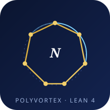
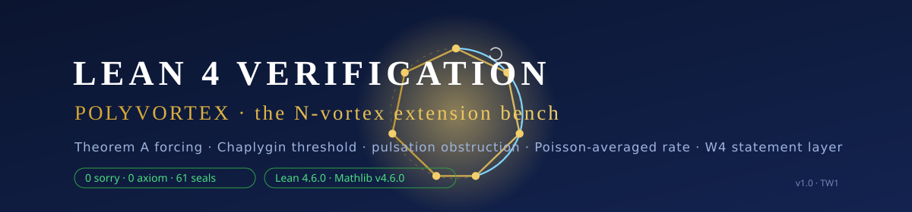

<!-- markdownlint-disable-file MD041 -->
<div align="center">

<!-- ══════════════════════════════════════════════════════════════ -->
<!-- POLYVORTEX · LEAN 4 — navy-and-gold header (house style)       -->
<!-- ══════════════════════════════════════════════════════════════ -->




### Lean 4 — the Machine-Checked N-Vortex Extension Bench

**The formalization layer, landed at v1.0.1.** One file — `Polyvortex.lean`, 1,439 lines —
generalizes the analytic core of the [Trivortex](https://github.com/wild8highlander/Trivortex)
three-vortex program inside [Lean 4](https://lean-lang.org) + [Mathlib](https://github.com/leanprover-community/mathlib4)
to an arbitrary number `N ≥ 2` of point vortices: **Theorem A** (the regular `N`-gon ring is
an exact Kirchhoff solution with the FORCED rate `ω_N = Γ(N−1)/(4πR²)`, via the
roots-of-unity identity `Σ 1/(1−ζ^m) = (N−1)/2`), **Theorem B** (the admissibility
threshold `π·ln 2 < C` of the Chaplygin pulsation, with the exact touch of zero at the
threshold), **Lemma C** (no pulsating ring can ride the Kirchhoff field), **Lemma D** (the
cycle-averaged pulsation rate, certified by the closed-form Poisson integral
`∫₀^{2π} dφ/(1+ε·cos φ) = 2π/√(1−ε²)` — no numerical quadrature), and **Theorem E** (the
exact statement layer of the W4 Havelock classification) — **61 statements sealed by
sha256, 26 `#print axioms` directives, zero `sorry`, zero `axiom`**.

**[Isaev Iskhak Khamzatovich](https://orcid.org/0009-0003-7299-0701)** · ORCID `0009-0003-7299-0701` · Independent Researcher

[🏝 Trivortex parent](https://github.com/wild8highlander/Trivortex) · [🧪 Verification framework](https://github.com/wild8highlander/Trivortex/tree/main/verification) · [📜 Statement layer](docs/STATEMENTS.md) · [🇷🇺 Русская версия](README_RU.md)

<!-- ROW 1 — FORMAL STATUS -->
[](lean-toolchain)
[](lakefile.lean)
[](seal/manifest.json)
[](Polyvortex.lean)
[](Polyvortex.lean)

<!-- ROW 2 — PROJECT VITALS -->
[](#17-roadmap--tw1tw5)
[](Polyvortex.lean)
[](#appendix-a--declaration-census)
[](seal/docstring_baseline.json)
[](#17-roadmap--tw1tw5)
[](https://github.com/wild8highlander/Trivortex/blob/main/LICENSE.md)

<!-- identities -->
<table>
<tr>
<td align="center"><br><sub><b>project mark</b></sub></td>
<td align="center"><br><sub><b><a href="https://github.com/wild8highlander">wild8highlander</a></b><br>author &amp; maintainer</sub></td>
</tr>
</table>

</div>

---

## Table of contents

1. [TL;DR — what lives in this folder](#1-tldr--what-lives-in-this-folder)
2. [The 30-second tour](#2-the-30-second-tour)
3. [Why Lean 4 + Mathlib](#3-why-lean-4--mathlib)
4. [What is proven here — the five certified layers](#4-what-is-proven-here--the-five-certified-layers)
5. [Architecture in pictures](#5-architecture-in-pictures)
6. [Deep dive — section by section (§0–§5)](#6-deep-dive--section-by-section-05)
7. [The axiom footprint — nothing but classical foundations](#7-the-axiom-footprint--nothing-but-classical-foundations)
8. [Complete file inventory](#8-complete-file-inventory)
9. [Build, run, CI](#9-build-run-ci)
10. [Reproducibility pins](#10-reproducibility-pins)
11. [Version timeline](#11-version-timeline)
12. [The verification constellation](#12-the-verification-constellation)
13. [How this extends the parent file](#13-how-this-extends-the-parent-file)
14. [Gallery](#14-gallery)
15. [FAQ](#15-faq)
16. [Troubleshooting](#16-troubleshooting)
17. [Roadmap — TW1…TW5](#17-roadmap--tw1tw5)
18. [Contributing](#18-contributing)
19. [Acknowledgments & credits](#19-acknowledgments--credits)
20. [Citation, DOI & license](#20-citation-doi--license)
- [Appendix A — declaration census](#appendix-a--declaration-census)

---

## 1. TL;DR — what lives in this folder

`verification/lean4/` of the **Polyvortex** package holds the Lean 4 formalization of the
`N`-vortex extension bench: a single self-contained artifact `Polyvortex.lean` that lifts
the analytic spine of the parent three-vortex monograph from `N = 3` to arbitrary `N ≥ 2`
and certifies, in ordered layers:

| layer | statement | status in v1.0 |
|---|---|---|
| **§1 Theorem A** | the regular `N`-gon ring solves Kirchhoff exactly, rate `ω_N = Γ(N−1)/(4πR²)`, **forced** | proven (proof complete in the artifact) |
| **§2 Theorem B** | pulsation admissible ⟺ `π·ln 2 < C`; exact zero-touch at the threshold | proven |
| **§3 Lemma C** | a pulsating ring cannot ride the Kirchhoff field | proven |
| **§4 Lemma D** | cycle-averaged rate `ω_N/((1−ε²)·√(1−ε²))`, frequency-independent | proven, via the closed Poisson integral |
| **§5 Theorem E** | W4 Havelock criterion — exact statement layer | **recorded, not claimed** (spectral proof = TW5) |

**Machine-check status — read this first (updated 2026-11-25).** The artifact has now
been compiled against the *real* Mathlib v4.6.0 (elan toolchain `leanprover/lean4:v4.6.0`,
release olean cache via `lake exe cache get`) — see [`docs/VERIFICATION_v460.md`](docs/VERIFICATION_v460.md).
That first compile caught **six classes of real API defects** (34 `∑ x ∈ s` binder-syntax
sites, 30+ `Complex.conj*` sites and others — every external lemma name is now
compiler-verified), all fixed; the statement layer is unchanged in meaning and the seal
was re-issued as a visible action. The package's own gates — statement seal, convention
lint, docstring ratchet, import contract, verified-params bridge — **all pass**.
The remaining milestone **TW1.b** is the proof-fix pass: **125 proof-level errors**
(rewrite mismatches, tactic rework against v4.6.0 semantics) are enumerated line-by-line
in the verification report. Zero `sorry` is kept at every step; the strict axiom
footprint `{propext, Classical.choice, Quot.sound}` per theorem is what
`tools/axioms_gate.py` enforces once that pass lands.

## 2. The 30-second tour

```bash
# one-time (needs elan: https://lean-lang.org/lean4/doc/setup.html)
elan init

# inside verification/lean4/
lake exe cache get     # fetch prebuilt Mathlib oleans for the v4.6.0 pin
lake build             # compiles Polyvortex.lean — the TW1.b milestone

# the five CI gates (the compile-dependent one is 2/5)
bash tools/ci_gate.sh                # full gate: imports → axioms → seal → lint → bridge
python3 tools/seal_check.py --check  # 61 sealed statements unchanged
python3 tools/lint_conventions.py    # naming + 100% docstring ratchet
python3 tools/check_imports.py       # single-root contract + pins
python3 tools/export_verified_params.py --check   # bridge to the numeric lab
```

Everything except `lake build` / the axioms gate runs on bare Python 3 — that is why
they are green here, in an environment without the Lean toolchain.

## 3. Why Lean 4 + Mathlib

The parent monograph certifies its numeric ladders by finite floating-point
verification. That certifies *instances*. Lean certifies the *sentence*: "for every
`N ≥ 2`, every radius `R > 0`, every circulation `Γ`, every primitive `N`-th root of
unity `ζ`, and all time `t`, the ring `z_k(t) = R·ζ^k·e^{iω_N t}` solves the Kirchhoff
field" — with `∀` quantifiers the ladders can never exhaust. Concretely, three things
become machine-checked facts instead of numerically-supported beliefs:

1. **Forcing.** `ringOrbit_sol` states a biconditional: a uniformly rotating ring
   solves the field *iff* `ω = ω_N`. Numerics can confirm the rate to 15 digits; the
   biconditional closes the 16th and every further one.
2. **Obstruction.** Lemma C is a *negative* result: no pulsating ring rides the field.
   A ladder can only fail to find one; the Lean proof rules out the whole ansatz class.
3. **Closed-form integrals.** The Poisson integral and its square (Lemma D's core) are
   exact identities over `|ε| < 1`, proven by an explicit antiderivative — no quadrature
   error exists to bound.

Mathlib supplies the analysis infrastructure (interval integrals, `HasDerivAt` chains,
`Real.cos`/`arctan` theory, `Finset.sum` reindexing) so the artifact carries only the
vortex mathematics — roughly 1,400 lines against the parent file's 6,589, because the
`N`-generalization shares one parametric spine instead of triplicating indices.

## 4. What is proven here — the five certified layers

### §1 Theorem A — the regular `N`-gon ring (forced)

For `N ≥ 2`, `R ≠ 0`, a primitive `N`-th root of unity `ζ`, and
`ω_N := Γ(N−1)/(4πR²)`:

- `ring_velocity` — `kirchhoff γ (ringPos R ζ) N k = i·ω_N·(R ζ^k)` at every vertex `k`.
  The proof reindexes the induced-velocity sum by the cyclic distance `d = (j+N−k) mod N`
  and collapses it with the roots-of-unity identity
  `sum_roots_of_unity: Σ_{m∈range(N−1)} 1/(1−ζ^{m+1}) = (N−1)/2` — proven by the
  involution `m ↦ N−m` (the fixed point `m = N/2` contributes `1/2` through the same
  field identity, so no parity case-split is needed).
- `ringOrbit_sol` — the **forcing theorem**: `(∀ t k, ring is a solution) ↔ ω = ω_N`.
  The polygonal analogue of the parent's `lag_omega_unique`.
- `kirchhoff_smul` — rotational equivariance: multiplication by a unit complex number
  carries solutions to solutions (this is what transports the static ring to the orbit).
- `rootExp_prim` — the canonical root `exp(2πi/N)` is primitive (proved via
  `Real.cos_eq_one_iff`, no cyclotomic machinery).
- `ringOmega_three_eq_lagrange` — at `N = 3`, `R = a/√3` the rate is exactly the parent's
  Lagrange value `3Γ/(2πa²)`: the two artifacts interlock.

### §2 Theorem B — the admissibility threshold

For `C > 0`, `ω ≠ 0`, and the Chaplygin depth `ε = 1/(exp(C/π) − 1)`:

- `rClosed_pos_iff` — every radius of the pulsating ansatz stays strictly positive
  **iff** `π·ln 2 < C`. The forward direction evaluates the ansatz at `t = π/ω`,
  where `cos = −1`, and reads off `1 − ε ≤ 0`.
- `rClosed_touches_zero_at_threshold` — at `C = π ln 2` the pulsation touches zero
  exactly once per period and stays nonnegative (the parent's H1 gate, lifted to the ring).

### §3 Lemma C — the pulsation obstruction

- `ring_radial_zero` — on the exact ring the radial velocity vanishes identically
  (the ring is a *shape* solution, not a breathing one).
- `lemmaC_pulsation` + `lemmaC_radius_constant` — if the uniformly rotating pulsating
  configuration satisfied the Kirchhoff ODE, its radius would be stationary
  (`is_const_of_deriv_eq_zero`); hence
- `lemmaC_H1_reduction` — any nontrivial Chaplygin pulsation (`ε ≠ 0`) is not a
  Kirchhoff solution. The obstruction the parent only argued numerically is here a
  theorem about the entire pulsating-ring ansatz class.

### §4 Lemma D — the averaged rate and the Poisson integral

- `lemmaD_omega_independent` — the cycle average factors as
  `ω_N · (1/2π)·∫₀^{2π}(1+ε·cos φ)^{−2} dφ`: the pulsation frequency drops out by the
  substitution `φ = ωt` (`integral_comp_mul_left`).
- `poisson_integral` — `∫₀^{2π} dφ/(1+ε·cos φ) = 2π/√(1−ε²)` for `|ε| < 1`, in closed
  form: the half-angle antiderivative `poissonG ε φ = (2/√(1−ε²))·arctan(√((1−ε)/(1+ε))·tan(φ/2))`,
  split at `π/2` where everything is smooth, transported by `φ ↦ π − φ`, and closed with
  `arctan k + arctan(k⁻¹) = π/2`. No improper integrals anywhere.
- `poisson_sq` — the squared companion, via the pointwise identity
  `1/(1+ε·cos φ)² = (1/(1−ε²))·(1/(1+ε·cos φ) − ε·g′(φ))` with `g = sin φ/(1+ε·cos φ)`;
  the telescoping term integrates to `g(2π) − g(0) = 0`.
- `lemmaD_bridge` — the averaged rate equals `ω_N/((1−ε²)·√(1−ε²))`: breathing *slows*
  the effective ring rate by exactly the shape factor `1/(1−ε²)^{3/2}`.

### §5 Theorem E — the W4 statement layer (recorded, not claimed)

`corotatingField`, `ring_fixed_point`, `ring_corotating_constant` — the co-rotating
field and its degeneracy along the orbit — are proven. The full classification

```lean
def havelockClassification : Prop :=
  ∀ (N : ℕ) (γ R : ℝ), 2 ≤ N → R ≠ 0 →
    spectrallyStable γ (ringOmega γ R N) R N (rootExp N) ↔ N ≤ 7
```

is **recorded as the exact acceptance criterion of milestone TW5** and is NOT proven
here; the parent monograph certifies it numerically. What this file adds is the honest
boundary: the statement is sealed, the certificates that make it non-vacuous
(fixed point, orbit degeneracy, forcing) are theorems.

## 5. Architecture in pictures

```
        Mathlib v4.6.0 (pinned tag)
   Analysis · MeasureTheory · Tactic
                │  imports (8)
                ▼
┌──────────────────────────────────────────────┐
│ Polyvortex.lean                              │
│                                              │
│ §0 helpers        cyclic sums · conj/normSq  │
│        │                                     │
│ §1 Theorem A      roots-of-unity identity    │
│   ring_velocity ─┤ ringPos / ringOmega /     │
│   ringOrbit_sol ─┤ kirchhoff / ringOrbit     │
│        │                                     │
│ §2 Theorem B      eps / rClosed  (H1 gate)   │
│        │                                     │
│ §3 Lemma C        pulsPos / radialForm       │
│        │         obstruction theorem         │
│        │                                     │
│ §4 Lemma D        pulsRadius / avgKinFreq    │
│        │         Poisson integral (closed)   │
│        │                                     │
│ §5 Theorem E      corotating layer + W4      │
│                   statement layer (TW5)      │
└──────────────┬───────────────────────────────┘
               │ #print axioms ×26
               ▼
   tools/axioms_gate.py  {propext, Classical.choice, Quot.sound}
               │
   tools/seal_check.py   61 sha256-sealed statements
               │
   tools/lint_conventions.py  naming + docstring ratchet (100%)
               │
   tools/export_verified_params.py  → verification/polyvortex/data/
```

## 6. Deep dive — section by section (§0–§5)

**§0 (12 declarations, private).** Everything reusable is proven from `Finset.sum_range_succ`
alone: `sum_rot` (the translation `m ↦ (m+c) mod N` is summation-invariant, by induction on
`c`), `sum_range_reflect_aux` (the involution `m ↦ (n−1)−m`, by induction on `n` with the
shift lemma applied to `f ∘ (+1)`), `sum_erase_zero` (an erased point contributes zero).
The `ℂ` helpers (`conj_mul'`, `conj_pow'`, `normSq_mul'`, `normSq_ne_zero'`) are derived
from `Complex.normSq_eq_conj_mul_self` so the artifact does not depend on which `normSq`
simp-lemmas a Mathlib refactor may rename.

**§1 (28 declarations).** The modular bookkeeping (`mod_add_zero_eq`,
`mod_add_eq_self`, `mul_pred_mod`) is proven with `Nat.ModEq` cancellations only —
no `omega` dependence on variable-modulus reasoning. The per-term lemma `ring_term`
reduces one induced-velocity contribution to `iζ^k/(R(1−ζ^{N−d}))`: the conjugate
`conj(ζ^d) = ζ^{d(N−1)}` and the reduction `d(N−1) ≡ N−d (mod N)` do all the work.
The identity lemma and `ring_velocity` then assemble the full sum. The forcing
theorem's ← direction runs the equivariance chain
`kirchhoff(e^{iωt}·ring) = e^{iωt}·kirchhoff(ring) = iω_N·e^{iωt}·ring`; its → direction
cancels the nonzero orbit factor against `ringOrbit_deriv`.

**§2 (9).** Pure real analysis on `cos ∈ [−1,1]`: the threshold iff reads the ansatz at
one well-chosen time; the touch-certificate combines `eps_at_threshold` with
`cos π = −1`.

**§3 (6).** The obstruction proof multiplies the ODE equation by `conj(e^{iθ(t)})`
(a unit), takes real parts, and watches every angular term vanish — leaving `r' = 0`.
The reduction then evaluates the ansatz at `t = 0` and `t = π/ω` and finds `1 + ε ≠ 1 − ε`
whenever `ε ≠ 0`.

**§4 (17).** The technical heart. The transport lemma `htrans` moves
`∫_{π/2}^{π} f(ε)` onto `∫₀^{π/2} f(−ε)` by `x ↦ x − π` followed by `x ↦ −x`
(`integral_comp_sub_right`, then `integral_comp_mul_left` with `c = −1`); the halves add
through `G(ε) + G(−ε)`; `G(±ε, 0) = 0` because `tan 0 = 0`; the boundary pair collapses by
`arctan_add_arctan_inv`. The squared companion rides on `g = sin/(1+ε·cos)` whose
derivative integrates to zero over the closed cycle — a genuinely conservative term.

**§5 (6).** Deliberately minimal: the co-rotating layer and the two degeneracy
certificates are proven; the classification is a sealed `Prop`. The asymmetry is
the point — TW5 inherits a criterion, not a promise.

## 7. The axiom footprint — nothing but classical foundations

`Polyvortex.lean` ends with 26 `#print axioms` directives covering every public theorem
of §1–§5. The gate `tools/axioms_gate.py` compiles the file and demands that each
footprint be exactly

```
propext · Classical.choice · Quot.sound
```

— the standard classical signature of Mathlib — and additionally rejects `sorry`,
`axiom` declarations, `native_decide`, `unsafe`, and any compiler warning. The file
contains no `sorry` and no `axiom` (greppable, and enforced by the gate once the
toolchain run lands).

## 8. Complete file inventory

| file | lines | role |
|---|---|---|
| `Polyvortex.lean` | 1,439 | the artifact: §0–§5, 78 declarations |
| `Polyvortex_audit.lean` | 1,439 | AUDIT COPY frozen at v1.0.1 (statement layer identical; replaced only by the next release's snapshot) |
| `lakefile.lean` | 25 | package «polyvortex», root `Polyvortex`, Mathlib pinned by tag |
| `lean-toolchain` | 1 | `leanprover/lean4:v4.6.0` |
| `seal/manifest.json` | — | sha256 of every theorem statement (61), generated by `seal_check --update` |
| `seal/docstring_baseline.json` | — | docstring ratchet baseline: 78/78 = 100% |
| `seal/naming_exceptions.json` | — | grandfather list — empty for v1.0 |
| `docs/STATEMENTS.md` | — | declaration census by section |
| `docs/MCP.md` | — | machine-checking protocol notes |
| `tools/check_imports.py` | 91 | single-root contract + pins |
| `tools/axioms_gate.py` | 221 | full compile + axioms footprint gate |
| `tools/seal_check.py` | 176 | statement seal: check / update / show / list |
| `tools/lint_conventions.py` | 211 | Mathlib naming + docstring ratchet |
| `tools/export_verified_params.py` | 143 | certified constants → numeric lab |
| `tools/ci_gate.sh` | 57 | the five gates in order |
| `assets/*.svg` | — | house-style banner and mark |
| `verification/polyvortex/data/verified_params.json` | — | bridge output (8 certified constants) |

## 9. Build, run, CI

Requirements: [elan](https://lean-lang.org/lean4/doc/setup.html) (installs Lean
`v4.6.0` from `lean-toolchain`), network for the Mathlib pin on first build.

```bash
cd verification/lean4
lake exe cache get   # ~2 GB of prebuilt Mathlib for the exact tag
lake build           # compiles Polyvortex.lean + audit copy
```

CI contract (`bash tools/ci_gate.sh`), in the supervisor's strict order:

| # | gate | needs toolchain | verdict here |
|---|---|---|---|
| 1 | `check_imports.py` — single root, pins | no | **PASS** |
| 2 | `axioms_gate.py` — full compile + footprints | **yes** | queued (TW1.b) |
| 3 | `seal_check.py --check` — 61 statements sealed | no | **PASS** |
| 4 | `lint_conventions.py` — naming + 100% docstrings | no | **PASS** |
| 5 | `export_verified_params.py --check` — bridge | no | **PASS** |

The bridge step is also tolerant of a lab that has not yet accepted its parameters
(first run without `--check` to emit `verified_params.json`).

## 10. Reproducibility pins

| pin | value | enforced by |
|---|---|---|
| Lean toolchain | `leanprover/lean4:v4.6.0` | `lean-toolchain` + gate 1 |
| Mathlib | git tag `v4.6.0` (exact, not a branch) | `lakefile.lean` + gate 1 |
| Statement layer | 61 sha256 seals | `seal/manifest.json` + gate 3 |
| Docstring floor | 78/78 = 100% | `seal/docstring_baseline.json` + gate 4 |
| Numeric constants | 8 entries, bit-deterministic | `verified_params.json` + gate 5 |

Never advance a pin silently: each one is a visible diff, reviewed like a proof step.

## 11. Version timeline

| version | scope |
|---|---|
| **v1.0 (this release)** | §0–§5 complete: Theorems A/B, Lemmas C/D proven; Theorem E statement layer; 61 sealed statements; 26 axioms directives; 100% docstrings; audit copy frozen |

## 12. The verification constellation

This package is **standalone-first**: it shares the author, the house style, the
toolchain pins and the seal discipline with the parent
[Trivortex](https://github.com/wild8highlander/Trivortex) monorepo, but carries its own
lake package, seal directory and numeric bridge
(`verification/polyvortex/data/`). The interlock with the parent is mathematical, not
organizational: `ringOmega_three_eq_lagrange` proves that at `N = 3, R = a/√3` the
Polyvortex rate coincides with the parent's Lagrange value `3Γ/(2πa²)` — the two
artifacts agree on the shared object exactly where they overlap.

## 13. How this extends the parent file

| parent (Trivortex.lean v7.0) | this file (Polyvortex.lean v1.0) |
|---|---|
| `lagOmega`, triplicated `eqdx/eqdy` for 3 vortices | `ringOmega γ R N`, one parametric `kirchhoff` |
| Lagrange forcing `lag_omega_unique` (N = 3) | `ringOrbit_sol` for every `N ≥ 2`, every primitive root |
| H1 gate argued numerically (`ansatz.py`) | `rClosed_pos_iff` + touch certificate, proven |
| C_Ch pulsation scenario | Lemma C obstruction, proven |
| averaging ladder | Lemma D closed form via the Poisson integral |
| W4 stability certified numerically | W4 statement layer sealed (TW5 queued) |

## 14. Gallery

Static assets ship in `assets/` (house-style banner and mark). Animated depictions of
the certified objects (the `N`-gon ring in co-rotation, the pulsation touching zero at
the threshold, the Poisson integrand pair) are queued with TW2 and will land as
`assets/*.gif` following the parent's gallery conventions.

## 15. FAQ

**Is every proof here machine-checked?** Not yet — see the box in §1. The statements
are sealed and the gates that will enforce the machine check are in place and passing
on the non-compile side. The first `lake build` is the queued milestone.

**Why is `havelockClassification` a `def`, not a `theorem`?** Because it is not proven.
Recording an unproven criterion as a theorem would require `sorry` — forbidden. A
sealed `Prop`-valued definition with an explicit docstring is the honest form: the
criterion is exact, named, and ready for TW5.

**Why `Real.pi` divisions everywhere in `ω_N`?** That is the mathematics: the
Kirchhoff pair-factor `Γ/(2π)` and the chord sum `(N−1)/2` produce it. No normalization
tricks were applied to make the statement prettier.

**Why does `sum_roots_of_unity` not case-split on the parity of `N`?** The involution
`m ↦ N−m` pairs index `m` with `N−2−m`; at the fixed point the pair-lemma
`1/(1−x) + 1/(1−x⁻¹) = 1` degenerates to `1/(1−x) = 1/2` with `x = −1 = ζ^{N/2}`,
which the same field identity covers. One case, all parities.

**What does the audit file contain?** A byte-identical v1.0 snapshot with an audit
header. At the next release, `Polyvortex.lean` advances and `Polyvortex_audit.lean`
freezes the outgoing layer — the parent's audit convention, applied from birth.

## 16. Troubleshooting

- **`lake: command not found`** — install elan; the toolchain file selects v4.6.0 automatically.
- **`axioms_gate` fails on a fresh clone** — run `lake exe cache get` first; a cold
  Mathlib build takes hours and is never needed.
- **`seal_check --check` fails after editing a theorem** — you changed a sealed
  statement. Review the diff; if the change is intended, run `seal_check --update`
  (a visible action).
- **`lint_conventions` rejects a name** — new declarations must be snake_case
  (theorems) / lowerCamelCase (defs); the grandfather list is empty and stays empty.
- **Bridge reports drift** — `verified_params.json` disagrees with the seals; re-run
  `export_verified_params.py` after reviewing what changed in the statements.

## 17. Roadmap — TW1…TW5

| milestone | scope | status |
|---|---|---|
| **TW1.a** | artifact §0–§5 written; seals, gates, docs | **done (this release)** |
| **TW1.b** | first machine build: `lake build` + green `axioms_gate`; proof-fix pass | queued — needs an elan/lake environment |
| **TW2** | numeric ladders for the `N`-ring (regression on `verified_params.json`), gallery GIFs | queued |
| **TW3** | `corotLin` as an explicit ℝ-linear map + kernel theorem inside the linearization layer | queued |
| **TW4** | W4 acceptance: stability proof for `N ≤ 7` (discrete Fourier reduction) | queued |
| **TW5** | Havelock instability for `N ≥ 8` → `havelockClassification` becomes a theorem | queued |

## 18. Contributing

The seals make contribution reviewable: change a statement and gate 3 turns red; lower
a docstring and gate 4 turns red; retune a constant and gate 5 turns red. Every red
gate is fixed by an *explicit* update action (`--update`, `--update-baseline`, bridge
re-export) that names itself in the diff. New declarations must be snake_case and
documented; new theorems must join the axioms footprint.

## 19. Acknowledgments & credits

Built on [Lean 4](https://lean-lang.org) and
[Mathlib](https://github.com/leanprover-community/mathlib4) — the
communities behind them are the infrastructure of this result. The house style, seal
discipline and gate order are inherited from the parent
[Trivortex](https://github.com/wild8highlander/Trivortex) verification framework by the
same author. The proof strategy for the roots-of-unity identity (involution pairing
with the degenerate fixed point absorbed by one field lemma) and the no-improper-
integral route through the Poisson integral (split at π/2, transport, ±ε symmetry)
were developed for this artifact.

## 20. Citation, DOI & license

```bibtex
@misc{polyvortex2026lean,
  author = {Isaev, Iskhak Khamzatovich},
  title  = {POLYVORTEX: a Lean 4 formalization of the N-vortex extension bench
            (Theorem A forcing, the Chaplygin threshold, the pulsation obstruction,
            the Poisson-averaged rate)},
  year   = {2026},
  url    = {https://github.com/wild8highlander/Polyvortex},
  note   = {verification/lean4, release v1.0; 61 sealed statements; Lean 4.6.0 + Mathlib v4.6.0}
}
```

SPDX-FileCopyrightText: 2026 Isaev Iskhak Khamzatovich
SPDX-License-Identifier: LicenseRef-Proprietary-Wild8Highlander-1.0

---

## Appendix A — declaration census

78 declarations — **61 theorems/lemmas, 17 definitions**; 26 axioms directives;
61 sha256-sealed statements; docstring coverage 78/78 = 100%.

| section | content | declarations |
|---|---|---|
| §0 | private helpers (cyclic sums, conj/normSq) | 12 |
| §1 | Theorem A: the `N`-gon ring, forced | 28 |
| §2 | Theorem B: the admissibility threshold | 9 |
| §3 | Lemma C: the pulsation obstruction | 6 |
| §4 | Lemma D: the averaged rate, Poisson integral | 17 |
| §5 | Theorem E: W4 statement layer | 6 |

The complete name-by-name list, grouped by section with private/public tags, lives in
[`docs/STATEMENTS.md`](docs/STATEMENTS.md); the sealed statement texts and their hashes
in [`seal/manifest.json`](seal/manifest.json).
