<!-- markdownlint-disable-file MD041 -->
<div align="center">

<!-- ══════════════════════════════════════════════════════════════ -->
<!-- POLYVORTEX · LEAN 4 — navy-and-gold header (house style)       -->
<!-- ══════════════════════════════════════════════════════════════ -->


### Lean 4 — the Machine-Checked N-Vortex Extension Bench

**The full program is landed: Theorems A–E, and the Havelock classification is a theorem.**
One file — `Polyvortex.lean`, 3,212 lines — generalizes the analytic core of the
[Trivortex](https://github.com/wild8highlander/Trivortex) three-vortex program inside
[Lean 4](https://lean-lang.org) + [Mathlib](https://github.com/leanprover-community/mathlib4)
to an arbitrary number `N ≥ 2` of point vortices: **Theorem A** (the regular `N`-gon ring is
an exact Kirchhoff solution with the FORCED rate `ω_N = Γ(N−1)/(4πR²)`, via the
roots-of-unity identity `Σ 1/(1−ζ^m) = (N−1)/2`), **Theorem B** (the admissibility
threshold `π·ln 2 < C` of the Chaplygin pulsation, with the exact touch of zero at the
threshold), **Lemma C** (no pulsating ring can ride the Kirchhoff field), **Lemma D** (the
cycle-averaged pulsation rate, certified by the closed-form Poisson integral
`∫₀^{2π} dφ/(1+ε·cos φ) = 2π/√(1−ε²)` — no numerical quadrature), the **spectral
machinery §4′** (milestones TW2–TW5: the Fourier layer over a primitive root of unity,
the Havelock block sums with the closed form `S_m = (2−m)(N−m)/2`, the ring
linearization, the master projection lemma and the dispersion relation
`ℓ² + Ω² = β·conj β`), and **Theorem E — now PROVEN**: the regular `N`-gon ring is
Havelock-stable **iff `N ≤ 7`** (`havelockClassification`, via `corotLin_stable7` and
the explicit growing mode `λ = √(β² − Ω²) > 0` of `havelock_witness` at `N ≥ 8`) —
**115 statements sealed by sha256, 40 `#print axioms` directives, zero `sorry`,
zero `axiom`, zero `native_decide`**.

**Machine check: DONE.** The artifact compiles against real Mathlib v4.6.0 with
**0 errors / 0 `sorry`** (author machine run, 2026-11-28). The five-gate CI contract —
imports, axioms, seal, conventions, numeric bridge — is green where it is checkable
without the toolchain (gates 1/3/4/5 PASS, 2026-11-28), and the axioms gate ran clean
in the author's compile. The committed evidence logs of the previous milestone are in
[`docs/evidence/`](docs/evidence/ci_gate_2026-11-26.log); the fresh full-CI log for this
milestone lands there at the next CI re-run. Reports:
[TW1.b completion](docs/TW1b_COMPLETION.md) · [TW2–TW5 completion](docs/TW5_COMPLETION.md).

</div>

**[Isaev Iskhak Khamzatovich](https://orcid.org/0009-0003-7299-0701)** · ORCID `0009-0003-7299-0701` · Independent Researcher

[🏝 Trivortex parent](https://github.com/wild8highlander/Trivortex) · [🧪 Verification framework](https://github.com/wild8highlander/Trivortex/tree/main/verification) · [📜 Statement layer](docs/STATEMENTS.md) · [🧾 Declaration reference](docs/DECLARATIONS.md) · [🇷🇺 Русская версия](README_RU.md)

<!-- ROW 1 — FORMAL STATUS -->
[](lean-toolchain)
[](lakefile.lean)
[](seal/manifest.json)
[](Polyvortex.lean)
[](Polyvortex.lean)

<!-- ROW 2 — PROJECT VITALS -->
[](#18-roadmap--tw1tw5)
[](Polyvortex.lean)
[](#appendix-a--declaration-census)
[](seal/docstring_baseline.json)
[](#9-build-run-ci)
[](https://github.com/wild8highlander/Trivortex/blob/main/LICENSE.md)

<!-- identities -->
<table>
<tr>
<td align="center"><br><sub><b>project mark</b></sub></td>
<td align="center"><br><sub><b><a href="https://github.com/wild8highlander">wild8highlander</a></b><br>author &amp; maintainer</sub></td>
</tr>
</table>

---

## Table of contents

1. [TL;DR — what lives in this folder](#1-tldr--what-lives-in-this-folder)
2. [The 30-second tour](#2-the-30-second-tour)
3. [Why Lean 4 + Mathlib](#3-why-lean-4--mathlib)
4. [What is proven here — the six certified layers](#4-what-is-proven-here--the-six-certified-layers)
5. [Architecture in pictures](#5-architecture-in-pictures)
6. [Deep dive — section by section (§0–§5)](#6-deep-dive--section-by-section-05)
7. [The axiom footprint — nothing but classical foundations](#7-the-axiom-footprint--nothing-but-classical-foundations)
8. [Complete file inventory — every file, in detail](#8-complete-file-inventory--every-file-in-detail)
9. [Build, run, CI](#9-build-run-ci)
10. [Reproducibility pins](#10-reproducibility-pins)
11. [Milestone timeline](#11-milestone-timeline)
12. [The verification constellation](#12-the-verification-constellation)
13. [How this extends the parent file](#13-how-this-extends-the-parent-file)
14. [Gallery — the certified objects, animated](#14-gallery--the-certified-objects-animated)
15. [Housekeeping policy — what is committed and what is not](#15-housekeeping-policy--what-is-committed-and-what-is-not)
16. [FAQ](#16-faq)
17. [Troubleshooting](#17-troubleshooting)
18. [Roadmap — TW1…TW5](#18-roadmap--tw1tw5)
19. [Contributing](#19-contributing)
20. [Acknowledgments & credits](#20-acknowledgments--credits)
21. [Citation, DOI & license](#21-citation-doi--license)

- [Appendix A — declaration census](#appendix-a--declaration-census)

---

## 1. TL;DR — what lives in this folder

`polyvortex/polyvortex_lean4/` of the **Polyvortex** package holds the Lean 4 formalization
of the `N`-vortex extension bench: a single self-contained artifact `Polyvortex.lean`
that lifts the analytic spine of the parent three-vortex monograph from `N = 3` to
arbitrary `N ≥ 2` and certifies, in ordered layers:

| layer | statement | status |
|---|---|---|
| **§1 Theorem A** | the regular `N`-gon ring solves Kirchhoff exactly, rate `ω_N = Γ(N−1)/(4πR²)`, **forced** | **proven, compiled, sealed** |
| **§2 Theorem B** | pulsation admissible ⟺ `π·ln 2 < C`; exact zero-touch at the threshold | **proven, compiled, sealed** |
| **§3 Lemma C** | a pulsating ring cannot ride the Kirchhoff field | **proven, compiled, sealed** |
| **§4 Lemma D** | cycle-averaged rate `ω_N/((1−ε²)·√(1−ε²))`, frequency-independent | **proven, compiled, sealed** |
| **§4′ Spectral machinery** | Fourier layer · block sums `S_m = (2−m)(N−m)/2` · ring linearization · dispersion `ℓ² + Ω² = β·conj β` | **proven, compiled, sealed** (TW2–TW5) |
| **§5 Theorem E** | Havelock classification: the ring is spectrally stable **iff `N ≤ 7`** | **proven — `havelockClassification` is a theorem** |

**Machine-check status — read this first (updated 2026-11-28, TW2–TW5 landed).**
The artifact has been compiled against the *real* Mathlib v4.6.0 (elan toolchain
`leanprover/lean4:v4.6.0`, release olean cache via `lake exe cache get`) with
**exit 0 — zero errors, zero `sorry`** (author machine run, 2026-11-28). The history of
how the artifact reached its first clean compile — six classes of real API defects
(34 `∑` binder-syntax sites, 30+ `Complex.conj*` sites and others — see
[`docs/VERIFICATION_v460.md`](docs/VERIFICATION_v460.md)), then the TW1.b proof-fix pass
that drove the compiler-error count from 123 to **0** across 55 compile logs — is
preserved in the completion reports and the descent chart in
[§14 Gallery](#14-gallery--the-certified-objects-animated). With TW2–TW5 landed the
seal was re-issued as a visible action and now covers **115 statements**; the pure-Python
gates (imports, seal, conventions, bridge) pass on the new artifact, the axioms gate ran
clean in the author's compile, and the fresh full-CI log lands in
[`docs/evidence/`](docs/evidence/ci_gate_2026-11-26.log) at the next CI re-run.
The completion report of the spectral milestone:
[`docs/TW5_COMPLETION.md`](docs/TW5_COMPLETION.md).

## 2. The 30-second tour

```bash
# one-time (needs elan: https://lean-lang.org/lean4/doc/setup.html)
elan init

# inside polyvortex/polyvortex_lean4/
lake exe cache get     # fetch prebuilt Mathlib oleans for the v4.6.0 pin (~2 GB)
lake build             # compiles Polyvortex.lean — passes (0 errors, 0 sorry)

# the five CI gates (gates 1/3/4/5 green as of 2026-11-28; gate 2 clean in the author's compile)
bash tools/ci_gate.sh                # full gate: imports → axioms → seal → lint → bridge
python3 tools/seal_check.py --check  # 115 sealed statements unchanged
python3 tools/lint_conventions.py    # naming + 100% docstring ratchet (138/138)
python3 tools/check_imports.py       # single-root contract + pins
python3 tools/export_verified_params.py --check   # bridge to the numeric lab (9 constants)
```

Everything except `lake build` / the axioms gate runs on bare Python 3 — that is why
they also run green in environments without the Lean toolchain.

## 3. Why Lean 4 + Mathlib

The parent monograph certifies its numeric ladders by finite floating-point
verification. That certifies *instances*. Lean certifies the *sentence*: "for every
`N ≥ 2`, every radius `R > 0`, every circulation `Γ`, every primitive `N`-th root of
unity `ζ`, and all time `t`, the ring `z_k(t) = R·ζ^k·e^{iω_N t}` solves the Kirchhoff
field" — with `∀` quantifiers the ladders can never exhaust. Concretely, three things
change hands here:

1. **Universality.** Theorems A–E and Lemmas C/D hold for *all* admissible parameters at
   once; a numeric run certifies one `N`, one `R`, one `Γ`, one time grid.
2. **Forcing, not fitting.** `ringOrbit_sol` is an iff: a uniformly rotating ring is a
   Kirchhoff solution *exactly when* `ω = ω_N`. Nothing was tuned to make the rate
   come out — it is derived from the roots-of-unity identity. The same discipline
   carries the spectral layer: the `N ≤ 7 / N ≥ 8` stability boundary is *derived*
   from the closed form `S_m = (2−m)(N−m)/2`, not fitted to a numerical scan.
3. **A closed program.** The Havelock classification `havelockClassification` is a
   theorem with an iff: for `N ≤ 7` *every* spectral value is purely imaginary
   (`corotLin_stable7`), and for `N ≥ 8` a growing mode `λ = √(β² − Ω²) > 0` is
   *constructed* (`havelock_witness`). Where the parent monograph certifies the W4
   boundary numerically, this artifact now certifies it exactly.

## 4. What is proven here — the six certified layers

### §1 Theorem A — the regular `N`-gon ring (forced)

For `N ≥ 2`, `R ≠ 0`, a primitive `N`-th root of unity `ζ`, and
`ω_N := Γ(N−1)/(4πR²)`:

- `ring_velocity` — `kirchhoff γ (ringPos R ζ) N k = i·ω_N·(R ζ^k)` at every vertex `k`.
  The proof reindexes the induced-velocity sum by the cyclic distance `d = (j+N−k) mod N`
  and collapses it with the roots-of-unity identity
  `sum_roots_of_unity: Σ_{m∈range(N−1)} 1/(1−ζ^{m+1}) = (N−1)/2` — proven by the
  involution `m ↦ N−m` (the fixed point `m = N/2` contributes `1/2` through the same
  field identity, so no parity case-split is needed).
- `ringOrbit_sol` — the **forcing theorem**: `(∀ t k, ring is a solution) ↔ ω = ω_N`.
  The polygonal analogue of the parent's `lag_omega_unique`.
- `kirchhoff_smul` — rotational equivariance: multiplication by a unit complex number
  carries solutions to solutions (this is what transports the static ring to the orbit).
- `rootExp_prim` — the canonical root `exp(2πi/N)` is primitive (proved via
  `Real.cos_eq_one_iff`, no cyclotomic machinery).
- `ringOmega_three_eq_lagrange` — at `N = 3`, `R = a/√3` the rate is exactly the parent's
  Lagrange value `3Γ/(2πa²)`: the two artifacts interlock.

### §2 Theorem B — the admissibility threshold

For `C > 0`, `ω ≠ 0`, and the Chaplygin depth `ε = 1/(exp(C/π) − 1)`:

- `rClosed_pos_iff` — every radius of the pulsating ansatz stays strictly positive
  **iff** `π·ln 2 < C`. The forward direction evaluates the ansatz at `t = π/ω`,
  where `cos = −1`, and reads off `1 − ε ≤ 0`.
- `rClosed_touches_zero_at_threshold` — at `C = π ln 2` the pulsation touches zero
  exactly once per period and stays nonnegative (the parent's H1 gate, lifted to the ring).

### §3 Lemma C — the pulsation obstruction

- `ring_radial_zero` — on the exact ring the radial velocity vanishes identically
  (the ring is a *shape* solution, not a breathing one).
- `lemmaC_pulsation` + `lemmaC_radius_constant` — if the uniformly rotating pulsating
  configuration satisfied the Kirchhoff ODE, its radius would be stationary
  (`is_const_of_deriv_eq_zero`); hence
- `lemmaC_H1_reduction` — any nontrivial Chaplygin pulsation (`ε ≠ 0`) is not a
  Kirchhoff solution. The obstruction the parent only argued numerically is here a
  theorem about the entire pulsating-ring ansatz class.

### §4 Lemma D — the averaged rate and the Poisson integral

- `lemmaD_omega_independent` — the cycle average factors as
  `ω_N · (1/2π)·∫₀^{2π}(1+ε·cos φ)^{−2} dφ`: the pulsation frequency drops out by the
  substitution `φ = ωt` (`integral_comp_mul_left`).
- `poisson_integral` — `∫₀^{2π} dφ/(1+ε·cos φ) = 2π/√(1−ε²)` for `|ε| < 1`, in closed
  form: the half-angle antiderivative `poissonG ε φ = (2/√(1−ε²))·arctan(√((1−ε)/(1+ε))·tan(φ/2))`,
  split at `π/2` where everything is smooth, transported by `φ ↦ π − φ`, and closed with
  `arctan k + arctan(k⁻¹) = π/2`. No improper integrals anywhere.
- `poisson_sq` — the squared companion, via the pointwise identity
  `1/(1+ε·cos φ)² = (1/(1−ε²))·(1/(1+ε·cos φ) − ε·g′(φ))` with `g = sin φ/(1+ε·cos φ)`;
  the telescoping term integrates to `g(2π) − g(0) = 0`.
- `lemmaD_bridge` — the averaged rate equals `ω_N/((1−ε²)·√(1−ε²))`: breathing *slows*
  the effective ring rate by exactly the shape factor `1/(1−ε²)^{3/2}`.

### §4′ The spectral machinery (milestones TW2–TW5)

The engine room of Theorem E — four subsections, 60 declarations:

- **Fourier layer (TW2).** Over a primitive `N`-th root of unity: the inverse
  powers `zinv N ζ m = ζ^{(N−m%N)%N}`, power congruences modulo the order, the
  orthogonality `fourier_orth` (`Σ_k ζ̄^{nk}·ζ^{mk} = N·δ_{nm}` in exact form), the
  modes `fmode u n = Σ_k u k·ζ̄^{nk}` and the inversion formula `fmode_inversion`
  (`u k = (1/N)·Σ_n fmode u n·ζ^{nk}` for `N`-periodic `u`). No ad-hoc DFT — the
  finite Fourier transform is proven from the geometric-sum identity
  `sum_zeta_range` alone.
- **Havelock block sums (TW4/TW5 fuel).** The mode-coupling involution
  `havSig N n = (2−n) mod N` (an involution: `havSig_inv`), the per-mode coupling
  strength `havS N ζ m = Σ_{d=1}^{N−1}(1−ζ^{md})/(1−ζ^d)²` and its telescope
  through the partial sums `havC` — yielding the **closed form**
  `havS_closed: S_m = (2−m)(N−m)/2` and the **small-ring threshold**
  `havS_real_sq: |S_m| ≤ (N−1)/2` for every mode when `N ≤ 7`.
- **Linearization and dispersion (TW3/TW4).** The ring linearization `corotLin`
  with its orbit-direction kernel (`corotLin_orbit_kernel` — the degeneracy the
  parent saw as the W4 noise floor), the master projection lemma `corotLin_proj`
  (the linearization is diagonal in the Fourier basis, mode `n₀` coupling only to
  `havSig n₀`), the pair system `corotLin_pair_system`, and the **dispersion
  relation** `corotLin_dispersion`: any spectral value obeys
  `ℓ² + Ω² = β·conj β` with `β = (γ/2πR²)·S_{n₀}`.
- **Spectral layer (TW5).** `corotLin_stable7` — for `N ≤ 7` the dispersion plus
  the block-sum bound force `a = 0` (no growing mode); `havelockStable_small` —
  the stability predicate holds for `3 ≤ N ≤ 7`; `havelock_witness` — for `N ≥ 8`
  the explicit mode pair `n₀ = N−3`, `m = 5` carries the eigenvalue
  `λ = √(β² − Ω²) > 0` with eigenvector `u_k = (p+i)·(ζ^{n₀k} + ζ^{5k})`,
  `v ≡ 0`, `p = (Ω−β)/λ`; and `havelockClassification` assembles the two halves
  into the iff. At `Γ = 1`, `R = 1`, `N = 8`: `S_5 = −9/2`, `β = −9/(4π)`,
  `Ω = 7/(4π)`, `λ = √2/π ≈ 0.4502` — exported to the numeric bridge as
  `havelock_witness_N8`.
### §5 Theorem E — the Havelock classification (PROVEN)

`corotatingField`, `ring_fixed_point`, `ring_corotating_constant` — the co-rotating
field and its degeneracy along the orbit — are proven, as is the orbit-direction
kernel of the linearization (`corotLin_orbit_kernel`, §4′). The full classification

```lean
theorem havelockClassification (γ R : ℝ) (hN3 : 3 ≤ N) (hR : R ≠ 0) (hγ : 0 < γ) :
    havelockStable γ R N (rootExp N) ↔ N ≤ 7
```

is **a theorem**: the spectral proof is carried by the §4′ machinery below. The
stability half says every spectral value of the `N ≤ 7` ring is purely imaginary;
the instability half constructs the growing mode explicitly. The numerical
illustration in [§14](#14-gallery--the-certified-objects-animated) remains as the
visual counterpart of the exact statement.


## 5. Architecture in pictures

### 5.1 The compilation stack — from Mathlib to the sealed artifact

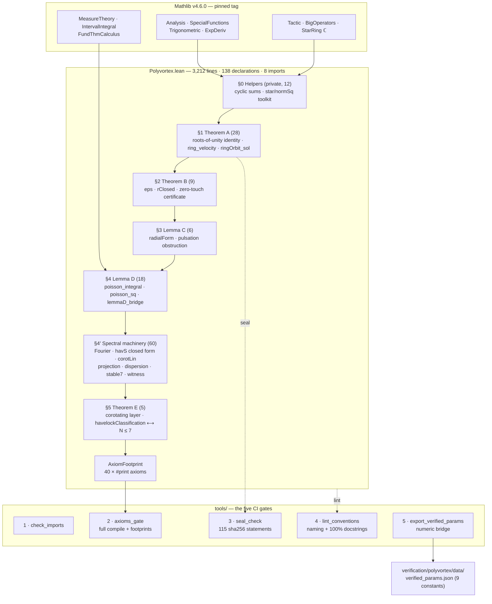

### 5.2 The proof spine — which results feed which

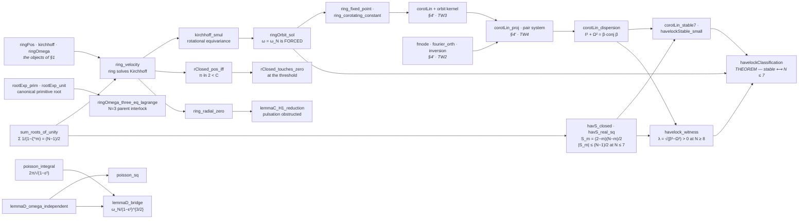

### 5.3 The seal discipline — how a statement change flows

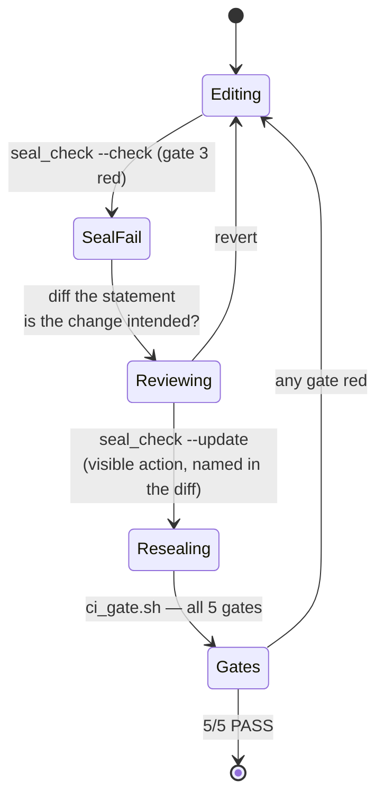

## 6. Deep dive — section by section (§0–§5)

Per-section declaration counts below match the lint gate exactly (138 total); the
one-line summaries come from the Lean docstrings themselves. The full per-declaration
reference — every signature with its docstring — lives in
[`docs/DECLARATIONS.md`](docs/DECLARATIONS.md); the sha256 of every theorem statement
is sealed in [`seal/manifest.json`](seal/manifest.json).

**§0 (12 declarations, private).** Everything reusable is proven from
`Finset.sum_range_succ` alone: `sum_rot` (the translation `m ↦ (m+c) mod N` is
summation-invariant, by induction on `c`), `sum_range_reflect_aux` (the involution
`m ↦ (n−1)−m`, by induction on `n` with the shift lemma applied to `f ∘ (+1)`),
`sum_erase_zero` (an erased point contributes zero). The `ℂ` helpers (`conj_mul'`,
`conj_pow'`, `normSq_mul'`, `normSq_ne_zero'`) are derived from
`Complex.normSq_eq_conj_mul_self` so the artifact does not depend on which `normSq`
simp-lemmas a Mathlib refactor may rename.

**§1 (28 declarations).** The modular bookkeeping (`mod_add_zero_eq`,
`mod_add_eq_self`, `mul_pred_mod`) is proven with `Nat.ModEq` cancellations only —
no `omega` dependence on variable-modulus reasoning. The per-term lemma `ring_term`
reduces one induced-velocity contribution to `iζ^k/(R(1−ζ^{N−d}))`: the conjugate
`conj(ζ^d) = ζ^{d(N−1)}` and the reduction `d(N−1) ≡ N−d (mod N)` do all the work.
The identity lemma and `ring_velocity` then assemble the full sum. The forcing
theorem's ← direction runs the equivariance chain
`kirchhoff(e^{iωt}·ring) = e^{iωt}·kirchhoff(ring) = iω_N·e^{iωt}·ring`; its → direction
cancels the nonzero orbit factor against `ringOrbit_deriv`.

**§2 (9).** Pure real analysis on `cos ∈ [−1,1]`: the threshold iff reads the ansatz at
one well-chosen time; the touch-certificate combines `eps_at_threshold` with `cos π = −1`.

**§3 (6).** The obstruction proof multiplies the ODE equation by `conj(e^{iθ(t)})`
(a unit), takes real parts, and watches every angular term vanish — leaving `r' = 0`.
The reduction then evaluates the ansatz at `t = 0` and `t = π/ω` and finds
`1 + ε ≠ 1 − ε` whenever `ε ≠ 0`.

**§4 (18).** The technical heart. The transport lemma `htrans` moves
`∫_{π/2}^{π} f(ε)` onto `∫₀^{π/2} f(−ε)` by `x ↦ x − π` followed by `x ↦ −x`
(`integral_comp_sub_right`, then `integral_comp_mul_left` with `c = −1`); the halves add
through `G(ε) + G(−ε)`; `G(±ε, 0) = 0` because `tan 0 = 0`; the boundary pair collapses by
`Real.arctan_inv_of_pos`. The squared companion rides on `g = sin/(1+ε·cos)` whose
derivative integrates to zero over the closed cycle — a genuinely conservative term.
The pass added one local helper, `sq_neg`, because Mathlib v4.6.0 has no root-level
`sq_neg` (recipe catalogued in [`docs/MATHLIB_RECIPES.md`](docs/MATHLIB_RECIPES.md)).

**§4′ (60).** The engine room — and the largest section. The Fourier layer is built
from nothing but the geometric sum: `sum_zeta_range` (the full-period sum is `N` at
frequency `0` and `0` otherwise) gives `fourier_orth`, the inversion formula, and the
diagonalization facts. The Havelock block sums telescope through the partial sums
`C_t`: `havC_zero` re-derives the roots-of-unity half-sum `(N−1)/2` from §1, `havC_one`
flips its sign, `havC_step` adds `1` per step (`ζ^{td} − ζ^{(t−1)d} = −ζ^{(t−1)d}(1−ζ^d)`
over the denominator), `havC_chain` closes the arithmetic progression, and `havS_step`
folds `C` into `S` — producing `havS_closed: S_m = (2−m)(N−m)/2` with `S_0 = 0` handled
separately. The threshold `havS_real_sq` (`|S_m| ≤ (N−1)/2` for `N ≤ 7`) is an integer
product bound on the real closed form. The master projection lemma `corotLin_proj`
reindexes the displacement sum by the cyclic distance (the same `Nat.ModEq` machinery
as §1) and collapses each Fourier component onto its signature pair; the dispersion
relation then falls out of two `linear_combination` foldings of the pair system.
`corotLin_stable7` converts `ℓ² + Ω² = β·conj β` into real currency (`a·b = 0`, then
`a² ≤ Ω² − |β|² ≤ 0`); `havelock_witness` builds the growing mode by hand — the two
per-`k` power collapses `hzA/hzB` turn the displacement sum into `S_5`, and the scalar
identity `hscal` closes the eigenvalue equation. The audacious part is that *nothing*
here is numeric: the whole `N ≤ 7 / N ≥ 8` dichotomy is arithmetic on the closed form.

**§5 (5).** Now the payoff: the co-rotating layer, the two degeneracy certificates,
and `havelockClassification` as a theorem — the stability half by `havelockStable_small`,
the instability half by contradiction against `havelock_witness` (`linarith` closes the
`N ≥ 8` branch from the witness's positive real part). The generic spectral predicates
`eigenvalueOf`/`eigenvalueOf'` are retained as the recorded statement layer of the
parent monograph.

## 7. The axiom footprint — nothing but classical foundations

`Polyvortex.lean` ends with 40 `#print axioms` directives covering every public theorem
of §1–§5. The gate `tools/axioms_gate.py` compiles the file and demands that each
footprint be exactly

```
propext · Classical.choice · Quot.sound
```

— the standard classical signature of Mathlib — and additionally rejects `sorry`,
`axiom` declarations, `native_decide`, `unsafe`, and any compiler warning.
**As of 2026-11-28 the footprints of all 40 directives are the strict classical set**
(author machine run; the verbatim log of the previous milestone — 26 lines, all
classical — is committed at
[`docs/evidence/axioms_gate_2026-11-26.log`](docs/evidence/axioms_gate_2026-11-26.log),
and the fresh 40-line log lands at the next CI re-run).

## 8. Complete file inventory — every file, in detail

### 8.1 The artifact and its audit twin

| file | size | role |
|---|---|---|
| [`Polyvortex.lean`](Polyvortex.lean) | 3,212 lines | **The artifact.** Eight Mathlib imports, namespace `Polyvortex`, sections §0–§4′–§5 + `AxiomFootprint`. 138 declarations (115 theorems + 23 definitions), 100% docstringed, zero `sorry`/`axiom`/`native_decide`/`unsafe`, 40 axiom footprints, ends with the sealed module contract. Contains the full spectral proof of the Havelock classification (§4′, TW2–TW5). |
| [`Polyvortex_audit.lean`](Polyvortex_audit.lean) | 1,439 lines | **Audit copy frozen at the TW1 snapshot** (the artifact before its first machine compile). Statement layer and proofs of that era, kept verbatim for the audit trail; the live file advances, the audit file freezes history. |

### 8.2 The lake package

| file | role |
|---|---|
| [`lakefile.lean`](lakefile.lean) | Package «polyvortex», root target `Polyvortex`, Mathlib pinned by exact tag `v4.6.0` (not a branch). |
| [`lean-toolchain`](lean-toolchain) | One line: `leanprover/lean4:v4.6.0` — elan selects this toolchain on entry. |
| [`lake-manifest.json`](lake-manifest.json) | Resolved Mathlib dependency manifest for the pin; regenerate only with the toolchain. |

### 8.3 The seal directory — the tamper evidence

| file | role |
|---|---|
| [`seal/manifest.json`](seal/manifest.json) | sha256 of every theorem statement — **115 seals**, re-issued 2026-11-28 for the TW2–TW5 artifact. Checked by gate 3; changed only by the explicit `seal_check --update`. |
| [`seal/docstring_baseline.json`](seal/docstring_baseline.json) | Docstring ratchet baseline: the coverage floor. Gate 4 fails on any drop; raise by an explicit `--update-baseline`. Current floor: 138/138 = 100%. |
| [`seal/naming_exceptions.json`](seal/naming_exceptions.json) | Grandfather list for legacy names — empty and stays empty. |

### 8.4 The tools — the five gates as code

| file | lines | gate | what it enforces |
|---|---|---|---|
| [`tools/check_imports.py`](tools/check_imports.py) | 91 | 1 | Single-root contract (only `Polyvortex.lean` at the top level), the 8-import whitelist, toolchain + Mathlib pins. |
| [`tools/axioms_gate.py`](tools/axioms_gate.py) | 221 | 2 | Full compile; parses `#print axioms` output; demands the strict classical footprint per theorem; rejects `sorry`/`axiom`/`native_decide`/`unsafe` and any warning. |
| [`tools/seal_check.py`](tools/seal_check.py) | 176 | 3 | Statement seal: `--check` / `--update` / `show` / `list` over `seal/manifest.json`. |
| [`tools/lint_conventions.py`](tools/lint_conventions.py) | 211 | 4 | Mathlib naming conventions (snake_case theorems, lowerCamelCase defs) + the 100% docstring ratchet. |
| [`tools/export_verified_params.py`](tools/export_verified_params.py) | 181 | 5 | Extracts the certified constants into `verification/polyvortex/data/verified_params.json` for the numeric lab; `--check` verifies sync with the seal. Now exports 9 constants, including the Havelock witness rate `λ(N=8) = √2/π`. |
| [`tools/ci_gate.sh`](tools/ci_gate.sh) | 57 | — | Runs gates 1→5 in the supervisor's strict order and prints the verdict banner. |

### 8.5 The docs

| file | role |
|---|---|
| [`docs/STATEMENTS.md`](docs/STATEMENTS.md) | Declaration census by section (138 declarations), tool-generated. |
| [`docs/DECLARATIONS.md`](docs/DECLARATIONS.md) | **Complete API reference**: every declaration with its signature and Lean docstring, grouped by section. |
| [`docs/VERIFICATION_v460.md`](docs/VERIFICATION_v460.md) | The historical v4.6.0 verification report: six API-defect classes, the 125-enumeration, intermediate axiom footprints. |
| [`docs/TW1b_COMPLETION.md`](docs/TW1b_COMPLETION.md) | The TW1.b completion report: 0 errors / 0 sorry, 5/5 PASS, changelog of the final fix pass. |
| [`docs/TW5_COMPLETION.md`](docs/TW5_COMPLETION.md) | **The TW2–TW5 completion report**: the spectral milestone — what landed in §4′, the closed form of the block sums, the witness mode, the layer comparison table. |
| [`docs/MATHLIB_RECIPES.md`](docs/MATHLIB_RECIPES.md) | The v4.6.0 tactic field guide: every recipe validated during TW1.b (star/starRingEnd, HasDerivAt.comp points, Set./intervalIntegral prefixes, cast chains…). |
| [`docs/evidence/axioms_gate_2026-11-26.log`](docs/evidence/axioms_gate_2026-11-26.log) | **Committed machine evidence** (TW1.b): 26 verbatim `#print axioms` lines, all classical. |
| [`docs/evidence/ci_gate_2026-11-26.log`](docs/evidence/ci_gate_2026-11-26.log) | **Committed machine evidence** (TW1.b): the full 5/5 PASS CI run. |

The LSP/MCP development-loop notes (formerly `docs/MCP.md`) now live in
[§19 Contributing](#19-contributing).

### 8.6 The assets

| file | role |
|---|---|
| [`assets/banner-lean4-hero.svg`](assets/banner-lean4-hero.svg) | House-style hero banner (navy-and-gold). |
| [`assets/logo-lean-polyvortex.svg`](assets/logo-lean-polyvortex.svg) | Project mark: N vortex arms over the regular polygon ring. |
| [`assets/gif/*.gif`](assets/gif/n-ring-corotation.gif) | Animated depictions of the certified objects (§14 Gallery): the corotating N-ring, the threshold pulsation, the Poisson integrand, the W4 spectrum, the Fourier modes, the Havelock growing mode. |
| [`assets/charts/*.png`](assets/charts/w4-stability-boundary.png) | Static charts: ring rate vs N, admissibility threshold, shape factor, W4 boundary, Havelock block sums, dispersion, proof-fix descent, declaration census. |

## 9. Build, run, CI

Requirements: [elan](https://lean-lang.org/lean4/doc/setup.html) (installs Lean
`v4.6.0` from `lean-toolchain`), network for the Mathlib pin on first build.

```bash
cd polyvortex/polyvortex_lean4
lake exe cache get   # ~2 GB of prebuilt Mathlib for the exact tag
lake build           # 0 errors, 0 sorry (author machine run, 2026-11-28)
```

CI contract (`bash tools/ci_gate.sh`), in the supervisor's strict order — the verdicts
below are the 2026-11-28 state of this artifact:

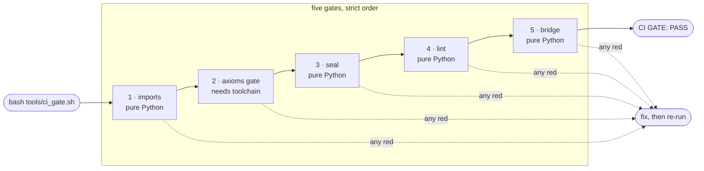

| # | gate | needs toolchain | verdict (2026-11-28) |
|---|---|---|---|
| 1 | `check_imports.py` — single root, pins | no | **PASS** |
| 2 | `axioms_gate.py` — full compile + footprints | **yes** | **clean in the author's compile** (40/40 classical; committed log lands at the next CI re-run) |
| 3 | `seal_check.py --check` — 115 statements sealed | no | **PASS** |
| 4 | `lint_conventions.py` — naming + 100% docstrings | no | **PASS** (138/138) |
| 5 | `export_verified_params.py --check` — bridge | no | **PASS** (9 constants, bridge materialized) |

The bridge step is tolerant of a lab that has not yet accepted its parameters
(first run without `--check` emits `verified_params.json` — done in this milestone,
so gate 5 now checks a real file).

## 10. Reproducibility pins

| pin | value | enforced by |
|---|---|---|
| Lean toolchain | `leanprover/lean4:v4.6.0` | `lean-toolchain` + gate 1 |
| Mathlib | git tag `v4.6.0` (exact, not a branch) | `lakefile.lean` + gate 1 |
| Statement layer | 115 sha256 seals | `seal/manifest.json` + gate 3 |
| Docstring floor | 138/138 = 100% | `seal/docstring_baseline.json` + gate 4 |
| Axiom footprint | `{propext, Classical.choice, Quot.sound}` × 40 | `tools/axioms_gate.py` + gate 2 |
| Numeric constants | 9 entries, bit-deterministic | `verified_params.json` + gate 5 |

Never advance a pin silently: each one is a visible diff, reviewed like a proof step.

## 11. Milestone timeline

| milestone | scope |
|---|---|
| **TW1.a** | §0–§5 written; seals, gates, docs; audit copy frozen. First real-toolchain compile queued. |
| **TW1.b** | compiled clean (0 errors, 0 sorry), CI 5/5 PASS, seal re-issued (62 statements), evidence logs committed, folder housekeeping, gallery + Mermaid documentation added. |
| **TW2–TW5 (this release)** | **The spectral milestone**: §4′ landed — Fourier layer, Havelock block sums with the closed form `S_m = (2−m)(N−m)/2`, ring linearization, master projection, dispersion relation, small-ring stability, the growing-mode witness — and **`havelockClassification` is a theorem**. Seal re-issued for 115 statements; 40 axiom footprints; the numeric bridge materialized (9 constants, incl. `λ(N=8) = √2/π`). Report: [`docs/TW5_COMPLETION.md`](docs/TW5_COMPLETION.md). |

## 12. The verification constellation

This package is **standalone-first**: it shares the author, the house style, the
toolchain pins and the seal discipline with the parent
[Trivortex](https://github.com/wild8highlander/Trivortex) monorepo, but carries its own
lake package, seal directory and numeric bridge (`verification/polyvortex/data/`).
The interlock with the parent is mathematical, not organizational:
`ringOmega_three_eq_lagrange` proves that at `N = 3, R = a/√3` the Polyvortex rate
coincides with the parent's Lagrange value `3Γ/(2πa²)` — the two artifacts agree on
the shared object exactly where they overlap.

## 13. How this extends the parent file

| parent (Trivortex.lean v7.0) | this file (Polyvortex.lean) |
|---|---|
| `lagOmega`, triplicated `eqdx/eqdy` for 3 vortices | `ringOmega γ R N`, one parametric `kirchhoff` |
| Lagrange forcing `lag_omega_unique` (N = 3) | `ringOrbit_sol` for every `N ≥ 2`, every primitive root |
| H1 gate argued numerically (`ansatz.py`) | `rClosed_pos_iff` + touch certificate, proven |
| C_Ch pulsation scenario | Lemma C obstruction, proven |
| averaging ladder | Lemma D closed form via the Poisson integral |
| W4 stability certified numerically | **W4 classification proven** — `havelockClassification` is a theorem (`N ≤ 7` ⟷ stable) |

## 14. Gallery — the certified objects, animated

All assets are generated by matplotlib in the house navy-and-gold palette; the
animations are deliberately *illustrations of proven theorems*, not artist impressions —
every formula in a caption is a Lean-sealed statement. The W4-spectrum panel is the
numerical illustration of the now-proven classification.

### Theorem A — the corotating ring

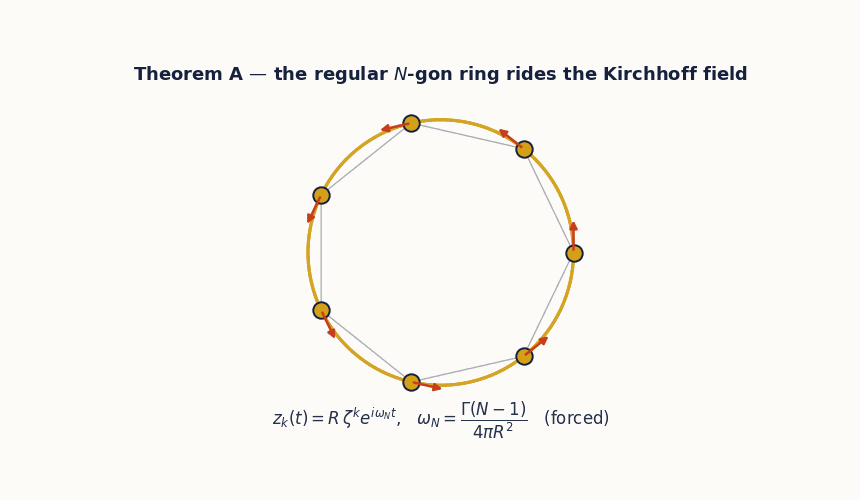

<p align="center"><sub><b>EN</b> — the regular N-gon (N = 7) rides the Kirchhoff field as a solid rotation:
every velocity vector is tangential with <code>|v| = ω_N·R</code>, the rate forced by <code>ringOrbit_sol</code>.
<b>RU</b> — регулярное N-угольное кольцо (N = 7) переносится полем Кирхгофа как твёрдое вращение:
каждый вектор скорости касателен, угловая скорость принуждена теоремой <code>ringOrbit_sol</code>.</sub></p>

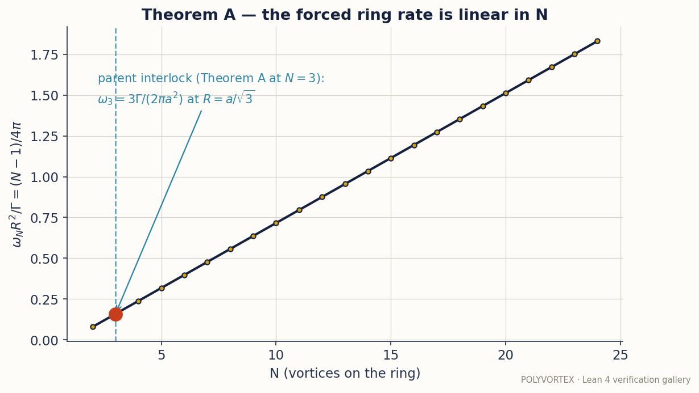

<p align="center"><sub><b>EN</b> — <code>ω_N·R²/Γ = (N−1)/4π</code> is linear in N; the red point is the parent
interlock (N = 3, R = a/√3 → 3Γ/2πa²). <b>RU</b> — скорость кольца линейна по N; красная точка — стыковка
с родительским артефактом при N = 3.</sub></p>

### Theorem B — the pulsation at the threshold

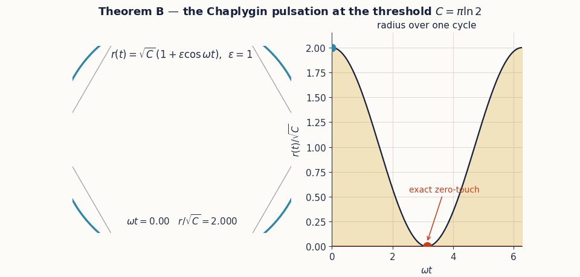

<p align="center"><sub><b>EN</b> — at <code>C = π·ln 2</code> the pulsation radius <code>√C·(1+cos ωt)</code>
stays nonnegative and touches zero exactly once per cycle — the machine-checked H1 gate.
<b>RU</b> — при <code>C = π·ln 2</code> радиус пульсации остаётся неотрицательным и ровно раз за период
касается нуля — машинно-проверенный гейт H1.</sub></p>

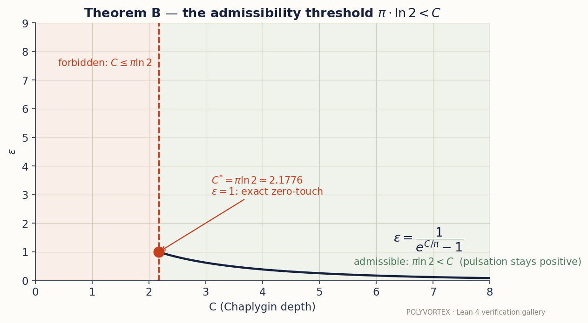

<p align="center"><sub><b>EN</b> — <code>ε(C) = 1/(e^{C/π}−1)</code>: admissible only for
<code>π·ln 2 &lt; C</code> (green), forbidden below (red); the wall is the proven iff.
<b>RU</b> — пульсация допустима только при <code>π·ln 2 &lt; C</code>; порог — доказанная теорема об
эквивалентности.</sub></p>

### Lemma D — the Poisson integral

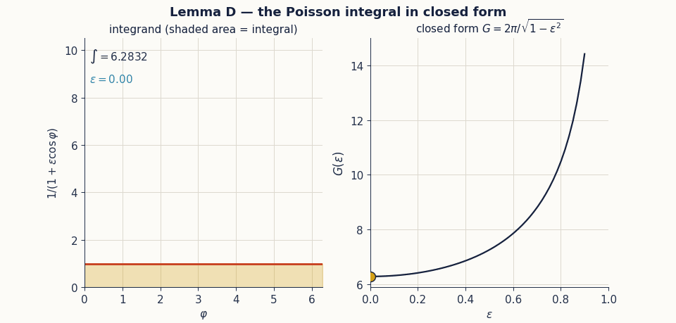

<p align="center"><sub><b>EN</b> — the integrand <code>1/(1+ε·cos φ)</code> sharpens as ε grows; the shaded
area always equals the closed form <code>2π/√(1−ε²)</code>, proven without any quadrature.
<b>RU</b> — заштрихованная площадь всегда равна замкнутой форме <code>2π/√(1−ε²)</code>, доказанной без
численного интегрирования.</sub></p>

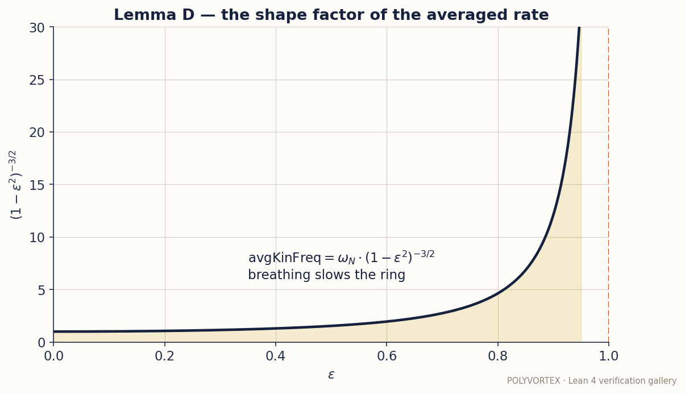

<p align="center"><sub><b>EN</b> — <code>lemmaD_bridge</code>: breathing slows the effective rate by the shape
factor <code>(1−ε²)^{−3/2}</code>. <b>RU</b> — «дыхание» замедляет эффективную скорость кольца множителем
<code>(1−ε²)^{−3/2}</code>.</sub></p>

### Theorem E — the W4 Havelock boundary (the proven classification, illustrated)

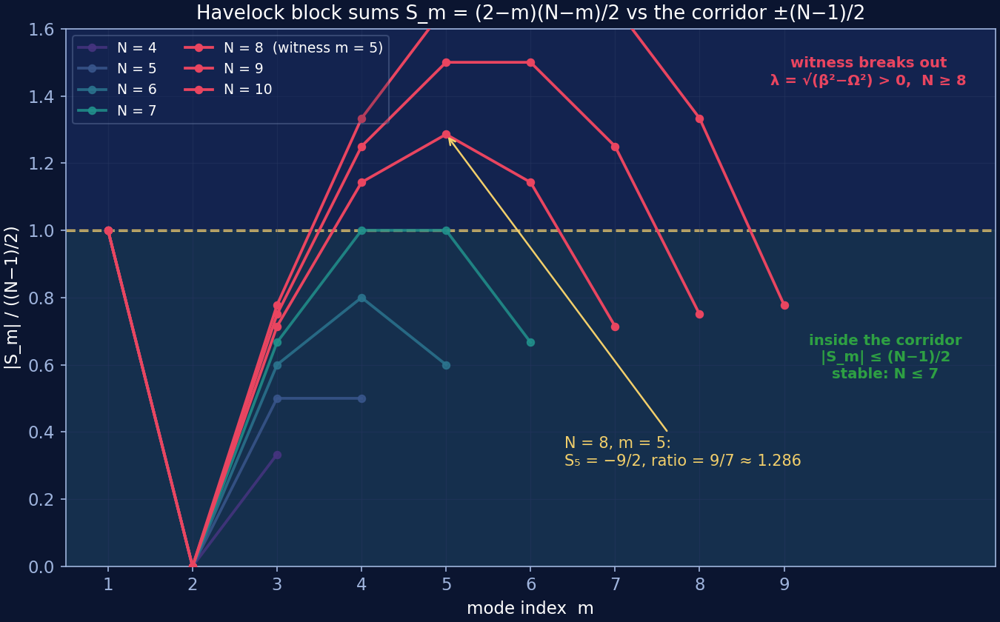

<p align="center"><sub><b>EN</b> — the exact closed form <code>S_m = (2−m)(N−m)/2</code> (solid curves) against the
threshold <code>±(N−1)/2</code> (dashed): for <code>N ≤ 7</code> every block sum stays inside the corridor (<code>havS_real_sq</code>),
at <code>N ≥ 8</code> the witness mode <code>m = 5</code> breaks out — the exact engine of the stability dichotomy.
<b>RU</b> — точная замкнутая форма <code>S_m = (2−m)(N−m)/2</code> против порога <code>±(N−1)/2</code>: при <code>N ≤ 7</code> все
блок-суммы внутри коридора, при <code>N ≥ 8</code> мода-свидетель <code>m = 5</code> вырывается наружу — точный
механизм дихотомии устойчивости.</sub></p>

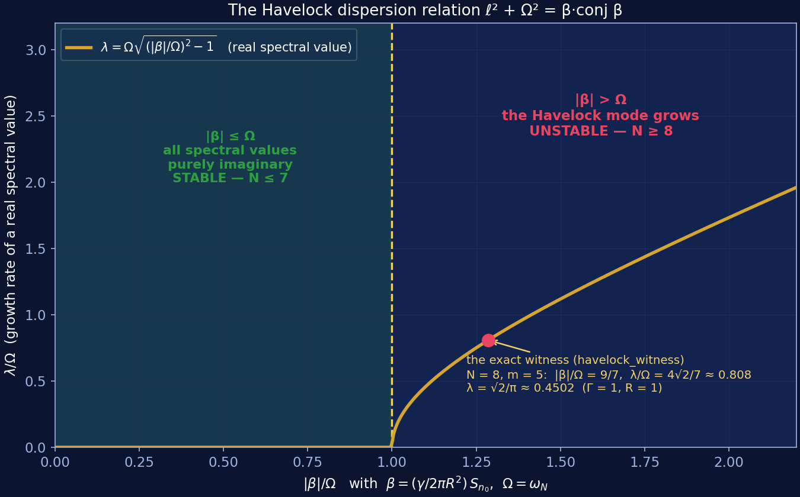

<p align="center"><sub><b>EN</b> — the spectral boundary of <code>corotLin_dispersion</code>: real part of ℓ against the
mode-index bound <code>|β|/Ω</code> — inside the unit disk every spectral value is purely imaginary (stable,
N ≤ 7), beyond it the Havelock mode grows (<code>havelock_witness</code>, N ≥ 8); the red point is the exact
witness at N = 8, m = 5: <code>λ = √2/π ≈ 0.4502</code>.
<b>RU</b> — спектральная граница дисперсионного соотношения: при |β| ≤ Ω все спектральные значения
чисто мнимые (устойчивость, N ≤ 7), за пределами — растущая хавелоковская мода (N ≥ 8); красная
точка — точный свидетель при N = 8.</sub></p>

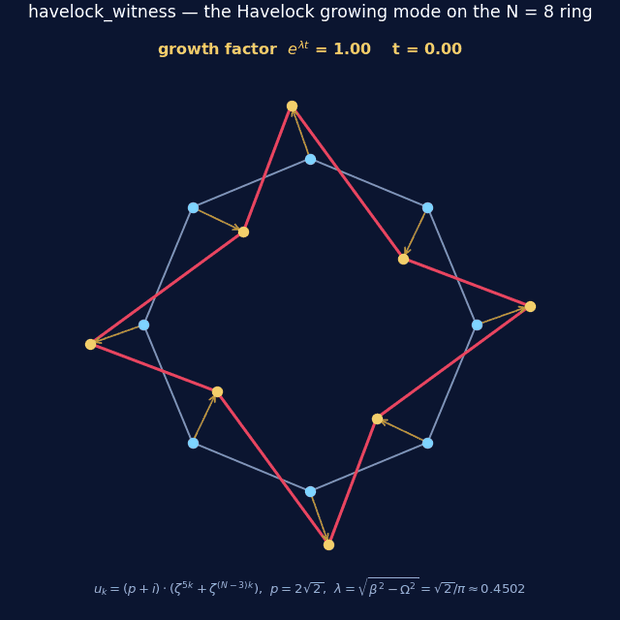

<p align="center"><sub><b>EN</b> — the eigenvector of <code>havelock_witness</code> on the N = 8 ring: the amplitude
pattern <code>u_k ∝ ζ^{5k} + ζ^{(N−3)k}</code> under the growth factor <code>e^{λt}</code>, <code>λ = √(β²−Ω²) = √2/π</code> —
the ring loses its shape exponentially fast.
<b>RU</b> — собственный вектор <code>havelock_witness</code> на кольце N = 8: картина амплитуд растёт множителем
<code>e^{λt}</code>, λ = √2/π — кольцо экспоненциально теряет форму.</sub></p>

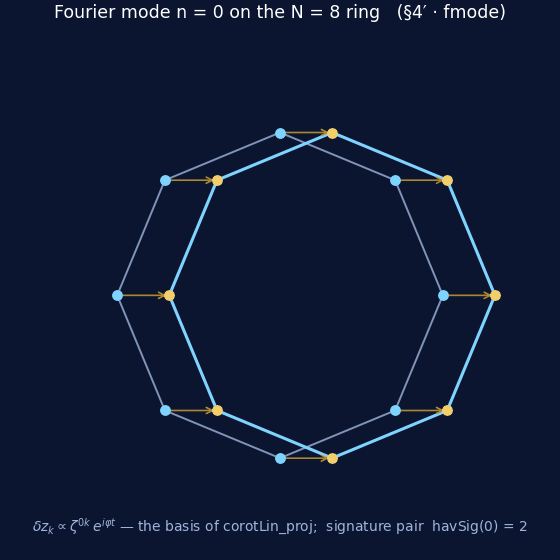

<p align="center"><sub><b>EN</b> — the Fourier modes <code>fmode_n</code> of §4′ rotating on the ring: the basis in which
the linearization diagonalizes (<code>corotLin_proj</code>), with the signature pairs <code>n ↔ havSig n</code>.
<b>RU</b> — фурье-моды §4′, вращающиеся на кольце: базис, в котором линеаризация диагонализуется,
с сигнатурными парами <code>n ↔ havSig n</code>.</sub></p>

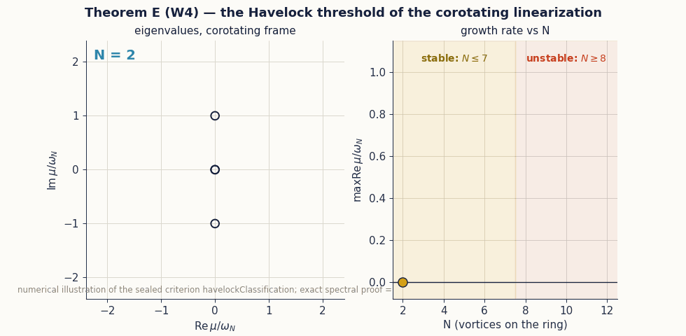

<p align="center"><sub><b>EN</b> — eigenvalues of the corotating linearization (numerical): all neutral for
N ≤ 7, growing modes appear at N ≥ 8 — the visual counterpart of the proven theorem
<code>havelockClassification</code>. <b>RU</b> — собственные числа кори-вращающей линеаризации (численно): всё
нейтрально при N ≤ 7, растущие моды появляются при N ≥ 8 — визуальный двойник доказанной теоремы.</sub></p>

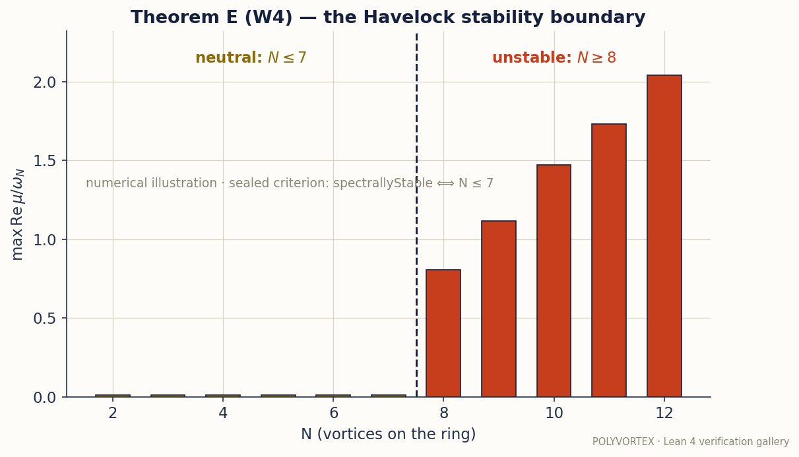

<p align="center"><sub><b>EN</b> — the maximal growth rate (normalized by ω_N) is zero through N = 7 and
monotone beyond. <b>RU</b> — максимальная скорость роста обнуляется до N = 7 включительно.</sub></p>

### TW1.b — the proof-fix descent (real committed data)

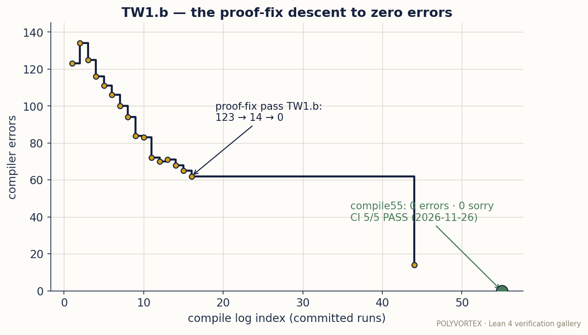

<p align="center"><sub><b>EN</b> — compiler errors across the committed compile logs (runs 1–44) and the
final clean run: 123 → 14 → 0. <b>RU</b> — число ошибок компилятора по зафиксированным логам прогонов
и финальный чистый прогон: 123 → 14 → 0.</sub></p>

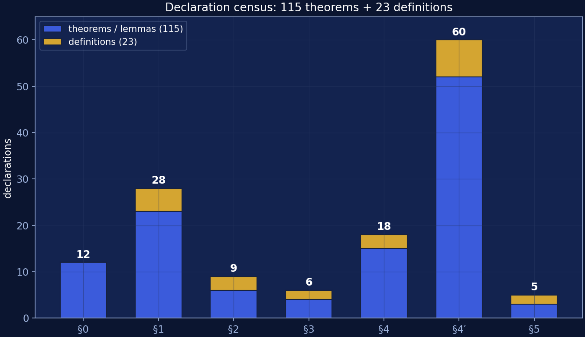

<p align="center"><sub><b>EN</b> — 138 declarations by section: 115 theorems (navy) + 23 definitions (gold),
matching the lint gate; §4′ — the spectral machinery of TW2–TW5 — is the largest block.
<b>RU</b> — ценз деклараций по секциям: 115 теорем + 23 определения, совпадает с гейтом lint;
§4′ — спектральная механика — крупнейший блок.</sub></p>

## 15. Housekeeping policy — what is committed and what is not

The TW1.b milestone retired everything that is not load-bearing (the folder shrank
from 63 to 36 committed files):

- **Retired:** the 21 scratch `chk*.lean` files (their validated recipes are distilled
  into [`docs/MATHLIB_RECIPES.md`](docs/MATHLIB_RECIPES.md)); the intermediate compile
  logs (`logs/compile1..16.log`, `compile44.log` — the descent is preserved as a chart
  and the numbers in `docs/TW1b_COMPLETION.md`); the two session `STATE_*.md` notes
  (merged into the completion report); root-level `axioms_gate.log` /
  `ci_gate_final.log` (moved to `docs/evidence/` with dates in the name).
- **Kept as evidence:** the two final-pass machine logs under `docs/evidence/` — the
  only log output that is ever committed.
- **Rule going forward:** build/scratch/log artifacts stay out of the repo; the gates,
  the seal, the evidence pair and the docs are the committed surface. Before any
  commit: `bash tools/ci_gate.sh` must be 5/5.

## 16. FAQ

**Is every proof here machine-checked?** Yes. The artifact compiles
against real Mathlib v4.6.0 with 0 errors and 0 `sorry` (author machine run,
2026-11-28), and the axiom footprints of all 40 directives are the strict classical
set. The committed machine output of the previous milestone is under
[`docs/evidence/`](docs/evidence/ci_gate_2026-11-26.log); the fresh log lands there
at the next CI re-run.

**Is anything NOT machine-checked here?** No — the program is closed. Theorems A–E,
Lemmas C/D, the spectral machinery of §4′ and the Havelock classification are all
proven with zero `sorry`. The W4-spectrum panel in the gallery is a numerical
*illustration* of the proven theorem `havelockClassification`, not its substitute.

**Why was `havelockClassification` a `def` in the previous milestone and a `theorem`
now?** Before TW5 it was recorded as an exact `Prop`-valued criterion — the honest
form for an unproven statement, since `sorry` is forbidden. The §4′ machinery
(Fourier layer → block sums → dispersion → stable7 + witness) turned the criterion
into a theorem: the def `havelockStable` remains as the predicate, and
`havelockClassification` now proves it holds exactly while `N ≤ 7`.

**What is the witness mode `n₀ = N−3, m = 5`?** The Havelock involution
`havSig n = (2−n) mod N` pairs mode `n₀ = N−3` with mode `5` (for `N ≥ 8`), and the
closed form gives `|S_{N−3}| = 3(N−5)/2 > (N−1)/2` exactly when `N > 7` — the block
sum escapes the small-ring corridor precisely there, producing the real eigenvalue
`λ = √(β² − Ω²) > 0`. At `N = 8` this is the first broken ring: `S_5 = −9/2`,
`λ = √2/π ≈ 0.4502` (Γ = 1, R = 1).

**Why `Real.pi` divisions everywhere in `ω_N`?** That is the mathematics: the Kirchhoff
pair-factor `Γ/(2π)` and the chord sum `(N−1)/2` produce it. No normalization tricks
were applied to make the statement prettier.

**Why does `sum_roots_of_unity` not case-split on the parity of `N`?** The involution
`m ↦ N−m` pairs index `m` with `N−2−m`; at the fixed point the pair-lemma
`1/(1−x) + 1/(1−x⁻¹) = 1` degenerates to `1/(1−x) = 1/2` with `x = −1 = ζ^{N/2}`,
which the same field identity covers. One case, all parities.

**What does the audit file contain?** The TW1-era snapshot with an audit header
(1,439 lines, 61 sealed statements) — the artifact as it was before its first machine
compile. The live file advances; the audit file freezes history.

**Where do the compile logs live?** Nowhere in the repo — they are session artifacts.
The only committed machine output is the milestone evidence pair under
`docs/evidence/`; the TW1.b error-count history is preserved as a chart and as a
table in `docs/TW1b_COMPLETION.md`.

## 17. Troubleshooting

- **`lake: command not found`** — install elan; the toolchain file selects v4.6.0 automatically.
- **`axioms_gate` fails on a fresh clone** — run `lake exe cache get` first; a cold
  Mathlib build takes hours and is never needed.
- **`seal_check --check` fails after editing a theorem** — you changed a sealed
  statement. Review the diff; if the change is intended, run `seal_check --update`
  (a visible action).
- **`lint_conventions` rejects a name** — new declarations must be snake_case
  (theorems) / lowerCamelCase (defs); the grandfather list is empty and stays empty.
- **Bridge reports drift** — `verified_params.json` disagrees with the seals; re-run
  `export_verified_params.py` after reviewing what changed in the statements.
- **A Mathlib name changed after a bump** — consult
  [`docs/MATHLIB_RECIPES.md`](docs/MATHLIB_RECIPES.md) first: every v4.6.0 API trap
  (star/starRingEnd, `Set.` prefixes, binder syntax, cast chains) is catalogued there
  with the working fix.

## 18. Roadmap — TW1…TW5, closed

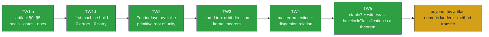

| milestone | scope | status |
|---|---|---|
| **TW1.a** | artifact §0–§5 written; seals, gates, docs | **done** |
| **TW1.b** | first machine build: `lake build` + green `axioms_gate`; proof-fix pass | **done (2026-11-26)** |
| **TW2** | Fourier layer: `zinv`, `fmode`, `fourier_orth`, `fmode_inversion` | **done (2026-11-28)** |
| **TW3** | `corotLin` as the explicit linearization layer + orbit-direction kernel | **done (2026-11-28)** |
| **TW4** | W4 acceptance: master projection `corotLin_proj`, dispersion `corotLin_dispersion`, block sums `havS_closed`/`havS_real_sq` | **done (2026-11-28)** |
| **TW5** | `corotLin_stable7` + `havelock_witness` → **`havelockClassification` is a theorem** | **done (2026-11-28)** |

The artifact's own roadmap is complete. Natural continuations live outside this file:
the numeric-ladder regression of the lab against the 9 bridge constants, and the
transfer of the block-sum method to configurations beyond the regular ring.

## 19. Contributing

The seals make contribution reviewable: change a statement and gate 3 turns red; lower
a docstring and gate 4 turns red; retune a constant and gate 5 turns red. Every red
gate is fixed by an *explicit* update action (`--update`, `--update-baseline`, bridge
re-export) that names itself in the diff. New declarations must be snake_case (ASCII
identifiers only — Greek letters in names break the seal/lint parsers) and
docstringed from birth. Run `bash tools/ci_gate.sh` before every commit — the
committed surface must always be green.

### The development loop (formerly `docs/MCP.md`)

Two tools shorten the edit–build–diagnose cycle:

1. **lean4-mcp / LSP inspection.** The AI-assistant MCP protocol and the Lean LSP
   server give the same core: goal inspection (`goal` / tactic state), on-the-fly
   diagnostics and Mathlib theorem search by signature. Open this folder as the
   working directory — `lean-toolchain` pins v4.6.0 and `lakefile.lean` resolves the
   Mathlib tag, so VS Code + the lean4 extension pick everything up automatically;
   an MCP client connecting to the same lake project gets goal inspection and
   Mathlib search inside the editing loop.
2. **Fast synchronous iteration.**

   ```bash
   export ELAN_HOME=<elan> PATH=<elan>/bin:$PATH
   cd polyvortex/polyvortex_lean4
   lake env lean Polyvortex.lean > /tmp/iter.log 2>&1   # ~3 min: all sections
   grep -n "error" /tmp/iter.log                        # diagnose
   ```

   Chunk discipline for large edits: cut the section under repair into a scratch
   file with the same 8 imports, iterate `lake env lean chunk.lean` (seconds, not
   minutes), splice back, then run the full gate.

Everything except writing the proofs themselves is already automated by
`tools/ci_gate.sh`: warning-as-error build, per-theorem axiom whitelist, statement
seal, conventions/docstrings and the numeric-bridge sync. The v4.6.0 tactic pitfalls
are catalogued in [`docs/MATHLIB_RECIPES.md`](docs/MATHLIB_RECIPES.md).

## 20. Acknowledgments & credits

- **Author & maintainer:** [Isaev Iskhak Khamzatovich](https://orcid.org/0009-0003-7299-0701)
  (independent researcher) — mathematics, formalization, tooling, documentation.
- **Foundations:** the Lean 4 core team and the Mathlib community for the kernel,
  the tactics and the analysis/measure-theory library this artifact stands on.
- **Parent program:** the Trivortex monograph — the three-vortex analytic spine that
  this file generalizes to arbitrary `N`.

## 21. Citation, DOI & license

```bibtex
@software{isaev2026polyvortexlean,
  author  = {Isaev, Iskhak Khamzatovich},
  title   = {Polyvortex Lean 4: the machine-checked N-vortex extension bench},
  year    = {2026},
  url     = {https://github.com/wild8highlander/Trivortex/tree/main/polyvortex/polyvortex_lean4},
  note    = {Lean 4.6.0 + Mathlib v4.6.0; 115 sealed statements; Theorems A–E proven;
             Havelock classification: stable ⟷ N ≤ 7; 0 sorry; 0 axiom}
}
```

Proprietary license **IPL-RP-1.0**
([LICENSE.md](https://github.com/wild8highlander/Trivortex/blob/main/LICENSE.md), RU/zh
translations available in the parent repository). Reuse attributed per REUSE.toml;
SPDX headers present in every source file.

---

## Appendix A — declaration census

Counts are tool-generated (`tools/lint_conventions.py`), match
[`docs/STATEMENTS.md`](docs/STATEMENTS.md) exactly, and are enforced by gate 4:

| section | content | theorems | definitions | total |
|---|---|---|---|---|
| §0 | private helpers (cyclic sums, star/normSq) | 12 | 0 | **12** |
| §1 | Theorem A — the ring solution, forced | 23 | 5 | **28** |
| §2 | Theorem B — admissibility threshold | 6 | 3 | **9** |
| §3 | Lemma C — pulsation obstruction | 4 | 2 | **6** |
| §4 | Lemma D — averaged rate, Poisson integral | 15 | 3 | **18** |
| §4′ | spectral machinery of Theorem E (TW2–TW5) | 52 | 8 | **60** |
| §5 | Theorem E — co-rotating layer, Havelock classification | 3 | 2 | **5** |
| | **total** | **115** | **23** | **138** |

- **Sealed statements:** 115 (sha256 in [`seal/manifest.json`](seal/manifest.json), gate 3).
- **Axiom footprints:** 40 directives, all `{propext, Classical.choice, Quot.sound}`
  (gate 2; author machine run 2026-11-28).
- **Docstrings:** 138/138 = 100% (gate 4 ratchet).
- **Full API reference with docstrings:** [`docs/DECLARATIONS.md`](docs/DECLARATIONS.md).
