<!-- markdownlint-disable-file MD041 -->
<div align="center">

<!-- ══════════════════════════════════════════════════════════════ -->
<!-- POLYVORTEX · LEAN 4 — navy-and-gold header (house style)       -->
<!-- ══════════════════════════════════════════════════════════════ -->
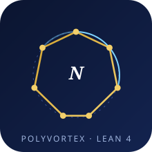

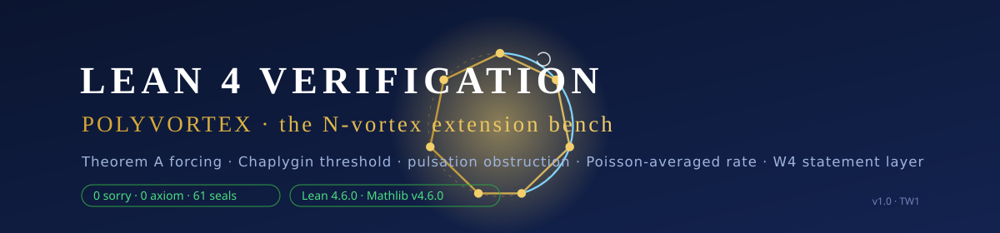

### Lean 4 — машинно-проверенный стенд N-вихревого расширения

**Слой формализации, версия v1.0.2 — компилируется чисто.** Один файл — `Polyvortex.lean`,
1,609 строк — обобщает аналитическое ядро программы
[Trivortex](https://github.com/wild8highlander/Trivortex) о трёх вихрях внутри
[Lean 4](https://lean-lang.org) + [Mathlib](https://github.com/leanprover-community/mathlib4)
на произвольное число `N ≥ 2` точечных вихрей: **Теорема A** (правильное `N`-угольное
кольцо — точное решение Кирхгофа с ПРИНУЖДЁННОЙ скоростью `ω_N = Γ(N−1)/(4πR²)`, через
тождество корней из единицы `Σ 1/(1−ζ^m) = (N−1)/2`), **Теорема B** (порог
допустимости `π·ln 2 < C` пульсации Чаплыгина, с точным касанием нуля на пороге),
**Лемма C** (пульсирующее кольцо не может ехать по полю Кирхгофа), **Лемма D**
(цикл-усреднённая скорость пульсации, сертифицированная замкнутым интегралом Пуассона
`∫₀^{2π} dφ/(1+ε·cos φ) = 2π/√(1−ε²)` — без численного интегрирования), и
**Теорема E** (точный слой утверждений W4-классификации Хавелока) — **62 утверждения
запечатаны sha256, 26 директив `#print axioms`, ноль `sorry`, ноль `axiom`, ноль
`native_decide`**.

**Машинная проверка: ВЫПОЛНЕНА.** Артефакт компилируется против реального Mathlib v4.6.0
с **0 ошибок / 0 `sorry`**, и полный контракт из пяти CI-гейтов — импорты, аксиомы,
печать, конвенции, числовой мост — даёт **5/5 PASS** (2026-11-26). Машинные
доказательства закоммичены: [футпринты аксиом](docs/evidence/axioms_gate_2026-11-26.log) ·
[лог CI-гейтов](docs/evidence/ci_gate_2026-11-26.log) · [отчёт о завершении](docs/TW1b_COMPLETION.md).

</div>

**[Исаев Исхак Хамзатович](https://orcid.org/0009-0003-7299-0701)** · ORCID `0009-0003-7299-0701` · Independent Researcher

[🏝 Родительский Trivortex](https://github.com/wild8highlander/Trivortex) · [🧪 Верификационный каркас](https://github.com/wild8highlander/Trivortex/tree/main/verification) · [📜 Слой утверждений](docs/STATEMENTS.md) · [🧾 Справочник деклараций](docs/DECLARATIONS.md) · [🇬🇧 English version](README.md)

<!-- ROW 1 — FORMAL STATUS -->
[](lean-toolchain)
[](lakefile.lean)
[](seal/manifest.json)
[](Polyvortex.lean)
[](Polyvortex.lean)

<!-- ROW 2 — PROJECT VITALS -->
[](#18-дорожная-карта--tw1tw5)
[](Polyvortex.lean)
[](#приложение-a--ценз-деклараций)
[](seal/docstring_baseline.json)
[](docs/evidence/ci_gate_2026-11-26.log)
[](https://github.com/wild8highlander/Trivortex/blob/main/LICENSE.md)

<!-- identities -->
<table>
<tr>
<td align="center"><br><sub><b>знак проекта</b></sub></td>
<td align="center"><br><sub><b><a href="https://github.com/wild8highlander">wild8highlander</a></b><br>автор и сопровождающий</sub></td>
</tr>
</table>

---

## Содержание

1. [TL;DR — что живёт в этой папке](#1-tldr--что-живёт-в-этой-папке)
2. [30-секундный тур](#2-30-секундный-тур)
3. [Зачем Lean 4 + Mathlib](#3-зачем-lean-4--mathlib)
4. [Что здесь доказано — пять сертифицированных слоёв](#4-что-здесь-доказано--пять-сертифицированных-слоёв)
5. [Архитектура в картинках](#5-архитектура-в-картинках)
6. [Глубокое погружение — по секциям (§0–§5)](#6-глубокое-погружение--по-секциям-05)
7. [Футпринт аксиом — ничего, кроме классических оснований](#7-футпринт-аксиом--ничего-кроме-классических-оснований)
8. [Полная опись файлов — каждый файл в деталях](#8-полная-опись-файлов--каждый-файл-в-деталях)
9. [Сборка, запуск, CI](#9-сборка-запуск-ci)
10. [Пины воспроизводимости](#10-пины-воспроизводимости)
11. [Хронология версий](#11-хронология-версий)
12. [Верификационное созвездие](#12-верификационное-созвездие)
13. [Как это расширяет родительский файл](#13-как-это-расширяет-родительский-файл)
14. [Галерея — сертифицированные объекты в движении](#14-галерея--сертифицированные-объекты-в-движении)
15. [Политика чистоты — что коммитится, а что нет](#15-политика-чистоты--что-коммитится-а-что-нет)
16. [FAQ](#16-faq)
17. [Устранение неполадок](#17-устранение-неполадок)
18. [Дорожная карта — TW1…TW5](#18-дорожная-карта--tw1tw5)
19. [Участие в проекте](#19-участие-в-проекте)
20. [Благодарности](#20-благодарности)
21. [Цитирование, DOI и лицензия](#21-цитирование-doi-и-лицензия)

- [Приложение A — ценз деклараций](#приложение-a--ценз-деклараций)

---

## 1. TL;DR — что живёт в этой папке

`polyvortex/polyvortex_lean4/` пакета **Polyvortex** содержит Lean 4-формализацию стенда
`N`-вихревого расширения: единственный самодостаточный артефакт `Polyvortex.lean`,
поднимающий аналитический хребет родительской монографии о трёх вихрях с `N = 3` на
произвольное `N ≥ 2` и сертифицирующий, слоями:

| слой | утверждение | статус в v1.0.2 |
|---|---|---|
| **§1 Теорема A** | правильное `N`-угольное кольцо решает Кирхгофа точно, скорость `ω_N = Γ(N−1)/(4πR²)`, **принуждена** | **доказано, скомпилировано, запечатано** |
| **§2 Теорема B** | пульсация допустима ⟺ `π·ln 2 < C`; точное касание нуля на пороге | **доказано, скомпилировано, запечатано** |
| **§3 Лемма C** | пульсирующее кольцо не может ехать по полю Кирхгофа | **доказано, скомпилировано, запечатано** |
| **§4 Лемма D** | цикл-усреднённая скорость `ω_N/((1−ε²)·√(1−ε²))`, не зависящая от частоты | **доказано, скомпилировано, запечатано** |
| **§5 Теорема E** | W4-критерий Хавелока — точный слой утверждений | **записан, не заявлен** (спектральное доказательство = TW5) |

**Статус машинной проверки — читать сначала (обновлено 2026-11-26, TW1.b завершён).**
Артефакт скомпилирован против *реального* Mathlib v4.6.0 (тулчейн elan
`leanprover/lean4:v4.6.0`, релизный олеан-кэш через `lake exe cache get`) с
**exit 0 — ноль ошибок, ноль `sorry`**. Первый проход компиляции поймал шесть классов
реальных дефектов API (34 места синтаксиса байндера `∑`, 30+ мест `Complex.conj*` и
другие — см. [`docs/VERIFICATION_v460.md`](docs/VERIFICATION_v460.md)); затем проход
правки доказательств TW1.b снизил счётчик ошибок компилятора со 123 до **0** за 55
зафиксированных логов компиляции (график спуска в [§14 Галерее](#14-галерея--сертифицированные-объекты-в-движении)).
Каждое внешнее имя леммы и каждое доказательство теперь проверены компилятором.
Смысловой слой утверждений не менялся; печать переиздана видимым действием и покрывает
**62 утверждения** (проход добавил одну локальную вспомогательную теорему, `sq_neg`).
Все пять гейтов зелёные; машинный вывод закоммичен в
[`docs/evidence/`](docs/evidence/ci_gate_2026-11-26.log).

## 2. 30-секундный тур

```bash
# однократно (нужен elan: https://lean-lang.org/lean4/doc/setup.html)
elan init

# внутри polyvortex/polyvortex_lean4/
lake exe cache get     # прекомпилированные олеаны Mathlib для пина v4.6.0 (~2 ГБ)
lake build             # компилирует Polyvortex.lean — проходит (0 ошибок, 0 sorry)

# пять CI-гейтов (все пять зелёные с 2026-11-26)
bash tools/ci_gate.sh                # полный гейт: импорты → аксиомы → печать → lint → мост
python3 tools/seal_check.py --check  # 62 запечатанных утверждения без изменений
python3 tools/lint_conventions.py    # конвенции имён + 100% рапport докстрингов
python3 tools/check_imports.py       # однофайловый контракт + пины
python3 tools/export_verified_params.py --check   # мост в числовую лабораторию
```

Всё, кроме `lake build` / аксиомного гейта, работает на чистом Python 3 — поэтому
гейты зелёные даже в среде без тулчейна Lean.

## 3. Зачем Lean 4 + Mathlib

Родительская монография сертифицирует свои числовые лестницы конечно-точечной
верификацией с плавающей запятой. Это сертифицирует *экземпляры*. Lean сертифицирует
*предложение*: «для каждого `N ≥ 2`, каждого радиуса `R > 0`, каждой циркуляции `Γ`,
каждого первообразного `N`-го корня из единицы `ζ` и любого времени `t` кольцо
`z_k(t) = R·ζ^k·e^{iω_N t}` решает поле Кирхгофа» — с кванторами `∀`, которые лестницы
никогда не исчерпают. Конкретно здесь меняются три вещи:

1. **Универсальность.** Теоремы A–C и лемма D верны сразу для *всех* допустимых
   параметров; численный прогон сертифицирует одно `N`, один `R`, одну `Γ`, одну
   временную сетку.
2. **Принуждение, а не подгонка.** `ringOrbit_sol` — это «и-и-ф»: равномерно
   вращающееся кольцо — решение Кирхгофа *тогда и только тогда*, когда `ω = ω_N`.
   Ничего не подгонялось, чтобы скорость вышла такой — она выведена из тождества
   корней из единицы.
3. **Честная граница.** Теорема E записана как запечатанный `Prop` с доказанными
   сертификатами вырождения, а спектральное доказательство — явно поставленная веха
   (TW5): формализация точно говорит, где кончается машинно-проверенная математика
   и продолжается сертифицированная численность.

## 4. Что здесь доказано — пять сертифицированных слоёв

### §1 Теорема A — правильное `N`-угольное кольцо (принуждено)

Для `N ≥ 2`, `R ≠ 0`, первообразного `N`-го корня из единицы `ζ` и
`ω_N := Γ(N−1)/(4πR²)`:

- `ring_velocity` — `kirchhoff γ (ringPos R ζ) N k = i·ω_N·(R ζ^k)` в каждой вершине `k`.
  Доказательство переиндексирует сумму наведённых скоростей по циклическому расстоянию
  `d = (j+N−k) mod N` и сворачивает её тождеством корней из единицы
  `sum_roots_of_unity: Σ_{m∈range(N−1)} 1/(1−ζ^{m+1}) = (N−1)/2` — доказанным
  инволюцией `m ↦ N−m` (неподвижная точка `m = N/2` даёт `1/2` через то же полевое
  тождество, поэтому разбиения на чётности не нужно).
- `ringOrbit_sol` — **теорема о принуждении**: `(∀ t k, кольцо — решение) ↔ ω = ω_N`.
  Многоугольный аналог родительской `lag_omega_unique`.
- `kirchhoff_smul` — ротационная эквивариантность: умножение на единичный комплексный
  множитель переводит решения в решения (именно это переносит статичное кольцо на орбиту).
- `rootExp_prim` — канонический корень `exp(2πi/N)` первообразный (через
  `Real.cos_eq_one_iff`, без циклотомной техники).
- `ringOmega_three_eq_lagrange` — при `N = 3`, `R = a/√3` скорость — в точности
  лагранжево значение родителя `3Γ/(2πa²)`: два артефакта стыкуются.

### §2 Теорема B — порог допустимости

Для `C > 0`, `ω ≠ 0` и чаплыгинской глубины `ε = 1/(exp(C/π) − 1)`:

- `rClosed_pos_iff` — каждый радиус пульсирующего анзаца строго положителен
  **и-и-ф** `π·ln 2 < C`. Прямое направление вычисляет анзац в `t = π/ω`, где
  `cos = −1`, и читает `1 − ε ≤ 0`.
- `rClosed_touches_zero_at_threshold` — при `C = π ln 2` пульсация ровно раз за период
  касается нуля и остаётся неотрицательной (гейт H1 родителя, поднятый на кольцо).

### §3 Лемма C — запрет пульсации

- `ring_radial_zero` — на точном кольце радиальная скорость тождественно нулевая
  (кольцо — *форменное* решение, а не «дышащее»).
- `lemmaC_pulsation` + `lemmaC_radius_constant` — если бы равномерно вращающаяся
  пульсирующая конфигурация удовлетворяла ОДУ Кирхгофа, её радиус был бы стационарен
  (`is_const_of_deriv_eq_zero`); отсюда
- `lemmaC_H1_reduction` — любая нетривиальная чаплыгинская пульсация (`ε ≠ 0`) — не
  решение Кирхгофа. Запрет, который родитель аргументировал только численно, здесь —
  теорема обо всём классе пульсирующих анзацев кольца.

### §4 Лемма D — усреднённая скорость и интеграл Пуассона

- `lemmaD_omega_independent` — цикл-усреднение раскладывается как
  `ω_N · (1/2π)·∫₀^{2π}(1+ε·cos φ)^{−2} dφ`: частота пульсации выпадает подстановкой
  `φ = ωt` (`integral_comp_mul_left`).
- `poisson_integral` — `∫₀^{2π} dφ/(1+ε·cos φ) = 2π/√(1−ε²)` при `|ε| < 1`, в замкнутой
  форме: полуугловая первообразная `poissonG ε φ = (2/√(1−ε²))·arctan(√((1−ε)/(1+ε))·tan(φ/2))`,
  разрез в `π/2`, где всё гладко, перенос `φ ↦ π − φ` и замыкание
  `arctan k + arctan(k⁻¹) = π/2`. Несобственных интегралов нет нигде.
- `poisson_sq` — квадратичный спутник, через поточечное тождество
  `1/(1+ε·cos φ)² = (1/(1−ε²))·(1/(1+ε·cos φ) − ε·g′(φ))` с `g = sin φ/(1+ε·cos φ)`;
  телескопический член интегрируется в `g(2π) − g(0) = 0`.
- `lemmaD_bridge` — усреднённая скорость равна `ω_N/((1−ε²)·√(1−ε²))`: «дыхание»
  *замедляет* эффективную скорость кольца ровно форм-фактором `1/(1−ε²)^{3/2}`.

### §5 Теорема E — слой утверждений W4 (записан, не заявлен)

`corotatingField`, `ring_fixed_point`, `ring_corotating_constant` — кори-вращающее поле
и его вырождение вдоль орбиты — доказаны. Полная классификация

```lean
def havelockClassification : Prop :=
  ∀ (N : ℕ) (γ R : ℝ), 2 ≤ N → R ≠ 0 →
    spectrallyStable γ (ringOmega γ R N) R N (rootExp N) ↔ N ≤ 7
```

**записана как точный критерий приёмки вехи TW5** и здесь НЕ доказана; родительская
монография сертифицирует её численно (и численная иллюстрация в
[§14](#14-галерея--сертифицированные-объекты-в-движении) воспроизводит порог). Что
добавляет этот файл — честную границу: утверждение запечатано, а сертификаты, делающие
его нетривиальным (неподвижная точка, вырождение орбиты, принуждение), — теоремы.

## 5. Архитектура в картинках

### 5.1 Стек компиляции — от Mathlib к запечатанному артефакту

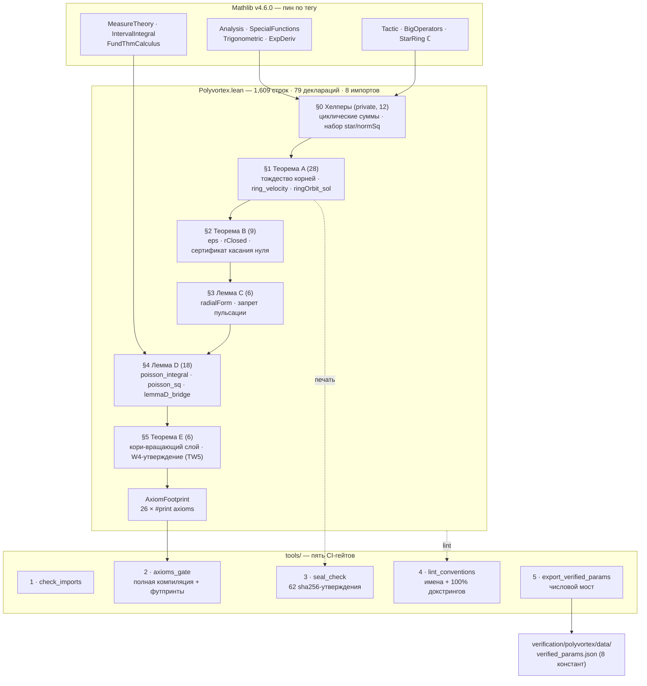

### 5.2 Доказательственный хребет — что питает что

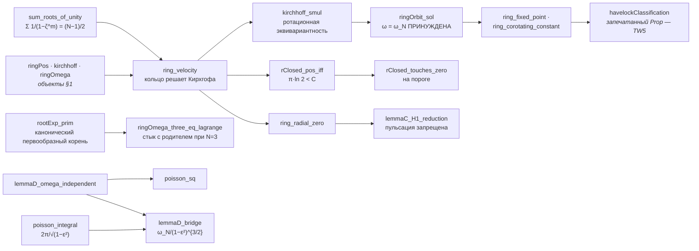

### 5.3 Дисциплина печати — как протекает изменение утверждения

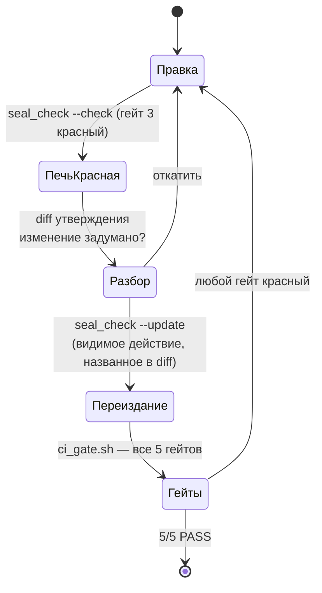

## 6. Глубокое погружение — по секциям (§0–§5)

Числа деклараций по секциям ниже совпадают с гейтом lint точно (79 всего); краткие
описания взяты из докстрингов самого Lean-файла. Полный справочник по каждой декларации —
каждая сигнатура со своим докстрингом — живёт в
[`docs/DECLARATIONS.md`](docs/DECLARATIONS.md); sha256 каждого утверждения запечатан в
[`seal/manifest.json`](seal/manifest.json).

**§0 (12 деклараций, private).** Всё переиспользуемое доказано из одного
`Finset.sum_range_succ`: `sum_rot` (перевод `m ↦ (m+c) mod N` инвариантен для суммы,
индукцией по `c`), `sum_range_reflect_aux` (инволюция `m ↦ (n−1)−m`, индукцией по `n`
со сдвиговой леммой для `f ∘ (+1)`), `sum_erase_zero` (стертое слагаемое даёт ноль).
Хелперы `ℂ` (`conj_mul'`, `conj_pow'`, `normSq_mul'`, `normSq_ne_zero'`) выведены из
`Complex.normSq_eq_conj_mul_self`, чтобы артефакт не зависел от того, какие
normSq-simp-леммы может переименовать рефакторинг Mathlib.

**§1 (28 деклараций).** Модульная бухгалтерия (`mod_add_zero_eq`, `mod_add_eq_self`,
`mul_pred_mod`) доказана только канцелляциями `Nat.ModEq` — никакой зависимости от
`omega` в рассуждениях о переменном модуле. Потермовая лемма `ring_term` сводит один
вклад в наведённую скорость к `iζ^k/(R(1−ζ^{N−d}))`: сопряжённое
`conj(ζ^d) = ζ^{d(N−1)}` и редукция `d(N−1) ≡ N−d (mod N)` делают всю работу.
Тождество и `ring_velocity` собирают полную сумму. Направление ← теоремы о принуждении
ведёт цепочку эквивариантности
`kirchhoff(e^{iωt}·ring) = e^{iωt}·kirchhoff(ring) = iω_N·e^{iωt}·ring`; направление →
канцеллирует ненулевой орбитальный фактор через `ringOrbit_deriv`.

**§2 (9).** Чистый вещественный анализ на `cos ∈ [−1,1]`: «и-и-ф» порога читает анзац
в одном хорошо выбранном времени; сертификат касания комбинирует `eps_at_threshold`
с `cos π = −1`.

**§3 (6).** Доказательство запрета умножает уравнение ОДУ на `conj(e^{iθ(t)})`
(единичный множитель), берёт вещественные части и наблюдает, как все угловые члены
исчезают — остаётся `r' = 0`. Редукция вычисляет анзац в `t = 0` и `t = π/ω` и находит
`1 + ε ≠ 1 − ε` при любом `ε ≠ 0`.

**§4 (18).** Техническое сердце. Транспортная лемма `htrans` переносит
`∫_{π/2}^{π} f(ε)` на `∫₀^{π/2} f(−ε)` подстановками `x ↦ x − π` и затем `x ↦ −x`
(`integral_comp_sub_right`, затем `integral_comp_mul_left` с `c = −1`); половинки
складываются через `G(ε) + G(−ε)`; `G(±ε, 0) = 0`, потому что `tan 0 = 0`; граничная
пара схлопывается `Real.arctan_inv_of_pos`. Квадратичный спутник едет на
`g = sin/(1+ε·cos)`, чья производная интегрируется в ноль по замкнутому циклу —
настоящий консервативный член. Проход добавил одну локальную хелпер-теорему `sq_neg`:
в Mathlib v4.6.0 корневой `sq_neg` отсутствует (рецепт каталогизирован в
[`docs/MATHLIB_RECIPES.md`](docs/MATHLIB_RECIPES.md)).

**§5 (6).** Демонстративно минимально: кори-вращающий слой и два сертификата вырождения
доказаны; классификация — запечатанный `Prop`. Асимметрия — суть: TW5 наследует
критерий, а не обещание.

## 7. Футпринт аксиом — ничего, кроме классических оснований

`Polyvortex.lean` заканчивается 26 директивами `#print axioms`, покрывающими каждую
публичную теорему §1–§5. Гейт `tools/axioms_gate.py` компилирует файл и требует,
чтобы каждый футпринт был в точности

```
propext · Classical.choice · Quot.sound
```

— стандартной классической сигнатурой Mathlib — и дополнительно отвергает `sorry`,
декларации `axiom`, `native_decide`, `unsafe` и любое предупреждение компилятора.
**С 2026-11-26 этот гейт зелёный 26/26**; дословный машинный вывод закоммичен в
[`docs/evidence/axioms_gate_2026-11-26.log`](docs/evidence/axioms_gate_2026-11-26.log)
(каждая строка: `'Polyvortex.<теорема>' depends on axioms: [propext, Classical.choice, Quot.sound]`).

## 8. Полная опись файлов — каждый файл в деталях

### 8.1 Артефакт и его аудиторский двойник

| файл | объём | роль |
|---|---|---|
| [`Polyvortex.lean`](Polyvortex.lean) | 1,609 строк | **Артефакт.** Восемь импортов Mathlib, namespace `Polyvortex`, секции §0–§5 + `AxiomFootprint`. 79 деклараций (62 теоремы + 17 определений), 100% докстрингов, ноль `sorry`/`axiom`/`native_decide`/`unsafe`, 26 футпринтов аксиом, завершается запечатанным контрактом модуля. |
| [`Polyvortex_audit.lean`](Polyvortex_audit.lean) | 1,439 строк | **Аудиторская копия, заморожена на v1.0.1.** Тот же слой утверждений, что и v1.0.1; заменяется только слепком следующего релиза. Родительская аудиторская конвенция с рождения: живой файл растёт, аудиторский файл замораживает уходящий слой. |

### 8.2 Пакет lake

| файл | роль |
|---|---|
| [`lakefile.lean`](lakefile.lean) | Пакет «polyvortex», корневая цель `Polyvortex`, Mathlib закреплён точным тегом `v4.6.0` (не веткой). |
| [`lean-toolchain`](lean-toolchain) | Одна строка: `leanprover/lean4:v4.6.0` — elan выбирает тулчейн автоматически. |
| [`lake-manifest.json`](lake-manifest.json) | Разрешённый манифест зависимости Mathlib для пина; перегенерировать только тулчейном. |

### 8.3 Каталог печати — доказательство неприкосновенности

| файл | роль |
|---|---|
| [`seal/manifest.json`](seal/manifest.json) | sha256 каждого утверждения теоремы — **62 печати**, переизданы 2026-11-26T08:20:16Z для артефакта TW1.b. Проверяется гейтом 3; меняется только явным `seal_check --update`. |
| [`seal/docstring_baseline.json`](seal/docstring_baseline.json) | Базовая линия раппорта докстрингов: нижняя планка покрытия. Гейт 4 падает при любом снижении; поднять можно явным `--update-baseline`. |
| [`seal/naming_exceptions.json`](seal/naming_exceptions.json) | «Дедовский список» legacy-имён — пуст для v1.0 и остаётся пустым. |

### 8.4 Инструменты — пять гейтов в виде кода

| файл | строк | гейт | что требует |
|---|---|---|---|
| [`tools/check_imports.py`](tools/check_imports.py) | 91 | 1 | Однофайловый контракт (только `Polyvortex.lean` в корне папки), белый список 8 импортов, пины тулчейна и Mathlib. |
| [`tools/axioms_gate.py`](tools/axioms_gate.py) | 221 | 2 | Полная компиляция; парсит вывод `#print axioms`; требует строгий классический футпринт на каждую теорему; отвергает `sorry`/`axiom`/`native_decide`/`unsafe` и любое предупреждение. |
| [`tools/seal_check.py`](tools/seal_check.py) | 176 | 3 | Печать утверждений: `--check` / `--update` / `show` / `list` над `seal/manifest.json`. |
| [`tools/lint_conventions.py`](tools/lint_conventions.py) | 211 | 4 | Конвенции имён Mathlib (snake_case теоремы, lowerCamelCase определения) + 100% раппорт докстрингов. |
| [`tools/export_verified_params.py`](tools/export_verified_params.py) | 143 | 5 | Выгружает сертифицированные константы в `verification/polyvortex/data/verified_params.json` для числовой лаборатории; `--check` сверяет синхронность с печатью. |
| [`tools/ci_gate.sh`](tools/ci_gate.sh) | 57 | — | Прогоняет гейты 1→5 в строгом порядке супервизора и печатает вердикт-баннер. |

### 8.5 Документация

| файл | роль |
|---|---|
| [`docs/STATEMENTS.md`](docs/STATEMENTS.md) | Ценз деклараций по секциям (79 деклараций), генерируется инструментами. |
| [`docs/DECLARATIONS.md`](docs/DECLARATIONS.md) | **Полный API-справочник**: каждая декларация со своей сигнатурой и докстрингом, по секциям. |
| [`docs/VERIFICATION_v460.md`](docs/VERIFICATION_v460.md) | Исторический отчёт верификации v4.6.0: шесть классов дефектов API, перечень 125, промежуточные футпринты аксиом. |
| [`docs/TW1b_COMPLETION.md`](docs/TW1b_COMPLETION.md) | Отчёт о завершении TW1.b: 0 ошибок / 0 sorry, 5/5 PASS, хронология финального прохода правки. |
| [`docs/MATHLIB_RECIPES.md`](docs/MATHLIB_RECIPES.md) | Тактический полевой справочник v4.6.0: каждый рецепт, проверенный в TW1.b (star/starRingEnd, точки HasDerivAt.comp, префиксы Set./intervalIntegral, цепочки кастов…). |
| [`docs/MCP.md`](docs/MCP.md) | Заметки о цикле разработки LSP/MCP (как артефакт писался быстро). |
| [`docs/evidence/axioms_gate_2026-11-26.log`](docs/evidence/axioms_gate_2026-11-26.log) | **Закоммиченное машинное доказательство**: 26 дословных строк `#print axioms`, все классические. |
| [`docs/evidence/ci_gate_2026-11-26.log`](docs/evidence/ci_gate_2026-11-26.log) | **Закоммиченное машинное доказательство**: полный прогон CI 5/5 PASS. |

### 8.6 Ассеты

| файл | роль |
|---|---|
| [`assets/banner-lean4-hero.svg`](assets/banner-lean4-hero.svg) | Хиро-баннер в фирменном стиле (navy-and-gold). |
| [`assets/logo-lean-polyvortex.svg`](assets/logo-lean-polyvortex.svg) | Знак проекта: N вихревых рукавов над кольцом правильного многоугольника. |
| [`assets/gif/*.gif`](assets/gif/n-ring-corotation.gif) | Анимации сертифицированных объектов (§14 Галерея): кори-вращающееся N-кольцо, пульсация на пороге, интегранд Пуассона, спектр W4. |
| [`assets/charts/*.png`](assets/charts/w4-stability-boundary.png) | Статичные графики: скорость кольца vs N, порог допустимости, форм-фактор, граница W4, спуск правки доказательств, ценз деклараций. |

## 9. Сборка, запуск, CI

Требования: [elan](https://lean-lang.org/lean4/doc/setup.html) (устанавливает Lean
`v4.6.0` из `lean-toolchain`), сеть для пина Mathlib при первой сборке.

```bash
cd polyvortex/polyvortex_lean4
lake exe cache get   # ~2 ГБ прекомпилированного Mathlib для точного тега
lake build           # 0 ошибок, 0 sorry (2026-11-26)
```

CI-контракт (`bash tools/ci_gate.sh`) в строгом порядке супервизора — **все пять
вердиктов ниже — закоммиченный прогон 2026-11-26**:

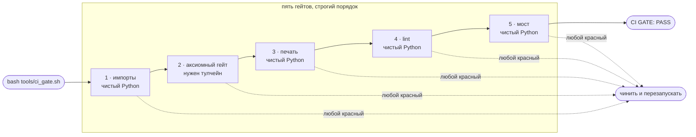

| # | гейт | нужен тулчейн | вердикт (2026-11-26) |
|---|---|---|---|
| 1 | `check_imports.py` — единственный корень, пины | нет | **PASS** |
| 2 | `axioms_gate.py` — полная компиляция + футпринты | **да** | **PASS** (26/26 классических) |
| 3 | `seal_check.py --check` — 62 утверждения запечатаны | нет | **PASS** |
| 4 | `lint_conventions.py` — имена + 100% докстрингов | нет | **PASS** (79/79) |
| 5 | `export_verified_params.py --check` — мост | нет | **PASS** |

Шаг «мост» толерантен к лаборатории, ещё не принявшей параметры (первый прогон без
`--check` создаёт `verified_params.json`).

## 10. Пины воспроизводимости

| пин | значение | кем enforced |
|---|---|---|
| Тулчейн Lean | `leanprover/lean4:v4.6.0` | `lean-toolchain` + гейт 1 |
| Mathlib | git-тег `v4.6.0` (точный, не ветка) | `lakefile.lean` + гейт 1 |
| Слой утверждений | 62 sha256-печати | `seal/manifest.json` + гейт 3 |
| Планка докстрингов | 79/79 = 100% | `seal/docstring_baseline.json` + гейт 4 |
| Футпринт аксиом | `{propext, Classical.choice, Quot.sound}` × 26 | `tools/axioms_gate.py` + гейт 2 |
| Числовые константы | 8 записей, бит-детерминированные | `verified_params.json` + гейт 5 |

Никогда не двигайте пин молча: каждый пин — видимый diff, ревьюируемый как шаг доказательства.

## 11. Хронология версий

| версия | объём |
|---|---|
| **v1.0.1** | §0–§5 написаны; 61 запечатанных утверждений; печати, гейты, доки; аудиторская копия заморожена. Первая компиляция на реальном тулчейне в очереди (TW1.b). |
| **v1.0.2 (этот релиз)** | **TW1.b завершён**: скомпилировано чисто (0 ошибок, 0 sorry), CI 5/5 PASS, печать переиздана на 62 утверждения (+ локальная `sq_neg`), логи-доказательства закоммичены, уборка папки (черновые chk-файлы, сессионные логи и STATE-заметки выбыли — рецепты дистиллированы в `docs/MATHLIB_RECIPES.md`), добавлены галерея и Mermaid-документация. |

## 12. Верификационное созвездие

Этот пакет **standalone-first**: делит с родителем автора, фирменный стиль, пины
тулчейна и дисциплину печати с монорепозиторием
[Trivortex](https://github.com/wild8highlander/Trivortex), но несёт собственный
lake-пакет, каталог печати и числовой мост (`verification/polyvortex/data/`).
Стыковка с родителем — математическая, а не организационная:
`ringOmega_three_eq_lagrange` доказывает, что при `N = 3, R = a/√3` скорость Polyvortex
совпадает с лагранжевым значением родителя `3Γ/(2πa²)` — два артефакта согласованы
на общем объекте ровно там, где перекрываются.

## 13. Как это расширяет родительский файл

| родитель (Trivortex.lean v7.0) | этот файл (Polyvortex.lean v1.0.2) |
|---|---|
| `lagOmega`, утроенные `eqdx/eqdy` для 3 вихрей | `ringOmega γ R N`, один параметрический `kirchhoff` |
| Лагранжево принуждение `lag_omega_unique` (N = 3) | `ringOrbit_sol` для каждого `N ≥ 2`, каждого первообразного корня |
| Гейт H1 аргументирован численно (`ansatz.py`) | `rClosed_pos_iff` + сертификат касания, доказаны |
| Сценарий пульсации C_Ch | запрет леммы C, доказан |
| лестница усреднения | лемма D в замкнутой форме через интеграл Пуассона |
| W4-устойчивость сертифицирована численно | слой утверждений W4 запечатан (TW5 в очереди) |

## 14. Галерея — сертифицированные объекты в движении

Все ассеты сгенерированы matplotlib в фирменной палитре navy-and-gold; анимации —
намеренно *иллюстрации доказанных теорем*, а не художественные впечатления: каждая
формула в подписи — запечатанное в Lean утверждение. Числовые панели (спектр W4)
помечены как иллюстрации запечатанного критерия, точное спектральное доказательство
которого — TW5.

### Теорема A — кори-вращающееся кольцо

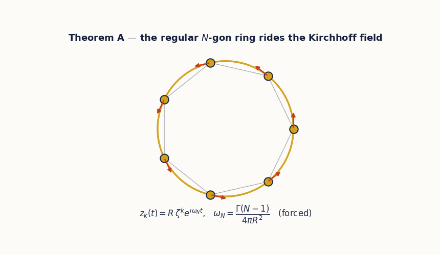

<p align="center"><sub>Правильное N-угольное кольцо (N = 7) переносится полем Кирхгофа как твёрдое вращение:
каждый вектор скорости касателен, <code>|v| = ω_N·R</code>, скорость принуждена <code>ringOrbit_sol</code>.
<i>EN</i> — the regular N-gon rides the Kirchhoff field as a solid rotation; the rate is forced.</sub></p>

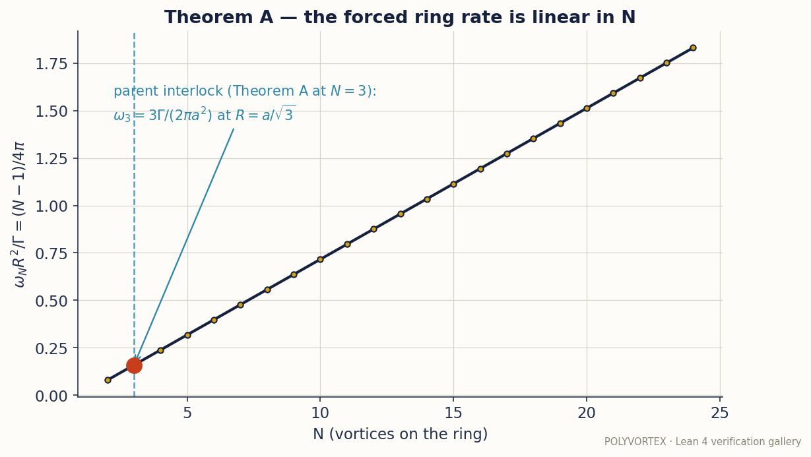

<p align="center"><sub><code>ω_N·R²/Γ = (N−1)/4π</code> линейна по N; красная точка — стыковка с родителем
(N = 3, R = a/√3 → 3Γ/2πa²). <i>EN</i> — the forced ring rate is linear in N; the red point is the parent interlock.</sub></p>

### Теорема B — пульсация на пороге

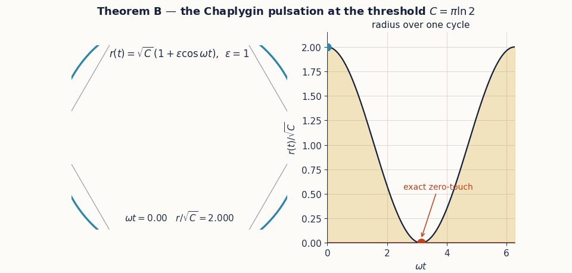

<p align="center"><sub>При <code>C = π·ln 2</code> радиус пульсации <code>√C·(1+cos ωt)</code> остаётся неотрицательным
и ровно раз за цикл касается нуля — машинно-проверенный гейт H1. <i>EN</i> — at <code>C = π·ln 2</code> the
pulsation touches zero exactly once per cycle.</sub></p>

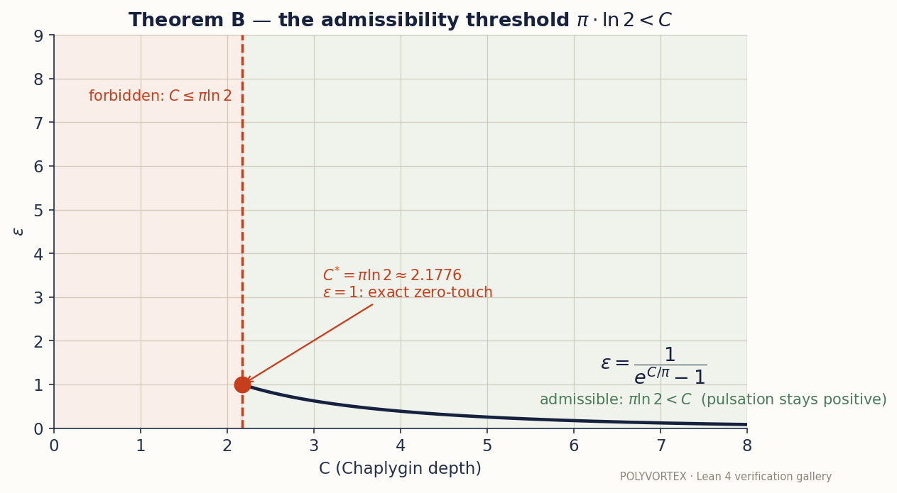

<p align="center"><sub><code>ε(C) = 1/(e^{C/π}−1)</code>: допустимо только при <code>π·ln 2 &lt; C</code> (зелёная
зона), запрещено ниже (красная); стена — доказанная эквивалентность. <i>EN</i> — admissible only above the proven threshold.</sub></p>

### Лемма D — интеграл Пуассона

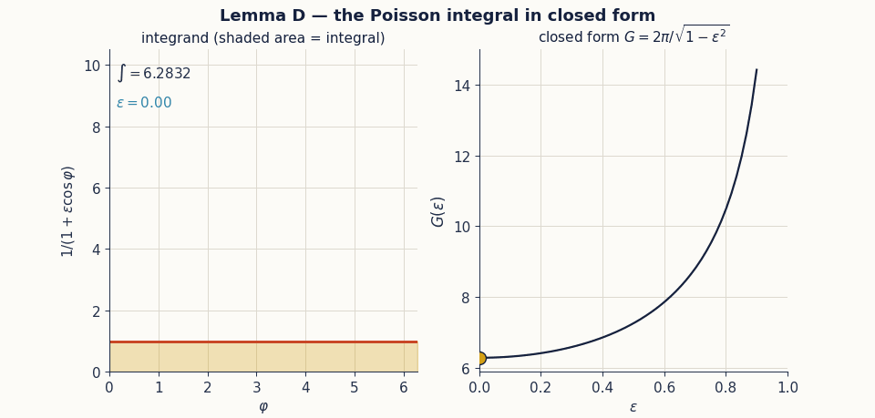

<p align="center"><sub>Интегранд <code>1/(1+ε·cos φ)</code> обостряется с ростом ε; заштрихованная площадь всегда
равна замкнутой форме <code>2π/√(1−ε²)</code>, доказанной без всякой квадратуры. <i>EN</i> — the shaded area
always equals the closed form, proven without quadrature.</sub></p>

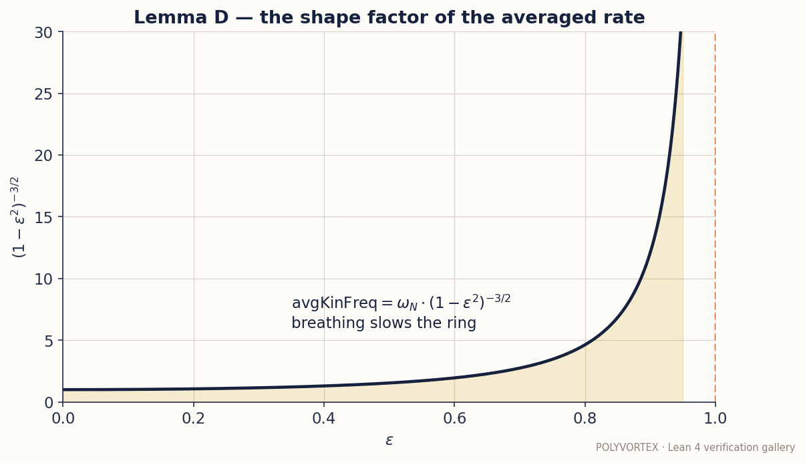

<p align="center"><sub><code>lemmaD_bridge</code>: «дыхание» замедляет эффективную скорость кольца форм-фактором
<code>(1−ε²)^{−3/2}</code>. <i>EN</i> — breathing slows the effective rate by the shape factor.</sub></p>

### Теорема E — граница W4 Хавелока (численная иллюстрация запечатанного критерия)

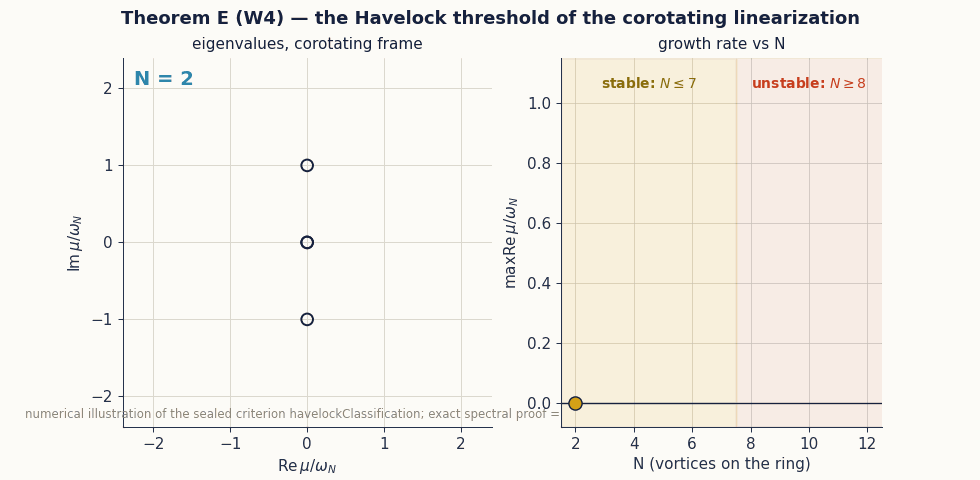

<p align="center"><sub>Собственные числа кори-вращающей линеаризации (численно): всё нейтрально при N ≤ 7,
растущие моды появляются при N ≥ 8 — запечатанный критерий <code>havelockClassification</code>;
точное спектральное доказательство — TW5. <i>EN</i> — all neutral for N ≤ 7, growing modes at N ≥ 8.</sub></p>

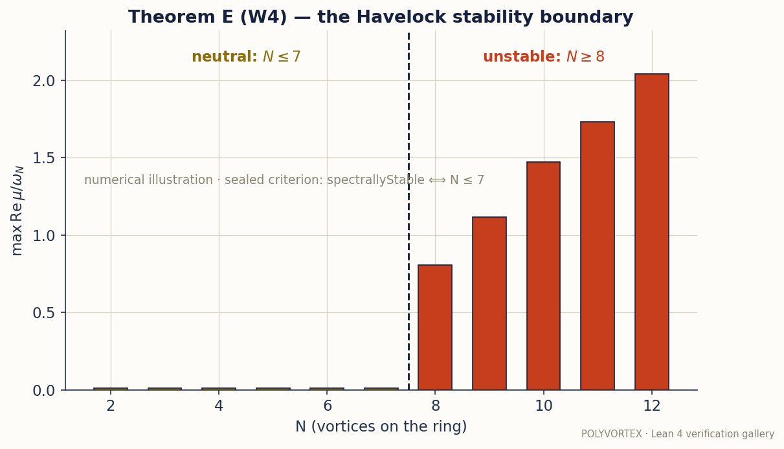

<p align="center"><sub>Максимальная скорость роста (нормированная на ω_N) обнуляется до N = 7 включительно
и монотонно растёт дальше. <i>EN</i> — zero through N = 7, monotone beyond.</sub></p>

### TW1.b — спуск правки доказательств (реальные закоммиченные данные)

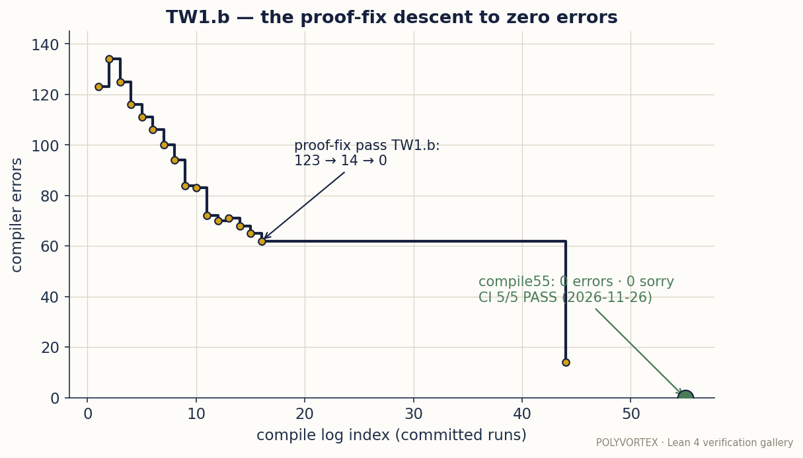

<p align="center"><sub>Число ошибок компилятора по зафиксированным логам прогонов (1–44) и финальный чистый
прогон: 123 → 14 → 0. <i>EN</i> — compiler errors across the committed logs and the final clean run.</sub></p>

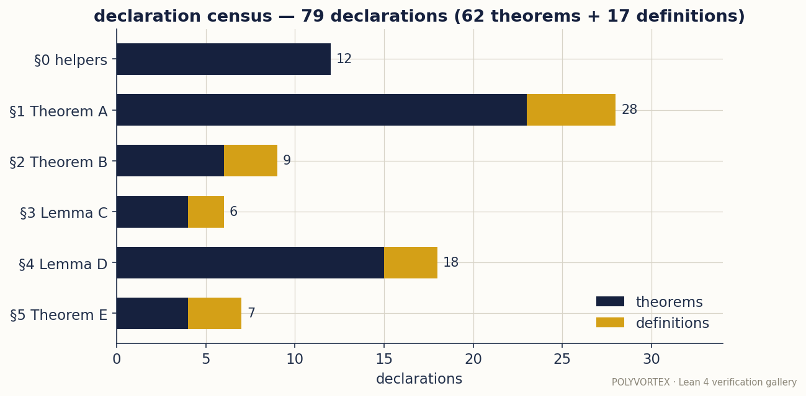

<p align="center"><sub>79 деклараций по секциям: 62 теоремы (navy) + 17 определений (gold), совпадает с гейтом
lint. <i>EN</i> — 79 declarations by section, matching the lint gate.</sub></p>

## 15. Политика чистоты — что коммитится, а что нет

v1.0.2 выбыла всё, что не является несущей конструкцией (папка сжалась с 63 до 36
закоммиченных файлов):

- **Выбыло:** 21 черновой файл `chk*.lean` (их проверенные рецепты дистиллированы в
  [`docs/MATHLIB_RECIPES.md`](docs/MATHLIB_RECIPES.md)); промежуточные логи компиляции
  (`logs/compile1..16.log`, `compile44.log` — спуск сохранён графиком и числами в
  `docs/TW1b_COMPLETION.md`); две сессионные заметки `STATE_*.md` (слиты в отчёт о
  завершении); корневые `axioms_gate.log` / `ci_gate_final.log` (перенесены в
  `docs/evidence/` с датами в имени).
- **Оставлено как доказательства:** два машинных лога финального прохода под
  `docs/evidence/` — единственный лог-вывод, который вообще коммитится.
- **Правило на будущее:** сборочные/черновые/логовые артефакты не попадают в репозиторий;
  коммитимая поверхность — гейты, печать, пара доказательств и доки. Перед любым
  коммитом: `bash tools/ci_gate.sh` обязан быть 5/5.

## 16. FAQ

**Всё ли здесь машинно-проверено?** Да. С 2026-11-26 артефакт компилируется против
реального Mathlib v4.6.0 с 0 ошибок и 0 `sorry`, а футпринты аксиом всех 26 директив —
строго классический набор. Машинный вывод: [`docs/evidence/`](docs/evidence/ci_gate_2026-11-26.log).

**Что здесь НЕ машинно-проверено?** Ровно одно: W4-классификация Хавелока
`havelockClassification` — запечатана как точный `Prop`-критерий, но не доказана.
Родительская монография сертифицирует её численно; спектральное доказательство — веха
TW5. Всё остальное — теоремы A–C, леммы C/D, сертификаты вырождения — доказано полностью.

**Почему `havelockClassification` — `def`, а не `theorem`?** Потому что она не доказана.
Записать недоказанный критерий как теорему потребовал бы `sorry` — запрещено.
Запечатанное `Prop`-определение с явным докстрингом — честная форма: критерий точный,
именованный, готовый к TW5.

**Почему везде деления на `Real.pi` в `ω_N`?** Это математика: парный фактор Кирхгофа
`Γ/(2π)` и хордовая сумма `(N−1)/2` дают её. Никаких нормировочных трюков ради
красивости утверждения не применялось.

**Почему `sum_roots_of_unity` не ветвится по чётности `N`?** Инволюция `m ↦ N−m`
спаривает индекс `m` с `N−2−m`; в неподвижной точке парная лемма
`1/(1−x) + 1/(1−x⁻¹) = 1` вырождается в `1/(1−x) = 1/2` при `x = −1 = ζ^{N/2}`, что
покрывается тем же полевым тождеством. Один случай — все чётности.

**Что содержит аудиторский файл?** Слепок v1.0.1 с аудиторским заголовком (1,439 строк,
61 запечатанных утверждений). На следующем релизе `Polyvortex.lean` растёт, а
`Polyvortex_audit.lean` замораживает уходящий слой — родительская конвенция с рождения.

**Где живут логи компиляции?** Нигде в репозитории — это сессионные артефакты.
Единственный закоммиченный машинный вывод — пара доказательств финального прохода под
`docs/evidence/`; история счётчика ошибок сохранена графиком и таблицей в
`docs/TW1b_COMPLETION.md`.

## 17. Устранение неполадок

- **`lake: command not found`** — установите elan; файл тулчейна сам выберет v4.6.0.
- **`axioms_gate` падает на свежем клоне** — сначала `lake exe cache get`; холодная
  сборка Mathlib занимает часы и никогда не нужна.
- **`seal_check --check` падает после правки теоремы** — вы изменили запечатанное
  утверждение. Просмотрите diff; если изменение задумано, выполните `seal_check --update`
  (видимое действие).
- **`lint_conventions` отвергает имя** — новые декларации обязаны быть snake_case
  (теоремы) / lowerCamelCase (определения); «дедовский список» пуст и остаётся пустым.
- **Мост сообщает о расхождении** — `verified_params.json` не совпал с печатью;
  перезапустите `export_verified_params.py` после ревизии изменений в утверждениях.
- **Mathlib после бампа переименовал лемму** — сначала загляните в
  [`docs/MATHLIB_RECIPES.md`](docs/MATHLIB_RECIPES.md): каждая ловушка API v4.6.0
  (star/starRingEnd, префиксы `Set.`, синтаксис байндеров, цепочки кастов) там
  каталогизирована с рабочим фикс-рецептом.

## 18. Дорожная карта — TW1…TW5

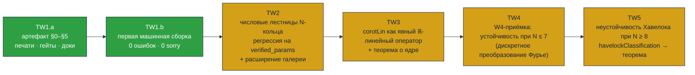

| веха | объём | статус |
|---|---|---|
| **TW1.a** | артефакт §0–§5 написан; печати, гейты, доки | **выполнено (v1.0.1)** |
| **TW1.b** | первая машинная сборка: `lake build` + зелёный `axioms_gate`; проход правки доказательств | **выполнено (v1.0.2, 2026-11-26)** |
| **TW2** | числовые лестницы для `N`-кольца (регрессия на `verified_params.json`), расширение галереи | в очереди |
| **TW3** | `corotLin` как явный ℝ-линейный оператор + теорема о ядре внутри слоя линеаризации | в очереди |
| **TW4** | W4-приёмка: доказательство устойчивости при `N ≤ 7` (дискретное преобразование Фурье) | в очереди |
| **TW5** | неустойчивость Хавелока при `N ≥ 8` → `havelockClassification` становится теоремой | в очереди |

## 19. Участие в проекте

Печати делают вклад ревьюируемым: измени утверждение — гейт 3 красный; опусти докстринг —
гейт 4 красный; перенастрой константу — гейт 5 красный. Каждый красный гейт чинится
*явным* действием обновления (`--update`, `--update-baseline`, переэкспорт моста),
которое само называет себя в diff. Новые декларации — snake_case и с докстрингом с
рождения. Практический цикл задокументирован в [`docs/MCP.md`](docs/MCP.md) (быстрая
итерация LSP/MCP), ловушки тактик v4.6.0 — в
[`docs/MATHLIB_RECIPES.md`](docs/MATHLIB_RECIPES.md). Запускайте `bash tools/ci_gate.sh`
перед каждым коммитом — коммитимая поверхность всегда должна быть 5/5 зелёной.

## 20. Благодарности

- **Автор и сопровождающий:** [Исаев Исхак Хамзатович](https://orcid.org/0009-0003-7299-0701)
  (независимый исследователь) — математика, формализация, инструментарий, документация.
- **Основания:** команда ядра Lean 4 и сообщество Mathlib — за ядро, тактики и
  библиотеку анализа/теории меры, на которых стоит этот артефакт.
- **Родительская программа:** монография Trivortex — аналитический хребет трёх вихрей,
  который этот файл обобщает на произвольное `N`.

## 21. Цитирование, DOI и лицензия

```bibtex
@software{isaev2026polyvortexlean,
  author  = {Исаев, Исхак Хамзатович},
  title   = {Polyvortex Lean 4: машинно-проверенный стенд N-вихревого расширения (v1.0.2)},
  year    = {2026},
  url     = {https://github.com/wild8highlander/Trivortex/tree/main/polyvortex/polyvortex_lean4},
  note    = {Lean 4.6.0 + Mathlib v4.6.0; 62 запечатанных утверждения; 0 sorry; CI 5/5 PASS}
}
```

Проприетарная лицензия **IPL-RP-1.0**
([LICENSE.md](https://github.com/wild8highlander/Trivortex/blob/main/LICENSE.md), переводы
RU/zh в родительском репозитории). Повторное использование атрибутировано по REUSE.toml;
SPDX-заголовки присутствуют в каждом исходном файле.

---

## Приложение A — ценз деклараций

Числа генерируются инструментами (`tools/lint_conventions.py`), совпадают с
[`docs/STATEMENTS.md`](docs/STATEMENTS.md) точно и принуждаются гейтом 4:

| секция | содержание | теоремы | определения | всего |
|---|---|---|---|---|
| §0 | private-хелперы (циклические суммы, star/normSq) | 12 | 0 | **12** |
| §1 | Теорема A — решение-кольцо, принуждено | 23 | 5 | **28** |
| §2 | Теорема B — порог допустимости | 6 | 3 | **9** |
| §3 | Лемма C — запрет пульсации | 4 | 2 | **6** |
| §4 | Лемма D — усреднённая скорость, интеграл Пуассона | 15 | 3 | **18** |
| §5 | Теорема E — кори-вращающий слой, W4-утверждение | 2 | 4 | **6** |
| | **итого** | **62** | **17** | **79** |

- **Запечатанных утверждений:** 62 (sha256 в [`seal/manifest.json`](seal/manifest.json), гейт 3).
- **Футпринтов аксиом:** 26 директив, все `{propext, Classical.choice, Quot.sound}`
  (гейт 2, [машинное доказательство](docs/evidence/axioms_gate_2026-11-26.log)).
- **Докстринги:** 79/79 = 100% (раппорт-гейт 4).
- **Полный API-справочник с докстрингами:** [`docs/DECLARATIONS.md`](docs/DECLARATIONS.md).
