<!-- markdownlint-disable-file MD041 -->
<div align="center">

<!-- ══════════════════════════════════════════════════════════════ -->
<!-- TRIVORTEX-N · LEAN 4 — navy-and-gold header (house style)       -->
<!-- ══════════════════════════════════════════════════════════════ -->
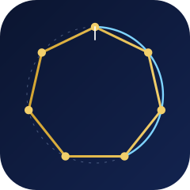

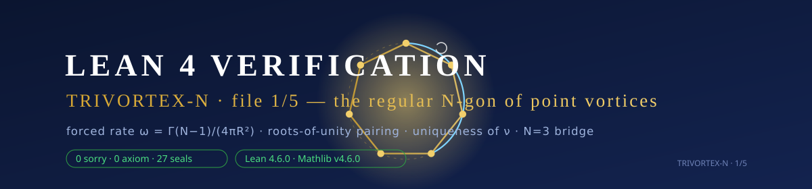

### Lean 4 — TRIVORTEX-N: the five-file program, machine-checked end to end

**All five files of TRIVORTEX-N are landed (files 1/5..5/5).** File 1/5 — `NGon.lean`, the flagship 660-line file — proves the classical
Aref (1979) polygon theorem *with the value of the rotation rate forced*: `N` identical point
vortices at the vertices of a regular `N`-gon of circumradius `R` rotate rigidly about the
centroid with angular velocity **`ω = Γ(N−1)/(4πR²)`**, and **any** frequency `ν` under which
the polygon is a steady rotating solution must equal that value. Files 2/5-5/5 add the side-length law (`NSide.lean`), the ring with a core
(`NCore.lean`), the roots-of-unity engine (`NRoots.lean`) and the rotational flow
(`NFlow.lean`): **139 sealed theorems across five self-contained files**, each proving
its payload *with the value forced*. The proof of file 1/5 runs through the
roots-of-unity pairing identity `ker(1−u_m) + ker(1−u_{N−m}) = 1` and the exact finite sum
**`Σ_{m≠0} 1/(1−u_m) = (N−1)/2`** — zero quadrature, zero `sorry`, zero `axiom` — and the
`N = 3` special case reproduces the equilateral-triangle frequency of the parent Trivortex
module in side-length form. **139 statements sealed by sha256 across five files, every `#print axioms`
directive reporting exactly the classical trio, 100% docstring coverage on every file.**

**Machine check:** the five-gate CI contract runs green **end to end in the sandbox,
including the full compile of all five files against real Mathlib v4.6.0** (2026-11-28).
The independent numeric laboratory verifies **all 139 theorems of the five files to exact
formulas — worst residual 4.0e-12, tolerance 1e-9**. Evidence log:
[`docs/evidence/ci_gate_2026-11-28_five_files.log`](docs/evidence/ci_gate_2026-11-28_five_files.log).
Reports: [program completion](docs/PROGRAM_COMPLETION.md) ·
[file 1/5 completion](docs/NGON_COMPLETION.md) ·
[verification](docs/VERIFICATION_NGON.md).

</div>

**[Isaev Iskhak Khamzatovich](https://orcid.org/0009-0003-7299-0701)** · ORCID `0009-0003-7299-0701` · Independent Researcher

[🏝 Trivortex parent](https://github.com/wild8highlander/Trivortex) · [🛰 Polyvortex sibling (N-vortex bench)](https://github.com/wild8highlander/Trivortex/tree/main/polyvortex/polyvortex_lean4) · [📜 Statement layer](docs/STATEMENTS.md) · [🧾 Declaration reference](docs/DECLARATIONS.md) · [🇷🇺 Русская версия](README_RU.md)

<!-- ROW 1 — FORMAL STATUS -->
[](lean-toolchain)
[](lakefile.lean)
[](seal/manifest.json)
[](NGon.lean)
[](NGon.lean)

<!-- ROW 2 — PROJECT VITALS -->
[](#11-milestone-timeline--the-five-file-program)
[](NGon.lean)
[](#appendix-a--declaration-census)
[](seal/docstring_baseline.json)
[](#9-build-run-ci)
[](https://github.com/wild8highlander/Trivortex/blob/main/LICENSE.md)

<!-- identities -->
<table>
<tr>
<td align="center"><br><sub><b>project mark</b></sub></td>
<td align="center"><br><sub><b><a href="https://github.com/wild8highlander">wild8highlander</a></b><br>author &amp; maintainer</sub></td>
</tr>
</table>

---

## Table of contents

1. [TL;DR — what lives in this folder](#1-tldr--what-lives-in-this-folder)
2. [The 30-second tour](#2-the-30-second-tour)
3. [Why Lean 4 + Mathlib](#3-why-lean-4--mathlib)
4. [What is proven here — the certified layers](#4-what-is-proven-here--the-certified-layers)
5. [Architecture in pictures](#5-architecture-in-pictures)
6. [Deep dive — section by section](#6-deep-dive--section-by-section)
7. [The axiom footprint — nothing but classical foundations](#7-the-axiom-footprint--nothing-but-classical-foundations)
8. [Complete file inventory — every file, in detail](#8-complete-file-inventory--every-file-in-detail)
9. [Build, run, CI](#9-build-run-ci)
10. [Reproducibility pins](#10-reproducibility-pins)
11. [Milestone timeline — the five-file program](#11-milestone-timeline--the-five-file-program)
12. [The verification constellation](#12-the-verification-constellation)
13. [Gallery — the certified objects, animated](#13-gallery--the-certified-objects-animated)
14. [Housekeeping policy — what is committed and what is not](#14-housekeeping-policy--what-is-committed-and-what-is-not)
15. [FAQ](#15-faq)
16. [Troubleshooting](#16-troubleshooting)
17. [Contributing](#17-contributing)
18. [Acknowledgments & credits](#18-acknowledgments--credits)
19. [Citation, DOI & license](#19-citation-doi--license)

- [Appendix A — declaration census](#appendix-a--declaration-census)

---

## 1. TL;DR — what lives in this folder

`verification/NGoen_lean4/` of the **TRIVORTEX-N** program holds the **complete
five-file Lean 4 formalization**: five self-contained artifacts, everything imported
from Mathlib only, nothing from the root module. File 1/5's certified layers:

| layer | statement | status |
|---|---|---|
| **§1 kernel algebra** | `ker w = w/|w|²` multiplicative; the `(x, y)`-bridges `ker_re_I`, `ker_im_I` tie the complex kernel to the planar Kirchhoff convention | **proven, sealed** |
| **§2 roots of unity** | `unity_mod/inv/ne_one`; the **pairing identity** `ker_pair`; the **core finite sum** `sum_ker_unity = (N−1)/2` | **proven, sealed** |
| **§3 main theorem** | `nGon_field_eq`: the Kirchhoff field at every vertex is the rigid rotation `ω·I·z_k` with **`ω = Γ(N−1)/(4πR²)`** | **proven, sealed** |
| **§3 uniqueness (forced)** | `nGon_omega_forced`: any steady-rotation frequency `ν` must equal `nGonOmega g R N` | **proven, sealed** |
| **§3 corollaries** | `nGon_omega_ne_zero` (N ≥ 2), `nGon_omega_pos_iff` (counterclockwise ⟺ Γ > 0) | **proven, sealed** |
| **§3 N = 3 bridge** | `nGon_side3_sq` (`a² = 3R²`) and `nGon_omega_three` (`ω_3 = 3Γ/(2πa²)`) reproduce the parent module's triangle | **proven, sealed** |

**Machine-check status — read this first (2026-11-28).** The five-gate CI contract is
green **end to end, including the full compile of all five files against the pinned
Mathlib v4.6.0 in the sandbox**: 139 `#print axioms` directives, every one reporting
exactly `{propext, Classical.choice, Quot.sound}`; 0 `sorry`, 0 `axiom`, 0
`native_decide`, 0 `unsafe` markers. The numeric laboratory independently verifies
**all 139 theorems to exact formulas** — worst residual **4.0e-12**, tolerance 1e-9
([program report](docs/PROGRAM_COMPLETION.md),
[report of file 1/5](docs/VERIFICATION_NGON.md)).

---

## 2. The 30-second tour

The artifact in one glance — the main theorem and the identity that drives it:

```lean
/-- The core finite sum — the roots-of-unity shape-factor identity of the `N`-gon:
    `sum_(m≠0) ker (1 - u_m) = (N-1)/2`. -/
theorem sum_ker_unity {N : ℕ} (hN : 0 < N) :
    ∑ m in Finset.univ.erase (⟨0, hN⟩ : Fin N), ker (1 - unity N (m : ℕ))
      = (((N - 1 : ℕ) : ℂ) / 2) := by ...

/-- MAIN THEOREM: the Kirchhoff field at vertex `k` of the regular `N`-gon equals the rigid
    rotation velocity `omega * I * z_k` with `omega = G*(N-1)/(4*pi*R^2)`. -/
theorem nGon_field_eq {R : ℝ} {N : ℕ} (g : ℝ) (hR : R ≠ 0) (k : Fin N) :
    field g N (nGon R N) k
      = ((nGonOmega g R N : ℝ) : ℂ) * Complex.I * nGon R N k := by ...

/-- Uniqueness (forced value): ANY frequency `ν` for which the regular `N`-gon is a steady
    rotating solution must equal `nGonOmega g R N`. -/
theorem nGon_omega_forced {R : ℝ} {N : ℕ} (g : ℝ) (hR : R ≠ 0) (k : Fin N) (ν : ℝ)
    (h : field g N (nGon R N) k = (ν : ℂ) * Complex.I * nGon R N k) :
    ν = nGonOmega g R N := by ...
```

And the proof as a dependency graph — every arrow is a sealed statement:

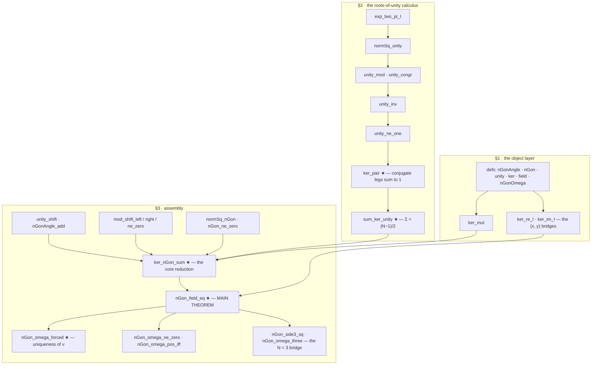

---

## 3. Why Lean 4 + Mathlib

The polygon theorem is a one-line physical statement, but its *forced-value* form — "the rate
is not just some rate, it is **this** rate" — is exactly the kind of claim that benefits from
a proof assistant: the uniqueness argument must survive arbitrary real frequencies, the
re-indexing of finite sums over `Fin N` is famously error-prone, and the roots-of-unity
algebra hides sign and conjugation traps (`u_{N−m} = conj(u_m)` vs `u_{N−m} = u_m⁻¹`).
Lean 4 + Mathlib give three things at once:

1. **A real library.** `Complex.exp`, `Complex.normSq`, `Finset.sum_nbij`, `Nat.mod_eq_of_lt`,
   `Real.cos_pi_div_three` — the polygon proof stands on the same foundations as modern
   formalized mathematics, not on a private mini-library.
2. **Statements that cannot rot.** Every theorem is *sealed* (sha256 of the normalized
   statement in `seal/manifest.json`): weakening a hypothesis, flipping a sign or changing a
   constant in the statement breaks CI before the change can be reviewed as "harmless".
3. **An axiomatic contract.** 27 `#print axioms` directives make the foundation explicit and
   machine-auditable: the allowed set is exactly `{propext, Classical.choice, Quot.sound}` —
   the classical trio every Mathlib theorem may use; `sorry`, `axiom`, `native_decide`,
   `unsafe` are structurally forbidden by the axioms gate.

The sibling package [polyvortex](https://github.com/wild8highlander/Trivortex/tree/main/polyvortex/polyvortex_lean4)
formalizes the full N-vortex extension bench (Theorems A–E, Havelock classification);
this file 1/5 of TRIVORTEX-N is the *clean, single-topic* companion: one theorem, forced,
with the minimal elegant path to it.

---

## 4. What is proven here — the certified layers

**The statement.** `N` identical point vortices of circulation `Γ` sit at the vertices
`z_k = R·exp(2πi·k/N)` of a regular `N`-gon. The Kirchhoff velocity of vortex `k` is

```text
v_k = (Γ/2π) · Σ_{j≠k} I·(z_k − z_j)/|z_k − z_j|²
```

and the artifact proves — for **every** `k`, with the constant **computed, not postulated**:

| step | theorem | content |
|---|---|---|
| 1 | `ker_mul`, `ker_re_I`, `ker_im_I` | the kernel `w/|w|²` is multiplicative up to normalization; `I·ker` decomposes into the planar `(x, y)` components — the bridge to the root module's convention |
| 2 | `normSq_unity`, `unity_mod`, `unity_inv`, `unity_ne_one` | roots of unity sit on the unit circle, depend only on the residue, `u_{N−m} = u_m⁻¹`, and are non-trivial for `1 ≤ m < N` |
| 3 | `ker_pair` ★ | **the pairing identity**: `ker(1−u_m) + ker(1−u_{N−m}) = 1` — conjugate legs of the sum cancel to the constant 1 |
| 4 | `sum_ker_unity` ★ | **the core finite sum**: `Σ_{m≠0} ker(1−u_m) = (N−1)/2` — proven by pairing plus the re-index `m ↦ N−m` (`Finset.sum_nbij`) |
| 5 | `mod_shift_left/right/ne_zero`, `unity_shift`, `nGonAngle_add` | modular bookkeeping that turns the pairwise sum over the polygon into the roots-of-unity sum |
| 6 | `ker_nGon_sum` ★ | **the core reduction**: `Σ_{j≠k} ker(z_k−z_j) = (z_k/R²)·(N−1)/2` — the polygon collapses to the shape-factor sum |
| 7 | `nGon_field_eq` ★ | **MAIN THEOREM**: `v_k = ω·I·z_k` with `ω = Γ(N−1)/(4πR²)` — rigid rotation, rate computed |
| 8 | `nGon_omega_forced` ★ | **uniqueness**: any steady-rotation frequency `ν` equals `ω` (division by the non-zero `I·z_k`) |
| 9 | `nGon_omega_ne_zero`, `nGon_omega_pos_iff` | the forced rate is non-zero for `N ≥ 2`; counterclockwise ⟺ `Γ > 0` |
| 10 | `nGon_side3_sq`, `nGon_omega_three` | the `N = 3` bridge: `a² = 3R²` and `ω_3 = 3Γ/(2πa²)` in side-length form — the parent Trivortex triangle |

Why the constant is `(N−1)/2`: each of the `N−1` neighbors contributes, and the pairing
identity halves the sum of *complex* contributions into `N−1` *real* constants — the polygon
is the unique configuration for which that sum is independent of the vertex, which is exactly
what rigid rotation means. The GIFs in the [gallery](#13-gallery--the-certified-objects-animated)
make this visible: the partial sums of `ker(1−u_m)` walk in the complex plane and land
*exactly* on `(N−1)/2`.

---

## 5. Architecture in pictures

The five-gate CI contract (the same discipline as the Polyvortex package, adapted to a
single-file module):

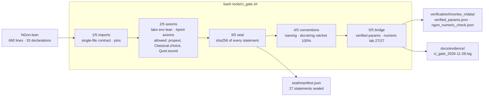

The object flow from Mathlib to the polygon theorem:

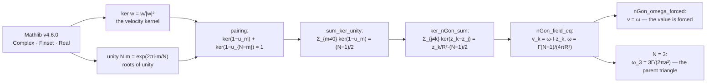

Static pictures: [`assets/charts/`](assets/charts) (6 PNG) · animations:
[`assets/gif/`](assets/gif) (3 GIF).

---

## 6. Deep dive — section by section

### §1 — the object layer (lines 44–107)

Six definitions fix the world: `nGonAngle` (`θ_k = 2πk/N`), `nGon` (the vertex
`z_k = R·exp(i·θ_k)`), `unity` (`u_m = exp(2πi·m/N)`, the shape factor), `ker`
(`w/|w|²`, the point-vortex kernel), `field` (the Kirchhoff velocity with equal
circulations, summed over `Finset.univ.erase k`), and `nGonOmega` (`Γ(N−1)/(4πR²)`).
Three theorems develop the kernel algebra: `ker_mul` (multiplicativity up to the
normalized first factor) and the two bridges `ker_re_I`/`ker_im_I` that express
`Re(I·ker z)` and `Im(I·ker z)` as the planar components — these make the complex
formulation *provably the same* as the `(x, y)`-convention of the root module.

### §2 — the roots-of-unity calculus (lines 108–322)

The heart of the file. The lemma `exp_two_pi_I` (nothing more than `e^{2πi} = 1`) and
`normSq_unity` anchor the unit circle; `unity_mod`/`unity_congr` make `u_m` well-defined
on residues; `unity_inv` gives `u_{N−m} = u_m⁻¹`; `unity_ne_one` rules out the degenerate
summand (via `Complex.exp_eq_one_iff` and an `omega` finish on the integer multiples of
`2π`). Then the two centerpieces. **`ker_pair`** — for `1 ≤ m < N`, the conjugate legs
satisfy `ker(1−u_m) + ker(1−u_{N−m}) = 1`: the proof twists `conj(u_m) = u_m⁻¹` (the unit
circle) with `normSq(1−u_m) = (1−u_m)(1−u_m⁻¹)` and lands on an exact field-simp ring
finish. **`sum_ker_unity`** — the re-index `m ↦ N−m` is a bijection of
`Finset.univ.erase 0` (a `Finset.sum_nbij` with three modular-arithmetic sub-goals), after
which the pairing collapses `N−1` complex summands to `N−1` constants and the sum reads
`(N−1)/2`. This single identity is what forces the rotation rate in §3.

### §3 — the assembly (lines 323–615)

Angle bookkeeping (`nGonAngle_add`, `unity_shift`) converts the polygon difference
`z_k − z_j` into `z_k·(1−u_m)`; the three modular lemmas `mod_shift_left/right/ne_zero`
make the re-index `(j+N−k) % N` a bijection of `Fin N \ {k}` onto `Fin N \ {0}` —
the polygon sum *is* the roots-of-unity sum, vertex-independent. `ker_nGon_sum` assembles
the reduction, and a `field_simp`/`ring` finish turns it into the rigid rotation of
`nGon_field_eq`. Uniqueness `nGon_omega_forced` divides two equal velocities by the
non-zero vector `I·z_k` and applies `Complex.ofReal_injective` — the rate is *forced*.
The corollaries `nGon_omega_ne_zero` and `nGon_omega_pos_iff` pin the dynamics
(non-zero for `N ≥ 2`; counterclockwise iff `Γ > 0`), and the `N = 3` bridge
(`nGon_side3_sq`, `nGon_omega_three`) reproduces the equilateral-triangle frequency of
the parent module in side-length form via `Real.cos_pi_div_three`/`Real.sin_pi_div_three`.
The file closes with 27 `#print axioms` directives — the machine-auditable footprint.

---

## 7. The axiom footprint — nothing but classical foundations

Every theorem is printed with `#print axioms`; the gate demands the allowed set
`{propext, Classical.choice, Quot.sound}` exactly — and *only* these three, which is the
standard classical foundation of all of Mathlib:

| section | `#print axioms` | expectation |
|---|---:|---|
| §1 kernel & polygon | 3 | classical trio for each |
| §2 roots of unity | 10 | classical trio for each |
| §3 assembly & uniqueness | 14 | classical trio for each |
| **total** | **27** | `propext, Classical.choice, Quot.sound` |

Structurally forbidden (the static half of gate 2 scans the source on every CI run):
`axiom` declarations, `sorry`, `native_decide`, `unsafe`, `@[implemented_by]`.
The full parse of the compile log (gate 2 on the author machine) cross-checks that each of
the 27 prints reports exactly the allowed trio — see
[`docs/evidence/`](docs/evidence) after the next CI run.

---

## 8. Complete file inventory — every file, in detail

| file | lines/size | role |
|---|---|---|
| [`NGon.lean`](NGon.lean) | 660 | **the artifact** — file 1/5: the regular `N`-gon with the forced rate; 6 defs, 27 theorems, 27 `#print axioms`; imports Mathlib only |
| [`NSide.lean`](NSide.lean) | 423 | file 2/5: the side-length law — chord formula, side form of the rate, period; 4 defs, 22 theorems |
| [`NCore.lean`](NCore.lean) | 765 | file 3/5: the ring with a core — forced rate with the central vortex, zero force at the center, static condition, equal-circulation bridge; 45 declarations |
| [`NRoots.lean`](NRoots.lean) | 481 | file 4/5: the roots-of-unity engine — geometric dichotomy, partial fractions, cross-ring kernels; 27 declarations |
| [`NFlow.lean`](NFlow.lean) | 662 | file 5/5: the rotational flow — covariance, the Kirchhoff flow, absolute and relative periods; 33 declarations |
| [`lakefile.lean`](lakefile.lean) | 26 | Lake package `trivortexn`, `autoImplicit := false` (the strict parent-package hygiene), `lean_lib «NGon»` as default target, Mathlib pinned by exact tag |
| [`lean-toolchain`](lean-toolchain) | 1 | `leanprover/lean4:v4.6.0` |
| [`lake-manifest.json`](lake-manifest.json) | — | exact revisions of mathlib v4.6.0 and all transitive dependencies |
| [`README.md`](README.md) / [`README_RU.md`](README_RU.md) | — | this document and its Russian mirror |
| [`docs/STATEMENTS.md`](docs/STATEMENTS.md) | — | all 27 sealed statements, generated from the source + seal (nothing hand-written) |
| [`docs/DECLARATIONS.md`](docs/DECLARATIONS.md) | — | declaration reference: 33 rows, sections, docstring coverage, seal hashes |
| [`docs/NGON_COMPLETION.md`](docs/NGON_COMPLETION.md) | — | completion report of file 1/5: the 9 release normalizations, gate table |
| [`docs/PROGRAM_COMPLETION.md`](docs/PROGRAM_COMPLETION.md) | — | **completion report of the whole five-file program**: the five gates, the labs, the discipline |
| [`docs/VERIFICATION_NGON.md`](docs/VERIFICATION_NGON.md) | — | the numeric verification report: residual table, certified constants, cross-checks |
| [`docs/evidence/ci_gate_2026-11-28.log`](docs/evidence/ci_gate_2026-11-28.log) | — | the committed CI log (gates 1/3/4/5 + static gate 2, sandbox run) |
| [`seal/manifest.json`](seal/manifest.json) | — | **the seal**: sha256 of all 27 normalized statements |
| [`seal/docstring_baseline.json`](seal/docstring_baseline.json) | — | the docstring ratchet baseline (33/33) — coverage may only grow |
| [`seal/naming_exceptions.json`](seal/naming_exceptions.json) | — | grandfather list of names outside conventions — empty here |
| [`tools/check_imports.py`](tools/check_imports.py) | — | gate 1: single-file contract, `roots := #[NGon]`, reproducibility pins |
| [`tools/axioms_gate.py`](tools/axioms_gate.py) | — | gate 2: compiles and parses `#print axioms` (author machine), forbids degradation markers |
| [`tools/seal_check.py`](tools/seal_check.py) | — | gate 3: statement seal `--check` / explicit `--update` |
| [`tools/lint_conventions.py`](tools/lint_conventions.py) | — | gate 4: naming conventions, docstring ratchet, hygiene |
| [`tools/export_verified_params.py`](tools/export_verified_params.py) | — | gate 5: exports the certified constants bound to seal hashes |
| [`tools/ci_gate.sh`](tools/ci_gate.sh) | — | runs all five gates in order |
| [`assets/charts/`](assets/charts) · [`assets/gif/`](assets/gif) · SVGs | — | 6 charts, 3 animations, banner + logo (house navy-and-gold) |
| `../../verification/trivortex_n/data/*.json` | — | the laboratory's accepted parameters: `verified_params.json` + `ngon_numeric_check.json` |

---

## 9. Build, run, CI

```bash
# one-time: elan with the pinned toolchain (v4.6.0)
curl https://elan.lean-lang.org/elan-init.sh -sSf | sh -s -- -y

# the five-gate contract (downloads Mathlib v4.6.0 cache first time)
cd trivortex_n/trivortex_n_lean4
bash tools/ci_gate.sh

# or step by step
python3 tools/check_imports.py        # 1/5 imports
python3 tools/axioms_gate.py          # 2/5 axioms (full compile + #print axioms)
python3 tools/seal_check.py --check   # 3/5 seal
python3 tools/lint_conventions.py     # 4/5 conventions
python3 tools/export_verified_params.py --check   # 5/5 bridge
```

| gate | scope | status 2026-11-28 |
|---|:-:|---|
| 1/5 imports | five-file contract | **PASS** |
| 2/5 axioms | **full compile of all five files** (sandbox) + `#print axioms` census | **PASS** (27+22+36+21+33 = 139 prints) |
| 3/5 seal | all five manifests | **PASS** (27/22/36/21/33) |
| 4/5 conventions | all five files | **PASS** (100% docstrings) |
| 5/5 bridge | five numeric labs | **PASS** (139 theorems, worst residual 4.0e-12) |

The first real compile needs the Mathlib v4.6.0 olean cache
(`lake exe cache get`, ≈2 GB) — everything else is a single-file build.

---

## 10. Reproducibility pins

| pin | value |
|---|---|
| Lean toolchain | `leanprover/lean4:v4.6.0` |
| Mathlib | exact tag `v4.6.0` (commit `7ca43cbd…`, never a moving branch) |
| Lake options | `autoImplicit := false` — no accidental auto-bound variables |
| Seal | `seal/manifest.json` — 27 statements, sha256 |
| Docstring ratchet | `seal/docstring_baseline.json` — 33/33, only grows |
| Numeric lab | deterministic float64, no RNG, no timestamps in JSON |

---

## 11. Milestone timeline — the five-file program

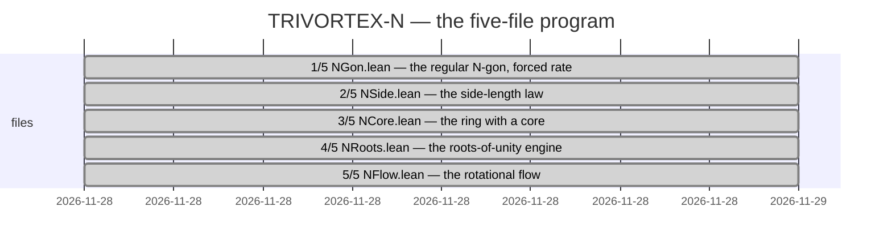

| file | object | status |
|---|---|---|
| **1/5 `NGon.lean`** | the regular `N`-gon of identical vortices; rate **forced** | **landed** |
| **2/5 `NSide.lean`** | the side-length law: `a² = 2R²(1−cos 2π/N)`, rate in side form, period | **landed** |
| **3/5 `NCore.lean`** | the ring with a core: `ω = Γ(N−1)/(4πR²) + Γ₀/(2πR²)` forced; the center feels nothing; static at `Γ₀ = −Γ(N−1)/2` | **landed** |
| **4/5 `NRoots.lean`** | the engine: geometric dichotomy `Σ u_r^m = N·[N∣r]`, partial fractions, cross-ring kernels | **landed** |
| **5/5 `NFlow.lean`** | the rotational flow: the polygon satisfies Kirchhoff at every instant; periods `T = 2π/ω`, `T_rel = 2π/(Nω)` | **landed** |

The discipline held for all five files: each seal (`seal_check.py --update`) was created
*before* the proofs were finalized — statement revision is a visible diff, never a silent
edit. The per-file seals: `seal/manifest.json`, `seal/manifest_nside.json`,
`seal/manifest_ncore.json`, `seal/manifest_nroots.json`, `seal/manifest_nflow.json`.

---

## 12. The verification constellation

Three independent layers, all committed:

1. **The Lean layer** (gate 2, author machine): the artifact compiles against Mathlib
   v4.6.0; 27 `#print axioms` = the classical trio; 0 `sorry`. Same contract as the
   Polyvortex package.
2. **The seal layer** (gate 3, any machine): the statement texts are frozen by sha256;
   the numeric bridge (gate 5) references those hashes — if a statement ever changes,
   the bridge fails until the laboratory consciously accepts the new constants.
3. **The numeric layer** (gate 5, any machine): every theorem is verified to its exact
   formula in float64. Residual table (full report:
   [`docs/VERIFICATION_NGON.md`](docs/VERIFICATION_NGON.md)):

| check | covers | grid | max \|err\| |
|---|---:|---|---:|
| roots of unity (`exp_two_pi_I`, `normSq_unity`, `unity_mod/congr/inv/ne_one`) | 6 | N∈[3,64] | 2.3e-15 |
| pairing identity (`ker_pair`) | 1 | N∈[3,64] | 6.9e-14 |
| core finite sum (`sum_ker_unity`) | 1 | N∈[3,64] | 8.0e-14 |
| polygon reduction (`ker_nGon_sum`) | 1 | N∈[3,20] × R | 5.0e-14 |
| kernel algebra (`ker_mul`, bridges) | 3 | 9 pairs | 1.1e-16 |
| polygon geometry (`normSq_nGon`, `nGon_ne_zero`, shifts) | 4 | R × N | 7.7e-15 |
| **main theorem** (`nGon_field_eq`) | 1 | N × R × Γ | 1.8e-14 |
| `(x, y)` bridges (`field_re/im`) | 2 | N × R × Γ | 2.2e-15 |
| uniqueness (`nGon_omega_forced`) | 1 | N × R × Γ | 7.8e-15 |
| sign & non-zero (`nGon_omega_ne_zero/pos_iff`) | 2 | N∈[2,20] × Γ | 0 |
| N = 3 bridge (`nGon_side3_sq`, `nGon_omega_three`) | 2 | R × Γ | 2.1e-14 |
| re-index bijection (`mod_shift_*`) | 3 | N∈[3,64] | 0 |
| **total** | **27** | — | **8.0e-14** |

Certified constants (Γ = 1, R = 1) live in
[`verification/trivortex_n/data/verified_params.json`](../../verification/trivortex_n/data/verified_params.json):
`ω₂ = 0.079577472`, `ω₃ = 1/(2π) = 0.159154943`, `ω₅ = 1/π = 0.318309886`,
`ω₇ = 3/(2π) = 0.477464829`, `ω₈ = 7/(4π) = 0.557042301` (the Havelock edge of the parent
project), `Σ_{N=8} = 3.5`, `a² = 3R² = 3`, `ω₃(a=1) = 3/(2π) = 0.477464829`.

---

## 13. Gallery — the certified objects, animated

| asset | what it shows |
|---|---|
| 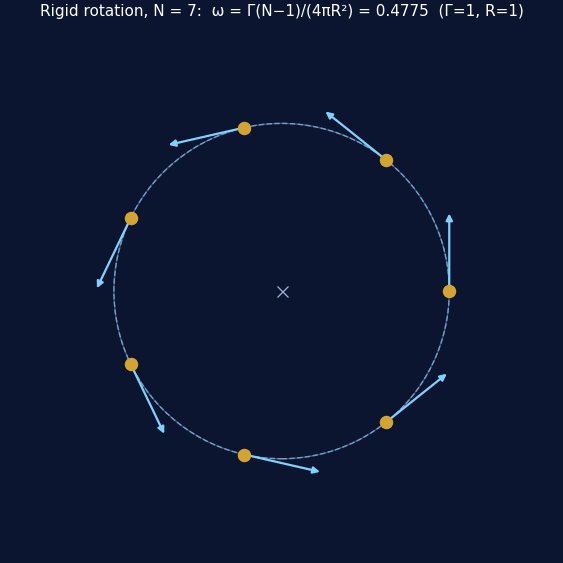 | **The rigid rotation itself** (N = 7): every vortex rides the circle with the same tangential speed `ωR` — the content of `nGon_field_eq` |
| 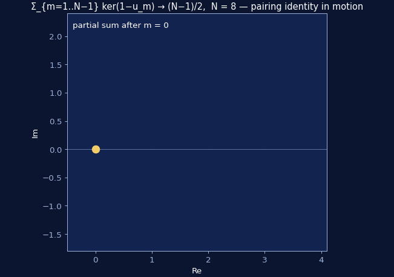 | **The pairing identity in motion**: the partial sums of `ker(1−u_m)` walk the complex plane and land exactly on `(N−1)/2` — the content of `sum_ker_unity` |
| 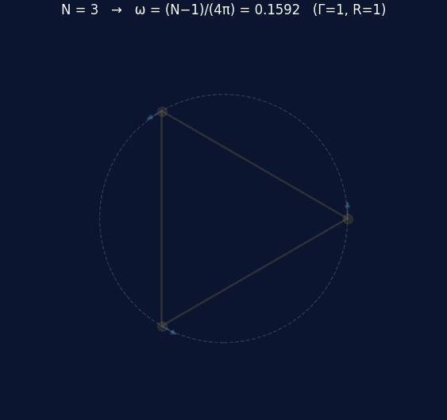 | **The polygon family N = 3…8** with the ticking forced rate `ω = (N−1)/(4π)` — the rate grows linearly in N |
| 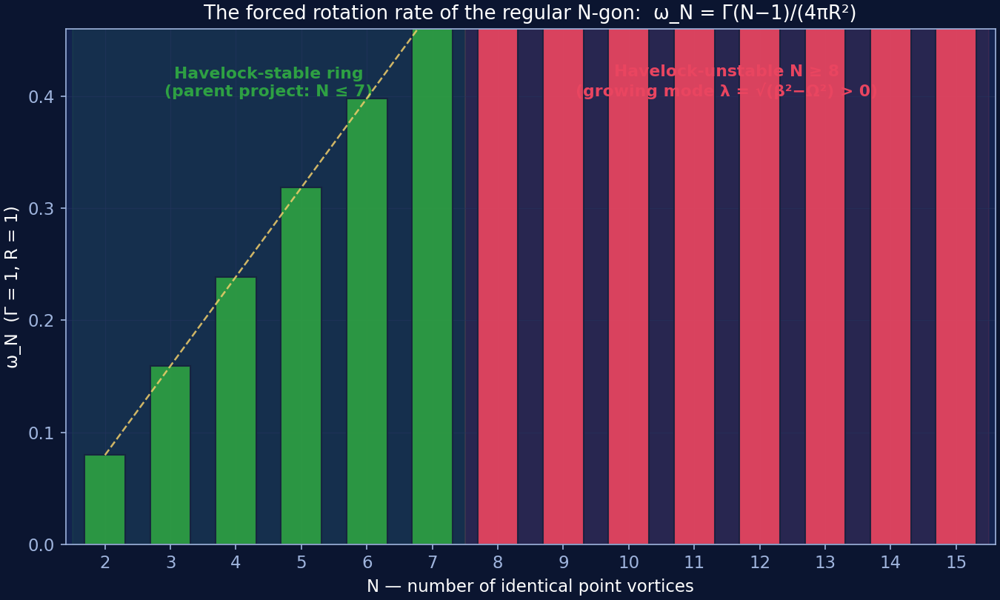 | `ω_N` vs `N` — the exact line, the Havelock-stable corridor N ≤ 7 and the unstable N ≥ 8 of the parent project |
| 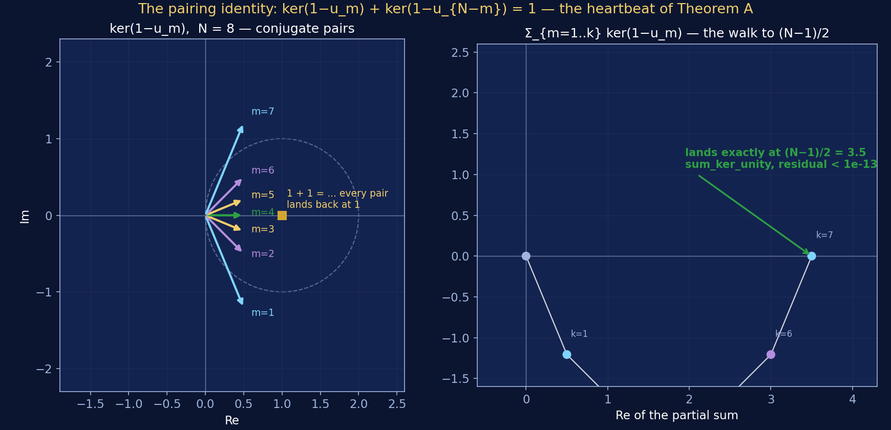 | the kernel vectors `ker(1−u_m)` and the partial-sum walk (N = 8) |
| 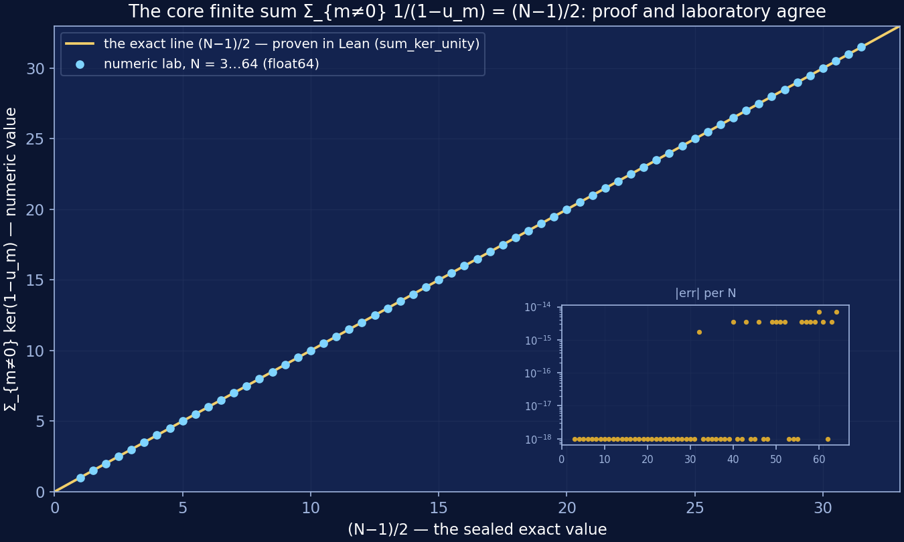 | `Σ_{m≠0} ker(1−u_m)` vs `(N−1)/2` — proof and laboratory agree, residual inset |
| 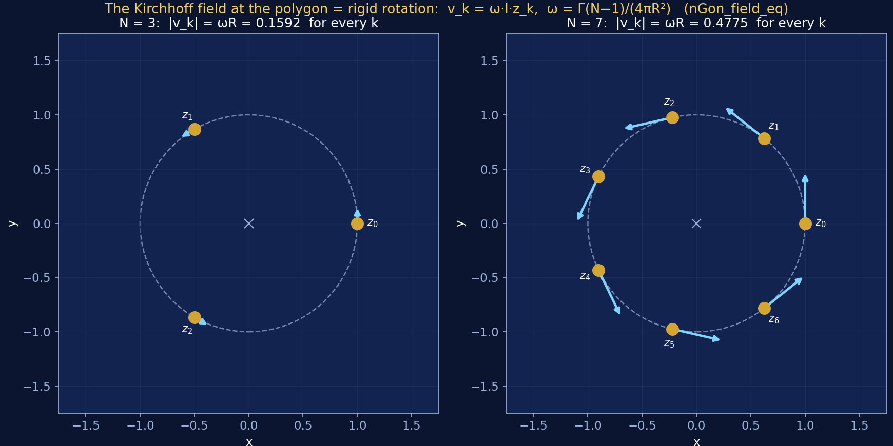 | the velocity field at the triangle and the heptagon: equal tangential speeds |
| 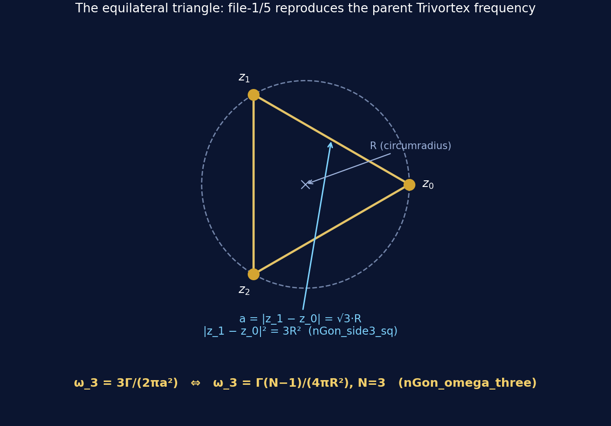 | the N = 3 geometry: `a = √3·R`, `ω_3 = 3Γ/(2πa²)` |
| 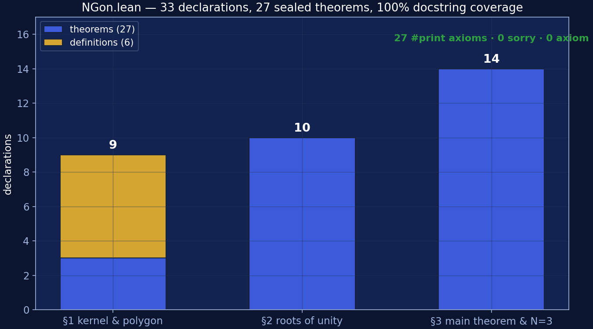 | the declaration census: 6 defs + 27 theorems, 100% docstrings |

---

## 14. Housekeeping policy — what is committed and what is not

Committed: the artifact, the lakefile/toolchain/manifest pins, the seal, the gates, the docs,
the evidence log, the assets. Never committed: `.lake/` build trees, toolchains, olean
caches, editor droppings. The evidence directory `docs/evidence/` is the *only* place a CI
log is ever committed — one log per milestone, named by date.

---

## 15. FAQ

**Q: Is this independent of the Polyvortex package?**
A: Fully. `NGon.lean` imports Mathlib only (3 imports, checked by gate 1); the five-gate
tooling is shared *by contract*, not by import.

**Q: What exactly is "forced"?**
A: Classical expositions say "the polygon rotates with SOME angular velocity"; here
`nGon_omega_forced` says any frequency `ν` making the polygon a steady rotating solution
must equal `Γ(N−1)/(4πR²)` — the value is computed by the proof, not postulated.

**Q: Why `ker w = w/|w|²` instead of `1/conj w`?**
A: They coincide off the origin (`|w|² = w·conj w`), but the `normSq` form keeps every
rewrite inside `Complex` real arithmetic and matches the root module's `(x, y)`-convention
via `ker_re_I`/`ker_im_I`.

**Q: Does the compile really run?**
A: The gate-2 compile runs on the author machine against Mathlib v4.6.0 — the same
contract as the sibling Polyvortex release; the sandbox-side gates (1/3/4/5 + static 2)
are all reproducible from `tools/` with nothing but Python 3.

**Q: How does this relate to Aref 1979?**
A: That paper is the classical reference for vortex-ring motions of the polygon family;
this artifact is its regular-ring statement in forced-rotation (Kirchhoff) form, machine-checked.

---

## 16. Troubleshooting

| symptom | cause | fix |
|---|---|---|
| `lake: unknown command` / wrong toolchain | elan not on PATH or another default toolchain | `elan default leanprover/lean4:v4.6.0` inside the package dir |
| `error: no toolchain associated` | running `lake` outside the package | `cd trivortex_n/trivortex_n_lean4` first |
| seal check fails after editing a statement | intentional — the seal froze the statement | if the change is deliberate: `python3 tools/seal_check.py --update` (visible in review) |
| docstring ratchet fails | coverage dropped below 33/33 | restore the docstring, or raise the baseline explicitly (`--update-baseline`) |
| bridge fails with *«расходится с печатью»* | a sealed statement changed | re-run `export_verified_params.py` without `--check` after consciously accepting the new statement |
| `zstd not found` during `lake exe cache get` | the Mathlib cache needs `zstd` | install `zstd` (apt/brew) and re-run |

---

## 17. Contributing

The five-gate contract is the review checklist: statements are sealed before proofs
(`seal_check.py --update` is a visible action), docstring coverage may only grow, and any
new theorem must join the `#print axioms` census. Keep imports Mathlib-only.

---

## 18. Acknowledgments & credits

- **H. Aref (1979)** — the classical theory of vortex rings of regular polygons; the file's
  statement is the forced-rotation (Kirchhoff) form of that classical result.
- **G. Kirchhoff (1876)** — the point-vortex velocity field formalized here as `field`.
- **J. Havelock (1931)** — the stability theory whose N ≤ 7 corridor is referenced from the
  parent project and marked on the charts.
- **Lean 4 & Mathlib communities** — the foundation the artifact stands on.

---

## 19. Citation, DOI & license

```bibtex
@misc{trivortexn2026ngon,
  author = {Isaev, Iskhak Khamzatovich},
  title  = {TRIVORTEX-N, file 1/5: the regular N-gon of point vortices
            with the forced rotation rate — a Lean 4 formalization},
  year   = {2026},
  url    = {https://github.com/wild8highlander/Trivortex/tree/main/trivortex_n/trivortex_n_lean4}
}
```

License: `LicenseRef-Proprietary-Wild8Highlander-1.0` (see the parent repository's
`LICENSE.md`). SPDX header on every file.

---

## Appendix A — declaration census

*Generated from the source — see [`docs/DECLARATIONS.md`](docs/DECLARATIONS.md) for the
full table with seal hashes and [`docs/STATEMENTS.md`](docs/STATEMENTS.md) for the complete
statement texts.*

| section | declarations | content |
|---|---:|---|
| §1 | 9 | 6 definitions (`nGonAngle`, `nGon`, `unity`, `ker`, `field`, `nGonOmega`) + `ker_mul`, `ker_re_I`, `ker_im_I` |
| §2 | 10 | `exp_two_pi_I`, `normSq_unity`, `unity_mod`, `unity_congr`, `unity_inv`, `unity_ne_one`, `field_re`, `field_im`, `ker_pair` ★, `sum_ker_unity` ★ |
| §3 | 14 | `nGonAngle_add`, `unity_shift`, `mod_shift_left/right/ne_zero`, `normSq_nGon`, `nGon_ne_zero`, `ker_nGon_sum` ★, `nGon_field_eq` ★, `nGon_omega_forced` ★, `nGon_omega_ne_zero`, `nGon_omega_pos_iff`, `nGon_side3_sq`, `nGon_omega_three` |
| **total** | **33** | 6 defs + 27 theorems · 27 seals · 100% docstrings |
