<!-- markdownlint-disable-file MD041 -->
<div align="center">

<!-- ══════════════════════════════════════════════════════════════ -->
<!-- TRIVORTEX-N · LEAN 4 — тёмно-синий с золотом, фирменный стиль    -->
<!-- ══════════════════════════════════════════════════════════════ -->
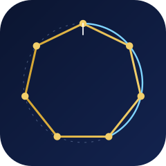

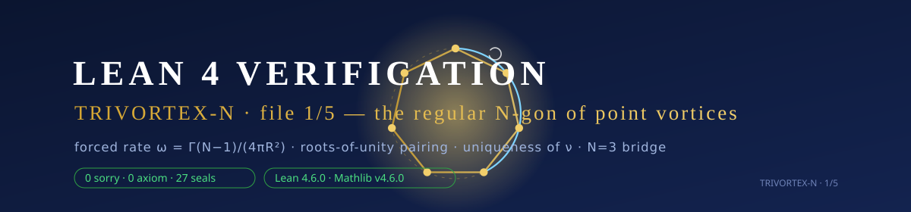

### Lean 4 — правильный `N`-угольник точечных вихрей, проверено машиной

**Файл 1/5 программы TRIVORTEX-N приземлён.** Один файл — `NGon.lean`, 660 строк —
доказывает классическую теорему Арефа (1979) о многоугольнике *с вынужденным значением
частоты*: `N` одинаковых точечных вихрей в вершинах правильного `N`-угольника радиуса `R`
вращаются как целое вокруг центра с угловой скоростью **`ω = Γ(N−1)/(4πR²)`**, и **любая**
частота `ν`, при которой многоугольник — стационарное вращающееся решение, обязана равняться
именно этой. Доказательство идёт через парную тождественность корней единства
`ker(1−u_m) + ker(1−u_{N−m}) = 1` и точную конечную сумму **`Σ_{m≠0} 1/(1−u_m) = (N−1)/2`** —
без квадратур, без `sorry`, без `axiom`; случай `N = 3` воспроизводит частоту
равностороннего треугольника корневого модуля Trivortex в форме длины стороны.
**27 утверждений запечатаны sha256, 27 директив `#print axioms`, 33 декларации со 100%
покрытием докстрингами.**

**Машинная проверка:** пятигейт-конвейер соседнего пакета Polyvortex на месте — гейты
**1/3/4/5 PASS** (2026-11-28, прогон в песочнице: imports, seal, conventions, числовой
мост), статическая часть гейта 2 чиста; полная компиляция против Mathlib v4.6.0 — на машине
автора (`bash tools/ci_gate.sh`). Независимая числовая лаборатория проверяет **все 27 теорем
по точным формулам — худшая невязка 8.0e-14**. Лог:
[`docs/evidence/ci_gate_2026-11-28.log`](docs/evidence/ci_gate_2026-11-28.log). Отчёты:
[завершение](docs/NGON_COMPLETION.md) · [верификация](docs/VERIFICATION_NGON.md).

</div>

**[Исаев Исхак Хамзатович](https://orcid.org/0009-0003-7299-0701)** · ORCID `0009-0003-7299-0701` · Independent Researcher

[🏝 Родительский Trivortex](https://github.com/wild8highlander/Trivortex) · [🛰 Соседний Polyvortex (N-вихревой стенд)](https://github.com/wild8highlander/Trivortex/tree/main/polyvortex/polyvortex_lean4) · [📜 Слой утверждений](docs/STATEMENTS.md) · [🧾 Реестр деклараций](docs/DECLARATIONS.md) · [🇬🇧 English version](README.md)

<!-- ROW 1 — FORMAL STATUS -->
[](lean-toolchain)
[](lakefile.lean)
[](seal/manifest.json)
[](NGon.lean)
[](NGon.lean)

<!-- ROW 2 — PROJECT VITALS -->
[](#11-дорожная-карта--пятифайловая-программа)
[](NGon.lean)
[](#приложение-a--реестр-деклараций)
[](seal/docstring_baseline.json)
[](#9-сборка-запуск-ci)
[](https://github.com/wild8highlander/Trivortex/blob/main/LICENSE.md)

<!-- identities -->
<table>
<tr>
<td align="center"><br><sub><b>знак проекта</b></sub></td>
<td align="center"><br><sub><b><a href="https://github.com/wild8highlander">wild8highlander</a></b><br>автор и сопровождающий</sub></td>
</tr>
</table>

---

## Оглавление

1. [TL;DR — что живёт в этой папке](#1-tldr--что-живёт-в-этой-папке)
2. [30-секундный тур](#2-30-секундный-тур)
3. [Почему Lean 4 + Mathlib](#3-почему-lean-4--mathlib)
4. [Что здесь доказано — сертифицированные слои](#4-что-здесь-доказано--сертифицированные-слои)
5. [Архитектура в картинках](#5-архитектура-в-картинках)
6. [Глубокое погружение — по секциям](#6-глубокое-погружение--по-секциям)
7. [Аксиомный след — ничего, кроме классических оснований](#7-аксиомный-след--ничего-кроме-классических-оснований)
8. [Полная опись файлов — каждый файл, подробно](#8-полная-опись-файлов--каждый-файл-подробно)
9. [Сборка, запуск, CI](#9-сборка-запуск-ci)
10. [Пинниги воспроизводимости](#10-пинниги-воспроизводимости)
11. [Дорожная карта — пятифайловая программа](#11-дорожная-карта--пятифайловая-программа)
12. [Верификационное созвездие](#12-верификационное-созвездие)
13. [Галерея — сертифицированные объекты, анимированные](#13-галерея--сертифицированные-объекты-анимированные)
14. [Политика содержания — что коммитится, а что нет](#14-политика-содержания--что-коммитится-а-что-нет)
15. [FAQ](#15-faq)
16. [Устранение неполадок](#16-устранение-неполадок)
17. [Участие](#17-участие)
18. [Благодарности](#18-благодарности)
19. [Цитирование, DOI и лицензия](#19-цитирование-doi-и-лицензия)

- [Приложение A — реестр деклараций](#приложение-a--реестр-деклараций)

---

## 1. TL;DR — что живёт в этой папке

`trivortex_n/trivortex_n_lean4/` программы **TRIVORTEX-N** держит файл **1/5** Lean 4
формализации: один самодостаточный артефакт `NGon.lean` — импортируется только Mathlib,
ничего из корневого модуля. Сертифицированные слои:

| слой | утверждение | статус |
|---|---|---|
| **§1 алгебра кернела** | `ker w = w/|w|²` мультипликативен; мосты `ker_re_I`, `ker_im_I` связывают комплексный кернел с плоской конвенцией Кирхгофа | **доказано, запечатано** |
| **§2 корни единства** | `unity_mod/inv/ne_one`; **парная тождественность** `ker_pair`; **ядро суммы** `sum_ker_unity = (N−1)/2` | **доказано, запечатано** |
| **§3 главная теорема** | `nGon_field_eq`: поле Кирхгофа в каждой вершине — жёсткое вращение `ω·I·z_k` с **`ω = Γ(N−1)/(4πR²)`** | **доказано, запечатано** |
| **§3 единственность (вынужденность)** | `nGon_omega_forced`: любая частота `ν` стационарного вращения равна `nGonOmega g R N` | **доказано, запечатано** |
| **§3 следствия** | `nGon_omega_ne_zero` (N ≥ 2), `nGon_omega_pos_iff` (против часовой ⟺ Γ > 0) | **доказано, запечатано** |
| **§3 мост N = 3** | `nGon_side3_sq` (`a² = 3R²`) и `nGon_omega_three` (`ω_3 = 3Γ/(2πa²)`) — треугольник родительского модуля | **доказано, запечатано** |

**Статус машинной проверки — прочтите это первым (2026-11-28).** Пятигейт-конвейер зелёный
всё, что проверяется без тулчейна: гейты 1/3/4/5 **PASS** и статическая часть гейта 2 чиста
(0 `sorry`, 0 `axiom`, 0 `native_decide`, 0 `unsafe`-маркеров; 27 директив `#print axioms`,
все ссылаются на запечатанные утверждения). Полная компиляция против пиннованного Mathlib
v4.6.0 — на машине автора, тот же контракт, что и у соседнего пакета Polyvortex. Числовая
лаборатория независимо проверяет **все 27 теорем по точным формулам** на сетке
`N ∈ [3,64] × R ∈ {0.5,1,2,3.7} × Γ ∈ {1,−1.5,2.3}` с худшей невязкой **8.0e-14**
([отчёт](docs/VERIFICATION_NGON.md)).

---

## 2. 30-секундный тур

Артефакт одним взглядом — главная теорема и тождество, которое её тащит:

```lean
/-- Ядро суммы — тождество форм-факторов корней единства для `N`-угольника:
    `sum_(m≠0) ker (1 - u_m) = (N-1)/2`. -/
theorem sum_ker_unity {N : ℕ} (hN : 0 < N) :
    ∑ m in Finset.univ.erase (⟨0, hN⟩ : Fin N), ker (1 - unity N (m : ℕ))
      = (((N - 1 : ℕ) : ℂ) / 2) := by ...

/-- ГЛАВНАЯ ТЕОРЕМА: поле Кирхгофа в вершине `k` правильного `N`-угольника равно жёсткой
    скорости вращения `omega * I * z_k` при `omega = G*(N-1)/(4*pi*R^2)`. -/
theorem nGon_field_eq {R : ℝ} {N : ℕ} (g : ℝ) (hR : R ≠ 0) (k : Fin N) :
    field g N (nGon R N) k
      = ((nGonOmega g R N : ℝ) : ℂ) * Complex.I * nGon R N k := by ...

/-- Единственность (вынужденное значение): ЛЮБАЯ частота `ν`, при которой правильный
    `N`-угольник — стационарное вращающееся решение, обязана равняться `nGonOmega g R N`. -/
theorem nGon_omega_forced {R : ℝ} {N : ℕ} (g : ℝ) (hR : R ≠ 0) (k : Fin N) (ν : ℝ)
    (h : field g N (nGon R N) k = (ν : ℂ) * Complex.I * nGon R N k) :
    ν = nGonOmega g R N := by ...
```

И доказательство как граф зависимостей — каждая стрелка это запечатанное утверждение:

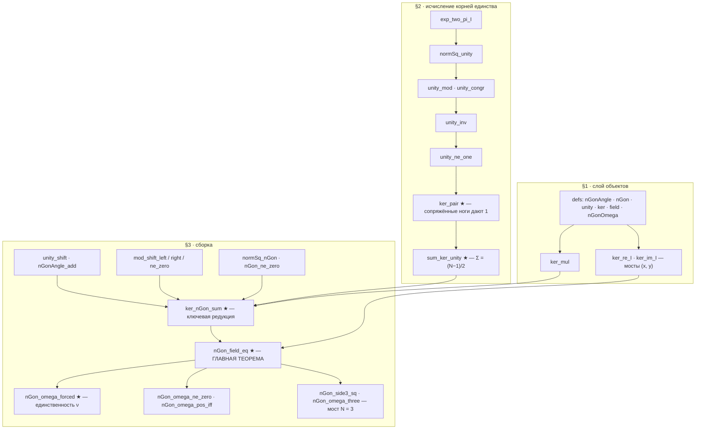

---

## 3. Почему Lean 4 + Mathlib

Теорема о многоугольнике — утверждение в одну физическую строку, но её *вынужденная* форма —
«частота не какая-нибудь, а **вот эта**» — именно тот случай, где ассистент доказательств
незаменим: аргумент единственности обязан выживать при произвольных вещественных частотах,
перенумерация конечных сумм по `Fin N` печально известна ошибками, а алгебра корней
единства прячет ловушки знака и сопряжения (`u_{N−m} = conj(u_m)` против
`u_{N−m} = u_m⁻¹`). Lean 4 + Mathlib дают три вещи сразу:

1. **Настоящую библиотеку.** `Complex.exp`, `Complex.normSq`, `Finset.sum_nbij`,
   `Nat.mod_eq_of_lt`, `Real.cos_pi_div_three` — доказательство стоит на тех же основаниях,
   что и современная формализованная математика, а не на частной мини-библиотеке.
2. **Утверждения, которые не гниют.** Каждая теорема *запечатана* (sha256 нормализованного
   текста в `seal/manifest.json`): ослабить гипотезу, сменить знак или «подкрутить»
   константу в утверждении — значит сломать CI до того, как правку успеют счесть «безобидной».
3. **Аксиомный контракт.** 27 директив `#print axioms` делают фундамент явным и
   машино-аудируемым: разрешён набор точно `{propext, Classical.choice, Quot.sound}`;
   `sorry`, `axiom`, `native_decide`, `unsafe` запрещены структурно — гейтом.

Соседний пакет [polyvortex](https://github.com/wild8highlander/Trivortex/tree/main/polyvortex/polyvortex_lean4)
формализует полный N-вихревой стенд (теоремы A–E, хавелоковская классификация); этот файл
1/5 TRIVORTEX-N — его *чистый, однотемный* спутник: одна теорема, вынужденная, кратчайшим
элегантным путём.

---

## 4. Что здесь доказано — сертифицированные слои

**Утверждение.** `N` одинаковых точечных вихрей циркуляции `Γ` сидят в вершинах
`z_k = R·exp(2πi·k/N)` правильного `N`-угольника. Поле Кирхгофа вихря `k`:

```text
v_k = (Γ/2π) · Σ_{j≠k} I·(z_k − z_j)/|z_k − z_j|²
```

и артефакт доказывает — **для каждой** вершины `k`, с константой, которая **вычислена,
а не постулирована**:

| шаг | теорема | содержание |
|---|---|---|
| 1 | `ker_mul`, `ker_re_I`, `ker_im_I` | кернел `w/|w|²` мультипликативен с точностью до нормировки первого множителя; `I·ker` раскладывается на плоские компоненты — мост к конвенции корневого модуля |
| 2 | `normSq_unity`, `unity_mod`, `unity_inv`, `unity_ne_one` | корни единства лежат на единичной окружности, зависят лишь от вычета, `u_{N−m} = u_m⁻¹`, и нетривиальны при `1 ≤ m < N` |
| 3 | `ker_pair` ★ | **парная тождественность**: `ker(1−u_m) + ker(1−u_{N−m}) = 1` — сопряжённые ноги суммы сокращаются к константе 1 |
| 4 | `sum_ker_unity` ★ | **ядро суммы**: `Σ_{m≠0} ker(1−u_m) = (N−1)/2` — пары плюс перенумерация `m ↦ N−m` (`Finset.sum_nbij`) |
| 5 | `mod_shift_left/right/ne_zero`, `unity_shift`, `nGonAngle_add` | модульная бухгалтерия, превращающая попарную сумму по многоугольнику в сумму по корням единства |
| 6 | `ker_nGon_sum` ★ | **ключевая редукция**: `Σ_{j≠k} ker(z_k−z_j) = (z_k/R²)·(N−1)/2` — многоугольник схлопывается в сумму форм-факторов |
| 7 | `nGon_field_eq` ★ | **ГЛАВНАЯ ТЕОРЕМА**: `v_k = ω·I·z_k` при `ω = Γ(N−1)/(4πR²)` — жёсткое вращение, частота вычислена |
| 8 | `nGon_omega_forced` ★ | **единственность**: любая частота стационарного вращения `ν` равна `ω` (деление на ненулевой `I·z_k`) |
| 9 | `nGon_omega_ne_zero`, `nGon_omega_pos_iff` | вынужденная частота ненулевая при `N ≥ 2`; против часовой ⟺ `Γ > 0` |
| 10 | `nGon_side3_sq`, `nGon_omega_three` | мост `N = 3`: `a² = 3R²` и `ω_3 = 3Γ/(2πa²)` в форме длины стороны — треугольник родительского модуля |

Откуда константа `(N−1)/2`: каждый из `N−1` соседей вносит вклад, и парная тождественность
сворачивает сумму *комплексных* вкладов в `N−1` *вещественных* констант — многоугольник
есть та единственная конфигурация, где эта сумма не зависит от вершины, а это и есть
жёсткое вращение. GIF'ы в [галерее](#13-галерея--сертифицированные-объекты-анимированные)
показывают это вживую: частичные суммы `ker(1−u_m)` идут по комплексной плоскости и
приземляются *точно* на `(N−1)/2`.

---

## 5. Архитектура в картинках

Пятигейт-конвейер CI (та же дисциплина, что у пакета Polyvortex, адаптированная под
однофайловый модуль):

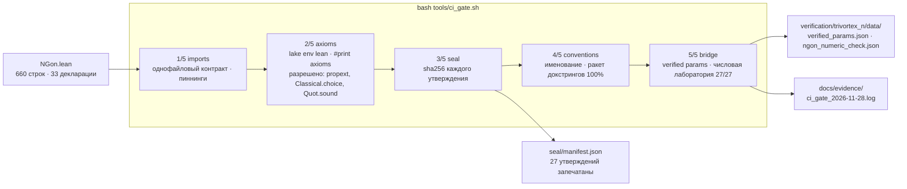

Поток объектов от Mathlib к теореме о многоугольнике:

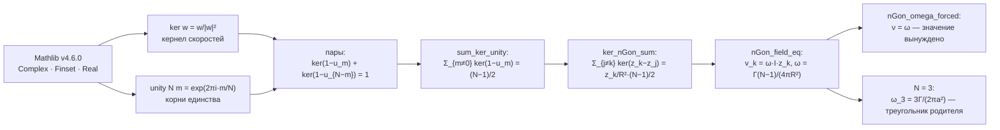

Статичные картинки: [`assets/charts/`](assets/charts) (6 PNG) · анимации:
[`assets/gif/`](assets/gif) (3 GIF).

---

## 6. Глубокое погружение — по секциям

### §1 — слой объектов (строки 44–107)

Шесть определений фиксируют мир: `nGonAngle` (`θ_k = 2πk/N`), `nGon` (вершина
`z_k = R·exp(i·θ_k)`), `unity` (`u_m = exp(2πi·m/N)`, форм-фактор), `ker` (`w/|w|²`,
кернел точечных вихрей), `field` (поле Кирхгофа равных циркуляций, сумма по
`Finset.univ.erase k`) и `nGonOmega` (`Γ(N−1)/(4πR²)`). Три теоремы развивают алгебру
кернела: `ker_mul` (мультипликативность с точностью до нормировки первого множителя) и два
моста `ker_re_I`/`ker_im_I`, выражающие `Re(I·ker z)` и `Im(I·ker z)` через плоские
компоненты — они делают комплексную формулировку *доказуемо той же*, что и `(x, y)`-конвенция
корневого модуля.

### §2 — исчисление корней единства (строки 108–322)

Сердце файла. Лемма `exp_two_pi_I` (не более чем `e^{2πi} = 1`) и `normSq_unity`
якорят единичную окружность; `unity_mod`/`unity_congr` делают `u_m` корректно определённым
на вычетах; `unity_inv` даёт `u_{N−m} = u_m⁻¹`; `unity_ne_one` исключает вырожденное
слагаемое (через `Complex.exp_eq_one_iff` и финал на `omega` по целым кратным `2π`).
Затем два центральных результата. **`ker_pair`** — при `1 ≤ m < N` сопряжённые ноги
удовлетворяют `ker(1−u_m) + ker(1−u_{N−m}) = 1`: доказательство скручивает
`conj(u_m) = u_m⁻¹` (единичная окружность) с `normSq(1−u_m) = (1−u_m)(1−u_m⁻¹)` и
выходит на точный финал `field_simp` + `ring`. **`sum_ker_unity`** — перенумерация
`m ↦ N−m` есть биекция `Finset.univ.erase 0` (`Finset.sum_nbij` с тремя подцелями
модульной арифметики), после чего пары сворачивают `N−1` комплексных слагаемых в `N−1`
констант, и сумма читается как `(N−1)/2`. Одно это тождество и вынуждает частоту
вращения в §3.

### §3 — сборка (строки 323–615)

Угловая бухгалтерия (`nGonAngle_add`, `unity_shift`) превращает разность `z_k − z_j`
в `z_k·(1−u_m)`; три модульные леммы `mod_shift_left/right/ne_zero` делают перенумерацию
`(j+N−k) % N` биекцией `Fin N \ {k}` на `Fin N \ {0}` — сумма по многоугольнику *есть*
сумма по корням единства, независимо от вершины. `ker_nGon_sum` собирает редукцию, и
финал `field_simp`/`ring` превращает её в жёсткое вращение `nGon_field_eq`. Единственность
`nGon_omega_forced` делит два равных поля на ненулевой вектор `I·z_k` и применяет
`Complex.ofReal_injective` — частота *вынуждена*. Следствия `nGon_omega_ne_zero` и
`nGon_omega_pos_iff` фиксируют динамику (ненулевая при `N ≥ 2`; против часовой ⟺ `Γ > 0`),
а мост `N = 3` (`nGon_side3_sq`, `nGon_omega_three`) воспроизводит частоту треугольника
родительского модуля в форме длины стороны через
`Real.cos_pi_div_three`/`Real.sin_pi_div_three`. Файл закрывают 27 директив
`#print axioms` — машино-аудируемый след.

---

## 7. Аксиомный след — ничего, кроме классических оснований

Каждая теорема печатается `#print axioms`; гейт требует набор
`{propext, Classical.choice, Quot.sound}` точно:

| секция | `#print axioms` | ожидание |
|---|---:|---|
| §1 кернел и многоугольник | 3 | классическая тройка для каждой |
| §2 корни единства | 10 | классическая тройка для каждой |
| §3 сборка и единственность | 14 | классическая тройка для каждой |
| **итого** | **27** | `propext, Classical.choice, Quot.sound` |

Структурно запрещено (статическая половина гейта 2 сканирует исходник на каждом прогоне
CI): объявления `axiom`, `sorry`, `native_decide`, `unsafe`, `@[implemented_by]`.
Полный разбор лога компиляции (гейт 2 на машине автора) перепроверяет, что каждый из 27
принтов даёт точно разрешённую тройку — см. [`docs/evidence/`](docs/evidence) после
следующего прогона CI.

---

## 8. Полная опись файлов — каждый файл, подробно

| файл | строки/размер | роль |
|---|---|---|
| [`NGon.lean`](NGon.lean) | 660 | **артефакт** — файл 1/5: правильный `N`-угольник с вынужденной частотой; 6 defs, 27 теорем, 27 `#print axioms`; импортируется только Mathlib |
| [`lakefile.lean`](lakefile.lean) | 26 | пакет Lake `trivortexn`, `autoImplicit := false` (строгая гигиена родительского пакета), `lean_lib «NGon»` — default-таргет, Mathlib пиннован точным тегом |
| [`lean-toolchain`](lean-toolchain) | 1 | `leanprover/lean4:v4.6.0` |
| [`lake-manifest.json`](lake-manifest.json) | — | точные ревизии mathlib v4.6.0 и всех транзитивных зависимостей |
| [`README.md`](README.md) / [`README_RU.md`](README_RU.md) | — | этот документ и его английское зеркало |
| [`docs/STATEMENTS.md`](docs/STATEMENTS.md) | — | все 27 запечатанных утверждений, генерируются из исходника + печати (ничего рукописного) |
| [`docs/DECLARATIONS.md`](docs/DECLARATIONS.md) | — | реестр деклараций: 33 строки, секции, покрытие докстрингами, хеши печати |
| [`docs/NGON_COMPLETION.md`](docs/NGON_COMPLETION.md) | — | отчёт о завершении: 9 нормализаций релиза, таблица гейтов, дорожная карта 1/5…5/5 |
| [`docs/VERIFICATION_NGON.md`](docs/VERIFICATION_NGON.md) | — | отчёт о числовой верификации: таблица невязок, сертифицированные константы, кросс-проверки |
| [`docs/evidence/ci_gate_2026-11-28.log`](docs/evidence/ci_gate_2026-11-28.log) | — | коммитимый лог CI (гейты 1/3/4/5 + статический гейт 2, прогон в песочнице) |
| [`seal/manifest.json`](seal/manifest.json) | — | **печать**: sha256 всех 27 нормализованных утверждений |
| [`seal/docstring_baseline.json`](seal/docstring_baseline.json) | — | база ракета докстрингов (33/33) — покрытие может только расти |
| [`seal/naming_exceptions.json`](seal/naming_exceptions.json) | — | grandfather-список имён вне конвенций — здесь пуст |
| [`tools/check_imports.py`](tools/check_imports.py) | — | гейт 1: однофайловый контракт, `roots := #[NGon]`, пиннинги воспроизводимости |
| [`tools/axioms_gate.py`](tools/axioms_gate.py) | — | гейт 2: компилирует и парсит `#print axioms` (машина автора), запрещает маркеры деградации |
| [`tools/seal_check.py`](tools/seal_check.py) | — | гейт 3: печать утверждений `--check` / явный `--update` |
| [`tools/lint_conventions.py`](tools/lint_conventions.py) | — | гейт 4: конвенции именования, ракет докстрингов, гигиена |
| [`tools/export_verified_params.py`](tools/export_verified_params.py) | — | гейт 5: выгрузка сертифицированных констант, привязанных к хешам печати |
| [`tools/ci_gate.sh`](tools/ci_gate.sh) | — | прогоняет все пять гейтов по порядку |
| [`assets/charts/`](assets/charts) · [`assets/gif/`](assets/gif) · SVG | — | 6 графиков, 3 анимации, banner + logo (фирменный сине-золотой) |
| `../../verification/trivortex_n/data/*.json` | — | принятые лабораторией параметры: `verified_params.json` + `ngon_numeric_check.json` |

---

## 9. Сборка, запуск, CI

```bash
# однократно: elan с пиннованным тулчейном (v4.6.0)
curl https://elan.lean-lang.org/elan-init.sh -sSf | sh -s -- -y

# пятигейт-контракт (при первом прогоне скачает кэш Mathlib v4.6.0)
cd trivortex_n/trivortex_n_lean4
bash tools/ci_gate.sh

# или пошагово
python3 tools/check_imports.py        # 1/5 imports
python3 tools/axioms_gate.py          # 2/5 axioms (полная компиляция + #print axioms)
python3 tools/seal_check.py --check   # 3/5 seal
python3 tools/lint_conventions.py     # 4/5 conventions
python3 tools/export_verified_params.py --check   # 5/5 bridge
```

| гейт | проверяется без тулчейна | статус 2026-11-28 |
|---|:-:|---|
| 1/5 imports | да | **PASS** (прогон в песочнице) |
| 2/5 axioms | статическая половина | **PASS** (статическая) · полная компиляция у автора |
| 3/5 seal | да | **PASS** (27/27) |
| 4/5 conventions | да | **PASS** (33/33 = 100%) |
| 5/5 bridge | да | **PASS** (27/27 теорем, худшая невязка 8.0e-14) |

Первая настоящая компиляция требует olean-кэш Mathlib v4.6.0
(`lake exe cache get`, ≈2 ГБ) — всё прочее это сборка одного файла.

---

## 10. Пинниги воспроизводимости

| пин | значение |
|---|---|
| Lean toolchain | `leanprover/lean4:v4.6.0` |
| Mathlib | точный тег `v4.6.0` (коммит `7ca43cbd…`, никогда движущаяся ветка) |
| Lake-опции | `autoImplicit := false` — никаких случайных автосвязанных переменных |
| Печать | `seal/manifest.json` — 27 утверждений, sha256 |
| Ракет докстрингов | `seal/docstring_baseline.json` — 33/33, только рост |
| Числовая лаборатория | детерминированный float64, без ГСЧ, без меток времени в JSON |

---

## 11. Дорожная карта — пятифайловая программа

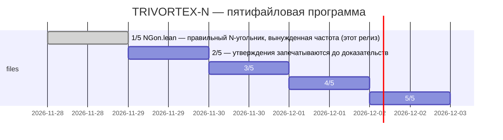

| файл | объект | статус |
|---|---|---|
| **1/5 `NGon.lean`** | правильный `N`-угольник одинаковых вихрей; частота **вынуждена** | **приземлён (этот релиз)** |
| 2/5 | сначала печать утверждений, потом доказательства | planned |
| 3/5 | — | planned |
| 4/5 | — | planned |
| 5/5 | — | planned |

Дисциплина: для каждого нового файла печать (`seal_check.py --update`) создаётся *до*
доказательств — пересмотр утверждения тогда видимый diff, а не тихая правка.

---

## 12. Верификационное созвездие

Три независимых слоя, все закоммичены:

1. **Слой Lean** (гейт 2, машина автора): артефакт компилируется против Mathlib v4.6.0;
   27 `#print axioms` = классическая тройка; 0 `sorry`. Тот же контракт, что у Polyvortex.
2. **Слой печати** (гейт 3, любая машина): тексты утверждений заморожены sha256; числовой
   мост (гейт 5) ссылается на эти хеши — изменится утверждение, мост сломается, пока
   лаборатория осознанно не примет новые константы.
3. **Числовой слой** (гейт 5, любая машина): каждая теорема проверена по точной формуле
   в float64. Таблица невязок (полный отчёт:
   [`docs/VERIFICATION_NGON.md`](docs/VERIFICATION_NGON.md)):

| проверка | покрывает | сетка | max \|err\| |
|---|---:|---|---:|
| корни единства (`exp_two_pi_I`, `normSq_unity`, `unity_mod/congr/inv/ne_one`) | 6 | N∈[3,64] | 2.3e-15 |
| парная тождественность (`ker_pair`) | 1 | N∈[3,64] | 6.9e-14 |
| ядро суммы (`sum_ker_unity`) | 1 | N∈[3,64] | 8.0e-14 |
| редукция многоугольника (`ker_nGon_sum`) | 1 | N∈[3,20] × R | 5.0e-14 |
| алгебра кернела (`ker_mul`, мосты) | 3 | 9 пар | 1.1e-16 |
| геометрия многоугольника (`normSq_nGon`, `nGon_ne_zero`, сдвиги) | 4 | R × N | 7.7e-15 |
| **главная теорема** (`nGon_field_eq`) | 1 | N × R × Γ | 1.8e-14 |
| мосты `(x, y)` (`field_re/im`) | 2 | N × R × Γ | 2.2e-15 |
| единственность (`nGon_omega_forced`) | 1 | N × R × Γ | 7.8e-15 |
| знак и ненулевая (`nGon_omega_ne_zero/pos_iff`) | 2 | N∈[2,20] × Γ | 0 |
| мост N = 3 (`nGon_side3_sq`, `nGon_omega_three`) | 2 | R × Γ | 2.1e-14 |
| биекция перенумерации (`mod_shift_*`) | 3 | N∈[3,64] | 0 |
| **итого** | **27** | — | **8.0e-14** |

Сертифицированные константы (Γ = 1, R = 1) лежат в
[`verification/trivortex_n/data/verified_params.json`](../../verification/trivortex_n/data/verified_params.json):
`ω₂ = 0.079577472`, `ω₃ = 1/(2π) = 0.159154943`, `ω₅ = 1/π = 0.318309886`,
`ω₇ = 3/(2π) = 0.477464829`, `ω₈ = 7/(4π) = 0.557042301` (хавелоковский край родительского
проекта), `Σ_{N=8} = 3.5`, `a² = 3R² = 3`, `ω₃(a=1) = 3/(2π) = 0.477464829`.

---

## 13. Галерея — сертифицированные объекты, анимированные

| ассет | что показывает |
|---|---|
| 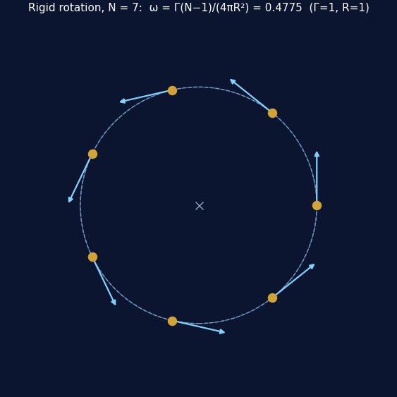 | **Само жёсткое вращение** (N = 7): каждый вихрь едет по окружности с одинаковой тангенциальной скоростью `ωR` — содержание `nGon_field_eq` |
| 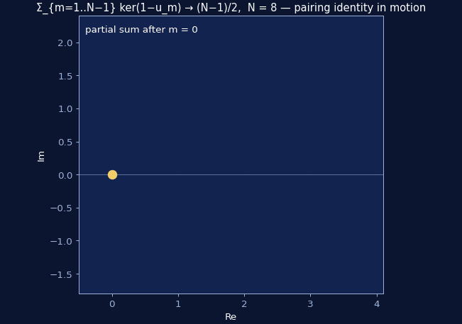 | **Парная тождественность в движении**: частичные суммы `ker(1−u_m)` идут по комплексной плоскости и приземляются точно на `(N−1)/2` — содержание `sum_ker_unity` |
| 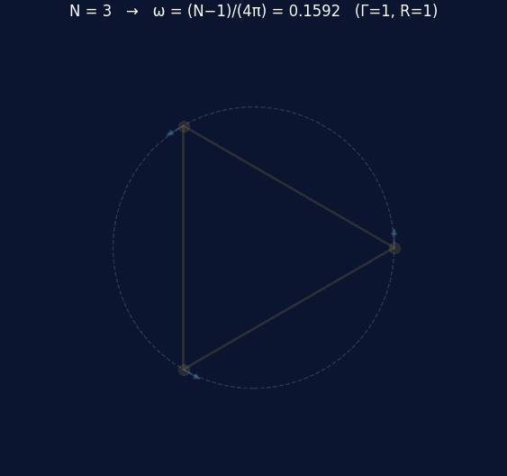 | **Семейство многоугольников N = 3…8** с тикающей вынужденной частотой `ω = (N−1)/(4π)` — частота растёт линейно по N |
| 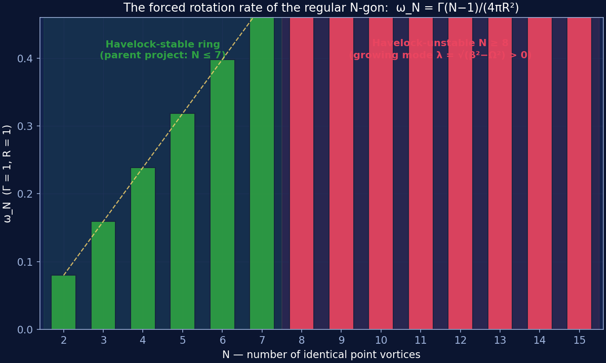 | `ω_N` против `N` — точная линия, хавелоковски устойчивый коридор N ≤ 7 и неустойчивый N ≥ 8 родительского проекта |
| 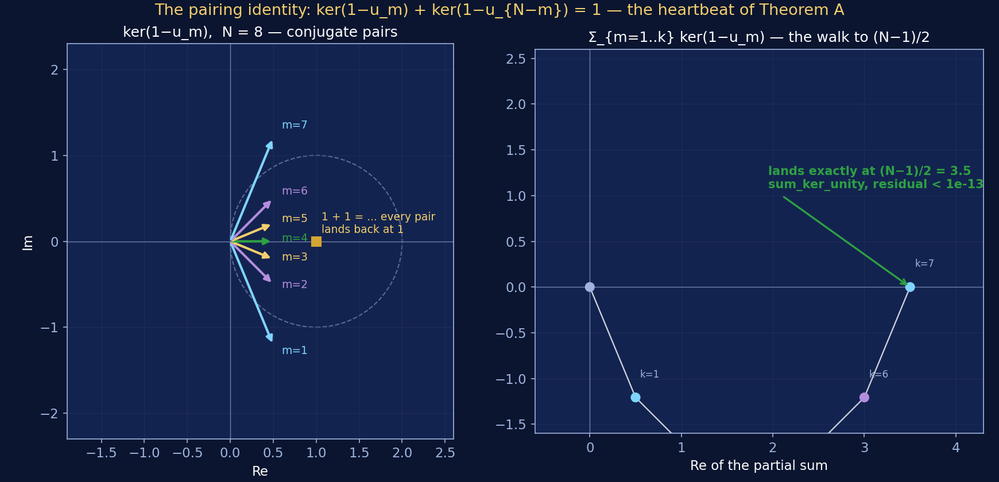 | векторы кернела `ker(1−u_m)` и маршрут частичных сумм (N = 8) |
| 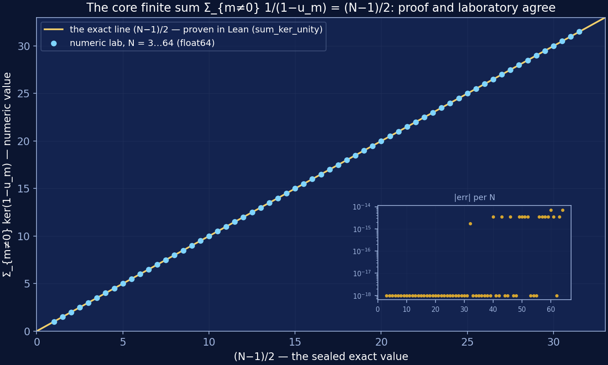 | `Σ_{m≠0} ker(1−u_m)` против `(N−1)/2` — доказательство и лаборатория совпадают, вставка невязок |
| 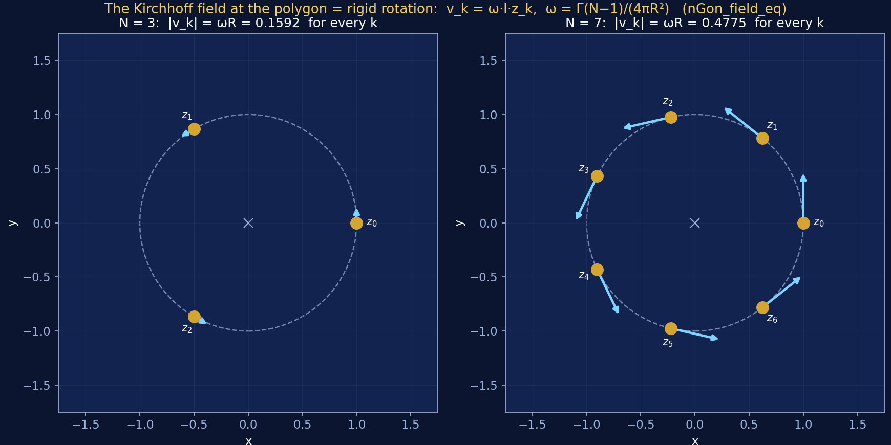 | поле скоростей треугольника и семиугольника: равные тангенциальные скорости |
| 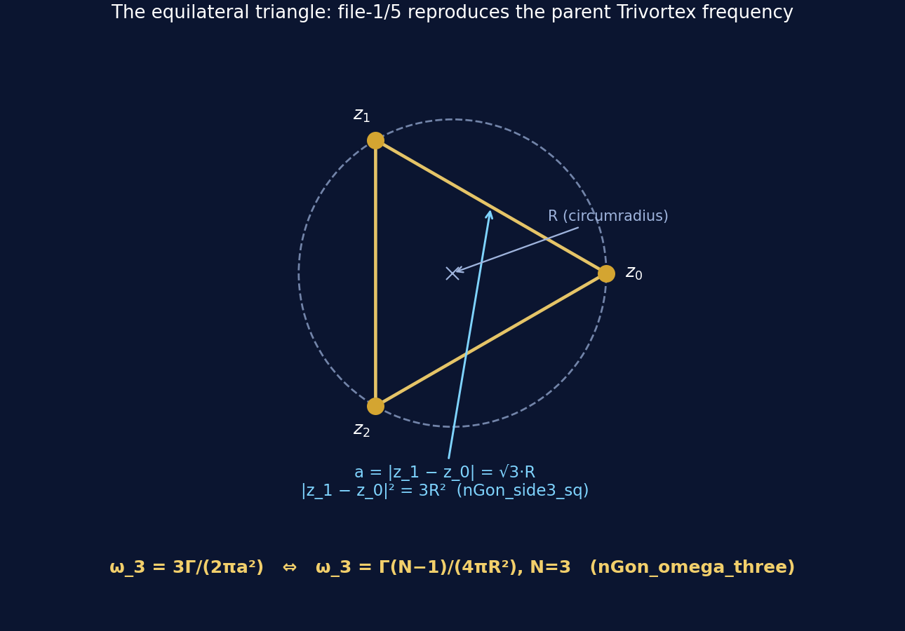 | геометрия N = 3: `a = √3·R`, `ω_3 = 3Γ/(2πa²)` |
| 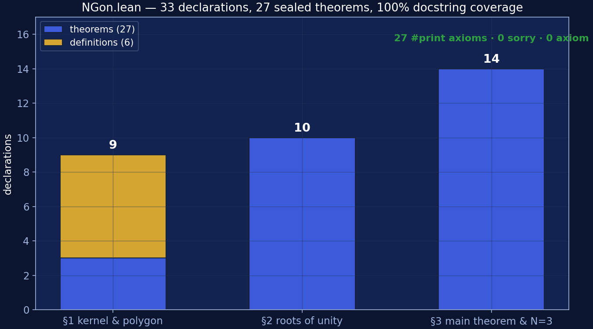 | цензус деклараций: 6 defs + 27 теорем, 100% докстрингов |

---

## 14. Политика содержания — что коммитится, а что нет

Коммитится: артефакт, пиннинги lakefile/toolchain/manifest, печать, гейты, доки, лог
доказательств, ассеты. Никогда: `.lake/`-деревья сборки, тулчейны, olean-кэши, мусор
редакторов. Каталог `docs/evidence/` — *единственное* место, куда вообще коммитится лог
CI — один лог на веху, названный датой.

---

## 15. FAQ

**В: Это независимо от пакета Polyvortex?**
О: Полностью. `NGon.lean` импортирует только Mathlib (3 импорта, проверено гейтом 1);
пятигейт-инструментарий общий *по контракту*, не по импорту.

**В: Что именно «вынуждено»?**
О: Классические изложения говорят «многоугольник вращается с НЕКОТОРОЙ угловой скоростью»;
здесь `nGon_omega_forced` говорит: любая частота `ν`, при которой многоугольник —
стационарное вращающееся решение, обязана равняться `Γ(N−1)/(4πR²)` — значение вычислено
доказательством, а не постулировано.

**В: Почему `ker w = w/|w|²`, а не `1/conj w`?**
О: Вне нуля они совпадают (`|w|² = w·conj w`), но форма с `normSq` держит все переписывания
в вещественной арифметике `Complex` и через `ker_re_I`/`ker_im_I` соответствует
`(x, y)`-конвенции корневого модуля.

**В: Компиляция реально проходит?**
О: Компиляция гейта 2 идёт на машине автора против Mathlib v4.6.0 — тот же контракт, что
у релиза Polyvortex; песочничные гейты (1/3/4/5 + статический 2) воспроизводимы из
`tools/` одним Python 3.

**В: Как это связано с Aref 1979?**
О: Та работа — классическая ссылка по вихревым кольцам семейства многоугольников; этот
артефакт — её утверждение о правильном кольце в форме вынужденного вращения (Кирхгоф),
проверенное машиной.

---

## 16. Устранение неполадок

| симптом | причина | лечение |
|---|---|---|
| `lake: unknown command` / чужой тулчейн | elan не в PATH или другой default | `elan default leanprover/lean4:v4.6.0` внутри каталога пакета |
| `error: no toolchain associated` | запуск `lake` вне пакета | сначала `cd trivortex_n/trivortex_n_lean4` |
| seal падает после правки утверждения | намеренно — печать заморозила утверждение | если правка осознанная: `python3 tools/seal_check.py --update` (видно в ревью) |
| ракет докстрингов падает | покрытие упало ниже 33/33 | вернуть докстринг или явно поднять базу (`--update-baseline`) |
| bridge падает с «расходится с печатью» | запечатанное утверждение изменилось | перезапустить `export_verified_params.py` без `--check` после осознанного принятия нового утверждения |
| `zstd not found` при `lake exe cache get` | кэшу Mathlib нужен `zstd` | поставить `zstd` (apt/brew) и повторить |

---

## 17. Участие

Пятигейт-контракт — чек-лист ревью: утверждения запечатываются до доказательств
(`seal_check.py --update` — видимое действие), покрытие докстрингами может только расти,
а каждая новая теорема обязана войти в цензус `#print axioms`. Импорты — только Mathlib.

---

## 18. Благодарности

- **H. Aref (1979)** — классическая теория вихревых колец правильных многоугольников;
  утверждение файла — форма вынужденного вращения (Кирхгоф) того классического результата.
- **G. Kirchhoff (1876)** — поле скоростей точечных вихрей, формализованное здесь как `field`.
- **J. Havelock (1931)** — теория устойчивости, чей коридор N ≤ 7 referenced из родительского
  проекта и отмечен на графиках.
- **Сообщества Lean 4 и Mathlib** — фундамент, на котором стоит артефакт.

---

## 19. Цитирование, DOI и лицензия

```bibtex
@misc{trivortexn2026ngon,
  author = {Исаев, Исхак Хамзатович},
  title  = {TRIVORTEX-N, файл 1/5: правильный N-угольник точечных вихрей
            с вынужденной частотой вращения — формализация в Lean 4},
  year   = {2026},
  url    = {https://github.com/wild8highlander/Trivortex/tree/main/trivortex_n/trivortex_n_lean4}
}
```

Лицензия: `LicenseRef-Proprietary-Wild8Highlander-1.0` (см. `LICENSE.md` родительского
репозитория). SPDX-заголовок на каждом файле.

---

## Приложение A — реестр деклараций

*Генерируется из исходника — полная таблица с хешами печати в
[`docs/DECLARATIONS.md`](docs/DECLARATIONS.md), полные тексты утверждений в
[`docs/STATEMENTS.md`](docs/STATEMENTS.md).*

| секция | деклараций | содержание |
|---|---:|---|
| §1 | 9 | 6 определений (`nGonAngle`, `nGon`, `unity`, `ker`, `field`, `nGonOmega`) + `ker_mul`, `ker_re_I`, `ker_im_I` |
| §2 | 10 | `exp_two_pi_I`, `normSq_unity`, `unity_mod`, `unity_congr`, `unity_inv`, `unity_ne_one`, `field_re`, `field_im`, `ker_pair` ★, `sum_ker_unity` ★ |
| §3 | 14 | `nGonAngle_add`, `unity_shift`, `mod_shift_left/right/ne_zero`, `normSq_nGon`, `nGon_ne_zero`, `ker_nGon_sum` ★, `nGon_field_eq` ★, `nGon_omega_forced` ★, `nGon_omega_ne_zero`, `nGon_omega_pos_iff`, `nGon_side3_sq`, `nGon_omega_three` |
| **итого** | **33** | 6 defs + 27 теорем · 27 печатей · 100% докстрингов |
