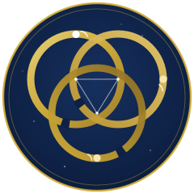
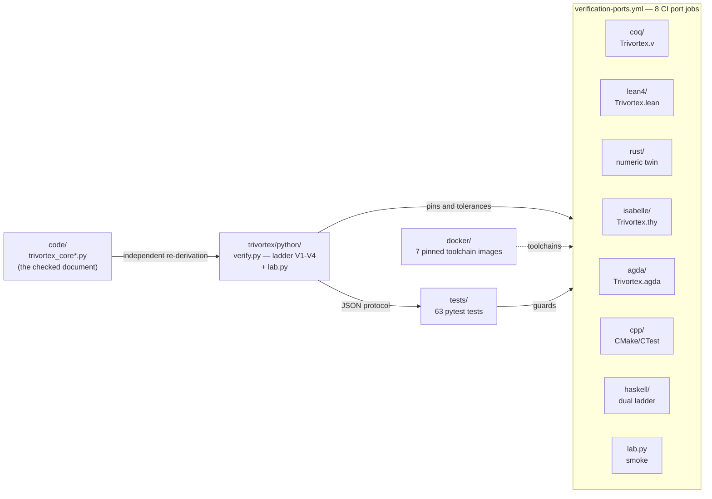

<!-- markdownlint-disable-file MD041 -->
<div align="center">

<!-- ══════════════════════════════════════════════════════════════ -->
<!-- TRIVORTEX verification framework — navy-and-gold hero header   -->
<!-- ══════════════════════════════════════════════════════════════ -->


# 🧪 TRIVORTEX — Verification Framework

**The multi-language framework that keeps every number in the TRIVORTEX
document honest.** The working Python ladder, the interactive scientific
laboratory, seven pinned toolchains and seven landed language ports —
Coq, Lean 4, Rust (M1), Isabelle, Agda (M2), C++, Haskell (M3).


<!-- ROW 1 — CI & STATUS -->
[](https://github.com/wild8highlander/Trivortex/actions/workflows/verification-ports.yml)
[](#7-multi-language-roadmap-and-milestones)
[](#5-the-v1v4-checks-in-detail)
[](tests/README.md)

<!-- ROW 2 — ARTIFACT & LICENSE -->
[](docker/README.md)
[](#12-the-json-protocol-schema)
[](Makefile)
[](https://github.com/wild8highlander/Trivortex/blob/main/LICENSE.md)
[](#71-what-is-next--the-m4-roadmap)

</div>

> **Navigation:** [`Trivortex`](../README.md) › **`verification`**
>
> The checks live in **independent code** (`trivortex/python/verify.py`
> shares no imports with the core document), run in a CI job on every
> push, emit JSON protocols with full parameter snapshots, and are mapped
> onto a multi-language port plan so that a future refactor cannot
> silently move the goalposts.

---

## Table of contents

1. [What this framework is for](#1-what-this-framework-is-for)
2. [What survives from the previous edition](#2-what-survives-from-the-previous-edition)
3. [Directory layout](#3-directory-layout)
4. [The working Python ladder (today)](#4-the-working-python-ladder-today)
5. [The V1–V4 checks in detail](#5-the-v1v4-checks-in-detail)
6. [Tolerance bands](#6-tolerance-bands)
7. [Multi-language roadmap and milestones](#7-multi-language-roadmap-and-milestones)
   - [7.1 What is next — the M4+ roadmap](#71-what-is-next--the-m4-roadmap)
8. [Docker toolchains](#8-docker-toolchains)
9. [How to reproduce everything](#9-how-to-reproduce-everything)
10. [How to contribute a new language](#10-how-to-contribute-a-new-language)
11. [The 63-test pytest guard in detail](#11-the-63-test-pytest-guard-in-detail)
12. [The JSON protocol schema](#12-the-json-protocol-schema)
13. [Honesty notes](#13-honesty-notes)
14. [Frequently asked questions](#14-frequently-asked-questions)
15. [Cross-references — the verification constellation](#15-cross-references--the-verification-constellation)

---

## 1. What this framework is for

The TRIVORTEX document — [`code/trivortex_core*.py`](../code/README.md) —
makes a small set of sharp, checkable claims about the three-body (and
N-body) problem in the vortex model: a closed-form rotating solution
(Theorem 3.1), a topological integral attributed to Chaplygin, and the
classical conservation laws of point-vortex dynamics. Numbers that are
only ever printed by the code that defines them are not verification;
they are repetition. This framework exists to break that circularity: the
checks live in **independent code** (`trivortex/python/verify.py` shares
no imports with the core document), run in a CI job on every push, emit
JSON protocols with full parameter snapshots, and are mapped onto a
multi-language port plan so that a future refactor cannot silently move
the goalposts.

Three principles govern the framework, inherited from the previous
edition of this repository and kept deliberately:

- **Every number is bound to a run.** Each check reports its residual,
  its tolerance, its parameter snapshot and its wall time; the JSON
  report is the single source of truth for the README tables.
- **Both outcomes are results.** A check that returns *effect* and a
  check that returns *strict bound* are equally valid science; what is
  not acceptable is an unclear criterion. Every criterion here is
  registered in advance in this README.
- **Skeletons are labelled as skeletons.** Directories whose artifacts
  have not landed yet say so in their first line. Nothing in this
  repository pretends to be verified when it is merely planned.

The framework at a glance — one independent ladder, one pytest guard,
eight CI port jobs, seven pinned toolchain images:



---

## 2. What survives from the previous edition

The repository is a single-direction research program (TRIVORTEX
v1.0.0) around the three-body vortex document. In `verification/`, the
**infrastructure** is organized for one purpose — keeping the program's
claims honest:

| Component | Status | Role under TRIVORTEX |
|---|---|---|
| `docker/` — 7 pinned toolchain images | **kept as-is** | same images, now aimed at Theorem 3.1 ports |
| `common/python/` — verifier base + config | **kept, config re-targeted** | shared verifier protocol for future sections |
| `tests/` — pytest suite | **rebuilt** | 63 tests guarding V1–V4, the analytic layer, the research program and the landed ports |
| section directories (`section1…section6`) | **removed** | belonged to the retired research lines (KdV, AB-Cloud, Klein, Riemann) |
| `python_levels/`, `julia_levels/` (L1–L5) | **removed** | legacy per-language verification chains |
| `api/`, `demo/`, `web-dashboard/`, `notebooks/` | **removed** | superseded by the static documentation site |
| per-language ports (Coq, Lean4, Rust, Isabelle, Agda, C++, Haskell) | **landed (v1.1)** | milestones M1–M3 realized — see [section 7](#7-multi-language-roadmap-and-milestones) |

If you are looking for the retired multi-topic verification chains
(KdV, AB-Cloud, Klein, Riemann): they remain reachable in
git history and in the Zenodo record 10.5281/zenodo.21825394.

---

## 3. Directory layout

```text
verification/
├── README.md                  ← this document
├── Makefile                   ← run, test, ports, docker targets
├── CODEOWNERS                 ← review routing per language directory
├── trivortex/                 ← ★ the working ladder (milestone M0)
│   ├── README.md  README_RU.md
│   └── python/
│       ├── verify.py          ← V1–V4, JSON protocol, presets
│       └── lab.py             ← ★ the interactive scientific laboratory
│                                 (bilingual, custom parameters, 600 dpi)
├── tests/                     ← pytest guard (63 tests, ~30 s)
│   ├── README.md
│   ├── test_trivortex.py      ← analytic pins + ladder (13 tests)
│   ├── test_research_smoke.py ← research program (14 tests)
│   └── test_ports.py          ← the multi-language port guard (36 tests)
├── common/                    ← shared verifier protocol (kept)
│   └── python/  …
├── coq/                       ← Trivortex.v — statement layer, PROVEN (M1)
├── lean4/                     ← Trivortex.lean — Mathlib formalization (M1)
├── rust/                      ← crate: f64 numeric twin + lab (M1)
├── isabelle/                  ← Trivortex.thy — HOL + optional SMT (M2)
├── agda/                      ← Trivortex.agda — constructive angles (M2)
├── cpp/                       ← CMake/CTest + -O2 benchmark (M3)
├── haskell/                   ← Double + exact ℚ(√3) dual (M3)
└── docker/                    ← 7 pinned toolchains
```

The two meta-files of the layer:

| File | Size | Role |
|---|---|---|
| [`Makefile`](Makefile) | 2 853 B | 21 targets: `run`, `run-quick`, `run-full`, `lab`, `lab-smoke`, `test`, `common`, one target per landed port (`rust`, `cpp`, `haskell`, `coq`, `lean4`, `isabelle`, `agda`), `docker-build`, `clean`, `run-check` |
| [`CODEOWNERS`](CODEOWNERS) | 469 B | review routing: every verification directory, the ladder and the docker layer are owned by `@wild8highlander` |

---

## 4. The working Python ladder (today)

[`trivortex/python/verify.py`](trivortex/python/verify.py) is a
self-contained script (469 lines, 17 911 B, documentation included)
whose only dependency is `numpy`. It re-implements, from
scratch, the objects it checks — the closed form of Theorem 3.1, the
Chaplygin combination, the Kirchhoff right-hand side and a classical RK4
stepper — so a bug in `code/trivortex_core*.py` cannot hide inside a
shared helper. The ladder has three presets:

| Preset | Rotations | Steps/period | C_Ch probes | Typical wall time |
|---|---|---|---|---|
| `quick` | 2 | 2 000 | 200 | ~0.5 s |
| `default` | 5 | 4 000 | 1 000 | ~2 s |
| `full` | 20 | 8 000 | 2 000 | ~35 s |

```bash
python3 verification/trivortex/python/verify.py                 # default
python3 verification/trivortex/python/verify.py --preset quick  # CI mode
python3 verification/trivortex/python/verify.py --preset full --out-dir /tmp/rep
```

Every invocation writes a JSON protocol (`suite`, `preset`, UTC date,
per-check residuals and parameter snapshots, wall time) — the same
"numbers are bound to runs" discipline the repository has used since its
first release.

Beside the ladder lives the second M0 artifact,
[`trivortex/python/lab.py`](trivortex/python/lab.py) (874 lines,
35 483 B): the interactive scientific laboratory — bilingual
(EN/RU menus), custom parameters, a convergence study over the step
grids 250…8 000 steps/period, an invariant-drift scan and dashboard
figures at 600 dpi. Its CI smoke entry is `lab.py --smoke`.

---

## 5. The V1–V4 checks in detail

### V1 — Theorem 3.1: choreography and periodicity of the closed form

The document's analytic solution places the three vortices at angles
`θ_k(t) = ωt + 2πk/3` — an equilateral triangle rotating rigidly — with a
radial modulation `r_k(t) = √C_Ch·(1 + ε·cos(ωt + 2πk/3))`. Two properties
are checked as pass/fail criteria: the **angular separation stays exactly
`2π/3`** (residual `≤ 1e-12`) at all probed times, and the closed form is
**periodic** with `T_r = 2π/ω` (residual `≤ 1e-12`). The endpoint drift of
the gauge-dependent combination `C_Ch(t) = r²(θ̇ − q·A_θ)` — the quantity
recorded by Section 6 of the core document — is reported as a *diagnostic*
with no pass/fail role, because by construction it oscillates with the
radial modulation; see [section 13](#13-honesty-notes).

### V2 — Rigid rotation at the Lagrange angular velocity

Three equal point vortices on an equilateral triangle of side `a` are
integrated with RK4 over several full rotations. The classical result —
the point-vortex twin of the Lagrange equilateral solution of the
three-body problem — is that the triangle rotates rigidly with
`ω = 3Γ/(2πa²)`. The check pins both the **shape** (relative side drift
`≤ 1e-10`) and the **frequency** (measured vs analytic, relative error
`≤ 1e-6`). The angle unwrapping lifts the raw `atan2` difference to the
branch closest to the expected unwrapped angle, so whole turns are
handled exactly.

### V3 — Conservation of the vortex integrals (equal circulations)

Along the V2 trajectory, the four classical invariants of point-vortex
dynamics are monitored: the Hamiltonian `H = −(1/2π)Σ_{i<j} ΓᵢΓⱼ ln rᵢⱼ`,
the linear impulses `P = ΣΓx`, `Q = ΣΓy`, and the angular impulse
`I = ΣΓ|r|²`. These are the many-body conservation laws of the model —
the Chaplygin-type integrals for vortex systems. Relative drift `≤ 1e-10`
per quantity.

### V4 — Robustness with unequal circulations

The same conservation statement for `Γ = (1, 2, 3)` started from a
generic (non-symmetric) triangle: the integrals do not require the
symmetric initial condition. Relative drift `≤ 1e-10`. Together V3+V4
demonstrate that the conservation laws are properties of the *equations*,
not artifacts of the equilateral choreography.

---

## 6. Tolerance bands

| Band | Applies to | Rationale |
|---|---|---|
| `1e-12` | closed-form residuals (V1) | argument reduction of `cos`, transcendental round-off in float64 |
| `1e-10` | RK4 invariants and shape (V2–V4) | fourth-order truncation at `dt = T/2000` dominates |
| `1e-6` | measured angular velocity (V2) | finite-step integration of the angle over multiple turns |

Tolerances are registered here and in `verify.py` **before** a check is
written; a test whose residual sits far below its band gets a tighter
band, because a check that cannot fail protects nothing.

---

## 7. Multi-language roadmap and milestones

The framework keeps seven pinned toolchains (Docker) and grows ports of
the same three objects — closed form, Chaplygin combination, vortex
integrals — language by language. Every port stated its acceptance
criteria in its directory README *before* the artifacts landed; the
criteria are checked in the same files now.

| Language directory | Artifact target | Milestone | Status |
|---|---|---|---|
| `trivortex/python/` | working ladder V1–V4 + JSON | **M0** | ✅ **done** (v1.0) |
| `tests/` | pytest guard of the ladder + program | **M0** | ✅ **done** (63 tests) |
| `trivortex/python/lab.py` | interactive scientific laboratory, 600 dpi | **M0+** | ✅ **landed** (v1.1) |
| [`coq/`](coq/README.md) | `Trivortex.v` — statement layer + choreography | **M1** | ✅ **landed** (v1.1) — proven, zero axioms |
| [`lean4/`](lean4/README.md) | `Trivortex.lean` — the full statement layer §1–§9 via Mathlib | **M1 + depth** | ✅ **landed** (v5.0) — proven, 144 `#print axioms` statements closed, 0 `sorry` |
| [`rust/`](rust/README.md) | crate — second floating-point implementation of V1–V4 | **M1** | ✅ **landed** (v1.1) — 14/14 tests, protocol committed |
| [`isabelle/`](isabelle/README.md) | `Trivortex.thy` — SMT-discharged invariant bounds | **M2** | ✅ **landed** (v1.1) — HOL proven; SMT session optional |
| [`agda/`](agda/README.md) | `Trivortex.agda` — constructive angle arithmetic | **M2** | ✅ **landed** (v1.1) — C3 lattice proven constructively |
| [`cpp/`](cpp/README.md) | CMake/CTest port + `-O2` benchmark of the ladder | **M3** | ✅ **landed** (v1.1) — 25 guards, 1.7e7 rhs/s |
| [`haskell/`](haskell/README.md) | `Double` vs exact-rational dual run of the ladder | **M3** | ✅ **landed** (v1.1) — ℚ(√3) anchors hold by computation |

The milestone chain as it stands — three delivered, three pre-registered:

```mermaid
flowchart LR
    M0["M0 · v1.0<br/>independent ladder<br/>V1-V4 + JSON protocols<br/>+ the laboratory"]
    M1["M1 · v1.1<br/>independent re-derivation<br/>Coq + Lean 4 + Rust"]
    M2["M2 · v1.1<br/>cross-checked statements<br/>Isabelle + Agda"]
    M3["M3 · v1.1<br/>performance and exactness<br/>C++ + Haskell"]
    M4["M4 · hardening<br/>target v1.2<br/>blocking ports, SMT online,<br/>Lean cache, site table"]
    M5["M5 · depth<br/>target v1.3<br/>50-digit anchors, Julia twin,<br/>Chaplygin identity proven"]
    M6["M6 · widening<br/>target v2.0<br/>V5 regular ring N=7,<br/>benchmark board"]
    M0 --> M1 --> M2 --> M3 --> M4 --> M5 --> M6
    style M0 fill:#1f2a44,color:#e6c77a
    style M1 fill:#1f2a44,color:#e6c77a
    style M2 fill:#1f2a44,color:#e6c77a
    style M3 fill:#1f2a44,color:#e6c77a
```



Milestone definitions:

- **M0 — independent ladder** *(v1.0)*: one language runs all
  four checks in CI with JSON protocols.
- **M1 — independent re-derivation** *(v1.1)*: two proof assistants
  and a second floating-point language reproduce the closed-form
  properties and the ladder numbers. **Delivered:** Coq + Lean 4
  (statement layer proven, zero non-classical axioms) and the Rust
  numeric twin (14 pinned-reference tests, quick ladder 4/4).
- **M2 — cross-checked statements** *(v1.1)*: two proof assistants prove
  the same statement layer; Isabelle HOL adds the machine-checked band
  record; the SMT-discharged bounds land as an optional session until
  Z3 ships in the pinned image. **Delivered:** Isabelle + Agda (the
  constructive C3 rotation lattice, `rot³ ≡ id`).
- **M3 — performance & exactness** *(v1.1)*: a compiled benchmark ladder
  and an exact-arithmetic split of the residual budget. **Delivered:**
  the C++ `-O2` port (CTest guard + `benchmark_rhs_per_s` in every
  protocol) and the Haskell dual ladder (`Double` + ℚ(√3), where the
  equilateral anchor identities hold by computation).

The CI contract of §10 stands: every port job in
[`verification-ports.yml`](../.github/workflows/verification-ports.yml)
is non-blocking (`continue-on-error: true`, 8 jobs on `ubuntu-24.04`); a
port becomes blocking after a green run on three consecutive days (flip
`continue-on-error` in the workflow for that job).

### 7.1 What is next — the M4+ roadmap

With M0–M3 landed, the program shifts from *breadth* (more languages)
to *hardening* (fewer escape hatches) and *depth* (stronger
statements). The tracks below are pre-registered in the same spirit
that governed M1–M3: an acceptance criterion may be tightened before
the artifacts land, never after.

**M4 — hardening** *(targets v1.2)*. Everything here tightens what
already exists; no new science.

1. **Blocking ports.** After three consecutive green days of
   `verification-ports.yml`, flip every port job to blocking
   (`continue-on-error: false`). Acceptance: all nine port jobs green
   *and* enforced on `main`.
2. **Isabelle SMT online.** Ship Z3 inside the pinned Isabelle image
   and move `Trivortex_SMT.thy` from the optional session into the
   default `ROOT` build. Acceptance: the SMT session appears green in
   the isabelle CI job log.
3. **Lean cache.** Pre-warm the Mathlib cache in the lean4 job (lake
   cache action keyed on `lean-toolchain`). Acceptance: the lean4 job
   wall time ≤ 15 min.
4. **Generated site table.** `docs/site/verification.html` currently
   mirrors the roadmap by hand; a `make site` target will regenerate
   the table from the committed JSON protocols. Acceptance: the HTML
   table is produced by the generator and stable on re-run.
5. **Release v1.2.** Tag the release carrying the landed M1–M3
   artifacts, the non-blocking→blocking flip and the lint-debt cleanup.

**M5 — depth** *(targets v1.3)*. Strengthen the evidence without
widening the surface.

1. **50-digit anchors.** An mpmath re-derivation of the V1/V2 anchors
   (ω, the Chaplygin combination) at 50 significant digits.
   Acceptance: the float ω matches the high-precision value to
   ≤ 1e-30 relative; the protocol is committed.
2. **Third numeric twin.** A Julia port of the V1–V4 ladder.
   Acceptance: all four checks inside the §6 tolerance bands; the
   protocol of a real run is committed.
3. **The Chaplygin identity, proven.** Coq and Lean currently pin the
   equilateral anchors H = 0, P = 0, Q = 0, I = Γ as proven
   statements; the next step derives `I = Γ` from the velocity field
   by the Stokes/Chaplygin argument inside each assistant. Acceptance:
   the integral identity proven with zero non-classical axioms in both.
4. **Exact Haskell everywhere.** The ℚ(√3) dual ladder currently
   certifies the equilateral anchors; extend the exact run to the full
   V1–V4 loop. Acceptance: the exact ladder reports all four checks.

**M6 — widening** *(targets v2.0)*. New physics surface, ported under
the same pre-registration rule.

1. **V5 — the regular ring.** A fifth ladder rung: the regular N-gon
   vortex ring (N = 7) — rotation rate, shape stability, invariant
   drift. Acceptance: V5 lands in Python first, then in at least two
   ports; §5 and the protocols gain the new rung.
2. **Benchmark board.** rust vs c++ rhs/s side by side, same machine
   and same protocol. Acceptance: both numbers pinned in §9.

---

## 8. Docker toolchains

One image per toolchain, each a thin layer over an official base image —
full recipes, entrypoints and honest per-image status live in
[`docker/README.md`](docker/README.md):

| Image | Base image | Pins |
|---|---|---|
| [`docker/coq/`](docker/coq/README.md) | `coqorg/coq:8.18-ocaml-4.14` | Coq/Rocq 8.18, standard Reals stack |
| [`docker/lean4/`](docker/lean4/README.md) | `ubuntu:24.04` + elan | Lean **v4.6.0** via [`lean-toolchain`](lean4/lean-toolchain) (`leanprover/lean4:v4.6.0`), Mathlib4 tag v4.6.0, lake |
| [`docker/isabelle/`](docker/isabelle/README.md) | `makarius/isabelle:Isabelle2024` | Isabelle-HOL 2024 session env |
| [`docker/agda/`](docker/agda/README.md) | `agda/agda:2.6.4` | Agda 2.6.4 + standard library |
| [`docker/rust/`](docker/rust/README.md) | `rust:1.77` | stable pin 1.77 (crate `rust-version = 1.75`), Cargo test at `--release` |
| [`docker/cpp/`](docker/cpp/README.md) | `gcc:13` | GCC 13 + CMake, C++17 (`CMAKE_CXX_STANDARD 17`) |
| [`docker/haskell/`](docker/haskell/README.md) | `haskell:9.4-slim` | GHC 9.4 + cabal |

Build and run any of them with the recipe in the corresponding language
README (see [section 3](#3-directory-layout) for the paths). The CI builds
images opportunistically via
[`docker.yml`](../.github/workflows/docker.yml); a failing formal
toolchain never blocks `main` (the ports contract of §7).

---

## 9. How to reproduce everything

```bash
# 1. the working ladder (three presets)
python3 verification/trivortex/python/verify.py --preset quick
python3 verification/trivortex/python/verify.py --preset default
python3 verification/trivortex/python/verify.py --preset full

# 2. the interactive scientific laboratory (bilingual, 600 dpi figures)
python3 verification/trivortex/python/lab.py --lang ru
python3 verification/trivortex/python/lab.py --smoke

# 3. the pytest guard (core + research + ports)
python -m pytest verification/tests/ -v

# 4. the executed ports (local toolchains)
cargo test --release --manifest-path verification/rust/Cargo.toml
cmake -S verification/cpp -B verification/cpp/build -DCMAKE_BUILD_TYPE=Release \
  && cmake --build verification/cpp/build -j \
  && ctest --test-dir verification/cpp/build --output-on-failure
cd verification/haskell && cabal build all && cabal test trivortex-guard

# 5. the formal ports (pinned Docker toolchains)
docker build -t trivortex-coq verification/docker/coq \
  && docker run --rm -v "$PWD":/work -w /work trivortex-coq coqc verification/coq/Trivortex.v
docker build -t trivortex-agda verification/docker/agda \
  && docker run --rm -v "$PWD":/work -w /work trivortex-agda agda verification/agda/Trivortex.agda
# ... isabelle / lean4 / haskell: see the language READMEs

# 6. the shared protocol CLI (sanity of the kept common package)
python3 verification/common/python/main.py --section 1 --preset default
```

Every step above has a one-command Makefile alias — `make help` prints
the full list (see [section 3](#3-directory-layout)); the
`docker-build` target builds all seven pinned images in one loop.

Environment: Python ≥ 3.10 with `numpy ≥ 1.24` (the laboratory adds
optional `matplotlib`); the Rust port needs only a stable toolchain; the
C++ port needs CMake ≥ 3.16 and a C++17 compiler; the Haskell port needs
GHC ≥ 9.4; the formal ports run inside their pinned Docker images (see
§8).

---

## 10. How to contribute a new language

1. Open an issue titled `port: <language>` describing which of the three
   objects (closed form / Chaplygin / integrals) you target and which
   milestone it belongs to.
2. Copy the structure of an existing roadmap README: *why this language*,
   *scope*, *acceptance criteria*, *build recipe* — criteria first, code
   second.
3. Pin the toolchain as a new `docker/<language>/Dockerfile`; never rely
   on unpinned system packages.
4. Land the port with a JSON protocol produced by a real run (the same
   schema as the Python ladder) and flip the status table here in the
   same commit.
5. Keep the CI contract: a port may be added as *non-blocking*; turning a
   port blocking requires a green run on three consecutive days.

The review rules live in [`CONTRIBUTING.md`](../CONTRIBUTING.md); code
ownership per directory in [`verification/CODEOWNERS`](CODEOWNERS).

---

## 11. The 63-test pytest guard in detail

`verification/tests/` is the CI-friendly wrapper around the whole program.
It needs only `numpy` and `pytest` (the port-guard suite is
toolchain-agnostic: it pins the committed protocols, it never invokes
Rust/C++/GHC), runs in ≈ 30 s, and contains 63 tests
(`pytest --collect-only` reports exactly 63: 13 + 14 + 36 — the raw
25 `def test_` functions expand under `@pytest.mark.parametrize`, e.g.
the 25-row artifact table of `test_ports.py`):

| Suite | Tests | Guards |
|---|---|---|
| `test_trivortex.py` — analytic pins | 13 | Theorem 3.1 reference values: ω = 1.3748022274393588, ε = 2.6680737914285615 (exact to float64), periodicity of the closed form, C_Ch formula shape, the quick-preset ladder in-process, JSON protocol shape |
| `test_research_smoke.py` — study smoke | 12 | every TRX-01…12 script executes in `--smoke` mode, exits 0, and its committed protocol reports `status: PASS` |
| `test_research_smoke.py` — completeness | 1 | every study ships README, code, pack, scheme SVG, four 300-dpi figures, monograph sources and the four monograph renditions (PDF+DOCX × RU/EN) |
| `test_research_smoke.py` — library | 1 | the reading room: 28 PDFs + 28 DOCX + HTML sources + the four build-system scripts |
| `test_ports.py` — artifact presence | 27 | every planned artifact of milestones M1–M3 landed where its stub said it would (7 languages + the laboratory), the bilingual README_RU contract, the SPDX headers |
| `test_ports.py` — reference protocols | 6 | the committed `protocol_quick.json` of Rust and C++ parse, carry the §12 schema, and agree with the Python ladder's pins inside the registered bands (V1 ≤ 1e-12, V2 shape ≤ 1e-10, ω ≤ 1e-6, drifts ≤ 1e-10) |
| `test_ports.py` — the laboratory | 3 | `lab.py` imports, speaks both languages, and its convergence/drift analyses stay inside the registered bands |

The reference constants are *pinned, not assumed*: each expected value is
computed from the closed form inside the test itself, so the suite fails if the
formula — not just the implementation — drifts. The same discipline now
spans the languages: the committed protocols of the Rust and C++ twins are
pinned against the Python ladder's numbers by `test_ports.py`. The full
test map, tolerance philosophy and CI wiring are documented in
[`tests/README.md`](tests/README.md).

---

## 12. The JSON protocol schema

Every ladder run writes a self-describing protocol; the same schema is shared
by the research studies:

```json
{
  "suite": "trivortex-verification",
  "version": "1.0",
  "preset": "quick",
  "date_utc": "2026-10-07T05:57:30+00:00",
  "wall_time_s": 0.53,
  "checks_passed": 4,
  "checks_total": 4,
  "all_passed": true,
  "checks": [
    {
      "check": "V1 Theorem 3.1: choreography + periodicity ...",
      "passed": true,
      "angular_separation_error": 6.9e-14,
      "angular_separation_tolerance": 1e-12,
      "params": {"C_Ch": 1.0, "T": 6.283185307179586, "...": "..."}
    }
  ]
}
```

| Field | Meaning |
|---|---|
| `preset` | which registered parameter set ran (`quick` / `default` / `full`) |
| `checks_passed` / `checks_total` | the verdict at a glance |
| `checks[].passed` | per-check verdict against the registered tolerance |
| `checks[].params` | the full parameter snapshot — the protocol is reproducible from the file alone |
| `date_utc`, `wall_time_s` | provenance of the run |

Committed instances of this schema live with the executed ports:
[`rust/protocol_quick.json`](rust/protocol_quick.json) (2 474 B) and
[`cpp/protocol_quick.json`](cpp/protocol_quick.json) (2 411 B); the
pytest guard pins both against the Python ladder's numbers (§11).

---

## 13. Honesty notes

- The Section-6 drift diagnostic of the core document is **recorded, not
  hidden**: the combination `C_Ch(t) = r²(θ̇ − q·A_θ)` with `A_θ = 1/r`
  oscillates together with the radial modulation, so its endpoint drift
  depends on the integration window. The window-independent conserved
  quantities of the model are the vortex integrals `H, P, Q, I` — and
  those are what V3/V4 certify. This separation between *recorded
  diagnostics* and *certified invariants* is deliberate and applies to
  every language port.
- The roadmap directories contain **landed artifacts with checked
  acceptance criteria**; each artifact header lists its axiom footprint,
  and every status table quotes a run-anchored result (a committed JSON
  protocol or a CI job), never a plan.
- The reference constants used by the pytest suite (e.g.
  `ω = 1.3748022274393588` for `C_Ch = 1`) are computed from the closed
  form in the test itself — they are *pinned*, not *assumed*.

---

## 14. Frequently asked questions

**Q: Why does the ladder not import the document?**
Because a checker that shares code with the checked cannot certify it. The
ladder re-implements the closed form, the Kirchhoff right-hand side and its own
RK4 stepper from the published formulas — the only things shared are the
mathematics and the numbers.

**Q: Which preset should I run?**
`quick` (~0.5 s) is what CI runs on every push; `default` (~2 s) is the local
workhorse; `full` (~35 s) is for release validation and tighter integration
grids. The registered tolerances hold for all three.

**Q: A check failed — what now?**
Attach the JSON protocol to an issue. The protocol carries the full parameter
snapshot, so the failure is reproducible without a single follow-up question.
If the failure involves a research study, attach that study's
`results/trxNN_results.json` too.

**Q: Can I add a V5 check?**
Yes — the contract is in section 10: register the criterion (statement,
tolerance, preset) in this README *before* the code lands, keep it independent
of the core document, emit the same JSON schema, and pin reference values in
the pytest suite.

**Q: What do the roadmap directories contain?**
Landed artifacts with their checked acceptance criteria — and each says
so in its first line. The formal ports (Coq, Lean, Isabelle, Agda) list
their axiom footprint in the artifact header; the numerical ports commit
the JSON protocol of a real run (`protocol_quick.json`). Status tables
can now quote all of them.

---

## 15. Cross-references — the verification constellation

| Where | What it holds |
|---|---|
| [`trivortex/`](trivortex/README.md) | the working ladder and the interactive laboratory (M0) — [README_RU](trivortex/README_RU.md) |
| [`tests/`](tests/README.md) | the 63-test pytest guard — test map and tolerance philosophy |
| [`common/`](common/README.md) | the shared verifier protocol package (kept from the previous edition) |
| [`notes/`](notes/README.md) | symbolic and numeric pre-verification scripts backing the Lean 4 §8/§9 chunks, with their run logs |
| [`lean4/`](lean4/README.md) | the Lean 4 hub — Mathlib formalization, landed v5.0, §1–§9, 145 `#print axioms` statements ([README_RU](lean4/README_RU.md)) |
| [`coq/`](coq/README.md) · [`isabelle/`](isabelle/README.md) · [`agda/`](agda/README.md) | the other formal ports (M1/M2) |
| [`rust/`](rust/README.md) · [`cpp/`](cpp/README.md) · [`haskell/`](haskell/README.md) | the compiled and exact-arithmetic ports (M1/M3) |
| [`docker/`](docker/README.md) | the 7 pinned toolchain images that run the formal ports |
| [`Makefile`](Makefile) · [`CODEOWNERS`](CODEOWNERS) | the command surface and review routing of the layer |

Repository-level context: the [root README](../README.md) (the document,
the studies, the reading room), [`CONTRIBUTING.md`](../CONTRIBUTING.md),
and the CI workflows [`ci.yml`](../.github/workflows/ci.yml) and
[`verification-ports.yml`](../.github/workflows/verification-ports.yml).

## 🇷🇺 Краткое резюме (Russian Summary)

- **`verification/`** — независимый контур проверки TRIVORTEX: лестница V1–V4 на Python (`trivortex/python/verify.py`, 469 строк, зависимость — только numpy), интерактивная лаборатория `lab.py` и pytest-щит из 63 тестов (~30 с).
- Каждая проверка привязана к запуску: JSON-протокол с снимком параметров, невязкой и допуском; допуски (1e-12 / 1e-10 / 1e-6) зарегистрированы в README заранее.
- Восемь портов приземлены (M0–M3): Coq и Lean 4 (доказано, без нетривиальных аксиом), Rust (числовой двойник), Isabelle и Agda (M2), C++ и Haskell (M3); CI-задания — `verification-ports.yml`, пока non-blocking.
- Семь Docker-образов фиксируют тулчейны (Coq 8.18, Lean v4.6.0, Isabelle 2024, Agda 2.6.4, Rust 1.77, GCC 13, GHC 9.4); сборка — `make docker-build`.
- Честность зафиксирована в §13: диагностика C_Ch(t) записывается, но не сертифицируется; консервируемые величины H, P, Q, I — то, что проверяют V3/V4.
- Дорожная карта M4–M6 (hardening → depth → widening) предварительно зарегистрирована: критерии приёмки нельзя ослаблять после приземления артефактов.

---

<div align="center">

**[⬆ Back to top](#-trivortex--verification-framework)** ·
**[Repository root](../README.md)**

*Part of [wild8highlander/Trivortex](https://github.com/wild8highlander/Trivortex) · Licensed under [IPL-RP-1.0](https://github.com/wild8highlander/Trivortex/blob/main/LICENSE.md) — All Rights Reserved*

</div>
