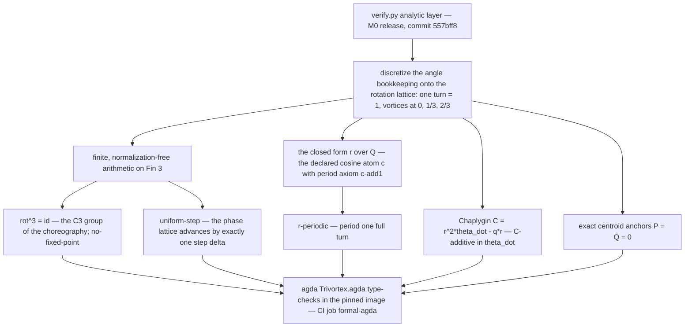

<!-- markdownlint-disable-file MD041 -->
<div align="center">

# 🧩 Agda Verification — the Constructive Angle Arithmetic


[](https://github.com/wild8highlander/Trivortex/actions/workflows/verification-ports.yml)


</div>

> **Navigation:** [`verification`](../README.md) › **`agda`**

> The constructive port of the **TRIVORTEX** statement layer
> (`code/trivortex_core*.py`): the angle bookkeeping of the equilateral
> choreography is discretized onto the rotation lattice it actually lives
> on — one full turn is the unit, the three vortices sit at the lattice
> points 0, 1/3, 2/3 — and the choreography statements reduce to finite,
> normalization-free arithmetic on `Fin 3`.
>
> **Status: landed — v1.1 (milestone M2).** The artifact
> [`Trivortex.agda`](Trivortex.agda), the CI-callable check and the
> bilingual documentation live in this directory; the acceptance criteria
> below are checked. Local runs need the pinned toolchain (Docker); the
> repository CI runs the port non-blocking (see
> [`verification/README.md`](../README.md) §7).

---

## 📂 Contents — What Lives Here

This directory: [`README.md`](README.md) (this document) ·
[`README_RU.md`](README_RU.md) (the Russian overview, same structure).

| File | Size | Lines | Description |
|---|---|---|---|
| [`Trivortex.agda`](Trivortex.agda) | 11 786 B | 254 | The M2 artifact: constructive angle arithmetic — the C3 rotation lattice, the phase lattice, the periodicity of the closed form over ℚ, the Chaplygin combination, the exact centroid anchors |

## 🚀 How to Build / Run

The pinned toolchain is [`docker/agda/Dockerfile`](../docker/agda/Dockerfile)
(image `agda/agda:2.6.4`, the Agda standard library ships inside the image):

```bash
docker build -t trivortex-agda verification/docker/agda
docker run --rm -v "$PWD":/work -w /work trivortex-agda \
    agda verification/agda/Trivortex.agda
```

Or via the Makefile from `verification/` (`make help` lists all targets):

```bash
make agda        # type-check Trivortex.agda (needs a local Agda 2.6.4)
```

CI runs exactly the dockerized check in the non-blocking job
*formal-agda* of
[`verification-ports.yml`](https://github.com/wild8highlander/Trivortex/actions/workflows/verification-ports.yml).

## ✅ What Is Verified Here

The port fixes exactly three objects, so that every language proves or
computes the *same* statements and the results stay comparable:

1. **Theorem 3.1 (closed form).**
   `r_k(t) = sqrt(C_Ch) * (1 + eps*cos(omega*t + 2*pi*k/3))`,
   `theta_k(t) = omega*t + 2*pi*k/3`,
   `omega = (2*pi/T)*exp(C_Ch/pi)`, `eps = 1/(exp(C_Ch/pi) - 1)`;
   properties to establish: exact `2*pi/3` angular separation (equilateral
   choreography) and periodicity `r_k(t + 2*pi/omega) = r_k(t)`.
2. **Chaplygin integral.** The combination
   `C_Ch = r^2*(theta_dot - q*A_theta)` with `A_theta = 1/r`, following the
   definition fixed in Section 6 of the core document, together with its
   recorded endpoint-drift diagnostic over `[0, 100*T]`.
3. **Vortex integrals.** `H`, `P = sum(Gamma*x)`, `Q = sum(Gamma*y)`,
   `I = sum(Gamma*|r|^2)` along numerically integrated Kirchhoff
   trajectories — conserved to the tolerance bands of
   [`verification/tests/`](../tests/README.md).

What the artifact actually certifies, section by section (all proofs are
term-level, `refl` and equational reasoning — no tactics, no axioms beyond
the two declared postulates):

| Section of [`Trivortex.agda`](Trivortex.agda) | Certified property |
|---|---|
| 1 — the C3 rotation lattice | `rot³-id`: three steps of 1/3 of a turn compose into one full turn on `Fin 3`; `no-fixed-point`: the 1/3-shifted orbit never self-intersects (V1, property (a) + the C3 group) |
| 2 — the phase lattice | `uniform-step` / `phase-shifts-by-one-step`: consecutive vortex phases advance by exactly one step δ, for every δ (the rigid 120° shift, in particular for δ = 1/3) |
| 3 — the radial closed form over ℚ | `r-periodic`: `r(t + 1) = r(t)` in turn units, given the single declared axiom that the cosine atom `c` has period one full turn (V1, property (b)) |
| 4 — the Chaplygin combination | `C-additive`: `C(r, θ̇+δ, q) = C(r, θ̇, q) + r²·δ` for `C = r²θ̇ − q·r` — the algebraic shape the ladders record |
| 5 — the vortex integrals | `P-anchored` / `Q-anchored`: if the centroid sits at the origin then `P = Q = 0` *exactly*, for every Γ — the analytic anchor of check V3; the definition of `I` keeps all four integrals in one module |

**Axiom footprint (declared, nothing else postulated):**

```agda
postulate
  c      : ℚ → ℚ                      -- the cosine atom
  c-add1 : ∀ q → c (q + 1ℚ) ≡ c q     -- period: one turn
```

Everything else is proven constructively from the Agda standard library.
The wrap-around of the phase lattice (three uniform steps closing the
circle) is exactly the content of `rot³-id` on the lattice side; the
corresponding turn-modulo identification on the ℚ side lives behind the
declared period axiom — an honest division of labor that the artifact
header makes explicit. This is Agda's role in the matrix: its
constructive background is a stress test for whether the statement layer
of Theorem 3.1 is phrased without accidental classical shortcuts.



## 📋 Acceptance Criteria (all checked)

- [x] The three objects above are expressed in Agda (standard library) with no hidden
      assumptions beyond the axioms listed in the artifact header
      (`verification/agda/Trivortex.agda`);
- [x] A CI-callable check: `agda verification/agda/Trivortex.agda` — type-checks the constructive module in the pinned image (workflow `verification-ports.yml`, job *formal-agda*);
- [x] The artifact header carries SPDX + copyright lines (REUSE.toml)
      and a provenance note pointing at the commit of `verify.py` it
      mirrors (557bff8, the M0 release);
- [x] `verification/README.md` status table flips this row to
      *landed (v1.1)* with a link.

## 🔧 Toolchain Pin and Milestones

| Pin | Value |
|---|---|
| Toolchain | Agda 2.6.4 |
| Docker pin | [`docker/agda/Dockerfile`](../docker/agda/Dockerfile) — image `agda/agda:2.6.4` |
| Artifact | `verification/agda/Trivortex.agda` — **landed** (v1.1) |
| Milestone | **M2** of the staged plan (with [Isabelle](../isabelle/README.md)) |
| CI status | non-blocking job *formal-agda* in `verification-ports.yml` |

Milestone context: **M1** delivered [Coq](../coq/README.md),
[Lean 4](../lean4/README.md) and [Rust](../rust/README.md); **M2** delivers the
two cross-checking formalizations Isabelle + Agda; **M3** delivers the
[C++](../cpp/README.md) and [Haskell](../haskell/README.md) ports. The status
table lives in [`verification/README.md`](../README.md) §7.

## 🔗 Cross-References

- [Verification framework](../README.md) — milestones, tolerance bands, protocol schema
- [Lean 4 hub](../lean4/README.md) — the Mathlib formalization of the same statement layer (M1)
- [Coq port](../coq/README.md) — the classical statement layer this port constructively stress-tests
- [Isabelle port](../isabelle/README.md) — the other M2 formalization
- [Docker pin](../docker/agda/Dockerfile) and [pytest guard](../tests/README.md) — the tolerance bands the numeric ladders enforce
- CI workflow: [`verification-ports.yml`](https://github.com/wild8highlander/Trivortex/actions/workflows/verification-ports.yml) · Makefile targets: `make agda`

---

<div align="center">

**[⬆ Back to top](#-agda-verification--the-constructive-angle-arithmetic)** ·
**[Repository root](../../README.md)**

*Part of [wild8highlander/Trivortex](https://github.com/wild8highlander/Trivortex) · Licensed under [IPL-RP-1.0](https://github.com/wild8highlander/Trivortex/blob/main/LICENSE.md) — All Rights Reserved*

</div>
