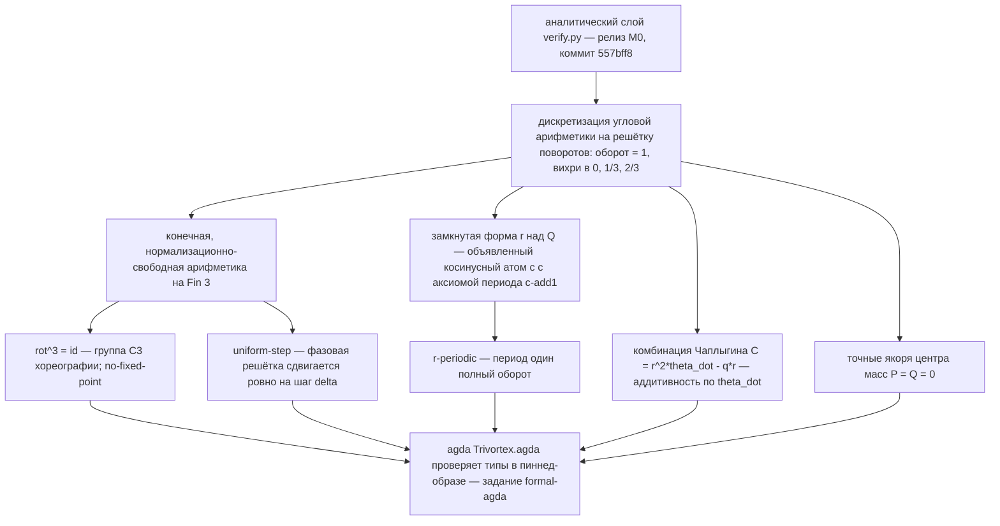

<!-- markdownlint-disable-file MD041 -->
<div align="center">

# 🧩 Верификация на Agda — конструктивная арифметика углов


[](https://github.com/wild8highlander/Trivortex/actions/workflows/verification-ports.yml)


</div>

> **Навигация:** [`verification`](../README.md) › **`agda`**

> Конструктивный порт слоя формулировок **TRIVORTEX**
> (`code/trivortex_core*.py`): угловая арифметика равносторонней
> хореографии ведётся на решётке поворотов, на которой она и живёт, —
> один полный оборот принят за единицу, три вихря занимают точки
> решётки 0, 1/3, 2/3, и утверждения хореографии сводятся к конечной,
> нормализационно-свободной арифметике на `Fin 3`.
>
> **Статус: реализовано — v1.1 (веха M2).** Артефакт
> [`Trivortex.agda`](Trivortex.agda), CI-вызываемая проверка и
> двуязычная документация живут в этом каталоге; критерии приёмки ниже
> выполнены. Локальные запуски требуют пиннед-тулчейн (Docker); CI
> репозитория гоняет порт non-blocking (см.
> [`verification/README.md`](../README.md) §7).

---

## 📂 Состав каталога

В этом каталоге: [`README.md`](README.md) (английский документ, язык
репозитория и CI) · [`README_RU.md`](README_RU.md) (этот перевод, та же
структура).

| Файл | Размер | Строк | Описание |
|---|---|---|---|
| [`Trivortex.agda`](Trivortex.agda) | 11 786 Б | 254 | Артефакт вехи M2: конструктивная арифметика углов — решётка поворотов C3, фазовая решётка, периодичность замкнутой формы над ℚ, комбинация Чаплыгина, точные якоря центра масс |

## 🚀 Сборка и запуск

Пиннед-тулчейн — [`docker/agda/Dockerfile`](../docker/agda/Dockerfile)
(образ `agda/agda:2.6.4`, стандартная библиотека Agda входит в образ):

```bash
docker build -t trivortex-agda verification/docker/agda
docker run --rm -v "$PWD":/work -w /work trivortex-agda \
    agda verification/agda/Trivortex.agda
```

Либо через Makefile из каталога `verification/` (`make help` перечисляет все цели):

```bash
make agda        # проверка типов Trivortex.agda (нужен локальный Agda 2.6.4)
```

CI выполняет ровно ту же docker-проверку в non-blocking задании
*formal-agda* воркфлоу
[`verification-ports.yml`](https://github.com/wild8highlander/Trivortex/actions/workflows/verification-ports.yml).

## ✅ Что здесь верифицировано

Порт фиксирует ровно три объекта, чтобы каждый язык доказывал или
вычислял *те же* утверждения и результаты оставались сопоставимыми:

1. **Теорема 3.1 (замкнутая форма).**
   `r_k(t) = sqrt(C_Ch) * (1 + eps*cos(omega*t + 2*pi*k/3))`,
   `theta_k(t) = omega*t + 2*pi*k/3`,
   `omega = (2*pi/T)*exp(C_Ch/pi)`, `eps = 1/(exp(C_Ch/pi) - 1)`;
   свойства к установлению: точное угловое разделение `2*pi/3`
   (равносторонняя хореография) и периодичность
   `r_k(t + 2*pi/omega) = r_k(t)`.
2. **Интеграл Чаплыгина.** Комбинация
   `C_Ch = r^2*(theta_dot - q*A_theta)` при `A_theta = 1/r`, согласно
   определению из раздела 6 основного документа, вместе с
   зарегистрированной диагностикой дрейфа на концах отрезка `[0, 100*T]`.
3. **Вихревые интегралы.** `H`, `P = sum(Gamma*x)`, `Q = sum(Gamma*y)`,
   `I = sum(Gamma*|r|^2)` вдоль численно проинтегрированных траекторий
   Кирхгофа — с сохранением в полосах допусков
   [`verification/tests/`](../tests/README.md).

Что артефакт реально сертифицирует, по разделам (все доказательства —
термовые, `refl` и эквациональные цепочки — без тактик и без аксиом,
кроме двух объявленных постулатов):

| Раздел [`Trivortex.agda`](Trivortex.agda) | Сертифицированное свойство |
|---|---|
| 1 — решётка поворотов C3 | `rot³-id`: три шага по 1/3 оборота дают полный оборот на `Fin 3`; `no-fixed-point`: орбита со сдвигом 1/3 никогда не совпадает сама с собой (V1, свойство (a) + группа C3) |
| 2 — фазовая решётка | `uniform-step` / `phase-shifts-by-one-step`: фазы соседних вихрей сдвигаются ровно на один шаг δ, для любого δ (жёсткий сдвиг 120°, в частности при δ = 1/3) |
| 3 — замкнутая радиальная форма над ℚ | `r-periodic`: `r(t + 1) = r(t)` в единицах оборота, при единственной объявленной аксиоме — период косинусного атома `c` равен одному обороту (V1, свойство (b)) |
| 4 — комбинация Чаплыгина | `C-additive`: `C(r, θ̇+δ, q) = C(r, θ̇, q) + r²·δ` для `C = r²θ̇ − q·r` — алгебраическая форма, которую записывают лестницы |
| 5 — вихревые интегралы | `P-anchored` / `Q-anchored`: если центр масс в начале координат, то `P = Q = 0` *точно*, при любом Γ — аналитический якорь проверки V3; определение `I` держит все четыре интеграла в одном модуле |

**След аксиом (объявлен, больше ничего не постулируется):**

```agda
postulate
  c      : ℚ → ℚ                      -- косинусный атом
  c-add1 : ∀ q → c (q + 1ℚ) ≡ c q     -- период: один оборот
```

Всё остальное выведено конструктивно из стандартной библиотеки Agda.
Замыкание фазовой решётки (три равномерных шага закрывают круг) — это в
точности содержание `rot³-id` на стороне решётки; соответствующее
отождествление «оборота по модулю» на стороне ℚ живёт за объявленной
аксиомой периода — честное разделение труда, зафиксированное в шапке
артефакта. В этом роль Agda в матрице: конструктивный фон служит
стресс-тестом того, что слой формулировок Теоремы 3.1 сформулирован без
случайных классических shortcuts.



## 📋 Критерии приёмки (все выполнены)

- [x] Три объекта выше выражены на Agda (стандартная библиотека) без скрытых
      допущений, кроме аксиом из шапки артефакта
      (`verification/agda/Trivortex.agda`);
- [x] CI-вызываемая проверка: `agda verification/agda/Trivortex.agda` —
      проверка типов конструктивного модуля в пиннед-образе (воркфлоу
      `verification-ports.yml`, задание *formal-agda*);
- [x] Шапка артефакта несёт строки SPDX + копирайта (REUSE.toml) и
      примечание о происхождении со ссылкой на коммит `verify.py`,
      зеркало которого это файл (557bff8, релиз M0);
- [x] Строка таблицы статусов в `verification/README.md` переключена в
      *landed (v1.1)* со ссылкой.

## 🔧 Пин тулчейна и вехи

| Пин | Значение |
|---|---|
| Тулчейн | Agda 2.6.4 |
| Docker-пин | [`docker/agda/Dockerfile`](../docker/agda/Dockerfile) — образ `agda/agda:2.6.4` |
| Артефакт | `verification/agda/Trivortex.agda` — **реализован** (v1.1) |
| Веха | **M2** поэтапного плана (вместе с [Isabelle](../isabelle/README_RU.md)) |
| Статус CI | non-blocking задание *formal-agda* в `verification-ports.yml` |

Контекст вех: **M1** — [Coq](../coq/README_RU.md),
[Lean 4](../lean4/README.md) и [Rust](../rust/README_RU.md); **M2** — две
перекрёстно проверяющие формализации Isabelle + Agda; **M3** — порты
[C++](../cpp/README_RU.md) и [Haskell](../haskell/README_RU.md). Таблица
статусов — в [`verification/README.md`](../README.md) §7.

## 🔗 Перекрёстные ссылки

- [Фреймворк верификации](../README.md) — вехи, полосы допусков, схема протокола
- [Lean 4 хаб](../lean4/README.md) — формализация того же слоя формулировок в Mathlib (M1)
- [Порт Coq](../coq/README_RU.md) — классический слой формулировок, который этот порт конструктивно стресс-тестирует
- [Порт Isabelle](../isabelle/README_RU.md) — вторая формализация M2
- [Docker-пин](../docker/agda/Dockerfile) и [pytest-защита](../tests/README.md) — полосы допусков, которые числовые лестницы enforce при каждом запуске
- CI-воркфлоу: [`verification-ports.yml`](https://github.com/wild8highlander/Trivortex/actions/workflows/verification-ports.yml) · цели Makefile: `make agda`

---

<div align="center">

**[⬆ Наверх](#-верификация-на-agda--конструктивная-арифметика-углов)** ·
**[Корень репозитория](../../README.md)**

*Часть [wild8highlander/Trivortex](https://github.com/wild8highlander/Trivortex) · Лицензия [IPL-RP-1.0](https://github.com/wild8highlander/Trivortex/blob/main/LICENSE.md) — All Rights Reserved*

</div>
