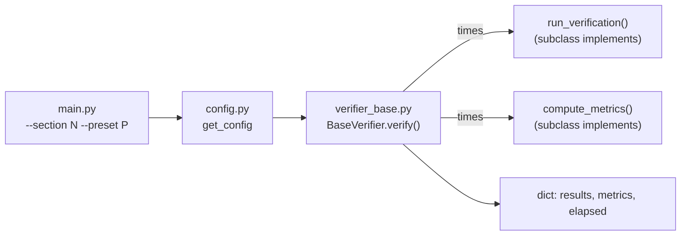

<!-- markdownlint-disable-file MD041 -->
<div align="center">

# 🧰 common · python — the Utility Package

</div>

> **Navigation:** [`verification`](../../README.md) › [`common`](../README.md) › **`python`**

  

The **utility package** itself: four modules totalling 2 162 B, pure standard library. `verifier_base.py` (the heart) implements the shared verifier contract as a template method; `config.py` the presets and the section registry; `main.py` the CLI entry; `__init__.py` the package marker. This is the shared protocol for composed TRIVORTEX verification front-ends — the working ladder in [`trivortex/`](../../trivortex/README.md) stays single-file by design and does not import it.

## 📂 Contents — What Lives Here

| File | Size | Description |
|---|---|---|
| [`__init__.py`](__init__.py) | 48 B | package marker — the module docstring "Common Python framework for verification." |
| [`config.py`](config.py) | 745 B | `PRESETS` (quick / default / full / extreme), `SECTION_NAMES` (sections 1–4), `get_config(section_id, preset)` |
| [`main.py`](main.py) | 621 B | CLI: `--section` (default 1) and `--preset` (default `default`); prints the section name, the preset and the resolved config |
| [`verifier_base.py`](verifier_base.py) | 748 B | `BaseVerifier` — template method `verify()`: times `run_verification()` + `compute_metrics()`, returns `{"results", "metrics", "elapsed"}` |

## 🧩 The module map



## ⚙️ The registered presets

| Preset | `N` | `tolerance` | `max_iter` |
|---|---|---|---|
| `quick` | 16 | 1e-3 | 1 000 |
| `default` | 36 | 1e-10 | 10 000 |
| `full` | 64 | 1e-14 | 50 000 |
| `extreme` | 128 | 1e-16 | 100 000 |

`get_config(section_id, preset)` resolves the preset dictionary
(falling back to `default` for an unknown name); the `section_id`
argument selects the entry of the section registry:

| Section | Registered name |
|---|---|
| 1 | TRIVORTEX: Theorem 3.1 closed form & choreography |
| 2 | TRIVORTEX: Chaplygin topological integral |
| 3 | TRIVORTEX: Lagrange rigid rotation (numerical) |
| 4 | TRIVORTEX: Vortex integrals H, P, Q, I |

## ▶️ How to Run

```bash
# from verification/ (the `make common` target):
python3 common/python/main.py --section 1 --preset default

# from the repository root:
python3 verification/common/python/main.py --section 1 --preset default
```

Expected output: the section's registered name, the preset line with the
resolved configuration, and `Verification complete.` — the sanity check
of the kept package quoted in [§9 of the framework hub](../../README.md#9-how-to-reproduce-everything).

## ✅ What Is Verified Here

Nothing physical — by design. This package is the **contract layer**:
a new section front-end subclasses `BaseVerifier`, implements
`run_verification()` and `compute_metrics()`, and inherits the timed,
uniform result dict. The actual physics checks live in the independent
ladder [`trivortex/python/verify.py`](../../trivortex/python/verify.py)
and its ports; the pytest guard of [`tests/`](../../tests/README.md)
pins those numbers. An honest note: `verify()` currently reports the
elapsed wall time of the two phase calls — the JSON emission of the
protocol stays the job of each front-end, matching the ladder's
`verify.py`, which writes its protocol itself.

## 🔗 Cross-References

- [Framework root — verification/](../../README.md)
- [Parent layer — common/](../README.md)
- [Working ladder — trivortex/](../../trivortex/README.md)
- [Lean 4 hub — formal statements of the same sections](../../lean4/README.md)

## 🇷🇺 Краткое резюме (Russian Summary)

Пакет утилит (2 162 B, чистая стандартная библиотека): `verifier_base.py` — `BaseVerifier` с шаблонным методом `verify()` (таймер `perf_counter`, результат — словарь `results / metrics / elapsed`; `run_verification` и `compute_metrics` абстрактные); `config.py` — пресеты `quick/default/full/extreme` (N, tolerance, max_iter) и реестр разделов 1–4; `main.py` — CLI `--section`/`--preset`; `__init__.py` — маркер пакета. Физических проверок здесь нет — это слой контракта; лестница и порты живут отдельно.

---

<div align="center">

**[⬆ Back to top](#-common--python--the-utility-package)** ·
**[Repository root](../../README.md)**

*Part of [wild8highlander/Trivortex](https://github.com/wild8highlander/Trivortex) · Licensed under [IPL-RP-1.0](https://github.com/wild8highlander/Trivortex/blob/main/LICENSE.md) — All Rights Reserved*

</div>
