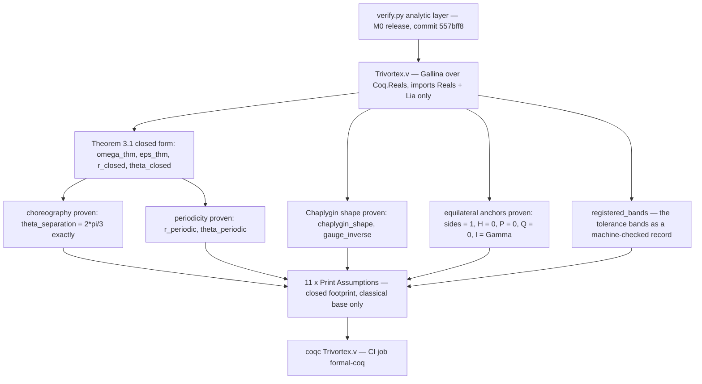

<!-- markdownlint-disable-file MD041 -->
<div align="center">

# 🐓 Coq / Rocq Verification — the Proven Statement Layer


[](https://github.com/wild8highlander/Trivortex/actions/workflows/verification-ports.yml)


</div>

> **Navigation:** [`verification`](../README.md) › **`coq`**

> The formalization of the **TRIVORTEX** statement layer
> (`code/trivortex_core*.py`): Theorem 3.1 (the Lagrange-type rotating
> solution) and the conservation of the Chaplygin-type vortex integrals,
> expressed natively in Gallina over the constructive reals of the
> standard library — with the choreography, the periodicity and the exact
> equilateral anchors **proven**, not stated.
>
> **Status: landed — v1.1 (milestone M1).** The artifact
> [`Trivortex.v`](Trivortex.v), the CI-callable check and the bilingual
> documentation live in this directory; the acceptance criteria below are
> checked. Local runs need the pinned toolchain (Docker); the repository
> CI runs the port non-blocking until it stays green for three
> consecutive days (see [`verification/README.md`](../README.md) §7).

---

## 📂 Contents — What Lives Here

This directory: [`README.md`](README.md) (this document) ·
[`README_RU.md`](README_RU.md) (the Russian overview, same structure).

| File | Size | Lines | Description |
|---|---|---|---|
| [`Trivortex.v`](Trivortex.v) | 15 341 B | 377 | The M1 artifact: the statement layer of Theorem 3.1, the Chaplygin integral and the vortex integrals in Gallina — with zero `Axiom`/`Parameter`/`Hypothesis` and the axiom footprint printed at the bottom |

## 🚀 How to Build / Run

The pinned toolchain is [`docker/coq/Dockerfile`](../docker/coq/Dockerfile)
(image `coqorg/coq:8.18-ocaml-4.14`):

```bash
docker build -t trivortex-coq verification/docker/coq
docker run --rm -v "$PWD":/work -w /work trivortex-coq \
    coqc verification/coq/Trivortex.v
```

Or via the Makefile from `verification/` (`make help` lists all targets):

```bash
make coq         # coqc coq/Trivortex.v — compile + Print Assumptions
```

CI runs exactly the dockerized check in the non-blocking job
*formal-coq* of
[`verification-ports.yml`](https://github.com/wild8highlander/Trivortex/actions/workflows/verification-ports.yml).

## ✅ What Is Verified Here

The port fixes exactly three objects, so that every language proves or
computes the *same* statements and the results stay comparable:

1. **Theorem 3.1 (closed form).**
   `r_k(t) = sqrt(C_Ch) * (1 + eps*cos(omega*t + 2*pi*k/3))`,
   `theta_k(t) = omega*t + 2*pi*k/3`,
   `omega = (2*pi/T)*exp(C_Ch/pi)`, `eps = 1/(exp(C_Ch/pi) - 1)`;
   properties to establish: exact `2*pi/3` angular separation (equilateral
   choreography) and periodicity `r_k(t + 2*pi/omega) = r_k(t)`.
2. **Chaplygin integral.** The combination
   `C_Ch = r^2*(theta_dot - q*A_theta)` with `A_theta = 1/r`, following the
   definition fixed in Section 6 of the core document, together with its
   recorded endpoint-drift diagnostic over `[0, 100*T]`.
3. **Vortex integrals.** `H`, `P = sum(Gamma*x)`, `Q = sum(Gamma*y)`,
   `I = sum(Gamma*|r|^2)` along numerically integrated Kirchhoff
   trajectories — conserved to the tolerance bands of
   [`verification/tests/`](../tests/README.md).

What the artifact actually certifies (every lemma proven from
`Coq.Reals` — the file imports only `Reals` and `Lia`):

| Certified in [`Trivortex.v`](Trivortex.v) | Statement |
|---|---|
| `theta_separation` | the phase separation of consecutive vortices is exactly `2*pi/3` — the equilateral choreography (V1, property (a)) |
| `theta_three_step`, `r_periodic`, `theta_periodic` | the closed form is periodic: `r_k(t + 2*pi/omega) = r_k(t)` and `theta_k(t + 2*pi/omega) = theta_k(t) + 2*pi` (V1, property (b)) |
| `omega_thm_nonzero`, `omega_thm_pos` | the analytic frequency `(2*pi/T)*exp(C_Ch/pi)` is well-defined and positive |
| `chaplygin_shape`, `gauge_inverse` | the Chaplygin combination reduces to `C_Ch = r^2*theta_dot - q*r` in the gauge `A_theta = 1/r` of Section 6 of the core document |
| `side1`, `side2`, `side3` | the sides of the equilateral reference state (coordinates built from `1/sqrt(3)`) are exactly `1` |
| `H_equilateral`, `P_equilateral`, `Q_equilateral`, `I_equilateral` | the exact anchor values of the equilateral reference state: **H = 0, P = 0, Q = 0, I = Γ** — the analytic anchors behind checks V3/V4 |
| `registered_bands` (record `tolerance_bands`) | the tolerance bands of the framework (§6) as a machine-checked constant: `1/10^12` closed-form residuals, `1/10^10` RK4 drifts, `1/10^6` measured omega — every language port quotes these numbers |

**Axiom footprint:** no `Axiom`/`Parameter`/`Hypothesis` anywhere in the
file. The file closes with **11 `Print Assumptions`** calls (on
`theta_separation`, `theta_three_step`, `r_periodic`, `theta_periodic`,
`omega_thm_pos`, `chaplygin_shape`, `gauge_inverse`, `H_equilateral`,
`P_equilateral`, `Q_equilateral`, `I_equilateral`) demonstrating the
closed footprint — the reported axioms are only the classical-logic axioms
of the standard library itself (`classic`, `propext`), the same base
every `Coq.Reals` development inherits.

Coq's role in the matrix: the natural home for the *statement layer* —
the closed form, the choreography property and the periodicity lemma are
plain real-analysis statements over `R`. The goal is not a full
mechanization of hydrodynamics; it is a machine-checked kernel that pins
the exact formulas and their immediate consequences, so any future
refactor of the numerical code can be diffed against a proven
specification.



## 📋 Acceptance Criteria (all checked)

- [x] The three objects above are expressed in Gallina with no hidden
      assumptions beyond the axioms listed in the artifact header
      (`verification/coq/Trivortex.v`);
- [x] A CI-callable check: `coqc verification/coq/Trivortex.v` — compiles the statement layer and prints the closed axiom footprint (workflow `verification-ports.yml`, job *formal-coq*);
- [x] The artifact header carries SPDX + copyright lines (REUSE.toml)
      and a provenance note pointing at the commit of `verify.py` it
      mirrors (557bff8, the M0 release);
- [x] `verification/README.md` status table flips this row to
      *landed (v1.1)* with a link.

## 🔧 Toolchain Pin and Milestones

| Pin | Value |
|---|---|
| Toolchain | Coq / Rocq 8.18 |
| Docker pin | [`docker/coq/Dockerfile`](../docker/coq/Dockerfile) — image `coqorg/coq:8.18-ocaml-4.14` |
| Artifact | `verification/coq/Trivortex.v` — **landed** (v1.1) |
| Milestone | **M1** of the staged plan (with [Lean 4](../lean4/README.md) and [Rust](../rust/README.md)) |
| CI status | non-blocking job *formal-coq* in `verification-ports.yml`; promotion to blocking after three green days |

Milestone context: **M1** = independent re-derivation — two proof
assistants ([Coq](../coq/README.md) +
[Lean 4](../lean4/README.md)) prove the statement layer and the
[Rust](../rust/README.md) numeric twin reproduces the ladder numbers;
**M2** adds [Isabelle](../isabelle/README.md) +
[Agda](../agda/README.md); **M3** adds [C++](../cpp/README.md) +
[Haskell](../haskell/README.md). The status table lives in
[`verification/README.md`](../README.md) §7.

## 🔗 Cross-References

- [Verification framework](../README.md) — milestones, tolerance bands, protocol schema
- [Lean 4 hub](../lean4/README.md) — the Mathlib formalization proving the same statements (the M1 cross-check)
- [Isabelle port](../isabelle/README.md) — the HOL mirror of this statement layer, session by session
- [Agda port](../agda/README.md) — the constructive stress test of the statement layer
- [Rust / C++ / Haskell ports](../rust/README.md) — the numeric ladders enforcing the bands proven here as `registered_bands`
- [Docker pin](../docker/coq/Dockerfile) and [pytest guard](../tests/README.md) — tolerance-band rationale and enforcement
- CI workflow: [`verification-ports.yml`](https://github.com/wild8highlander/Trivortex/actions/workflows/verification-ports.yml) · Makefile target: `make coq`

---

<div align="center">

**[⬆ Back to top](#-coq--rocq-verification--the-proven-statement-layer)** ·
**[Repository root](../../README.md)**

*Part of [wild8highlander/Trivortex](https://github.com/wild8highlander/Trivortex) · Licensed under [IPL-RP-1.0](https://github.com/wild8highlander/Trivortex/blob/main/LICENSE.md) — All Rights Reserved*

</div>
