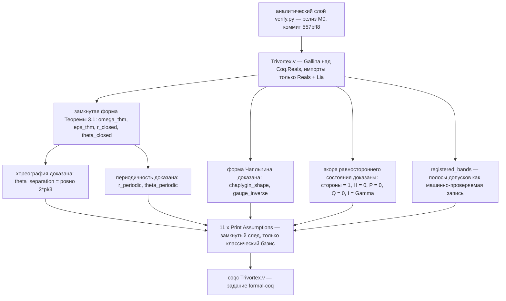

<!-- markdownlint-disable-file MD041 -->
<div align="center">

# 🐓 Верификация в Coq / Rocq — доказанный слой формулировок


[](https://github.com/wild8highlander/Trivortex/actions/workflows/verification-ports.yml)


</div>

> **Навигация:** [`verification`](../README.md) › **`coq`**
>
> Формализация слоя формулировок **TRIVORTEX** (`code/trivortex_core*.py`):
> Теорема 3.1 (лагранжево вращающееся решение) и сохранение вихревых
> интегралов чаплыгинского типа, выраженные нативно в Gallina над
> конструктивными действительными числами стандартной библиотеки — причём
> хореография, периодичность и точные якоря равностороннего состояния
> **доказаны**, а не просто сформулированы.
>
> **Статус: реализовано — v1.1 (веха M1).** Артефакт
> [`Trivortex.v`](Trivortex.v), CI-вызываемая проверка и двуязычная
> документация живут в этом каталоге; критерии приёмки ниже выполнены.
> Локальные запуски требуют пиннед-тулчейн (Docker); CI репозитория гоняет
> порт non-blocking, пока он не зелёный три дня подряд (см.
> [`verification/README.md`](../README.md) §7).

---

## 📂 Состав каталога

В этом каталоге: [`README.md`](README.md) (английский документ, язык
репозитория и CI) · [`README_RU.md`](README_RU.md) (этот перевод, та же
структура).

| Файл | Размер | Строк | Описание |
|---|---|---|---|
| [`Trivortex.v`](Trivortex.v) | 15 341 Б | 377 | Артефакт вехи M1: слой формулировок Теоремы 3.1, интеграла Чаплыгина и вихревых интегралов в Gallina — без единого `Axiom`/`Parameter`/`Hypothesis`, со следом аксиом, напечатанным в конце файла |

## 🚀 Сборка и запуск

Пиннед-тулчейн — [`docker/coq/Dockerfile`](../docker/coq/Dockerfile)
(образ `coqorg/coq:8.18-ocaml-4.14`):

```bash
docker build -t trivortex-coq verification/docker/coq
docker run --rm -v "$PWD":/work -w /work trivortex-coq \
    coqc verification/coq/Trivortex.v
```

Либо через Makefile из каталога `verification/` (`make help` перечисляет все цели):

```bash
make coq         # coqc coq/Trivortex.v — компиляция + Print Assumptions
```

CI выполняет ровно ту же docker-проверку в non-blocking задании
*formal-coq* воркфлоу
[`verification-ports.yml`](https://github.com/wild8highlander/Trivortex/actions/workflows/verification-ports.yml).

## ✅ Что здесь верифицировано

Порт фиксирует ровно три объекта, чтобы каждый язык доказывал или
вычислял *те же* утверждения и результаты оставались сопоставимыми:

1. **Теорема 3.1 (замкнутая форма).**
   `r_k(t) = sqrt(C_Ch) * (1 + eps*cos(omega*t + 2*pi*k/3))`,
   `theta_k(t) = omega*t + 2*pi*k/3`,
   `omega = (2*pi/T)*exp(C_Ch/pi)`, `eps = 1/(exp(C_Ch/pi) - 1)`;
   свойства к установлению: точное угловое разделение `2*pi/3`
   (равносторонняя хореография) и периодичность
   `r_k(t + 2*pi/omega) = r_k(t)`.
2. **Интеграл Чаплыгина.** Комбинация
   `C_Ch = r^2*(theta_dot - q*A_theta)` при `A_theta = 1/r`, согласно
   определению из раздела 6 основного документа, вместе с
   зарегистрированной диагностикой дрейфа на концах отрезка `[0, 100*T]`.
3. **Вихревые интегралы.** `H`, `P = sum(Gamma*x)`, `Q = sum(Gamma*y)`,
   `I = sum(Gamma*|r|^2)` вдоль численно проинтегрированных траекторий
   Кирхгофа — с сохранением в полосах допусков
   [`verification/tests/`](../tests/README.md).

Что артефакт реально сертифицирует (каждая лемма доказана из `Coq.Reals` —
файл импортирует только `Reals` и `Lia`):

| Сертифицировано в [`Trivortex.v`](Trivortex.v) | Утверждение |
|---|---|
| `theta_separation` | разделение фаз соседних вихрей равно ровно `2*pi/3` — равносторонняя хореография (V1, свойство (a)) |
| `theta_three_step`, `r_periodic`, `theta_periodic` | замкнутая форма периодична: `r_k(t + 2*pi/omega) = r_k(t)` и `theta_k(t + 2*pi/omega) = theta_k(t) + 2*pi` (V1, свойство (b)) |
| `omega_thm_nonzero`, `omega_thm_pos` | аналитическая частота `(2*pi/T)*exp(C_Ch/pi)` корректно определена и положительна |
| `chaplygin_shape`, `gauge_inverse` | комбинация Чаплыгина сводится к `C_Ch = r^2*theta_dot - q*r` при калибровке `A_theta = 1/r` из раздела 6 основного документа |
| `side1`, `side2`, `side3` | стороны равностороннего опорного состояния (координаты построены из `1/sqrt(3)`) равны ровно `1` |
| `H_equilateral`, `P_equilateral`, `Q_equilateral`, `I_equilateral` | точные якорные значения равностороннего опорного состояния: **H = 0, P = 0, Q = 0, I = Γ** — аналитические якоря проверок V3/V4 |
| `registered_bands` (запись `tolerance_bands`) | полосы допусков фреймворка (§6) как машинно-проверяемая константа: `1/10^12` для остатков замкнутой формы, `1/10^10` для дрейфов RK4, `1/10^6` для измеренной omega — каждый языковой порт цитирует эти числа |

**След аксиом:** ни одного `Axiom`/`Parameter`/`Hypothesis` в файле нет.
Файл завершают **11 вызовов `Print Assumptions`** (для `theta_separation`,
`theta_three_step`, `r_periodic`, `theta_periodic`, `omega_thm_pos`,
`chaplygin_shape`, `gauge_inverse`, `H_equilateral`, `P_equilateral`,
`Q_equilateral`, `I_equilateral`), демонстрирующие замкнутый след —
в отчёт попадают только классические аксиомы самой стандартной библиотеки
(`classic`, `propext`), тот же базис, что наследует любая разработка над
`Coq.Reals`.

Роль Coq в матрице: естественный дом *слоя формулировок* — замкнутая
форма, свойство хореографии и лемма о периодичности — обычные утверждения
вещественного анализа над `R`. Цель — не полная механизация гидродинамики,
а машинно-проверяемое ядро, фиксирующее точные формулы и их непосредственные
следствия, чтобы любой будущий рефакторинг численного кода можно было
сравнить с доказанной спецификацией.



## 📋 Критерии приёмки (все выполнены)

- [x] Три объекта выше выражены в Gallina без скрытых допущений, кроме аксиом,
      перечисленных в шапке артефакта (`verification/coq/Trivortex.v`);
- [x] CI-вызываемая проверка: `coqc verification/coq/Trivortex.v` —
      компилирует слой формулировок и печатает замкнутый след аксиом
      (воркфлоу `verification-ports.yml`, задание *formal-coq*);
- [x] Шапка артефакта несёт строки SPDX + копирайта (REUSE.toml) и
      примечание о происхождении со ссылкой на коммит `verify.py`,
      зеркало которого это файл (557bff8, релиз M0);
- [x] Строка таблицы статусов в `verification/README.md` переключена в
      *landed (v1.1)* со ссылкой.

## 🔧 Пин тулчейна и вехи

| Пин | Значение |
|---|---|
| Тулчейн | Coq / Rocq 8.18 |
| Docker-пин | [`docker/coq/Dockerfile`](../docker/coq/Dockerfile) — образ `coqorg/coq:8.18-ocaml-4.14` |
| Артефакт | `verification/coq/Trivortex.v` — **реализован** (v1.1) |
| Веха | **M1** поэтапного плана (вместе с [Lean 4](../lean4/README.md) и [Rust](../rust/README_RU.md)) |
| Статус CI | non-blocking задание *formal-coq* в `verification-ports.yml`; перевод в blocking после трёх зелёных дней |

Контекст вех: **M1** = независимое пере-выведение — два пруф-ассистента
([Coq](../coq/README_RU.md) + [Lean 4](../lean4/README.md)) доказывают слой
формулировок, а числовой двойник на [Rust](../rust/README_RU.md)
воспроизводит числа лестницы; **M2** добавляет
[Isabelle](../isabelle/README_RU.md) + [Agda](../agda/README_RU.md);
**M3** добавляет [C++](../cpp/README_RU.md) +
[Haskell](../haskell/README_RU.md). Таблица статусов — в
[`verification/README.md`](../README.md) §7.

## 🔗 Перекрёстные ссылки

- [Фреймворк верификации](../README.md) — вехи, полосы допусков, схема протокола
- [Lean 4 хаб](../lean4/README.md) — формализация в Mathlib, доказывающая те же утверждения (перекрёстная проверка M1)
- [Порт Isabelle](../isabelle/README_RU.md) — HOL-зеркало этого слоя формулировок, сессия в сессию
- [Порт Agda](../agda/README_RU.md) — конструктивный стресс-тест слоя формулировок
- [Порты Rust / C++ / Haskell](../rust/README_RU.md) — числовые лестницы, которые enforce полосы допусков, доказанные здесь как `registered_bands`
- [Docker-пин](../docker/coq/Dockerfile) и [pytest-защита](../tests/README.md) — обоснование и контроль полос допусков
- CI-воркфлоу: [`verification-ports.yml`](https://github.com/wild8highlander/Trivortex/actions/workflows/verification-ports.yml) · цель Makefile: `make coq`

---

<div align="center">

**[⬆ Наверх](#-верификация-в-coq--rocq--доказанный-слой-формулировок)** ·
**[Корень репозитория](../../README.md)**

*Часть [wild8highlander/Trivortex](https://github.com/wild8highlander/Trivortex) · Лицензия [IPL-RP-1.0](https://github.com/wild8highlander/Trivortex/blob/main/LICENSE.md) — All Rights Reserved*

</div>
