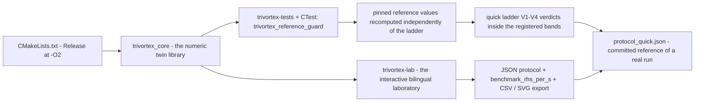

<!-- markdownlint-disable-file MD041 -->
<div align="center">

# 🔧 C++ Verification — the Compiled Benchmark Ladder


[](https://github.com/wild8highlander/Trivortex/actions/workflows/verification-ports.yml)


</div>

> **Navigation:** [`verification`](../README.md) › **`cpp`**

> The compiled, throughput-oriented port of the **TRIVORTEX** document
> (`code/trivortex_core*.py`): a dependency-free C++17 numeric twin of the
> V1–V4 ladder — the same four checks with `std::sin`/`std::cos` and a
> fixed-order RK4 — driven by CMake/CTest and timed at `-O2`, plus the
> interactive bilingual laboratory `trivortex-lab`.
>
> **Status: landed — v1.1 (milestone M3).** The artifact, the
> CI-callable check and the bilingual documentation live in this
> directory; the acceptance criteria below are checked. Local runs
> need the pinned toolchain (Docker); the repository CI runs the
> port non-blocking (see [`verification/README.md`](../README.md) §7).

---

## 📂 Contents — What Lives Here

This directory: [`README.md`](README.md) (this document) ·
[`README_RU.md`](README_RU.md) (the Russian overview, same structure) ·
[`src/README.md`](src/README.md) (the annotated source map).

| File | Size | Lines | Description |
|---|---|---|---|
| [`CMakeLists.txt`](CMakeLists.txt) | 1 295 B | 34 | CMake ≥ 3.16, C++17, Release at `-O2`; targets `trivortex_core` (library), `trivortex-lab` (the laboratory) and `trivortex-tests` with the CTest test `trivortex_reference_guard` |
| [`src/verify.hpp`](src/verify.hpp) | 7 098 B | 196 | The core header: the closed form, the Chaplygin combination, the Kirchhoff RHS, the RK4 stepper, the registered tolerance bands, the JSON value tree, the i18n hooks |
| [`src/verify.cpp`](src/verify.cpp) | 29 363 B | 751 | The ladder implementation: V1–V4 with recorded residuals and the JSON protocol payload |
| [`src/tests.cpp`](src/tests.cpp) | 5 366 B | 124 | The CTest guard: pinned reference values recomputed independently of the ladder code paths ("pinned, not assumed") |
| [`src/main.cpp`](src/main.cpp) | 18 964 B | 400 | The CLI entry point of `trivortex-lab`: preset selection, protocol output, the benchmark mode, the bilingual menu |
| [`protocol_quick.json`](protocol_quick.json) | 2 411 B | 84 | The committed reference protocol of a real quick run (the pytest guard pins against it) |

## 🚀 How to Build / Run

Direct CMake flow (from the repository root):

```bash
cmake -S verification/cpp -B verification/cpp/build -DCMAKE_BUILD_TYPE=Release
cmake --build verification/cpp/build -j
ctest --test-dir verification/cpp/build --output-on-failure
./verification/cpp/build/trivortex-lab        # interactive menu
```

Or via the Makefile from `verification/` (`make help` lists all targets):

```bash
make cpp         # cmake configure + build + CTest guard
make cpp-lab     # ./cpp/build/trivortex-lab
```

The pinned toolchain is [`docker/cpp/Dockerfile`](../docker/cpp/Dockerfile)
(image `gcc:13` + CMake; the Docker entrypoint runs the CTest guard and
then the quick ladder in CI mode with `--out-dir outputs/cpp`):

```bash
docker build -t trivortex-cpp verification/docker/cpp
docker run --rm trivortex-cpp
```

CI runs the same flow in the non-blocking job *cpp-ctest* of
[`verification-ports.yml`](https://github.com/wild8highlander/Trivortex/actions/workflows/verification-ports.yml).

## ✅ What Is Verified Here

The port fixes exactly three objects, so that every language proves or
computes the *same* statements and the results stay comparable:

1. **Theorem 3.1 (closed form).**
   `r_k(t) = sqrt(C_Ch) * (1 + eps*cos(omega*t + 2*pi*k/3))`,
   `theta_k(t) = omega*t + 2*pi*k/3`,
   `omega = (2*pi/T)*exp(C_Ch/pi)`, `eps = 1/(exp(C_Ch/pi) - 1)`;
   properties to establish: exact `2*pi/3` angular separation (equilateral
   choreography) and periodicity `r_k(t + 2*pi/omega) = r_k(t)`.
2. **Chaplygin integral.** The combination
   `C_Ch = r^2*(theta_dot - q*A_theta)` with `A_theta = 1/r`, following the
   definition fixed in Section 6 of the core document, together with its
   recorded endpoint-drift diagnostic over `[0, 100*T]`.
3. **Vortex integrals.** `H`, `P = sum(Gamma*x)`, `Q = sum(Gamma*y)`,
   `I = sum(Gamma*|r|^2)` along numerically integrated Kirchhoff
   trajectories — conserved to the tolerance bands of
   [`verification/tests/`](../tests/README.md).

The V1–V4 registers (same names, same bands as every other port):

| Check | Registered band | Committed quick-protocol value ([`protocol_quick.json`](protocol_quick.json), 2026-10-08) |
|---|---|---|
| V1 Theorem 3.1: choreography + periodicity of the closed form | `1e-12` | angular separation error `6.88e-14`, periodicity residual `9.39e-14` |
| V2 Lagrange rigid rotation: shape + analytic ω = 3Γ/(2πa²) | shape `1e-10`, omega `1e-6` | shape drift `1.58e-14`, ω = `0.477464829275686` with relative error `2.86e-12` |
| V3 vortex integrals H, P, Q, I conserved (equal Γ) | `1e-10` | worst drift `2.93e-14` |
| V4 robustness: H, P, Q, I conserved for Γ = (1, 2, 3) | `1e-10` | worst drift `2.86e-14` |

The full run: `4/4 checks passed`, wall time `0.0038 s` — and the M3
benchmark metric `benchmark_rhs_per_s = 16734651.19`, i.e. **≈ 1.7·10⁷ RK4
right-hand-side evaluations per second** at `-O2`, recorded in every JSON
protocol this port emits.

The CTest guard ([`src/tests.cpp`](src/tests.cpp)) re-derives the pinned
reference values *independently of the ladder code paths* — 25 `expect_*`
assertions, among them: ω(C=1, T=2π) = `1.3748022274393588` to `1e-12`;
the ε guard (returns 1 for C_Ch ≤ 0.01); closed-form periodicity for each
of the three vortices; the Chaplygin shape identity; the Lagrange pins
ω_Lagrange(Γ, a) = 3Γ/(2πa²); the equilateral sides = 1; the antisymmetric
pair RHS; the quick-ladder verdicts V1–V4; the ω pin
`0.477464829275686`; every residual inside its registered band; and the
JSON serialization smoke (`suite`, `all_passed`, `benchmark_rhs_per_s`).

C++'s role in the matrix: keeping the legacy toolchain of computational
physics honest — the port is a single core translation unit implementing
the same four checks, driven by CMake/CTest. Its role is benchmarking
(compiled at `-O2` it runs orders of magnitude faster than the Python
ladder) and serving as the reference for any future GPU port of the
vortex dynamics. Where the statement is algebraic, the ladder separates
the float residual from the exact value: the ℚ(√3)-style evaluation
happens on the [Haskell](../haskell/README.md) side, and the C++ port
quantifies the floating-point envelope around it.



## 📋 Acceptance Criteria (all checked)

- [x] The three objects above are expressed in C++ (CMake) with no hidden
      assumptions beyond the artifact header
      (`verification/cpp/` — the CMake/CTest port + the `-O2` benchmark ladder);
- [x] A CI-callable check: `cmake -S verification/cpp -B build && ctest --test-dir build` — runs the pinned-reference guard and the benchmark ladder (workflow `verification-ports.yml`, job *cpp-ctest*);
- [x] The artifact header carries SPDX + copyright lines (REUSE.toml)
      and a provenance note pointing at the commit of `verify.py` it
      mirrors (557bff8, the M0 release);
- [x] `verification/README.md` status table flips this row to
      *landed (v1.1)* with a link.

## 🔧 Toolchain Pin and Milestones

| Pin | Value |
|---|---|
| Toolchain | C++17, CMake ≥ 3.16 |
| Docker pin | [`docker/cpp/Dockerfile`](../docker/cpp/Dockerfile) — image `gcc:13` + CMake, Release at `-O2` |
| Artifact | `verification/cpp/` (`src/verify.cpp` core, `src/main.cpp` laboratory, `src/tests.cpp` guard) — **landed** (v1.1) |
| Milestone | **M3** of the staged plan (with [Haskell](../haskell/README.md)) |
| CI status | non-blocking job *cpp-ctest* in `verification-ports.yml` |

Milestone context: **M1** delivered [Coq](../coq/README.md),
[Lean 4](../lean4/README.md) and [Rust](../rust/README.md); **M2** added
[Isabelle](../isabelle/README.md) + [Agda](../agda/README.md); **M3** is the
performance and exactness milestone — this compiled benchmark ladder plus
the exact-arithmetic [Haskell](../haskell/README.md) dual. The status table
lives in [`verification/README.md`](../README.md) §7.

## 🔗 Cross-References

- [Verification framework](../README.md) — milestones, tolerance bands, protocol schema
- [Lean 4 hub](../lean4/README.md) — the Mathlib formalization of the statement layer this ladder measures against
- [Rust port](../rust/README.md) — the other floating-point twin of the ladder
- [Haskell port](../haskell/README.md) — the exact ℚ(√3) dual that closes the residual split C++ quantifies
- [The C++ sources, annotated](src/README.md) — file-by-file map of the port
- [Docker pin](../docker/cpp/Dockerfile) and [pytest guard](../tests/README.md) — the committed numbers the pytest suite pins against
- CI workflow: [`verification-ports.yml`](https://github.com/wild8highlander/Trivortex/actions/workflows/verification-ports.yml) · Makefile targets: `make cpp`, `make cpp-lab`

---

<div align="center">

**[⬆ Back to top](#-c-verification--the-compiled-benchmark-ladder)** ·
**[Repository root](../../README.md)**

*Part of [wild8highlander/Trivortex](https://github.com/wild8highlander/Trivortex) · Licensed under [IPL-RP-1.0](https://github.com/wild8highlander/Trivortex/blob/main/LICENSE.md) — All Rights Reserved*

</div>
