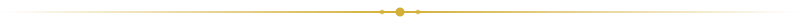
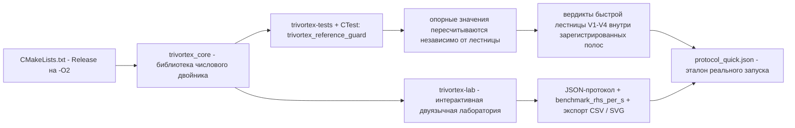

<!-- markdownlint-disable-file MD041 -->
<div align="center">

# 🔧 Верификация на C++ — скомпилированная лестница-бенчмарк


[](https://github.com/wild8highlander/Trivortex/actions/workflows/verification-ports.yml)




</div>

> **Навигация:** [`verification`](../README.md) › **`cpp`**

> Компилированный, ориентированный на пропускную способность порт
> документа **TRIVORTEX** (`code/trivortex_core*.py`): C++17-двойник
> лестницы V1–V4 без зависимостей — те же четыре проверки через
> `std::sin`/`std::cos` и RK4 фиксированного порядка — под управлением
> CMake/CTest с замером на `-O2`, плюс интерактивная двуязычная
> лаборатория `trivortex-lab`.
>
> **Статус: реализовано — v1.1 (веха M3).** Артефакт, CI-вызываемая
> проверка и двуязычная документация живут в этом каталоге; критерии
> приёмки ниже выполнены. Локальные запуски требуют пиннед-тулчейн
> (Docker); CI репозитория гоняет порт non-blocking (см.
> [`verification/README.md`](../README.md) §7).

---

## 📂 Состав каталога

В этом каталоге: [`README.md`](README.md) (этот документ) ·
[`README_RU.md`](README_RU.md) (этот перевод, та же структура) ·
[`src/README.md`](src/README.md) (аннотированная карта исходников).

| Файл | Размер | Строк | Описание |
|---|---|---|---|
| [`CMakeLists.txt`](CMakeLists.txt) | 1 295 Б | 34 | CMake ≥ 3.16, C++17, Release на `-O2`; цели `trivortex_core` (библиотека), `trivortex-lab` (лаборатория) и `trivortex-tests` с CTest-тестом `trivortex_reference_guard` |
| [`src/verify.hpp`](src/verify.hpp) | 7 098 Б | 196 | Ядро-заголовок: замкнутая форма, комбинация Чаплыгина, правая часть Кирхгофа, шаг RK4, зарегистрированные полосы допусков, JSON-дерево значений, хуки i18n |
| [`src/verify.cpp`](src/verify.cpp) | 29 363 Б | 751 | Реализация лестницы: V1–V4 с записанными остатками и полезной нагрузкой JSON-протокола |
| [`src/tests.cpp`](src/tests.cpp) | 5 366 Б | 124 | CTest-защита: опорные значения пересчитываются независимо от кодовых путей лестницы («pinned, not assumed») |
| [`src/main.cpp`](src/main.cpp) | 18 964 Б | 400 | Точка входа CLI `trivortex-lab`: выбор пресетов, вывод протокола, режим бенчмарка, двуязычное меню |
| [`protocol_quick.json`](protocol_quick.json) | 2 411 Б | 84 | Эталонный протокол реального быстрого запуска (pytest-защита пиннится к нему) |

## 🚀 Сборка и запуск

Прямой CMake-поток (из корня репозитория):

```bash
cmake -S verification/cpp -B verification/cpp/build -DCMAKE_BUILD_TYPE=Release
cmake --build verification/cpp/build -j
ctest --test-dir verification/cpp/build --output-on-failure
./verification/cpp/build/trivortex-lab        # интерактивное меню
```

Либо через Makefile из каталога `verification/` (`make help` перечисляет все цели):

```bash
make cpp         # cmake configure + build + CTest-защита
make cpp-lab     # ./cpp/build/trivortex-lab
```

Пиннед-тулчейн — [`docker/cpp/Dockerfile`](../docker/cpp/Dockerfile)
(образ `gcc:13` + CMake; entrypoint контейнера выполняет CTest-защиту,
затем быструю лестницу в режиме CI с `--out-dir outputs/cpp`):

```bash
docker build -t trivortex-cpp verification/docker/cpp
docker run --rm trivortex-cpp
```

CI выполняет тот же поток в non-blocking задании *cpp-ctest* воркфлоу
[`verification-ports.yml`](https://github.com/wild8highlander/Trivortex/actions/workflows/verification-ports.yml).

## ✅ Что здесь верифицировано

Порт фиксирует ровно три объекта, чтобы каждый язык доказывал или
вычислял *те же* утверждения и результаты оставались сопоставимыми:

1. **Теорема 3.1 (замкнутая форма).**
   `r_k(t) = sqrt(C_Ch) * (1 + eps*cos(omega*t + 2*pi*k/3))`,
   `theta_k(t) = omega*t + 2*pi*k/3`,
   `omega = (2*pi/T)*exp(C_Ch/pi)`, `eps = 1/(exp(C_Ch/pi) - 1)`;
   свойства к установлению: точное угловое разделение `2*pi/3`
   (равносторонняя хореография) и периодичность
   `r_k(t + 2*pi/omega) = r_k(t)`.
2. **Интеграл Чаплыгина.** Комбинация
   `C_Ch = r^2*(theta_dot - q*A_theta)` при `A_theta = 1/r`, согласно
   определению из раздела 6 основного документа, вместе с
   зарегистрированной диагностикой дрейфа на концах отрезка `[0, 100*T]`.
3. **Вихревые интегралы.** `H`, `P = sum(Gamma*x)`, `Q = sum(Gamma*y)`,
   `I = sum(Gamma*|r|^2)` вдоль численно проинтегрированных траекторий
   Кирхгофа — с сохранением в полосах допусков
   [`verification/tests/`](../tests/README.md).

Регистры V1–V4 (те же имена, те же полосы, что у всех портов):

| Проверка | Зарегистрированная полоса | Значение из эталонного протокола ([`protocol_quick.json`](protocol_quick.json), 2026-10-08) |
|---|---|---|
| V1 Теорема 3.1: хореография + периодичность замкнутой формы | `1e-12` | ошибка углового разделения `6.88e-14`, остаток периодичности `9.39e-14` |
| V2 жёсткое вращение Лагранжа: форма + аналитическая ω = 3Γ/(2πa²) | форма `1e-10`, omega `1e-6` | дрейф формы `1.58e-14`, ω = `0.477464829275686` с относительной ошибкой `2.86e-12` |
| V3 вихревые интегралы H, P, Q, I сохраняются (равные Γ) | `1e-10` | худший дрейф `2.93e-14` |
| V4 устойчивость: H, P, Q, I сохраняются при Γ = (1, 2, 3) | `1e-10` | худший дрейф `2.86e-14` |

Полный запуск: `4/4 проверки пройдены`, wall time `0.0038 с` — и метрика
бенчмарка M3 `benchmark_rhs_per_s = 16734651.19`, то есть **≈ 1.7·10⁷
вычислений правой части RK4 в секунду** на `-O2`, записываемая в каждый
JSON-протокол этого порта.

CTest-защита ([`src/tests.cpp`](src/tests.cpp)) пересчитывает опорные
значения *независимо от кодовых путей лестницы* — 25 утверждений
`expect_*`, среди них: ω(C=1, T=2π) = `1.3748022274393588` с точностью
`1e-12`; защитный предел ε (возвращает 1 при C_Ch ≤ 0.01); периодичность
замкнутой формы для каждого из трёх вихрей; тождество формы Чаплыгина;
лагранжевы пины ω_Lagrange(Γ, a) = 3Γ/(2πa²); стороны равностороннего
треугольника = 1; антисимметричная правая часть пары; вердикты быстрой
лестницы V1–V4; пин ω = `0.477464829275686`; каждый остаток внутри своей
зарегистрированной полосы; и дымовая проверка JSON-сериализации
(`suite`, `all_passed`, `benchmark_rhs_per_s`).

Роль C++ в матрице: держать честным наследуемый тулчейн вычислительной
физики — порт представляет собой один ключевой файл трансляции с теми же
четырьмя проверками под управлением CMake/CTest. Его назначение —
бенчмаркинг (в компиляции на `-O2` он работает на порядки быстрее
Python-лестницы) и роль референса для любого будущего GPU-порта вихревой
динамики. Там, где утверждение алгебраично, лестница отделяет
плавающий остаток от точного значения: ℚ(√3)-вычисление живёт на стороне
[Haskell](../haskell/README_RU.md), а порт C++ квантует плавающую
оболочку вокруг него.



## 📋 Критерии приёмки (все выполнены)

- [x] Три объекта выше выражены на C++ (CMake) без скрытых допущений, кроме
      шапки артефакта (`verification/cpp/` — CMake/CTest-порт + бенчмарк-лестница
      на `-O2`);
- [x] CI-вызываемая проверка: `cmake -S verification/cpp -B build && ctest --test-dir build` —
      защита опорных значений и бенчмарк-лестница (воркфлоу
      `verification-ports.yml`, задание *cpp-ctest*);
- [x] Шапка артефакта несёт строки SPDX + копирайта (REUSE.toml) и
      примечание о происхождении со ссылкой на коммит `verify.py`,
      зеркало которого это файл (557bff8, релиз M0);
- [x] Строка таблицы статусов в `verification/README.md` переключена в
      *landed (v1.1)* со ссылкой.

## 🔧 Пин тулчейна и вехи

| Пин | Значение |
|---|---|
| Тулчейн | C++17, CMake ≥ 3.16 |
| Docker-пин | [`docker/cpp/Dockerfile`](../docker/cpp/Dockerfile) — образ `gcc:13` + CMake, Release на `-O2` |
| Артефакт | `verification/cpp/` (`src/verify.cpp` ядро, `src/main.cpp` лаборатория, `src/tests.cpp` защита) — **реализован** (v1.1) |
| Веха | **M3** поэтапного плана (вместе с [Haskell](../haskell/README_RU.md)) |
| Статус CI | non-blocking задание *cpp-ctest* в `verification-ports.yml` |

Контекст вех: **M1** — [Coq](../coq/README_RU.md),
[Lean 4](../lean4/README.md) и [Rust](../rust/README_RU.md); **M2** —
[Isabelle](../isabelle/README_RU.md) + [Agda](../agda/README_RU.md);
**M3** — веха производительности и точности: эта компилируемая
лестница-бенчмарк плюс точная арифметика двойника
[Haskell](../haskell/README_RU.md). Таблица статусов — в
[`verification/README.md`](../README.md) §7.

## 🔗 Перекрёстные ссылки

- [Фреймворк верификации](../README.md) — вехи, полосы допусков, схема протокола
- [Lean 4 хаб](../lean4/README.md) — формализация слоя формулировок в Mathlib, эталон для этой лестницы
- [Порт Rust](../rust/README_RU.md) — второй плавающий двойник лестницы
- [Порт Haskell](../haskell/README_RU.md) — точный ℚ(√3)-двойник, замыкающий расщепление остатка, которое квантует C++
- [Исходники C++, аннотированные](src/README.md) — карта порта файл за файлом
- [Docker-пин](../docker/cpp/Dockerfile) и [pytest-защита](../tests/README.md) — закоммиченные числа, к которым пиннится pytest-набор
- CI-воркфлоу: [`verification-ports.yml`](https://github.com/wild8highlander/Trivortex/actions/workflows/verification-ports.yml) · цели Makefile: `make cpp`, `make cpp-lab`

---

<div align="center">

**[⬆ Наверх](#-верификация-на-c--скомпилированная-лестница-бенчмарк)** ·
**[Корень репозитория](../../README.md)**

*Часть [wild8highlander/Trivortex](https://github.com/wild8highlander/Trivortex) · Лицензия [IPL-RP-1.0](https://github.com/wild8highlander/Trivortex/blob/main/LICENSE.md) — All Rights Reserved*

</div>
