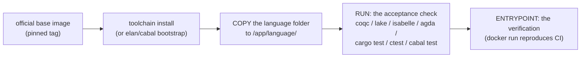

<!-- markdownlint-disable-file MD041 -->
<div align="center">

# 🐳 verification · docker — Pinned Toolchain Images (×7)

</div>

> **Navigation:** [`verification`](../README.md) › **`docker`**

  

One **Docker image per extended toolchain** — seven subfolders, each with its own `Dockerfile` pinning the exact environment a formal or compiled port needs. This is how a reviewer reproduces a result without installing Lean, Coq, Isabelle, Agda or the compiled toolchains locally: pull the base image, build the folder, run the verification inside the container.

Every `Dockerfile` follows the same four-step pattern — **pin the base image → install the toolchain → copy the verification sources → compile the artifact at build time** (the CI-callable acceptance check) — and then runs the verification itself as the `ENTRYPOINT`. All seven carry the SPDX header block (`LicenseRef-Proprietary-Wild8Highlander-1.0`, © 2026 Isaev Iskhak Khamzatovich). The images are wired into [`docker.yml`](../../.github/workflows/docker.yml), which builds them opportunistically (the `|| true` guard — a failing image never blocks `main`) on every push that touches `verification/docker/**`; the build context is `verification/` itself, so the sources land at `/app/<language>/`.

## 📂 Contents — What Lives Here

| Folder | Dockerfile | Base image | Pinned toolchain | Build-time check → `ENTRYPOINT` |
|---|---|---|---|---|
| [`agda/`](agda/README.md) | 581 B | `agda/agda:2.6.4` | Agda 2.6.4 + stdlib | `agda Trivortex.agda` → `agda Trivortex.agda` + OK echo |
| [`coq/`](coq/README.md) | 629 B | `coqorg/coq:8.18-ocaml-4.14` | Coq/Rocq 8.18, Reals stack | `coqc Trivortex.v` → same + "statement layer verified" |
| [`cpp/`](cpp/README.md) | 694 B | `gcc:13` | GCC 13 + CMake, C++17 | cmake Release build → `ctest` + the `-O2` lab |
| [`haskell/`](haskell/README.md) | 553 B | `haskell:9.4-slim` | GHC 9.4 + cabal | `cabal build all` + `cabal test trivortex-guard` → the dual lab |
| [`isabelle/`](isabelle/README.md) | 514 B | `makarius/isabelle:Isabelle2024` | Isabelle-HOL 2024 | `isabelle build -D .` → same (SMT session optional) |
| [`lean4/`](lean4/README.md) | 1 018 B | `ubuntu:24.04` + elan | Lean **v4.6.0** + Mathlib tag v4.6.0 | `lake update` + `cache get!` + `lake build` → `lake build` |
| [`rust/`](rust/README.md) | 527 B | `rust:1.77` | Rust 1.77 (crate floor 1.75) | `cargo test --release` → the lab at `--preset quick` |

## 🗂 Directory Layout

```text
docker/
├── agda/      # Dockerfile + README.md
├── coq/       # Dockerfile + README.md
├── cpp/       # Dockerfile + README.md
├── haskell/   # Dockerfile + README.md
├── isabelle/  # Dockerfile + README.md
├── lean4/     # Dockerfile + README.md
├── rust/      # Dockerfile + README.md
└── README.md  # this file
```

## ▶️ How to Run

```bash
# Example — build and run the Lean 4 image exactly as CI does
# (the build context is verification/, matching the COPY paths):
cd verification
docker build -t rp-lean4 -f docker/lean4/Dockerfile .
docker run --rm rp-lean4

# Or build the whole matrix (the Makefile loop over docker/*/):
make docker-build
```

CI names its images `rpv-<service>` and never fails the pipeline on a
broken image (`|| true` in [`docker.yml`](../../.github/workflows/docker.yml));
`make docker-build` builds each `docker/*/` folder in turn and skips a
failing image with a note. Per-image tags, pins and honest status live
in the seven sub-READMEs.

## ✅ What This Layer Guarantees

- the **same toolchain version** on a laptop, in CI and on a
  contributor's machine — byte-for-byte at the toolchain level, so a
  proof that compiles here compiles everywhere;
- the **artifact compiles at image build time**: each `RUN` executes the
  language's acceptance check (coqc / lake build / isabelle build /
  agda / cargo test / ctest / cabal test), so a broken port cannot hide
  behind a green `docker build`;
- **`docker run` executes the verification itself** — the `ENTRYPOINT`
  is the same command CI would run, not a shell;
- no floating-point drift question: the formal artifacts are proof
  objects, the numeric twins pin their committed JSON protocols
  (`protocol_quick.json` of Rust and C++, checked by the
  [pytest guard](../tests/README.md)).



## 🔗 Cross-References

- [Framework root — verification/](../README.md) (§8 docker toolchains, §9 reproduce recipes)
- [Docker workflow](../../.github/workflows/docker.yml) · [Ports workflow](../../.github/workflows/verification-ports.yml)
- Language hubs: [coq](../coq/README.md) · [lean4](../lean4/README.md) · [isabelle](../isabelle/README.md) · [agda](../agda/README.md) · [rust](../rust/README.md) · [cpp](../cpp/README.md) · [haskell](../haskell/README.md)

## 🇷🇺 Краткое резюме (Russian Summary)

**verification/docker/** — семь Docker-образов, по одному на расширенный тулчейн (Agda 2.6.4, Coq/Rocq 8.18, GCC 13 + CMake, GHC 9.4, Isabelle 2024, Lean v4.6.0 на ubuntu:24.04 + elan, Rust 1.77). Каждый Dockerfile: пин базового образа → установка тулчейна → копирование исходников → сборка артефакта при сборке образа (проверка приёмки), `ENTRYPOINT` запускает верификацию. Сборка в CI — `docker.yml` (оппортунистическая, контекст `verification/`); локально — `make docker-build`. Статусы артефактов — в семи суб-README.

---

<div align="center">

**[⬆ Back to top](#-verification--docker--pinned-toolchain-images-7)** ·
**[Repository root](../README.md)**

*Part of [wild8highlander/Trivortex](https://github.com/wild8highlander/Trivortex) · Licensed under [IPL-RP-1.0](https://github.com/wild8highlander/Trivortex/blob/main/LICENSE.md) — All Rights Reserved*

</div>
