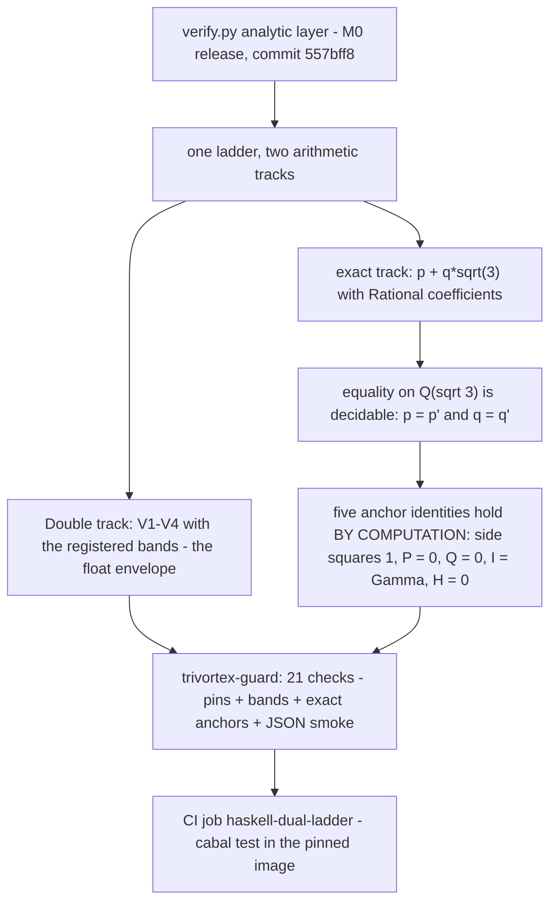

<!-- markdownlint-disable-file MD041 -->
<div align="center">

# 🧮 Haskell Verification — the Exact-Arithmetic Dual Ladder


[](https://github.com/wild8highlander/Trivortex/actions/workflows/verification-ports.yml)


</div>

> **Navigation:** [`verification`](../README.md) › **`haskell`**
>
> The lazy, purely functional port of the **TRIVORTEX** document
> (`code/trivortex_core*.py`): the same four checks V1–V4 run twice —
> once in `Double` for the floating-point envelope, once in exact
> rational arithmetic over the quadratic field ℚ(√3), where the
> equilateral anchor identities hold *by computation* (equality on
> ℚ(√3) is decidable).
>
> **Status: landed — v1.1 (milestone M3).** The artifact, the
> CI-callable check and the bilingual documentation live in this
> directory; the acceptance criteria below are checked. Local runs
> need the pinned toolchain (Docker); the repository CI runs the
> port non-blocking (see [`verification/README.md`](../README.md) §7).

---

## 📂 Contents — What Lives Here

This directory: [`README.md`](README.md) (this document) ·
[`README_RU.md`](README_RU.md) (the Russian overview, same structure) ·
annotated source maps in [`app/`](app/README.md), [`src/`](src/README.md)
and [`test/`](test/README.md).

| File | Size | Lines | Description |
|---|---|---|---|
| [`trivortex-verify.cabal`](trivortex-verify.cabal) | 1 555 B | 43 | The cabal package `trivortex-verify` 1.0.0 (cabal-version 2.4, Haskell2010): library `Trivortex.Verify`, executable `trivortex-lab`, test-suite `trivortex-guard` — `base >=4.14 && <5`, zero other dependencies, `-O2 -Wall` |
| [`src/Trivortex/Verify.hs`](src/Trivortex/Verify.hs) | 28 676 B | 729 | The core module: the closed form, the Kirchhoff RHS, the RK4 stepper, the exact ℚ(√3) arithmetic, the V1–V4 registers |
| [`app/Main.hs`](app/Main.hs) | 12 277 B | 250 | The CLI entry point of the laboratory: presets, the dual-mode ladder, the bilingual (EN/RU) report, SVG/CSV/JSON export |
| [`test/Ladder.hs`](test/Ladder.hs) | 4 725 B | 106 | The guard suite: 21 checks pinning both the `Double` and the exact ℚ(√3) registers |

## 🚀 How to Build / Run

```bash
cd verification/haskell
cabal build all && cabal test trivortex-guard   # the guard
echo 0 | cabal run trivortex-lab                 # the laboratory (menu)
cabal run -- --preset quick                      # CI-style ladder run
```

Or via the Makefile from `verification/` (`make help` lists all targets):

```bash
make haskell         # cabal build all + cabal test trivortex-guard
make haskell-lab     # echo 0 | cabal run trivortex-lab
```

The pinned toolchain is
[`docker/haskell/Dockerfile`](../docker/haskell/Dockerfile)
(image `haskell:9.4-slim`; the image builds the package, runs
`cabal test trivortex-guard` at build time, and its entrypoint starts the
laboratory menu):

```bash
docker build -t trivortex-haskell verification/docker/haskell
docker run --rm trivortex-haskell
```

CI runs the same flow in the non-blocking job *haskell-dual-ladder* of
[`verification-ports.yml`](https://github.com/wild8highlander/Trivortex/actions/workflows/verification-ports.yml).

## ✅ What Is Verified Here

The port fixes exactly three objects, so that every language proves or
computes the *same* statements and the results stay comparable:

1. **Theorem 3.1 (closed form).**
   `r_k(t) = sqrt(C_Ch) * (1 + eps*cos(omega*t + 2*pi*k/3))`,
   `theta_k(t) = omega*t + 2*pi*k/3`,
   `omega = (2*pi/T)*exp(C_Ch/pi)`, `eps = 1/(exp(C_Ch/pi) - 1)`;
   properties to establish: exact `2*pi/3` angular separation (equilateral
   choreography) and periodicity `r_k(t + 2*pi/omega) = r_k(t)`.
2. **Chaplygin integral.** The combination
   `C_Ch = r^2*(theta_dot - q*A_theta)` with `A_theta = 1/r`, following the
   definition fixed in Section 6 of the core document, together with its
   recorded endpoint-drift diagnostic over `[0, 100*T]`.
3. **Vortex integrals.** `H`, `P = sum(Gamma*x)`, `Q = sum(Gamma*y)`,
   `I = sum(Gamma*|r|^2)` along numerically integrated Kirchhoff
   trajectories — conserved to the tolerance bands of
   [`verification/tests/`](../tests/README.md).

The exact-arithmetic story is the interesting part. The equilateral
choreography lives in ℚ(√3): the coordinates are exact rational
combinations of 1 and √3, written as `p + q·√3` with `Rational`
coefficients. Equality on ℚ(√3) is decidable — `p + q√3 = p' + q'√3`
⟺ `p = p'` and `q = q'` — so the guard certifies **five** anchor
identities *by evaluation*, with no tolerance involved
([`test/Ladder.hs`](test/Ladder.hs), check `r19`; the anchors are computed
by `exactAnchors` in [`src/Trivortex/Verify.hs`](src/Trivortex/Verify.hs)):

| Exact ℚ(√3) identity | Meaning |
|---|---|
| side squares exactly 1 (all three) | the equilateral reference geometry, exactly |
| `P = 0` exactly | the linear impulse anchor for Γ = 1 |
| `Q = 0` exactly | the transverse impulse anchor |
| `I = Γ` exactly (Γ = 1) | the angular impulse anchor |
| `H = 0` exactly | the Hamiltonian anchor — distances exactly 1, `ln 1 = 0` |

The `Double` track runs the same V1–V4 registers in floating point and
quantifies the envelope; the exact track proves the identities hold by
evaluation. The residual split the [C++ port](../cpp/README.md) *measures*
(transcendental round-off versus integrator truncation), this port
*closes* — a number no other language in the matrix produces this
directly. The library depends on nothing but `base`: the floating-point
path is exactly the platform's, with no library in between.



## 📋 Acceptance Criteria (all checked)

- [x] The three objects above are expressed in Haskell (GHC + cabal) with no hidden
      assumptions beyond the artifact header
      (`verification/haskell/` — the `Double` ladder + the exact ℚ(√3) dual);
- [x] A CI-callable check: `cd verification/haskell && cabal test trivortex-guard` — runs the pinned-reference guard and the exact-anchor check (workflow `verification-ports.yml`, job *haskell-dual-ladder*);
- [x] The artifact header carries SPDX + copyright lines (REUSE.toml)
      and a provenance note pointing at the commit of `verify.py` it
      mirrors (557bff8, the M0 release);
- [x] `verification/README.md` status table flips this row to
      *landed (v1.1)* with a link.

## 🔧 Toolchain Pin and Milestones

| Pin | Value |
|---|---|
| Toolchain | GHC 9.4 + cabal (package `trivortex-verify` 1.0.0, `base >=4.14 && <5`) |
| Docker pin | [`docker/haskell/Dockerfile`](../docker/haskell/Dockerfile) — image `haskell:9.4-slim` |
| Artifact | `verification/haskell/` (`src/Trivortex/Verify.hs` core, `app/Main.hs` laboratory, `test/Ladder.hs` guard) — **landed** (v1.1) |
| Milestone | **M3** of the staged plan (with [C++](../cpp/README.md)) |
| CI status | non-blocking job *haskell-dual-ladder* in `verification-ports.yml` |

Milestone context: **M1** delivered [Coq](../coq/README.md),
[Lean 4](../lean4/README.md) and [Rust](../rust/README.md); **M2** added
[Isabelle](../isabelle/README.md) + [Agda](../agda/README.md); **M3** is the
performance and exactness milestone — the compiled benchmark ladder of
[C++](../cpp/README.md) plus this exact-arithmetic dual. The status table
lives in [`verification/README.md`](../README.md) §7.

## 🔗 Cross-References

- [Verification framework](../README.md) — milestones, tolerance bands, protocol schema
- [Lean 4 hub](../lean4/README.md) — the Mathlib formalization of the statement layer the exact anchors mirror
- [C++ port](../cpp/README.md) — the compiled ladder whose float envelope this port closes
- [Rust port](../rust/README.md) — the other `Double`-precision twin of the ladder
- [Sources map](src/README.md) · [CLI map](app/README.md) · [Guard suite](test/README.md) — the annotated sub-directory guides
- [Docker pin](../docker/haskell/Dockerfile) and [pytest guard](../tests/README.md) — the committed numbers the pytest suite pins against
- CI workflow: [`verification-ports.yml`](https://github.com/wild8highlander/Trivortex/actions/workflows/verification-ports.yml) · Makefile targets: `make haskell`, `make haskell-lab`

---

<div align="center">

**[⬆ Back to top](#-haskell-verification--the-exact-arithmetic-dual-ladder)** ·
**[Repository root](../../README.md)**

*Part of [wild8highlander/Trivortex](https://github.com/wild8highlander/Trivortex) · Licensed under [IPL-RP-1.0](https://github.com/wild8highlander/Trivortex/blob/main/LICENSE.md) — All Rights Reserved*

</div>
