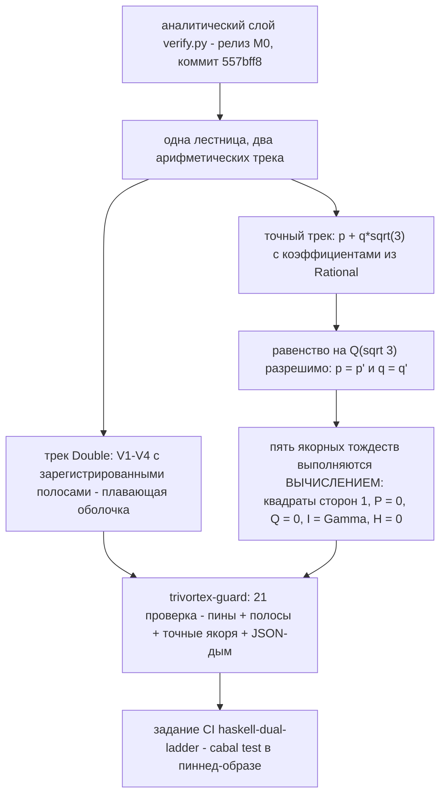

<!-- markdownlint-disable-file MD041 -->
<div align="center">

# 🧮 Верификация на Haskell — двойная лестница точной арифметики


[](https://github.com/wild8highlander/Trivortex/actions/workflows/verification-ports.yml)


</div>

> **Навигация:** [`verification`](../README.md) › **`haskell`**
>
> Ленивый чисто функциональный порт документа **TRIVORTEX**
> (`code/trivortex_core*.py`): те же четыре проверки V1–V4 выполняются
> дважды — один раз в `Double` для плавающей оболочки, один раз в точной
> рациональной арифметике над квадратичным полем ℚ(√3), где якорные
> тождества равностороннего состояния выполняются *вычислением*
> (равенство на ℚ(√3) разрешимо).
>
> **Статус: реализовано — v1.1 (веха M3).** Артефакт, CI-вызываемая
> проверка и двуязычная документация живут в этом каталоге; критерии
> приёмки ниже выполнены. Локальные запуски требуют пиннед-тулчейн
> (Docker); CI репозитория гоняет порт non-blocking (см.
> [`verification/README.md`](../README.md) §7).

---

## 📂 Состав каталога

В этом каталоге: [`README.md`](README.md) (этот документ) ·
[`README_RU.md`](README_RU.md) (этот перевод, та же структура) ·
аннотированные карты исходников в [`app/`](app/README.md),
[`src/`](src/README.md) и [`test/`](test/README.md).

| Файл | Размер | Строк | Описание |
|---|---|---|---|
| [`trivortex-verify.cabal`](trivortex-verify.cabal) | 1 555 Б | 43 | Пакет cabal `trivortex-verify` 1.0.0 (cabal-version 2.4, Haskell2010): библиотека `Trivortex.Verify`, исполняемый `trivortex-lab`, test-suite `trivortex-guard` — `base >=4.14 && <5`, ноль прочих зависимостей, `-O2 -Wall` |
| [`src/Trivortex/Verify.hs`](src/Trivortex/Verify.hs) | 28 676 Б | 729 | Ядро-модуль: замкнутая форма, правая часть Кирхгофа, шаг RK4, точная арифметика ℚ(√3), регистры V1–V4 |
| [`app/Main.hs`](app/Main.hs) | 12 277 Б | 250 | Точка входа CLI лаборатории: пресеты, лестница в двух режимах, двуязычный (EN/RU) отчёт, экспорт SVG/CSV/JSON |
| [`test/Ladder.hs`](test/Ladder.hs) | 4 725 Б | 106 | Защитный набор: 21 проверка, пиннящая регистры `Double` и точного ℚ(√3) |

## 🚀 Сборка и запуск

```bash
cd verification/haskell
cabal build all && cabal test trivortex-guard   # защита
echo 0 | cabal run trivortex-lab                 # лаборатория (меню)
cabal run -- --preset quick                      # запуск лестницы в стиле CI
```

Либо через Makefile из каталога `verification/` (`make help` перечисляет все цели):

```bash
make haskell         # cabal build all + cabal test trivortex-guard
make haskell-lab     # echo 0 | cabal run trivortex-lab
```

Пиннед-тулчейн —
[`docker/haskell/Dockerfile`](../docker/haskell/Dockerfile)
(образ `haskell:9.4-slim`; при сборке образа выполняются сборка пакета и
`cabal test trivortex-guard`, entrypoint запускает меню лаборатории):

```bash
docker build -t trivortex-haskell verification/docker/haskell
docker run --rm trivortex-haskell
```

CI выполняет тот же поток в non-blocking задании *haskell-dual-ladder*
воркфлоу
[`verification-ports.yml`](https://github.com/wild8highlander/Trivortex/actions/workflows/verification-ports.yml).

## ✅ Что здесь верифицировано

Порт фиксирует ровно три объекта, чтобы каждый язык доказывал или
вычислял *те же* утверждения и результаты оставались сопоставимыми:

1. **Теорема 3.1 (замкнутая форма).**
   `r_k(t) = sqrt(C_Ch) * (1 + eps*cos(omega*t + 2*pi*k/3))`,
   `theta_k(t) = omega*t + 2*pi*k/3`,
   `omega = (2*pi/T)*exp(C_Ch/pi)`, `eps = 1/(exp(C_Ch/pi) - 1)`;
   свойства к установлению: точное угловое разделение `2*pi/3`
   (равносторонняя хореография) и периодичность
   `r_k(t + 2*pi/omega) = r_k(t)`.
2. **Интеграл Чаплыгина.** Комбинация
   `C_Ch = r^2*(theta_dot - q*A_theta)` при `A_theta = 1/r`, согласно
   определению из раздела 6 основного документа, вместе с
   зарегистрированной диагностикой дрейфа на концах отрезка `[0, 100*T]`.
3. **Вихревые интегралы.** `H`, `P = sum(Gamma*x)`, `Q = sum(Gamma*y)`,
   `I = sum(Gamma*|r|^2)` вдоль численно проинтегрированных траекторий
   Кирхгофа — с сохранением в полосах допусков
   [`verification/tests/`](../tests/README.md).

Самое интересное здесь — точная арифметика. Равносторонняя хореография
живёт в ℚ(√3): координаты — точные рациональные комбинации 1 и √3,
записываемые как `p + q·√3` с коэффициентами из `Rational`. Равенство на
ℚ(√3) разрешимо — `p + q√3 = p' + q'√3` ⟺ `p = p'` и `q = q'` — поэтому
защита сертифицирует **пять** якорных тождеств *вычислением*, без всяких
допусков ([`test/Ladder.hs`](test/Ladder.hs), проверка `r19`; якоря
считает `exactAnchors` в [`src/Trivortex/Verify.hs`](src/Trivortex/Verify.hs)):

| Точное тождество в ℚ(√3) | Смысл |
|---|---|
| квадраты сторон ровно 1 (все три) | равносторонняя опорная геометрия, точно |
| `P = 0` точно | якорь линейного импульса при Γ = 1 |
| `Q = 0` точно | якорь поперечного импульса |
| `I = Γ` точно (Γ = 1) | якорь углового импульса |
| `H = 0` точно | якорь гамильтониана — расстояния ровно 1, `ln 1 = 0` |

Трек `Double` прогоняет те же регистры V1–V4 в плавающей арифметике и
квантует оболочку; точный трек доказывает тождества вычислением.
Расщепление остатка, которое порт [C++](../cpp/README_RU.md) *измеряет*
(трансцендентный round-off против усечения интегратора), этот порт
*замыкает* — число, которое больше ни один язык матрицы не даёт так
напрямую. Библиотека зависит только от `base`: плавающий путь — ровно
платформенный, без библиотек между.



## 📋 Критерии приёмки (все выполнены)

- [x] Три объекта выше выражены на Haskell (GHC + cabal) без скрытых допущений,
      кроме шапки артефакта (`verification/haskell/` — лестница `Double` +
      точный ℚ(√3)-двойник);
- [x] CI-вызываемая проверка: `cd verification/haskell && cabal test trivortex-guard` —
      защита опорных значений и проверка точных якорей (воркфлоу
      `verification-ports.yml`, задание *haskell-dual-ladder*);
- [x] Шапка артефакта несёт строки SPDX + копирайта (REUSE.toml) и
      примечание о происхождении со ссылкой на коммит `verify.py`,
      зеркало которого это файл (557bff8, релиз M0);
- [x] Строка таблицы статусов в `verification/README.md` переключена в
      *landed (v1.1)* со ссылкой.

## 🔧 Пин тулчейна и вехи

| Пин | Значение |
|---|---|
| Тулчейн | GHC 9.4 + cabal (пакет `trivortex-verify` 1.0.0, `base >=4.14 && <5`) |
| Docker-пин | [`docker/haskell/Dockerfile`](../docker/haskell/Dockerfile) — образ `haskell:9.4-slim` |
| Артефакт | `verification/haskell/` (ядро `src/Trivortex/Verify.hs`, лаборатория `app/Main.hs`, защита `test/Ladder.hs`) — **реализован** (v1.1) |
| Веха | **M3** поэтапного плана (вместе с [C++](../cpp/README_RU.md)) |
| Статус CI | non-blocking задание *haskell-dual-ladder* в `verification-ports.yml` |

Контекст вех: **M1** — [Coq](../coq/README_RU.md),
[Lean 4](../lean4/README.md) и [Rust](../rust/README_RU.md); **M2** —
[Isabelle](../isabelle/README_RU.md) + [Agda](../agda/README_RU.md);
**M3** — веха производительности и точности: компилируемая лестница-бенчмарк
[C++](../cpp/README_RU.md) плюс этот точный арифметический двойник.
Таблица статусов — в [`verification/README.md`](../README.md) §7.

## 🔗 Перекрёстные ссылки

- [Фреймворк верификации](../README.md) — вехи, полосы допусков, схема протокола
- [Lean 4 хаб](../lean4/README.md) — формализация слоя формулировок в Mathlib, зеркало точных якорей
- [Порт C++](../cpp/README_RU.md) — компилируемая лестница, плавающую оболочку которой этот порт замыкает
- [Порт Rust](../rust/README_RU.md) — второй `Double`-двойник лестницы
- [Карта исходников](src/README.md) · [Карта CLI](app/README.md) · [Защитный набор](test/README.md) — аннотированные гиды по подкаталогам
- [Docker-пин](../docker/haskell/Dockerfile) и [pytest-защита](../tests/README.md) — закоммиченные числа, к которым пиннится pytest-набор
- CI-воркфлоу: [`verification-ports.yml`](https://github.com/wild8highlander/Trivortex/actions/workflows/verification-ports.yml) · цели Makefile: `make haskell`, `make haskell-lab`

---

<div align="center">

**[⬆ Наверх](#-верификация-на-haskell--двойная-лестница-точной-арифметики)** ·
**[Корень репозитория](../../README.md)**

*Часть [wild8highlander/Trivortex](https://github.com/wild8highlander/Trivortex) · Лицензия [IPL-RP-1.0](https://github.com/wild8highlander/Trivortex/blob/main/LICENSE.md) — All Rights Reserved*

</div>
