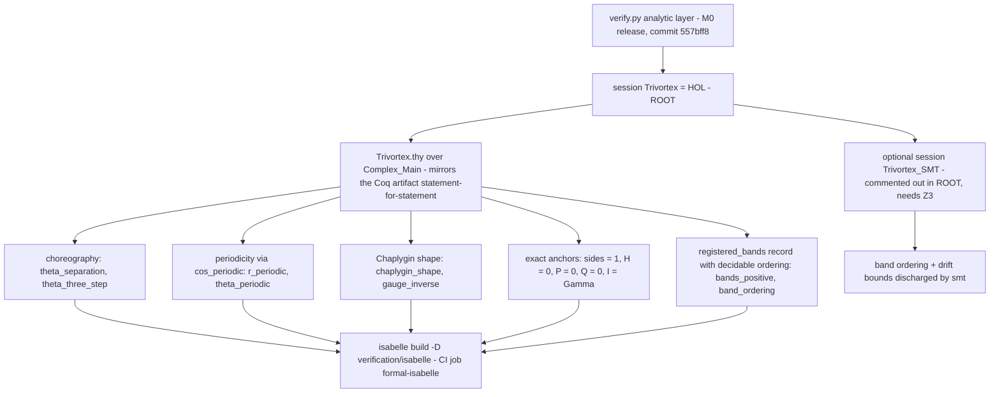

<!-- markdownlint-disable-file MD041 -->
<div align="center">

# 🧿 Isabelle/HOL Verification — the Automated Cross-Check


[](https://github.com/wild8highlander/Trivortex/actions/workflows/verification-ports.yml)


</div>

> **Navigation:** [`verification`](../README.md) › **`isabelle`**

> The HOL mirror of the **TRIVORTEX** statement layer
> (`code/trivortex_core*.py`): one `Trivortex.thy` session over
> `Complex_Main` that mirrors the [Coq artifact](../coq/README.md)
> statement-for-statement — so the two provers cross-check each other —
> plus the M2 flavor of this port: the tolerance bands pinned as
> decidable strict inequalities and the optional SMT-discharged numeric
> bounds.
>
> **Status: landed — v1.1 (milestone M2).** The artifact, the
> CI-callable check and the bilingual documentation live in this
> directory; the acceptance criteria below are checked. Local runs
> need the pinned toolchain (Docker); the repository CI runs the
> port non-blocking (see [`verification/README.md`](../README.md) §7).

---

## 📂 Contents — What Lives Here

This directory: [`README.md`](README.md) (this document) ·
[`README_RU.md`](README_RU.md) (the Russian overview, same structure).

| File | Size | Lines | Description |
|---|---|---|---|
| [`ROOT`](ROOT) | 847 B | 21 | The session definition: `session Trivortex = HOL` with theory `Trivortex`; the optional `Trivortex_SMT` session is listed but commented out — the `smt` method needs Z3 on PATH, which the toolchain image does not ship |
| [`Trivortex.thy`](Trivortex.thy) | 11 211 B | 262 | The M2 artifact: the statement layer of Theorem 3.1, the Chaplygin integral and the vortex integrals over the reals of `Complex_Main`, with the machine-checked band record |
| [`Trivortex_SMT.thy`](Trivortex_SMT.thy) | 2 063 B | 56 | The optional SMT-discharged numeric bounds: band ordering and representative drift inequalities discharged `by smt` (Z3) |

## 🚀 How to Build / Run

The pinned toolchain is
[`docker/isabelle/Dockerfile`](../docker/isabelle/Dockerfile)
(image `makarius/isabelle:Isabelle2024`; the image entrypoint is
`isabelle build -D .`):

```bash
docker build -t trivortex-isabelle verification/docker/isabelle
docker run --rm trivortex-isabelle isabelle build -D /app/isabelle
```

Or directly (from the repository root):

```bash
isabelle build -D verification/isabelle
```

Or via the Makefile from `verification/` (`make help` lists all targets):

```bash
make isabelle    # isabelle build -D isabelle
```

CI builds the HOL session in the pinned Isabelle2024 image in the
non-blocking job *formal-isabelle* of
[`verification-ports.yml`](https://github.com/wild8highlander/Trivortex/actions/workflows/verification-ports.yml).

## ✅ What Is Verified Here

The port fixes exactly three objects, so that every language proves or
computes the *same* statements and the results stay comparable:

1. **Theorem 3.1 (closed form).**
   `r_k(t) = sqrt(C_Ch) * (1 + eps*cos(omega*t + 2*pi*k/3))`,
   `theta_k(t) = omega*t + 2*pi*k/3`,
   `omega = (2*pi/T)*exp(C_Ch/pi)`, `eps = 1/(exp(C_Ch/pi) - 1)`;
   properties to establish: exact `2*pi/3` angular separation (equilateral
   choreography) and periodicity `r_k(t + 2*pi/omega) = r_k(t)`.
2. **Chaplygin integral.** The combination
   `C_Ch = r^2*(theta_dot - q*A_theta)` with `A_theta = 1/r`, following the
   definition fixed in Section 6 of the core document, together with its
   recorded endpoint-drift diagnostic over `[0, 100*T]`.
3. **Vortex integrals.** `H`, `P = sum(Gamma*x)`, `Q = sum(Gamma*y)`,
   `I = sum(Gamma*|r|^2)` along numerically integrated Kirchhoff
   trajectories — conserved to the tolerance bands of
   [`verification/tests/`](../tests/README.md).

What the artifact actually certifies:

| Certified in [`Trivortex.thy`](Trivortex.thy) | Statement |
|---|---|
| `theta_separation`, `theta_three_step` | the equilateral choreography — phase separation exactly `2*pi/3` (V1, property (a)) |
| `r_periodic`, `theta_periodic` | periodicity of the closed form, `r(t + 2*pi/omega) = r(t)` — proven via the standard `cos_periodic` lemma (V1, property (b)) |
| `chaplygin_shape`, `gauge_inverse` | the Chaplygin combination reduces to `C_Ch = r^2*theta_dot - q*r` in the gauge `A_theta = 1/r` of Section 6 |
| `rdist_eq1..3` | the sides of the equilateral reference state are exactly `1` (coordinates built from `1/sqrt 3`) |
| `H_equilateral`, `P_equilateral`, `Q_equilateral`, `I_equilateral` | the exact anchors: **H = 0, P = 0, Q = 0, I = Γ** |
| `lagrange_omega` | the point-vortex Lagrange frequency `3*gamma/(2*pi*a^2)` as a definition the ladders pin against |
| `registered_bands` (record `tolerance_bands`) + `bands_positive`, `band_ordering` | the tolerance bands (`1/10^12`, `1/10^10`, `1/10^6`) as a machine-checked record with decidable ordering — strictly positive and mutually ordered |

The M2 flavor — the optional SMT session ([`Trivortex_SMT.thy`](Trivortex_SMT.thy)):

| Lemma | Discharged by |
|---|---|
| `band_closed_form_lt_rk4`, `band_rk4_lt_omega` | the band ordering `1/10^12 < 1/10^10 < 1/10^6`, `by smt`-style numeric reasoning |
| `drift_bound_smt` | `x ≤ 1e-12 ⟹ x < 1e-6` — a representative drift bound in the exact numeric form the ladders enforce |
| `tolerance_decidable_smt` | `x ≤ 1e-10 ∨ x > 1e-10` — the decidable strict inequality kernel of the tolerance contract |

The SMT theory is kept **out of the default build** (see [`ROOT`](ROOT)):
the `smt` method replays its certificates at build time and requires Z3
on PATH, which the toolchain image does not ship. To enable it, install
Z3 (e.g. `apt-get install z3` inside the image), uncomment the
`session Trivortex_SMT = Trivortex +` block in `ROOT` and rebuild — the
default build stays green on any Isabelle installation either way.

Isabelle's role in the matrix: the strongest automation (`smt`, `auto`,
`presburger`) of the LCF family, which suits the invariant conservation
checks — the drift statements are polynomial/rational bounds once the
closed form is substituted, and SMT can discharge most of them. The
single `Trivortex.thy` session mirrors the [Coq artifact](../coq/README.md)
statement-for-statement, so the two provers cross-check each other.



## 📋 Acceptance Criteria (all checked)

- [x] The three objects above are expressed in Isabelle/HOL with no hidden
      assumptions beyond the artifact header
      (`verification/isabelle/Trivortex.thy` (+ optional `Trivortex_SMT.thy`));
- [x] A CI-callable check: `isabelle build -D verification/isabelle` — builds the HOL session in the pinned Isabelle2024 image (workflow `verification-ports.yml`, job *formal-isabelle*);
- [x] The artifact header carries SPDX + copyright lines (REUSE.toml)
      and a provenance note pointing at the commit of `verify.py` it
      mirrors (557bff8, the M0 release);
- [x] `verification/README.md` status table flips this row to
      *landed (v1.1)* with a link.

## 🔧 Toolchain Pin and Milestones

| Pin | Value |
|---|---|
| Toolchain | Isabelle/HOL 2024 |
| Docker pin | [`docker/isabelle/Dockerfile`](../docker/isabelle/Dockerfile) — image `makarius/isabelle:Isabelle2024` |
| Artifact | `verification/isabelle/Trivortex.thy` (+ optional `Trivortex_SMT.thy`) — **landed** (v1.1) |
| Milestone | **M2** of the staged plan (with [Agda](../agda/README.md)) |
| CI status | non-blocking job *formal-isabelle* in `verification-ports.yml` |

Milestone context: **M1** delivered [Coq](../coq/README.md),
[Lean 4](../lean4/README.md) and [Rust](../rust/README.md); **M2** delivers
the two cross-checking formalizations Isabelle + Agda; **M3** delivers the
[C++](../cpp/README.md) and [Haskell](../haskell/README.md) ports. The
status table lives in [`verification/README.md`](../README.md) §7.

## 🔗 Cross-References

- [Verification framework](../README.md) — milestones, tolerance bands, protocol schema
- [Lean 4 hub](../lean4/README.md) — the Mathlib formalization of the same statement layer (M1)
- [Coq port](../coq/README.md) — the artifact this session mirrors statement-for-statement
- [Agda port](../agda/README.md) — the constructive half of milestone M2
- [Docker pin](../docker/isabelle/Dockerfile) and [pytest guard](../tests/README.md) — the tolerance bands formalized here and enforced there
- CI workflow: [`verification-ports.yml`](https://github.com/wild8highlander/Trivortex/actions/workflows/verification-ports.yml) · Makefile target: `make isabelle`

---

<div align="center">

**[⬆ Back to top](#-isabellehol-verification--the-automated-cross-check)** ·
**[Repository root](../../README.md)**

*Part of [wild8highlander/Trivortex](https://github.com/wild8highlander/Trivortex) · Licensed under [IPL-RP-1.0](https://github.com/wild8highlander/Trivortex/blob/main/LICENSE.md) — All Rights Reserved*

</div>
