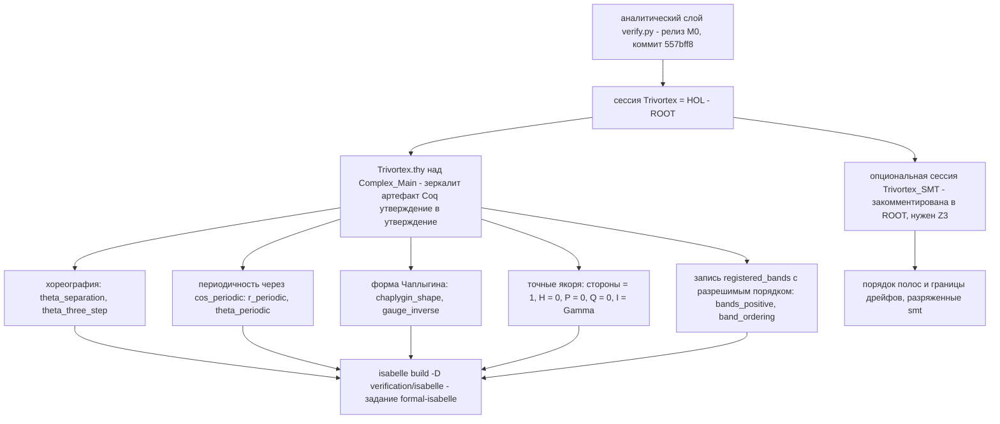

<!-- markdownlint-disable-file MD041 -->
<div align="center">

# 🧿 Верификация в Isabelle/HOL — автоматизированная перекрёстная проверка


[](https://github.com/wild8highlander/Trivortex/actions/workflows/verification-ports.yml)


</div>

> **Навигация:** [`verification`](../README.md) › **`isabelle`**

> HOL-зеркало слоя формулировок **TRIVORTEX** (`code/trivortex_core*.py`):
> одна сессия `Trivortex.thy` над `Complex_Main`, зеркалящая артефакт
> [Coq](../coq/README_RU.md) утверждение в утверждение — чтобы два
> прувера перекрёстно проверяли друг друга, — плюс «вкус» M2 этого порта:
> полосы допусков, закреплённые как разрешимые строгие неравенства, и
> опциональные SMT-разряженные численные границы.
>
> **Статус: реализовано — v1.1 (веха M2).** Артефакт, CI-вызываемая
> проверка и двуязычная документация живут в этом каталоге; критерии
> приёмки ниже выполнены. Локальные запуски требуют пиннед-тулчейн
> (Docker); CI репозитория гоняет порт non-blocking (см.
> [`verification/README.md`](../README.md) §7).

---

## 📂 Состав каталога

В этом каталоге: [`README.md`](README.md) (этот документ) ·
[`README_RU.md`](README_RU.md) (этот перевод, та же структура).

| Файл | Размер | Строк | Описание |
|---|---|---|---|
| [`ROOT`](ROOT) | 847 Б | 21 | Определение сессии: `session Trivortex = HOL` с теорией `Trivortex`; опциональная сессия `Trivortex_SMT` перечислена, но закомментирована — методу `smt` нужен Z3 на PATH, которого нет в образе тулчейна |
| [`Trivortex.thy`](Trivortex.thy) | 11 211 Б | 262 | Артефакт вехи M2: слой формулировок Теоремы 3.1, интеграла Чаплыгина и вихревых интегралов над вещественными числами `Complex_Main`, с машинно-проверяемой записью полос допусков |
| [`Trivortex_SMT.thy`](Trivortex_SMT.thy) | 2 063 Б | 56 | Опциональные SMT-разряженные численные границы: порядок полос и репрезентативные неравенства дрейфов, разряженные `by smt` (Z3) |

## 🚀 Сборка и запуск

Пиннед-тулчейн —
[`docker/isabelle/Dockerfile`](../docker/isabelle/Dockerfile)
(образ `makarius/isabelle:Isabelle2024`; entrypoint образа —
`isabelle build -D .`):

```bash
docker build -t trivortex-isabelle verification/docker/isabelle
docker run --rm trivortex-isabelle isabelle build -D /app/isabelle
```

Либо напрямую (из корня репозитория):

```bash
isabelle build -D verification/isabelle
```

Либо через Makefile из каталога `verification/` (`make help` перечисляет все цели):

```bash
make isabelle    # isabelle build -D isabelle
```

CI собирает HOL-сессию в пиннед-образе Isabelle2024 в non-blocking задании
*formal-isabelle* воркфлоу
[`verification-ports.yml`](https://github.com/wild8highlander/Trivortex/actions/workflows/verification-ports.yml).

## ✅ Что здесь верифицировано

Порт фиксирует ровно три объекта, чтобы каждый язык доказывал или
вычислял *те же* утверждения и результаты оставались сопоставимыми:

1. **Теорема 3.1 (замкнутая форма).**
   `r_k(t) = sqrt(C_Ch) * (1 + eps*cos(omega*t + 2*pi*k/3))`,
   `theta_k(t) = omega*t + 2*pi*k/3`,
   `omega = (2*pi/T)*exp(C_Ch/pi)`, `eps = 1/(exp(C_Ch/pi) - 1)`;
   свойства к установлению: точное угловое разделение `2*pi/3`
   (равносторонняя хореография) и периодичность
   `r_k(t + 2*pi/omega) = r_k(t)`.
2. **Интеграл Чаплыгина.** Комбинация
   `C_Ch = r^2*(theta_dot - q*A_theta)` при `A_theta = 1/r`, согласно
   определению из раздела 6 основного документа, вместе с
   зарегистрированной диагностикой дрейфа на концах отрезка `[0, 100*T]`.
3. **Вихревые интегралы.** `H`, `P = sum(Gamma*x)`, `Q = sum(Gamma*y)`,
   `I = sum(Gamma*|r|^2)` вдоль численно проинтегрированных траекторий
   Кирхгофа — с сохранением в полосах допусков
   [`verification/tests/`](../tests/README.md).

Что артефакт реально сертифицирует:

| Сертифицировано в [`Trivortex.thy`](Trivortex.thy) | Утверждение |
|---|---|
| `theta_separation`, `theta_three_step` | равносторонняя хореография — разделение фаз ровно `2*pi/3` (V1, свойство (a)) |
| `r_periodic`, `theta_periodic` | периодичность замкнутой формы, `r(t + 2*pi/omega) = r(t)` — через стандартную лемму `cos_periodic` (V1, свойство (b)) |
| `chaplygin_shape`, `gauge_inverse` | комбинация Чаплыгина сводится к `C_Ch = r^2*theta_dot - q*r` при калибровке `A_theta = 1/r` из раздела 6 |
| `rdist_eq1..3` | стороны равностороннего опорного состояния равны ровно `1` (координаты построены из `1/sqrt 3`) |
| `H_equilateral`, `P_equilateral`, `Q_equilateral`, `I_equilateral` | точные якоря: **H = 0, P = 0, Q = 0, I = Γ** |
| `lagrange_omega` | лагранжева частота точечных вихрей `3*gamma/(2*pi*a^2)` как определение, к которому пиннятся лестницы |
| `registered_bands` (запись `tolerance_bands`) + `bands_positive`, `band_ordering` | полосы допусков (`1/10^12`, `1/10^10`, `1/10^6`) как машинно-проверяемая запись с разрешимым порядком — строго положительные и взаимно упорядоченные |

«Вкус» M2 — опциональная SMT-сессия ([`Trivortex_SMT.thy`](Trivortex_SMT.thy)):

| Лемма | Как разряжена |
|---|---|
| `band_closed_form_lt_rk4`, `band_rk4_lt_omega` | порядок полос `1/10^12 < 1/10^10 < 1/10^6`, численное рассуждение в стиле `by smt` |
| `drift_bound_smt` | `x ≤ 1e-12 ⟹ x < 1e-6` — репрезентативная граница дрейфа в точной численной форме, которую enforce лестницы |
| `tolerance_decidable_smt` | `x ≤ 1e-10 ∨ x > 1e-10` — разрешимое ядро строгих неравенств контракта допусков |

SMT-теория держится **вне сборки по умолчанию** (см. [`ROOT`](ROOT)):
метод `smt` перепроигрывает сертификаты при сборке и требует Z3 на PATH,
которого нет в образе тулчейна. Чтобы включить её, установите Z3
(например, `apt-get install z3` внутри образа), раскомментируйте блок
`session Trivortex_SMT = Trivortex +` в `ROOT` и пересоберите — сборка по
умолчанию в любом случае остаётся зелёной на любой установке Isabelle.

Роль Isabelle в матрице: сильнейшая автоматизация (`smt`, `auto`,
`presburger`) семейства LCF, что подходит проверкам сохранения
инвариантов — утверждения о дрейфах становятся полиномиальными или
рациональными границами после подстановки замкнутой формы, и SMT
разряжает большинство из них. Единственная сессия `Trivortex.thy`
зеркалит артефакт [Coq](../coq/README_RU.md) утверждение в утверждение,
так что два прувера перекрёстно проверяют друг друга.



## 📋 Критерии приёмки (все выполнены)

- [x] Три объекта выше выражены в Isabelle/HOL без скрытых допущений, кроме шапки
      артефакта (`verification/isabelle/Trivortex.thy` (+ опционально
      `Trivortex_SMT.thy`));
- [x] CI-вызываемая проверка: `isabelle build -D verification/isabelle` —
      сборка HOL-сессии в пиннед-образе Isabelle2024 (воркфлоу
      `verification-ports.yml`, задание *formal-isabelle*);
- [x] Шапка артефакта несёт строки SPDX + копирайта (REUSE.toml) и
      примечание о происхождении со ссылкой на коммит `verify.py`,
      зеркало которого это файл (557bff8, релиз M0);
- [x] Строка таблицы статусов в `verification/README.md` переключена в
      *landed (v1.1)* со ссылкой.

## 🔧 Пин тулчейна и вехи

| Пин | Значение |
|---|---|
| Тулчейн | Isabelle/HOL 2024 |
| Docker-пин | [`docker/isabelle/Dockerfile`](../docker/isabelle/Dockerfile) — образ `makarius/isabelle:Isabelle2024` |
| Артефакт | `verification/isabelle/Trivortex.thy` (+ опционально `Trivortex_SMT.thy`) — **реализован** (v1.1) |
| Веха | **M2** поэтапного плана (вместе с [Agda](../agda/README_RU.md)) |
| Статус CI | non-blocking задание *formal-isabelle* в `verification-ports.yml` |

Контекст вех: **M1** — [Coq](../coq/README_RU.md),
[Lean 4](../lean4/README.md) и [Rust](../rust/README_RU.md); **M2** — две
перекрёстно проверяющие формализации Isabelle + Agda; **M3** — порты
[C++](../cpp/README_RU.md) и [Haskell](../haskell/README_RU.md).
Таблица статусов — в [`verification/README.md`](../README.md) §7.

## 🔗 Перекрёстные ссылки

- [Фреймворк верификации](../README.md) — вехи, полосы допусков, схема протокола
- [Lean 4 хаб](../lean4/README.md) — формализация того же слоя формулировок в Mathlib (M1)
- [Порт Coq](../coq/README_RU.md) — артефакт, который эта сессия зеркалит утверждение в утверждение
- [Порт Agda](../agda/README_RU.md) — конструктивная половина вехи M2
- [Docker-пин](../docker/isabelle/Dockerfile) и [pytest-защита](../tests/README.md) — полосы допусков, формализованные здесь и контролируемые там
- CI-воркфлоу: [`verification-ports.yml`](https://github.com/wild8highlander/Trivortex/actions/workflows/verification-ports.yml) · цель Makefile: `make isabelle`

---

<div align="center">

**[⬆ Наверх](#-верификация-в-isabellehol--автоматизированная-перекрёстная-проверка)** ·
**[Корень репозитория](../../README.md)**

*Часть [wild8highlander/Trivortex](https://github.com/wild8highlander/Trivortex) · Лицензия [IPL-RP-1.0](https://github.com/wild8highlander/Trivortex/blob/main/LICENSE.md) — All Rights Reserved*

</div>
