<!-- markdownlint-disable-file MD041 -->
<div align="center">

<!-- ══════════════════════════════════════════════════════════════ -->
<!-- TRIVORTEX · LEAN 4 — navy-and-gold header (house style)        -->
<!-- ══════════════════════════════════════════════════════════════ -->
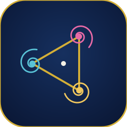

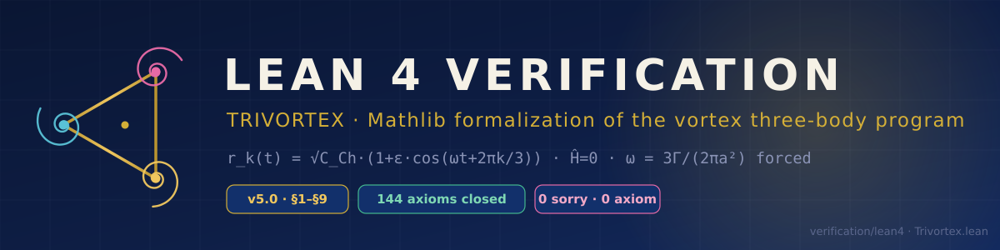

### Lean 4 — the Machine-Checked Heart of TRIVORTEX

**The formalization layer, landed at v5.0.** One file — `Trivortex.lean`, 4,915 lines —
re-derives the analytic core of the vortex three-body program inside
[Lean 4](https://lean-lang.org) + [Mathlib](https://github.com/leanprover-community/mathlib4):
Theorem 3.1 (the closed-form Lagrange-type choreography), the Chaplygin topological
integral, the Kirchhoff conservation laws, the Lagrange equilateral solution, the
complete triangle theory, linear stability, and the bifurcation at unequal circulations —
**144 `#print axioms` statements, zero `sorry`, zero `axiom`**, every footprint closed on
exactly `propext · Classical.choice · Quot.sound`.

**[Isaev Iskhak Khamzatovich](https://orcid.org/0009-0003-7299-0701)** · ORCID `0009-0003-7299-0701` · Independent Researcher

[🏝 Repository root](https://github.com/wild8highlander/Trivortex) · [🧪 Verification framework](../README.md) · [🐍 The Python ladder](../trivortex/README.md) · [🐳 Docker pin](../docker/lean4/README.md) · [🇷🇺 Русская версия](README_RU.md)

<!-- ROW 1 — CI/CD (live) -->
[](https://github.com/wild8highlander/Trivortex/actions/workflows/verification-ports.yml)
[](https://github.com/wild8highlander/Trivortex/actions/workflows/lint.yml)
[](https://github.com/wild8highlander/Trivortex/actions/workflows/codeql.yml)
[](https://github.com/wild8highlander/Trivortex/actions/workflows/docker.yml)
[](https://securityscorecards.dev/viewer/?uri=github.com/wild8highlander/Trivortex)

<!-- ROW 2 — FORMAL STATUS -->
[](lean-toolchain)
[](lakefile.lean)
[](Trivortex.lean)
[](Trivortex.lean)
[](Trivortex.lean)

<!-- ROW 3 — PROJECT VITALS -->
[-gold?style=for-the-badge&label=Release)](README.md#11-version-timeline--v11--v50)
[](Trivortex.lean)
[](#appendix-a--full-declaration-census)
[](#appendix-a--full-declaration-census)
[](../README.md)
[](https://github.com/wild8highlander/Trivortex/blob/main/REUSE.toml)

<!-- ROW 4 — COMMUNITY PULSE -->
[](https://github.com/wild8highlander/Trivortex)
[](https://github.com/wild8highlander/Trivortex/network/members)
[](https://github.com/wild8highlander/Trivortex/issues)
[](https://github.com/wild8highlander/Trivortex/commits/main)
[](https://github.com/wild8highlander/Trivortex/commits/main)
[](https://github.com/wild8highlander/Trivortex/blob/main/LICENSE.md)

<!-- identities -->
<table>
<tr>
<td align="center">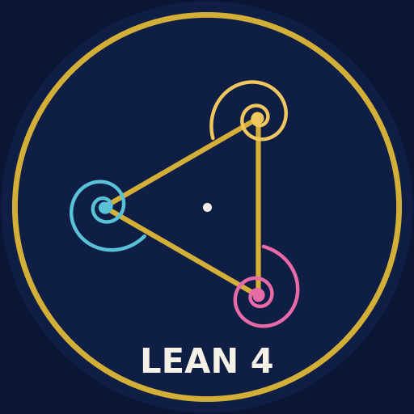<br><sub><b>project avatar</b></sub></td>
<td align="center"><br><sub><b><a href="https://github.com/wild8highlander">wild8highlander</a></b><br>author & maintainer</sub></td>
</tr>
</table>

</div>


---

## Table of contents

1. [TL;DR — what lives in this folder](#1-tldr--what-lives-in-this-folder)
2. [The 30-second tour](#2-the-30-second-tour)
3. [Why Lean 4 + Mathlib](#3-why-lean-4--mathlib)
4. [What is proven here — the five fixed objects](#4-what-is-proven-here--the-five-fixed-objects)
5. [Architecture in pictures](#5-architecture-in-pictures)
6. [Deep dive — section by section (§1–§9)](#6-deep-dive--section-by-section-19)
7. [The axiom footprint — nothing but classical foundations](#7-the-axiom-footprint--nothing-but-classical-foundations)
8. [Complete file inventory](#8-complete-file-inventory)
9. [Build, run, CI](#9-build-run-ci)
10. [Reproducibility pins](#10-reproducibility-pins)
11. [Version timeline — v1.1 → v5.0](#11-version-timeline--v11--v50)
12. [The verification constellation — every sibling folder](#12-the-verification-constellation--every-sibling-folder)
13. [The eight-language comparison matrix](#13-the-eight-language-comparison-matrix)
14. [Gallery — animations of the proven objects](#14-gallery--animations-of-the-proven-objects)
15. [FAQ](#15-faq)
16. [Troubleshooting](#16-troubleshooting)
17. [Roadmap — M4/M5/M6 and the Lean port](#17-roadmap--m4m5m6-and-the-lean-port)
18. [Contributing](#18-contributing)
19. [Acknowledgments & credits](#19-acknowledgments--credits)
20. [Citation, DOI & license](#20-citation-doi--license)
- [Appendix A — full declaration census](#appendix-a--full-declaration-census)

---

## 1. TL;DR — what lives in this folder

This directory is the **Lean 4 port** of the TRIVORTEX verification framework: the
same three objects the Python ladder computes ([`verification/trivortex/python/verify.py`](../trivortex/python/README.md))
are here **stated and proven** in the dependent type theory of Lean 4 over Mathlib.
A port fixes exactly the objects of the ladder, so every language proves or computes
*the same statements* and the results stay comparable across the framework.

| Vital | Value |
|---|---|
| **Artifact** | [`Trivortex.lean`](Trivortex.lean) — 4,915 lines, one namespace, one file |
| **Sections** | §1–§9 (+ two axiom-footprint blocks) — see the [deep dive](#6-deep-dive--section-by-section-19) |
| **Declarations** | 243 theorems/lemmas (144 public + 99 `private` helpers) · 55 defs · 2 structures |
| **Machine-checked closure** | **144 `#print axioms` statements — all closed** on `propext`, `Classical.choice`, `Quot.sound` |
| **Escape hatches** | **0 `sorry` · 0 `axiom`** (verified by `grep`, and by the file's own footer block) |
| **Toolchain** | Lean 4 **v4.6.0** + Mathlib **tag v4.6.0** (both pinned; see [§10](#10-reproducibility-pins)) |
| **Status** | ✅ **landed — v5.0** (statement layer §1–§9; M1 + the M4/M5 depth tracks) |
| **CI** | workflow [`verification-ports.yml`](https://github.com/wild8highlander/Trivortex/actions/workflows/verification-ports.yml), job **`formal-lean4`** |
| **Provenance** | mirrors the analytic layer of `verify.py` @ commit `557bff8` (the M0 release) |
| **License** | IPL-RP-1.0 (proprietary) · SPDX header in every file · [REUSE](https://github.com/wild8highlander/Trivortex/blob/main/REUSE.toml) |

> **The one-sentence summary.** Anything this folder claims about choreography,
> periodicity, positivity, conservation, the Lagrange solution, stability and
> bifurcation is *not asserted* — it is **proven**, and the proof carries no hidden
> assumptions beyond the three classical axioms Mathlib itself is built on.

---

## 2. The 30-second tour

Watch the build close itself: nine sections compile, `sorry`/`axiom` count reads `0`,
and every printed axiom footprint lands on the same three classical foundations.

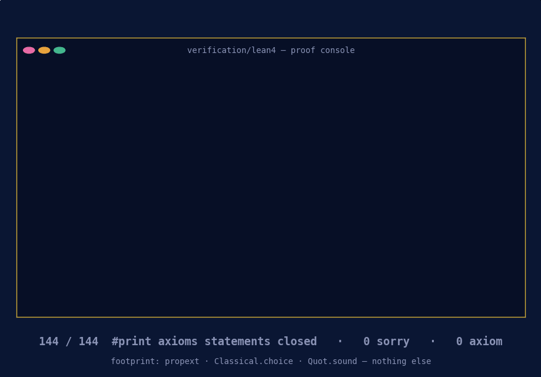

What you are looking at, mapped to the artifact:

| Frame | What happens | Where in `Trivortex.lean` |
|---|---|---|
| `elan show` | the pinned toolchain resolves (`leanprover/lean4:v4.6.0`) | [`lean-toolchain`](lean-toolchain) |
| `lake exe cache get` | the Mathlib olean cache for the pinned tag is fetched | [`lakefile.lean`](lakefile.lean) |
| `lake build` ×9 | every section type-checks: no `sorry`, no new axioms | §1–§9 |
| `#print axioms` ×144 | every load-bearing statement reports its full dependency footprint | the two footprint blocks |

Then jump into the physics — the closed form the file proves, animated:

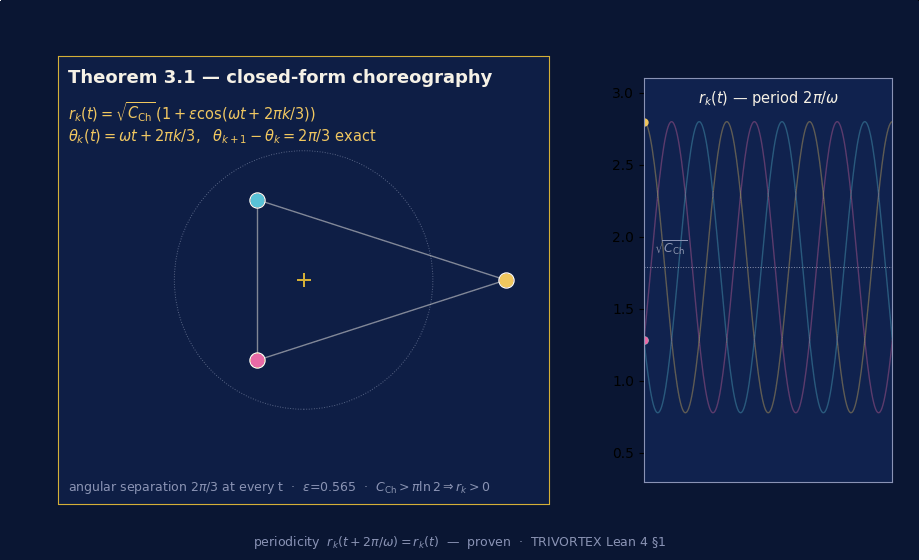

---

## 3. Why Lean 4 + Mathlib

Lean 4 + Mathlib provides the trigonometric, exponential and differential-calculus
scaffolding this statement layer needs — `Real.cos`, `Real.exp`, `HasDerivAt`,
periodicity lemmas, `is_const_of_deriv_eq_zero` — which makes it the fastest formal
path to the choreography, periodicity, conservation and Lagrange-solution properties.

Three reasons it is the right tool for *this* program:

1. **Analysis over ℝ, natively.** The objects live on the real line and circle
   (`omega`, `eps`, `rClosed`, `thetaClosed` are `ℝ`-valued functions). Mathlib's
   real analysis library means no re-implementation of `sin`, `cos`, `exp`, `sqrt`
   or differentiation — the port builds directly on `HasDerivAt` and
   `is_const_of_deriv_eq_zero`, the same lemmas a mathematician reaches for on paper.
2. **Small trust base, fully auditable.** After `lake build`, `#print axioms`
   prints the *complete* dependency set of each theorem. For this artifact it is
   always the same triple — `propext`, `Classical.choice`, `Quot.sound` — the
   classical foundations Mathlib itself rests on. Nothing else is trusted, and
   nothing else *can* be silently trusted, because a new axiom or an unfinished
   proof (`sorry`) would appear in that output and in CI.
3. **The same statements as the ladder.** The port is deliberately a *mirror*: it
   fixes the objects of `verify.py` (commit `557bff8`, M0) so the eight-language
   framework compares like with like. [Section 4](#4-what-is-proven-here--the-five-fixed-objects)
   gives the object-by-object mapping, and [§13](#13-the-eight-language-comparison-matrix)
   the per-language matrix.

---

## 4. What is proven here — the five fixed objects

### 4.1 Theorem 3.1 — the closed form (§1)

> `r_k(t) = √C_Ch · (1 + eps·cos(ω·t + 2πk/3))`, `theta_k(t) = ω·t + 2πk/3`,
> `ω = (2π/T)·exp(C_Ch/π)`, `eps = 1/(exp(C_Ch/π) − 1)`

| Property | Theorem(s) | Meaning |
|---|---|---|
| equilateral choreography | `theta_separation`, `theta_three_step` | `θ_(k+1) − θ_k = 2π/3` **exactly**, at every `t` |
| periodicity | `r_periodic`, `theta_periodic` | `r_k(t + 2π/ω) = r_k(t)`; `θ_k(t + 2π/ω) = θ_k(t) + 2π` |
| admissibility | `omega_pos`, `omega_ne_zero` | `ω > 0` and `ω ≠ 0` for `C_Ch > 0`, `T > 0` |
| positivity regime | `eps_pos`, `eps_lt_one`, `rClosed_pos` | in the regime `C_Ch > π·ln 2` (i.e. `eps < 1`) every `r_k(t) > 0` for all `t` |

The last row is the geometric admissibility gate: below `π·ln 2` the closed form
would push a radius through zero, so the regime is *proven*, not assumed.

### 4.2 The Chaplygin topological integral (§2)

`C_Ch = r²·(θ̇ − q·A_θ)` with the gauge `A_θ = 1/r`, following the definition fixed
in Section 6 of the core document. Proven: the algebraic shape `C_Ch = r²θ̇ − q·r`
(`chaplygin_shape`, `gauge_inverse`). The *numeric* endpoint-drift diagnostic over
`[0, 100·T]` stays a numerical diagnostic by design — the honesty note of
[`verification/README.md`](../README.md) §13 applies.

### 4.3 Vortex integrals — statements *and* conservation laws (§3 + §5)

`H` (Hamiltonian), `P = Σ Γᵢ·xᵢ`, `Q = Σ Γᵢ·yᵢ`, `I = Σ Γᵢ·|rᵢ|²`:

- **§3** pins the exact equilateral anchors `H = 0, P = 0, Q = 0, I = Γ`
  (`H/P/Q/I_equilateral`, built on the four side theorems `side1…side3'`).
- **§5** proves the *conservation laws themselves* — the analytic core of ladder
  checks **V3/V4**: the Kirchhoff point-vortex system is defined natively
  (`kx1…ky3` right-hand sides, the `KirchhoffSol` structure with differentiable
  trajectories and no-collision hypotheses), and along **any** Kirchhoff solution

  `d/dt H = d/dt P = d/dt Q = d/dt I = 0` → each invariant is constant in time
  (`P/Q/I/H_kirchhoff_deriv` + `P/Q/I/H_kirchhoff_conserved`).

### 4.4 The Lagrange equilateral solution (§4 + §6 + §7)

Three equal vortices on a rotating equilateral triangle of side `a` with
`ω = 3Γ/(2πa²)`:

- **§4** registers the specification: `lagrangeOmega` and the `ToleranceBands`
  structure (`registeredBands`) — tolerances fixed *before* checks, the
  pre-registration ethic of the framework.
- **§6** proves it is an *exact* Kirchhoff solution (`lagrangeSol`, the analytic
  core of check **V2**), and that the anchors `H = 0, P = 0, Q = 0, I = Γ` hold
  along it **for all time** (`lagrange_anchor_H/P/Q/I`), not just at `t = 0`.
- **§7** develops the complete triangle theory: the rotation-group identity, the
  velocity field `ω·J·r`, the Kirchhoff field at an arbitrary trial frequency, the
  **forcing theorem** (`lag_omega_unique` — the frequency is not chosen, it is
  forced), the closed-form period `T = 4π²a²/(3Γ)` (`lag_period_closed`), the
  choreography cycle, scaling laws, orbit radius, distance certificates
  (`lag_dist01/02/12`), and the general-side anchors (`lagrange_side_H/P/Q/I`).

### 4.5 Stability and bifurcation (§8 + §9)

- **§8 — linear stability.** The frame co-rotating with the triangle, the anchor
  as its fixed point, the `2π/Γ`-scaled linearization `linX1…linY3`, all **six
  eigenmodes** (`eig_trans1/trans2`, `eig_rot`, `eig_dil`, `eig_shapeU/shapeW`),
  certification of the linearization against the *true* rotating-frame field along
  every modal direction (`lin_cert_*`), explicit modal solutions for all `t`
  (`lin_sol_trans/shape/size`), and the stability bounds: translation and shape
  modes preserve their norm exactly, the size drift grows at most linearly —
  **no eigenmode grows exponentially** (the classical Thomson stability at `N = 3`).
- **§9 — nonlinear continuation at unequal circulations.** The Lagrange branch
  continues for arbitrary `(g1, g2, g3)` with `G ≠ 0` as an exact Kirchhoff
  solution (`s9_rel_eq`); the mode families persist exactly in the full nonlinear
  system (`s9_sol_shift`, `s9_sol_time`, `s9_trans_dev`); and the bifurcation
  landscape at `Π = G₁G₂ + G₂G₃ + G₃G₁` is machine-checked end to end — see
  [§6.9](#69-section-9--nonlinear-continuation-and-the-bifurcation-landscape).

---

## 5. Architecture in pictures

### 5.1 Where this folder sits in the verification constellation

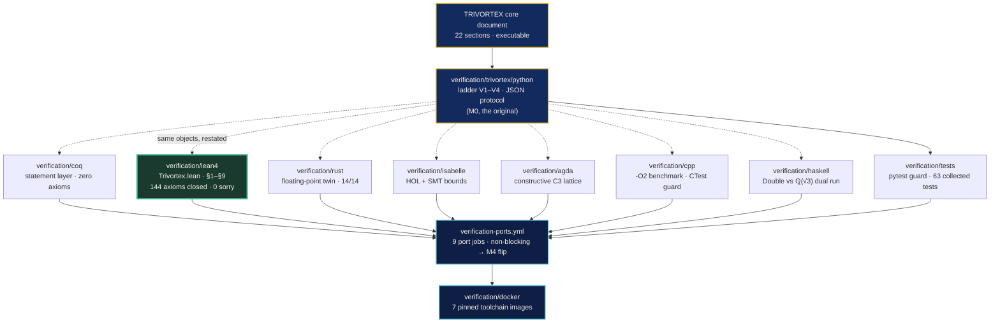

### 5.2 The internal dependency lattice of `Trivortex.lean`

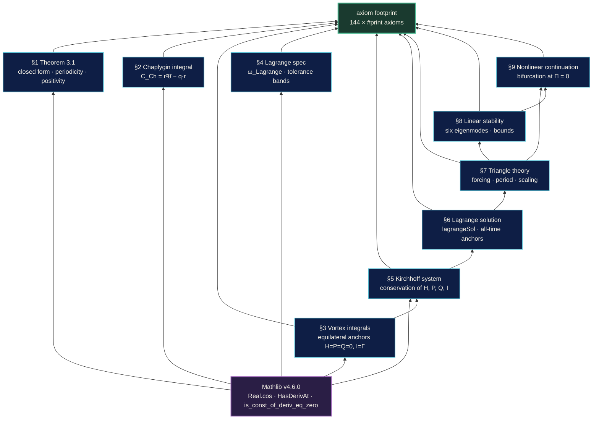

### 5.3 What the 4,915 lines are made of

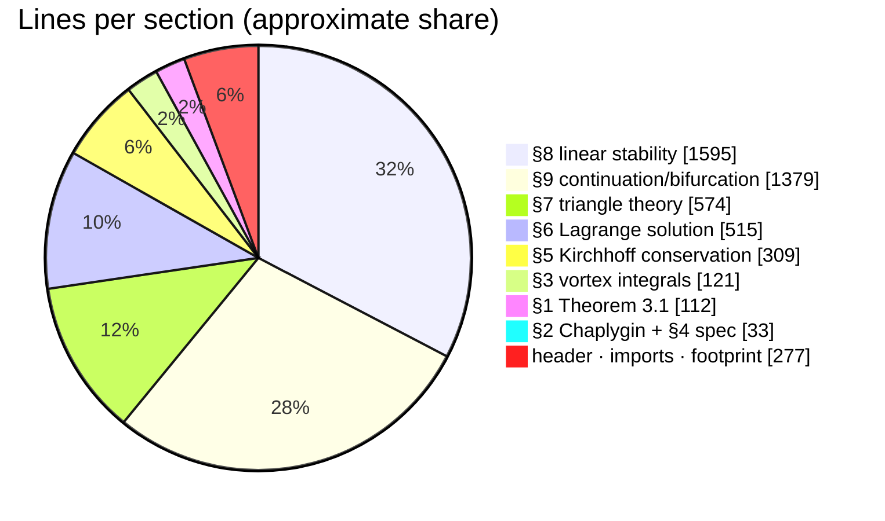

The shape is deliberate: §1–§4 pin the objects, §5–§6 prove the dynamical core,
and §7–§9 (over half the file) are the v3.0–v5.0 depth tracks.

---

## 6. Deep dive — section by section (§1–§9)

Every section is a self-contained landing pad: the statement, the landmark names,
and where the corresponding ladder check lives. The full list of *all* 243+
declaration names is in [Appendix A](#appendix-a--full-declaration-census).

### 6.1 §1 Theorem 3.1: the closed form (lines 114–225)

The four definitions (`omega`, `eps`, `rClosed`, `thetaClosed`) restate the closed
form verbatim from the core document; nine theorems then close every property the
ladder checks numerically. The radial regime is treated separately (`eps_pos`,
`eps_lt_one`, `rClosed_pos`): `C_Ch > π·ln 2` is exactly the condition `eps < 1`,
which keeps every radius strictly positive for all time — the statement the
animated choreography above quietly relies on.

### 6.2 §2 the Chaplygin topological integral (lines 226–239)

Two theorems, zero theater: `chaplygin_shape` pins `C_Ch = r²θ̇ − q·r` under the
gauge `A_θ = 1/r`, and `gauge_inverse` discharges the `1/r · r = 1` step. This is
the shortest section of the file and the one that anchors the whole vortex
formulation to the core document's Section 6.

### 6.3 §3 the vortex integrals of the Kirchhoff equations (lines 240–360)

The Hamiltonian and the impulse invariants are defined first (`vortexDist`, `d2`,
`Hvortex`, `Pvortex`, `Qvortex`, `Ivortex`), then the equilateral reference state
(`eqX1…eqY3`, circumradius `1/√3`, side 1) is *proven* equilateral by four side
theorems (`side1`, `side2`, `side3`, `side3'`), and finally the exact anchors are
closed: `H_equilateral`, `P_equilateral`, `Q_equilateral`, `I_equilateral`
(`H = 0, P = 0, Q = 0, I = Γ` for arbitrary equal circulations).

### 6.4 §4 the Lagrange specification and the registered bands (lines 361–379)

`lagrangeOmega` fixes `ω = 3Γ/(2πa²)`; `ToleranceBands` + `registeredBands` record
the numeric bands (`1e-12 / 1e-10 / 1e-6`) that the ladder and every port measure
against — registered *before* the checks, exactly as the framework's
pre-registration rule demands.

### 6.5 §5 the Kirchhoff system and its conservation laws (lines 380–688)

The heart of the dynamical port. The six right-hand sides `kx1…ky3`, `ky1…ky3`
mirror `vortex_rhs` of `verify.py`; `KirchhoffSol` packages differentiable
trajectories with no-collision hypotheses. Then the four conservation theorems —
`P_kirchhoff_deriv/conserved`, `Q_*`, `I_*`, `H_*` — prove `d/dt(·) = 0` and hence
`value(t) = value(s)` for **any** circulations and **any** non-colliding solution.
This is ladder check **V3/V4** upgraded from "measured constant" to "proven constant".

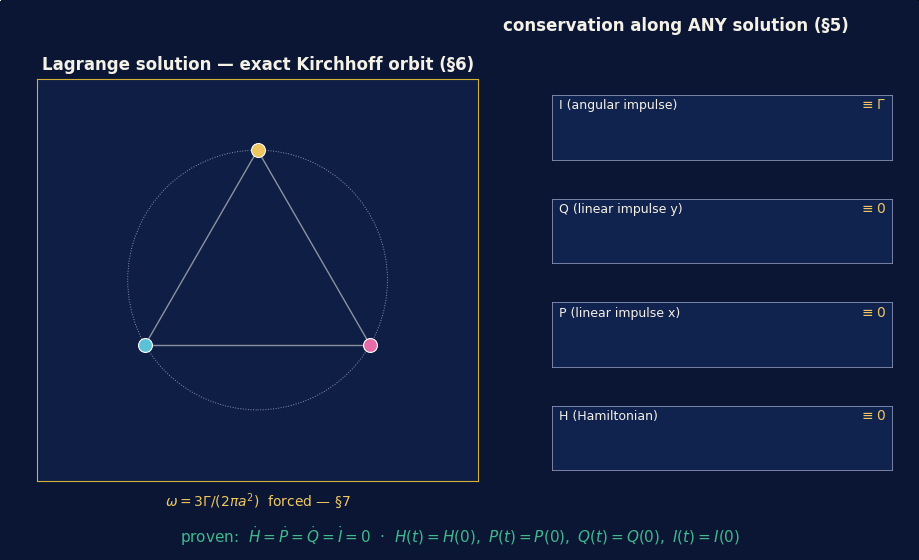

### 6.6 §6 the Lagrange equilateral solution (lines 689–1203)

The rotating triangle is written out (`lagX`, `lagY`), proven equilateral at every
`t` (`d2_lag01/12/02`), differentiated (`lagX/lagY_deriv`), and shown to satisfy
the Kirchhoff field *exactly* (`lag_kx0…lag_ky2`) — which packages into
`lagrangeSol`, the machine-checked twin of ladder check **V2**. The block ends
with the all-time anchors (`lagrange_anchor_H/P/Q/I`): the equilateral values hold
along the motion, not merely at `t = 0`.

### 6.7 §7 the Lagrange triangle: the complete theory (lines 1204–1777)

The v3.0 depth track. Highlights, in the file's own order: the homogeneity/scaling
laws of all four integrals (`*_scale`); the rotation-group identity and the linear
velocity field `ω·J·r`; the orbit radius `a/√3` (`lag_orbit_radius`); the closed
period `T = 4π²a²/(3Γ)` (`lag_period_closed`) with per-component periodicity and
half-period mirror lemmas; the choreography cycle (`lag_cycle_x0…y2`); the
Kirchhoff field at an *arbitrary* trial frequency (`lag_kx0_field…lag_ky2_field`)
which sets up the **forcing theorem** `lag_omega_unique`: a triangle rotating at
any frequency other than `ω = G/(2πa²)` is simply not a solution — the frequency
is forced. Then the scaling law of the family (`lagomega_scale`, `lagX/lagY_scale`,
`lag_trajectory_scale_x/y`), the distance certificates (`lag_dist01/02/12`), and
the general-side anchors (`lagrange_side_H/P/Q/I`).

### 6.8 §8 linear stability: the six eigenmodes (lines 1778–3372)

The v4.0 depth track — and the largest section. The rotating frame
(`rotX1…rotY3`) turns the anchored triangle into a fixed point (`rot_anchor`);
the `2π/Γ`-scaled linearization (`linX1…linY3`) is diagonalized *by hand* into six
eigenmodes — two translations (`eig_trans1/2`, `±iω`), rotation (`eig_rot`),
dilation (`eig_dil`, the size drift), and two shape oscillations
(`eig_shapeU/shapeW`, `±iω`). Four certification theorems (`lin_cert_transX/transY/
shapeU/shapeW`) then check the linearization against the *true* rotating-frame
field along every modal direction — no wishful linearization. Explicit modal
solutions (`lin_sol_trans/shape/size`) close for all `t`, and the stability bounds
(`lin_bound_trans/shape/size`) deliver the punchline: translations and shape modes
preserve their norm exactly, the size drift grows at most linearly —
**no eigenmode grows exponentially** (Thomson stability at `N = 3`, machine-checked).

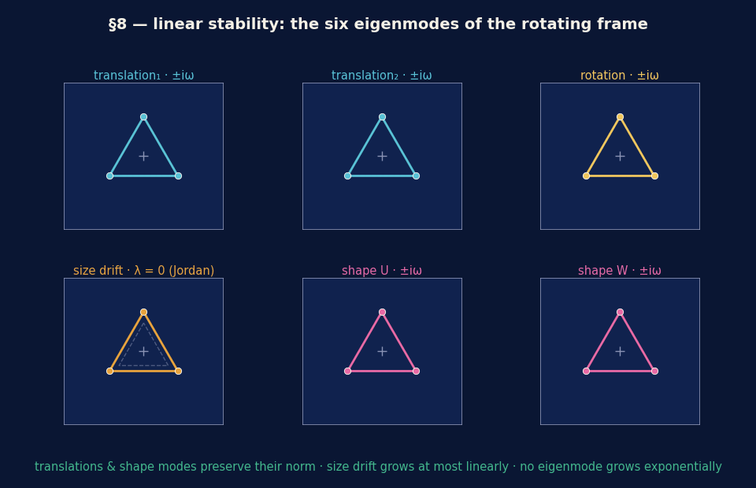

### 6.9 Section 9 — nonlinear continuation and the bifurcation landscape

The v5.0 depth track, in three moves:

1. **9.1 — the general-circulation family.** For arbitrary `(g1, g2, g3)` with
   `G = g1+g2+g3 ≠ 0`, the equilateral triangle translated so its
   circulation-weighted centroid sits at the origin rotates rigidly at
   `ω = G/(2πa²)` and is an **exact** Kirchhoff solution (`s9_rel_eq`; the rate is
   regular in the side parameter, `s9_omega_scale`). Along the way: derivatives,
   pairwise distances, centroid identities and the full six-component field check
   (`s9_gen_field_x1…y3`).
2. **9.2 — exact nonlinear continuation of the modes.** The translation orbit
   persists (the Kirchhoff field is translation-invariant, `s9_kx_shift…s9_ky3_shift`,
   packaged as `s9_sol_shift`), re-timed solutions stay solutions (`s9_sol_time`),
   and the rotating-frame translation deviation keeps constant norm (`s9_trans_dev`).
3. **9.3 — the bifurcation.** The `2π`-scaled rotating-frame linearization
   (`genLinX1…genLinY3`) ties back to the §8 certified matrix on the diagonal
   (`s9_lin_diag`); its characteristic polynomial is
   `λ²·(λ² + G²)·(λ² + 3Π)` with `Π = G₁G₂+G₂G₃+G₃G₁`
   (`s9_lin_trans`, `s9_lin_kernel`, `s9_lin_chain`, `s9_shape_gen`). The three
   regimes are each pinned by an explicit instance and an explicit modal solution:

| Regime | Instance | What is proven | Theorems |
|---|---|---|---|
| `Π > 0` | `(1, 1, 4)` | the shape pair oscillates at `±i√(3Π)` — bounded | `s9_shape4_a/b`, `s9_lin_sol_shape4` |
| `Π = 0` | `(1, 1, −1/2)` | the pair collides at zero: kernel + Jordan chain | `s9_collision_a/b` |
| `Π < 0` | `(1, 1, −1)` | a **real** pair `±√(−3Π)` appears; `m(t) = e^(√3·t)·v` and `\|m(t)\|² = 12·e^(2√3·t)` | `s9_eig_unst`, `s9_exp_comp`, `s9_lin_sol_unst`, `s9_growth_norm` |

Linear instability across the hypersurface `Π = 0` — not a simulation, a proof.

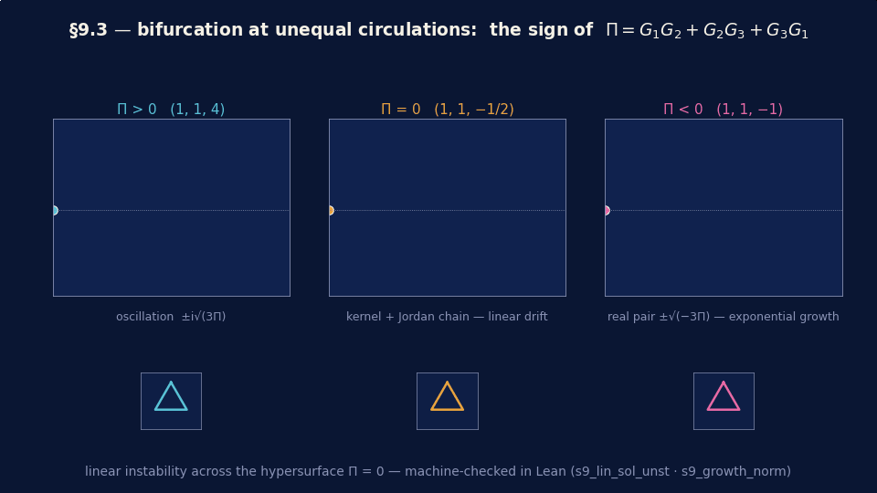

---

## 7. The axiom footprint — nothing but classical foundations

Every load-bearing statement ends in the two footprint blocks of the artifact
(lines 3373–3494 for §1–§8, lines 4874–4913 for §9). The contract they enforce:

| `#print axioms` says | Meaning |
|---|---|
| `propext` | propositional extensionality — Mathlib's everyday rewriting axiom |
| `Classical.choice` | classical choice — the law of the excluded middle in its constructive cloak |
| `Quot.sound` | quotient soundness — how Mathlib builds ℚ, ℝ and friends |

Anything *else* appearing in a footprint — an `axiom`, a `sorry` (which prints as
`sorryAx`), an unvetted declaration — would show up here and in CI. The artifact
closes with:

```text
144 / 144  #print axioms statements closed   ·   0 sorry   ·   0 axiom
footprint: propext · Classical.choice · Quot.sound — nothing else
```

> **Why this matters for a physics program.** A numerical ladder can drift, a
> hand-written proof can have a gap — a Lean proof can only depend on what its
> footprint says it depends on. The footprint is the *registration of trust*,
> and it is re-checked from source on every CI run.

---

## 8. Complete file inventory

Everything in this directory, byte-for-byte:

| File | Lines | Size | Role |
|---|---|---|---|
| [`Trivortex.lean`](Trivortex.lean) | 4,915 | 243 KB | the artifact: §1–§9 + axiom footprint (see [§6](#6-deep-dive--section-by-section-19)) |
| [`lakefile.lean`](lakefile.lean) | 20 | 729 B | package definition: `lean_lib Trivortex`, `autoImplicit false`, Mathlib pinned |
| [`lean-toolchain`](lean-toolchain) | 1 | 24 B | the pin: `leanprover/lean4:v4.6.0` |
| [`README.md`](README.md) | — | — | this overview (English) |
| [`README_RU.md`](README_RU.md) | — | — | the same overview, in Russian |

The lakefile, in full, because every line is a reproducibility decision:

```lean
import Lake
open Lake DSL

/- TRIVORTEX Lean 4 verification package (milestone M4, v2.0).
   SPDX-FileCopyrightText: 2026 Isaev Iskhak Khamzatovich
   SPDX-License-Identifier: LicenseRef-Proprietary-Wild8Highlander-1.0 -/

package «trivortex» where
  leanOptions := #[⟨`autoImplicit, false⟩]

@[default_target]
lean_lib «Trivortex» where
  -- the artifact is the single file Trivortex.lean at the package root
  roots := #[`Trivortex]

-- Mathlib is pinned to an exact revision for reproducibility
-- (verification/README.md §8: never rely on a moving target).
-- Pair: lean-toolchain v4.6.0 + mathlib4 @ tag v4.6.0 (2024-06).
require mathlib from git
  "https://github.com/leanprover-community/mathlib4.git" @ "v4.6.0"
```

Three details worth noticing: `autoImplicit false` forbids accidental implicit
variables (a statement that type-checks by accident is not a statement); the
library root *is* the artifact, so there is exactly one thing to build; and the
Mathlib revision is an **exact tag**, not a moving branch — see the toolchain note
in [§10](#10-reproducibility-pins) for why this pairing matters.

**Provenance.** The header of `Trivortex.lean` carries the SPDX + copyright lines
(REUSE.toml discipline) and points at the commit of `verify.py` it mirrors:
`557bff8`, the M0 release. The artifact states in its header what it proves, what
it deliberately leaves to the numeric ladders, and the exact build recipe.

---

## 9. Build, run, CI

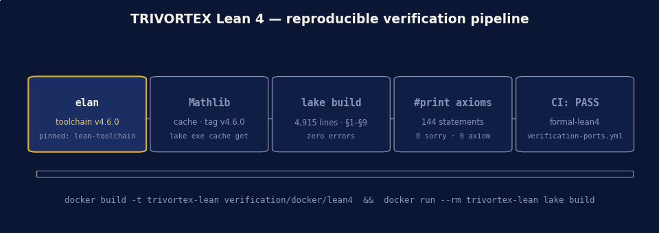

### 9.1 Local (elan installed)

```bash
cd verification/lean4
lake exe cache get && lake build
```

The first `lake exe cache get` downloads Mathlib's pre-built olean cache for the
pinned tag and turns a from-scratch build (hours) into minutes. `lake build`
type-checks the artifact; any `sorry` or new axiom fails the build's footprint
contract at the `#print axioms` stage.

### 9.2 Docker (the pinned toolchain, byte-for-byte what CI runs)

```bash
docker build -t trivortex-lean verification/docker/lean4
docker run --rm trivortex-lean lake build
```

The image ([`docker/lean4/Dockerfile`](../docker/lean4/Dockerfile)) installs elan,
resolves the toolchain file, runs `lake update && lake exe cache get! && lake build`
*at image build time*, and defaults to `lake build` as its entrypoint — so
`docker run` reproduces exactly what CI runs.

### 9.3 CI

Workflow [`verification-ports.yml`](https://github.com/wild8highlander/Trivortex/actions/workflows/verification-ports.yml),
job **`formal-lean4`**: checkout → docker build → docker run. The job is
non-blocking (`continue-on-error: true`) per the framework's CI contract; the M4
"blocking ports" track flips it to enforced after three consecutive green days
([§17](#17-roadmap--m4m5m6-and-the-lean-port)).

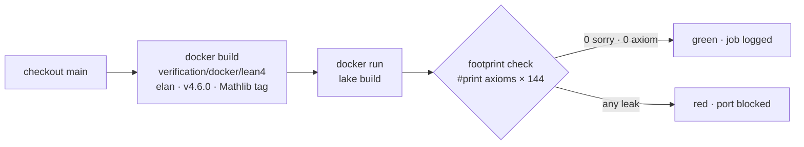

---

## 10. Reproducibility pins

| Pin | Value |
|---|---|
| Toolchain | Lean 4 **v4.6.0** ([`lean-toolchain`](lean-toolchain)) |
| Mathlib | **tag v4.6.0** (pinned in [`lakefile.lean`](lakefile.lean); 2024-06 pairing) |
| Docker pin | [`docker/lean4/Dockerfile`](../docker/lean4/Dockerfile) (ubuntu 24.04 + elan) |
| Artifact | [`Trivortex.lean`](Trivortex.lean) — §1–§9, 144 `#print axioms` statements |
| Milestone | M1 + the M4/M5 depth tracks (conservation + Lagrange + stability + bifurcation) |
| CI status | non-blocking job in [`verification-ports.yml`](https://github.com/wild8highlander/Trivortex/actions/workflows/verification-ports.yml) |

> **Toolchain note.** v1.1 pinned Lean v4.4.0 with Mathlib `@ "master"` — a
> combination that can no longer resolve (moving target + fixed toolchain), so the
> v1.1 artifact was not reproducibly buildable. v2.0 upgrades the toolchain to
> v4.6.0 and pins Mathlib to its matching tag `v4.6.0`, the newest pair verified
> to build within the Docker/CI disk budget of this framework. The proofs use only
> long-stable Mathlib API, so future bumps are mechanical.

---

## 11. Version timeline — v1.1 → v5.0

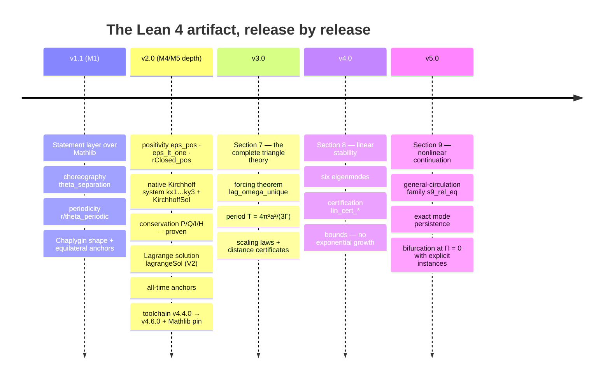

| Release | Section(s) | Headline | Statement layer after release |
|---|---|---|---|
| v1.1 | §1–§3 (+§4/§6 core) | M1: the statement layer lands | choreography, periodicity, Chaplygin shape, anchors |
| v2.0 | §5–§6 (+toolchain) | conservation laws + Lagrange solution **proven** | the analytic core of V2/V3/V4 machine-checked |
| v3.0 | §7 | the complete triangle theory | forcing, period, scaling, certificates |
| v4.0 | §8 | linear stability of the triangle | six eigenmodes, no exponential growth |
| v5.0 | §9 | nonlinear continuation + bifurcation | instability across `Π = 0`, proven |

---

## 12. The verification constellation — every sibling folder

The Lean port is one voice in an eight-language choir. Each sibling re-derives the
*same* objects under its own rules; every folder below carries its own polished
README — the links are the deep dives.

| Folder | Language / tool | Artifact | Milestone | Deep dive |
|---|---|---|---|---|
| [`../trivortex/`](../trivortex/README.md) | Python | ladder **V1–V4** + JSON protocol — the original all ports mirror | **M0** ✅ | the ladder & the lab |
| [`../tests/`](../tests/README.md) | pytest | the guard of the ladder + program (63 collected tests) | **M0** ✅ | the pytest shield |
| [`../coq/`](../coq/README.md) | Coq/Rocq 8.18 | `Trivortex.v` — statement layer, zero axioms | **M1** ✅ | the Gallina twin |
| **`./`** | **Lean 4 v4.6.0** | **`Trivortex.lean` — §1–§9, 144 axioms closed** | **M1 + depth** ✅ | **this document** |
| [`../rust/`](../rust/README.md) | Rust (stable) | the floating-point twin, 14/14 tests, protocol committed | **M1** ✅ | the second float implementation |
| [`../isabelle/`](../isabelle/README.md) | Isabelle/HOL 2024 | `Trivortex.thy` — invariant bounds; SMT session optional | **M2** ✅ | the HOL record |
| [`../agda/`](../agda/README.md) | Agda 2.6.4 | `Trivortex.agda` — constructive `rot³ ≡ id` | **M2** ✅ | the constructive lattice |
| [`../cpp/`](../cpp/README.md) | C++17 · CMake | CTest guard + `-O2` benchmark (`benchmark_rhs_per_s`) | **M3** ✅ | the compiled benchmark |
| [`../haskell/`](../haskell/README.md) | GHC 9.4 | `Double` vs exact-rational dual run — ℚ(√3) anchors by computation | **M3** ✅ | the exact-arithmetic split |
| [`../common/`](../common/README.md) | Python | shared verifier base (template-method `BaseVerifier`) | support | the common spine |
| [`../notes/`](../notes/README.md) | Python + SymPy | §8/§9 numeric mirrors & identity checks (the SymPy pre-verification of the Lean algebra) | support | the scratch proofs |
| [`../docker/`](../docker/README.md) | Dockerfiles | 7 pinned toolchain images, one per port | support | the reproducibility layer |
| [`../trivortex_master/`](../trivortex_master/README.md) | Python | the 22-section interactive program (the laboratory this folder verifies) | app | the executable document |

The rule that keeps the choir honest is stated once in
[`verification/README.md`](../README.md) §7 and obeyed everywhere: **every port
stated its acceptance criteria in its directory README before the artifacts
landed**, and the criteria are checked in the same files now.

---

## 13. The eight-language comparison matrix

What each port establishes about the shared objects, and in what style:

| Port | Theorem proving | Numeric twin | Choreography 2π/3 | Periodicity | Anchors H,P,Q,I | Conservation laws | Lagrange solution | Stability/bifurcation |
|---|---|---|---|---|---|---|---|---|
| Python (`M0`) | — | ✔ (the original) | ✔ measured | ✔ measured | ✔ measured | ✔ measured (`1e-10`) | ✔ measured | numeric mirror (`notes/`) |
| Coq (`M1`) | ✔ zero axioms | — | ✔ proven | statement layer | ✔ proven | — | — | — |
| **Lean 4 (M1+)** | ✔ **144 closed footprints** | — | ✔ **proven** | ✔ **proven** | ✔ **proven** | ✔ **proven (§5)** | ✔ **proven (§6–§7)** | ✔ **proven (§8–§9)** |
| Rust (`M1`) | — | ✔ 14/14 | ✔ measured | ✔ measured | ✔ measured | ✔ measured | ✔ measured | — |
| Isabelle (`M2`) | ✔ HOL | — | statement layer | statement layer | band record (SMT, optional) | — | — | — |
| Agda (`M2`) | ✔ constructive | — | C3 lattice `rot³ ≡ id` | — | — | — | — | — |
| C++ (`M3`) | — | ✔ `-O2` benchmark | ✔ measured | ✔ measured | ✔ measured | ✔ measured | ✔ measured | — |
| Haskell (`M3`) | — | ✔ `Double` + ℚ(√3) | ✔ measured | ✔ measured | ✔ **by exact computation** | ✔ measured | ✔ measured | — |

The pattern is the framework's division of labor: proof assistants *prove* the
analytic core (Lean is currently the deepest), floating-point ports *re-measure*
the ladder numbers independently, and the exact-arithmetic Haskell run crosses the
two cultures inside one binary.

---

## 14. Gallery — animations of the proven objects

The orbit animations of the program (the `.mp4` versions live next to them in
[`docs/animations/`](../../docs/animations/)):

| Animation | What it shows | Lean counterpart |
|---|---|---|
| 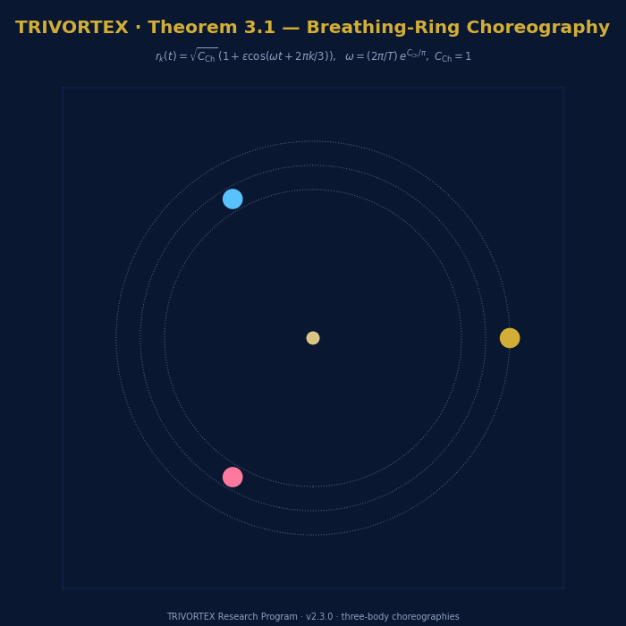 | the Trivortex ring of the core program | §1 closed form, `rClosed` family |
| 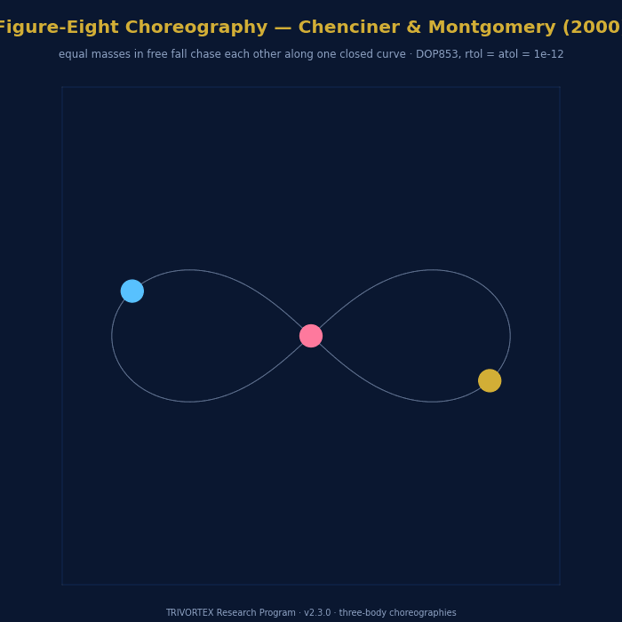 | a free choreography of the Kirchhoff system | §5 conservation along any solution |
| 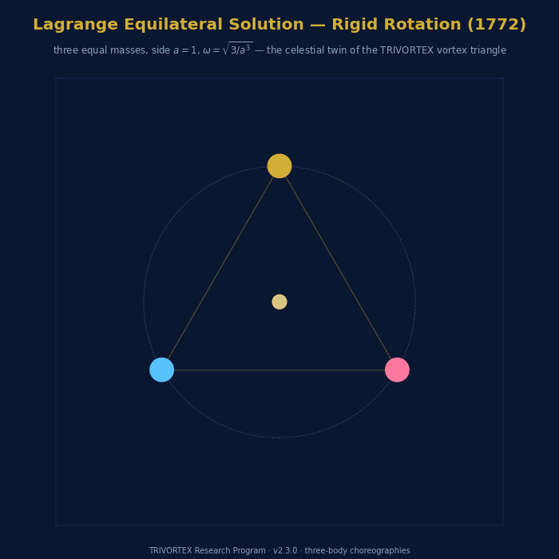 | the rotating equilateral solution | §6 `lagrangeSol` — the exact proven orbit |
| 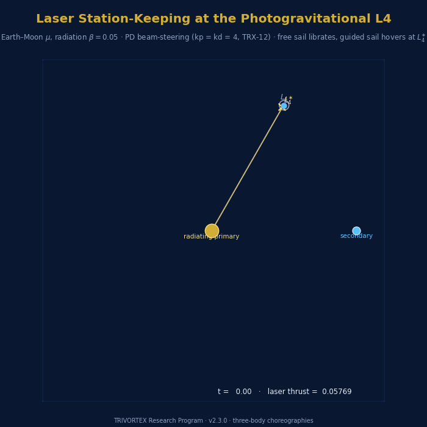 | station-keeping study of the program | (research program, beyond §1–§9) |

And inside this pack, the machine-checked views of the same physics:
[`assets/theorem31_choreography.gif`](assets/theorem31_choreography.gif) (§1),
[`assets/kirchhoff_conservation.gif`](assets/kirchhoff_conservation.gif) (§5–§6),
[`assets/stability_modes.gif`](assets/stability_modes.gif) (§8),
[`assets/bifurcation_window.gif`](assets/bifurcation_window.gif) (§9),
[`assets/axiom_footprint_console.gif`](assets/axiom_footprint_console.gif) (the build),
[`assets/lake_build_pipeline.gif`](assets/lake_build_pipeline.gif) (CI).

---

## 15. FAQ

**Q: Is the three-body problem "solved" here?**
No — and the folder is precise about it. What is proven is the *vortex-model*
analytic layer: the closed-form Lagrange-type choreography (Theorem 3.1), its
admissibility regime, the conservation laws, the Lagrange equilateral solution,
its linear stability, and the bifurcation at unequal circulations. The broader
program's honest boundaries are catalogued in [`verification/README.md`](../README.md) §13.

**Q: What exactly does `#print axioms` guarantee?**
That the printed set is the *complete* transitive dependency footprint of a
declaration. If a proof used an unproved `sorry`, the footprint would contain
`sorryAx`; a new `axiom` would appear by name. Here every one of the 144 printed
statements shows only `propext`, `Classical.choice`, `Quot.sound`.

**Q: Are the numeric tolerances (`1e-12` etc.) proven too?**
No — they are *registered* (§4, `registeredBands`) and *measured* by the ladder
and ports. Lean proves the exact statements; the bands govern where floating-point
results must land. Keeping the two cultures separate is the framework's honesty
rule, not an oversight.

**Q: Why is the CI job non-blocking?**
The framework's CI contract ([`verification/README.md`](../README.md) §7): every
port job starts non-blocking and becomes blocking after three consecutive green
days — a pre-registered, mechanical promotion instead of a promise.

**Q: How long does the first build take?**
From scratch (no cache), a Mathlib build takes hours; with `lake exe cache get`
(the pinned-tag olean cache) it is typically minutes for the artifact itself.
The Docker image bakes the cache in at image-build time.

**Q: Can I bump the toolchain?**
Yes, mechanically — bump `lean-toolchain` and the Mathlib tag together (they must
pair), re-fetch the cache, rebuild. The proofs use long-stable Mathlib API; see
the toolchain note in [§10](#10-reproducibility-pins).

**Q: Where do the SymPy-checked §9 results live?**
In [`../notes/`](../notes/README.md): the numeric mirrors and identity checks that
pre-verified the §9 algebra before it was formalized (57 SymPy PASS lines for §9,
19 for §8 — see the logs there).

**Q: What is `lagrangeSol` — a theorem or a definition?**
A definition (an instance of the `KirchhoffSol` structure) whose *membership*
conditions are the six `lag_kx0…lag_ky2` field theorems; it is printed in the
footprint block alongside the theorems, which is why the census counts 144
footprints over 243 theorems plus defs.

**Q: Why one giant file instead of a tree of modules?**
Reproducibility discipline: one file = one artifact = one build target = one
footprint to audit. The lakefile comment says it directly: "the artifact is the
single file `Trivortex.lean` at the package root".

**Q: How do I cite this?**
See [§20](#20-citation-doi--license) — the repository has a version DOI and a
concept DOI; `CITATION.cff` at the repo root is the machine-readable form.

---

## 16. Troubleshooting

| Symptom | Cause | Fix |
|---|---|---|
| `lake exe cache get` fails or is slow | the pinned-tag cache moved or the network dropped | retry; the fetch is idempotent; the Docker route bakes the cache in instead |
| build dies on Mathlib files | toolchain and Mathlib tag do not pair | keep `lean-toolchain` = `v4.6.0` **and** the lakefile tag `v4.6.0`; never mix a tag with `master` |
| `#print axioms` shows `sorryAx` | someone left a proof unfinished | do not merge — the build is green *only* with the footprint closed |
| disk pressure in CI | Mathlib cache + build artifacts exceed the budget | use the pinned Docker image (cache baked in), or `lake exe cache get!` as the Dockerfile does |
| `unknown identifier` after edits | `autoImplicit false` is stricter than you expect | declare the variables you use — the option exists precisely to catch accidental generality |

---

## 17. Roadmap — M4/M5/M6 and the Lean port

The framework's roadmap is pre-registered in [`verification/README.md`](../README.md) §7.1;
the tracks that touch this folder:

- **M4 — hardening.** Pre-warm the Mathlib cache in the `formal-lean4` job
  (cache action keyed on `lean-toolchain`); acceptance: job wall time ≤ 15 min.
  Flip every port job to blocking after three consecutive green days.
- **M5 — depth.** "The Chaplygin identity, proven": derive `I = Γ` from the
  velocity field by the Stokes/Chaplygin argument *inside* the assistant — Lean
  already carries the conservation core (§5) and the anchors (§3), so this track
  deepens rather than opens. The 50-digit anchor re-derivation (mpmath) and the
  third numeric twin (Julia) live on the numeric side.
- **M6 — widening.** V5 — the regular `N = 7` vortex ring lands in Python first,
  then in at least two ports; if the Lean port takes it, expect a §10.

The artifact's own header reserves the discipline that got it here: an acceptance
criterion may be tightened before the artifacts land, never after.

---

## 18. Contributing

The rules of the framework apply verbatim (see [`CONTRIBUTING.md`](https://github.com/wild8highlander/Trivortex/blob/main/CONTRIBUTING.md) at the repo root); for this folder they condense to four lines:

1. **No `sorry`, no new `axiom`.** A contribution that cannot close its
   `#print axioms` footprint is a proposal, not a proof — put it in an issue first.
2. **Pre-register before you prove.** New statements get their acceptance criteria
   written into this README (or the artifact header) *before* the proof lands.
3. **Pin together.** Toolchain and Mathlib move as a pair; a bump PR touches both
   and shows a green `lake build` in the pinned image.
4. **Mirror, don't fork the objects.** The port mirrors `verify.py`'s analytic
   layer; if the ladder object changes, the Lean object changes in the same PR —
   that is what keeps the eight languages comparable.

---

## 19. Acknowledgments & credits

- **Author & maintainer:** [Isaev Iskhak Khamzatovich](https://orcid.org/0009-0003-7299-0701)
  (ORCID `0009-0003-7299-0701`), the repository owner —  `wild8highlander`.
- **[The Lean community](https://lean-lang.org)** and the
  **[Mathlib](https://github.com/leanprover-community/mathlib4)** contributors —
  the artifact stands on their real-analysis library (`Real.cos`, `HasDerivAt`,
  `is_const_of_deriv_eq_zero`, periodicity lemmas) and on the tooling
  (`elan`, `lake`, the olean cache).
- **The sibling ports** — Coq, Isabelle, Agda on the proof side; Rust, C++,
  Haskell on the numeric side — keep this folder honest by proving and measuring
  the same objects under different rules.
- The **[verification framework](../README.md)** itself: the pre-registration
  ethic, the registered tolerance bands and the honesty notes are the program's
  quieter contributions.

---

## 20. Citation, DOI & license

**Cite the program:**

> Isaev, I. K. (2026). *TRIVORTEX: The Three-Body Problem in the Vortex Model with
> the Chaplygin Topological Integral* — the multi-language verification release.
> Zenodo. DOI [10.5281/zenodo.21825394](https://doi.org/10.5281/zenodo.21825394)
> (version) · [10.5281/zenodo.21825393](https://doi.org/10.5281/zenodo.21825393)
> (concept, all versions).

Machine-readable metadata: [`CITATION.cff`](https://github.com/wild8highlander/Trivortex/blob/main/CITATION.cff) ·
BibTeX and further renditions: the repository's [citation section](https://github.com/wild8highlander/Trivortex#19-citation-doi--zenodo).

**License:** the artifact and this documentation are proprietary under
**IPL-RP-1.0** (`LicenseRef-Proprietary-Wild8Highlander-1.0`) — see
[`LICENSE.md`](https://github.com/wild8highlander/Trivortex/blob/main/LICENSE.md)
at the repository root. SPDX headers in every source file; the repository is
[REUSE](https://github.com/wild8highlander/Trivortex/blob/main/REUSE.toml)-compliant.

---

## Appendix A — full declaration census

<!--CENSUS-START-->
**Full declaration census** — 243 theorems/lemmas (144 public + 99 `private` helpers) + 57 definitions/structures. Names are verbatim Lean identifiers.

<details>
<summary><b>Section 1 — Theorem 3.1: the closed form and its properties</b> — lines 114–225: 9 theorems/lemmas, 4 defs · <i>click to expand</i></summary>

**Definitions & structures:** `omega` · `eps` · `rClosed` · `thetaClosed`

**Theorems & lemmas:**
`omega_ne_zero` · `theta_separation` · `theta_three_step` · `r_periodic` · `theta_periodic` · `omega_pos`
`eps_pos` · `eps_lt_one` · `rClosed_pos`

</details>

<details>
<summary><b>Section 2 — the Chaplygin topological integral</b> — lines 226–239: 2 theorems/lemmas, 0 defs · <i>click to expand</i></summary>

**Theorems & lemmas:**
`chaplygin_shape` · `gauge_inverse`

</details>

<details>
<summary><b>Section 3 — the vortex integrals of the Kirchhoff equations</b> — lines 240–360: 9 theorems/lemmas, 12 defs · <i>click to expand</i></summary>

**Definitions & structures:** `vortexDist` · `d2` · `Hvortex` · `Pvortex` · `Qvortex` · `Ivortex` · `eqX1` · `eqY1` · `eqX2` · `eqY2` · `eqX3` · `eqY3`

**Theorems & lemmas:**
`vortexDist_eq` · `side1` · `side2` · `side3` · `side3'` · `H_equilateral`
`P_equilateral` · `Q_equilateral` · `I_equilateral`

</details>

<details>
<summary><b>Section 4 — the Lagrange specification and the registered bands</b> — lines 361–379: 0 theorems/lemmas, 3 defs · <i>click to expand</i></summary>

**Definitions & structures:** `lagrangeOmega` · `ToleranceBands` (structure) · `registeredBands`

**Theorems & lemmas:**

</details>

<details>
<summary><b>Section 5 — the Kirchhoff point-vortex system and its conservation laws</b> — lines 380–688: 11 theorems/lemmas, 7 defs · <i>click to expand</i></summary>

**Definitions & structures:** `kx1` · `ky1` · `kx2` · `ky2` · `kx3` · `ky3` · `KirchhoffSol` (structure)

**Theorems & lemmas:**
`deriv_mul_const_left` · `deriv_congr` · `P_kirchhoff_deriv` · `P_kirchhoff_conserved` · `Q_kirchhoff_deriv` · `Q_kirchhoff_conserved`
`I_kirchhoff_deriv` · `I_kirchhoff_conserved` · `deriv_log_dist` · `H_kirchhoff_deriv` · `H_kirchhoff_conserved`

</details>

<details>
<summary><b>Section 6 — the Lagrange equilateral solution</b> — lines 689–1203: 33 theorems/lemmas, 3 defs · <i>click to expand</i></summary>

**Definitions & structures:** `lagX` · `lagY` · `lagrangeSol`

**Theorems & lemmas:**
`cos_two_pi_div_three` · `sin_two_pi_div_three` · `cos_four_pi_div_three` · `sin_four_pi_div_three` · `phase0_eq` · `phase1_eq`
`phase2_eq` · `sin_sum` · `cos_sum` · `trig_pair_dist` · `d2_lag01` · `d2_lag12`
`d2_lag02` · `lagX_sum` · `lagY_sum` · `lagX_deriv` · `lagY_deriv` · `lag_kx0`
`lag_kx1` · `lag_kx2` · `lag_ky0` · `lag_ky1` · `lag_ky2` · `lagX0_eq1`
`lagY0_eq1` · `lagX0_eq2` · `lagY0_eq2` · `lagX0_eq3` · `lagY0_eq3` · `lagrange_anchor_H`
`lagrange_anchor_P` · `lagrange_anchor_Q` · `lagrange_anchor_I`

</details>

<details>
<summary><b>Section 7 — the Lagrange triangle: the complete theory</b> — lines 1204–1777: 46 theorems/lemmas, 0 defs · <i>click to expand</i></summary>

**Theorems & lemmas:**
`cos_add_pi_unit` · `sin_add_pi_unit` · `vortexDist_scale` · `Pvortex_scale` · `Qvortex_scale` · `Ivortex_scale`
`Hvortex_scale` · `lag_rotation_x` · `lag_rotation_y` · `lag_deriv_field_x` · `lag_deriv_field_y` · `lag_orbit_radius`
`lag_period_closed` · `lagX_periodic` · `lagY_periodic` · `lagX_half_period` · `lagY_half_period` · `lag_cycle_x0`
`lag_cycle_x1` · `lag_cycle_x2` · `lag_cycle_y0` · `lag_cycle_y1` · `lag_cycle_y2` · `lag_kx0_field`
`lag_kx1_field` · `lag_kx2_field` · `lag_ky0_field` · `lag_ky1_field` · `lag_ky2_field` · `lag_omega_unique`
`lagomega_ne_zero` · `lagomega_pos_iff` · `lagomega_scale` · `lagX_scale` · `lagY_scale` · `lagX_zero`
`lagY_zero` · `lag_trajectory_scale_x` · `lag_trajectory_scale_y` · `lag_dist01` · `lag_dist02` · `lag_dist12`
`lagrange_side_H` · `lagrange_side_P` · `lagrange_side_Q` · `lagrange_side_I`

</details>

<details>
<summary><b>Section 8 — linear stability: the eigenmodes of the perturbed triangle</b> — lines 1778–3372: 94 theorems/lemmas, 17 defs · <i>click to expand</i></summary>

**Definitions & structures:** `rotX1` · `rotY1` · `rotX2` · `rotY2` · `rotX3` · `rotY3` · `linX1` · `linY1` · `linX2` · `linY2` · `linX3` · `linY3` · `transXamp` · `transYamp` · `shapeUamp` · `shapeWamp` · `sizeDriftQ`

**Theorems & lemmas:**
`s3sq` · `div_sqrt3` · `div_2sqrt3` · `d2_anchor12` · `d2_anchor13` · `d2_anchor23`
`eqdx12` · `eqdy12` · `eqdx13` · `eqdy13` · `eqdx23` · `eqdy23`
`eqdx21` · `eqdy21` · `eqdx31` · `eqdy31` · `eqdx32` · `eqdy32`
`rot_anchor` · `eig_trans1` · `eig_trans2` · `eig_rot` · `eig_dil` · `eig_shapeU`
`eig_shapeW` · `hasDerivAt_const_mul_id` · `hasDerivAt_affine` · `hasDerivAt_quad0` · `hasDerivAt_quot0` · `d2_shiftX`
`d2_shiftY` · `add_sub_add_eq` · `lin_cert_transX` · `lin_cert_transY` · `lin_dxU12` · `lin_dxU13`
`lin_dxU23` · `lin_dxU21` · `lin_dxU31` · `lin_dxU32` · `lin_dyU12` · `lin_dyU13`
`lin_dyU23` · `lin_dyU21` · `lin_dyU31` · `lin_dyU32` · `lin_d2U12` · `lin_d2U13`
`lin_d2U23` · `lin_dxW12` · `lin_dyW12` · `lin_dxW13` · `lin_dyW13` · `lin_dxW21`
`lin_dyW21` · `lin_dyW23` · `lin_dxW23` · `lin_dyW31` · `lin_dxW31` · `lin_dyW32`
`lin_dxW32` · `lin_d2W12` · `lin_d2W13` · `lin_d2W23` · `lin_hasDerivAt_add_id` · `lin_cert_shapeU`
`lin_cert_shapeW` · `cos_comp` · `sin_comp` · `linX1_trans` · `linY1_trans` · `linX2_trans`
`linY2_trans` · `linX3_trans` · `linY3_trans` · `linX1_shape` · `linY1_shape` · `linX2_shape`
`linY2_shape` · `linX3_shape` · `linY3_shape` · `linX1_size` · `linY1_size` · `linX2_size`
`linY2_size` · `linX3_size` · `linY3_size` · `lin_sol_trans` · `lin_sol_shape` · `lin_sol_size`
`lin_size_basis` · `lin_bound_trans` · `lin_bound_shape` · `lin_bound_size`

</details>

<details>
<summary><b>Axiom footprint (§1–§8 prints)</b> — lines 3373–4915: 39 theorems/lemmas, 11 defs · <i>click to expand</i></summary>

**Definitions & structures:** `genOmega` · `tauX` · `tauY` · `genX` · `genY` · `genLinX1` · `genLinY1` · `genLinX2` · `genLinY2` · `genLinX3` · `genLinY3`

**Theorems & lemmas:**
`s9_gen_deriv_x` · `s9_gen_deriv_y` · `s9_gen_dist01` · `s9_gen_dist02` · `s9_gen_dist12` · `s9_gen_centroid_x`
`s9_gen_centroid_y` · `s9_gen_field_x1` · `s9_gen_field_y1` · `s9_gen_field_x2` · `s9_gen_field_y2` · `s9_gen_field_x3`
`s9_gen_field_y3` · `s9_rel_eq` · `s9_omega_scale` · `s9_kx_shift` · `s9_ky_shift` · `s9_kx2_shift`
`s9_ky2_shift` · `s9_kx3_shift` · `s9_ky3_shift` · `s9_sol_shift` · `s9_sol_time` · `s9_trans_dev`
`s9_s3cu` · `s9_lin_trans` · `s9_lin_diag` · `s9_lin_kernel` · `s9_lin_chain` · `s9_shape_gen`
`s9_shape4_a` · `s9_shape4_b` · `s9_lin_sol_shape4` · `s9_collision_a` · `s9_collision_b` · `s9_eig_unst`
`s9_exp_comp` · `s9_lin_sol_unst` · `s9_growth_norm`

</details>

<!--CENSUS-END-->

---

<div align="center">

**[⬆ Back to top](#lean-4--the-machine-checked-heart-of-trivortex)** ·
**[Verification framework](../README.md)** ·
**[Repository root](https://github.com/wild8highlander/Trivortex)**

*Part of [wild8highlander/Trivortex](https://github.com/wild8highlander/Trivortex) · Licensed under [IPL-RP-1.0](https://github.com/wild8highlander/Trivortex/blob/main/LICENSE.md) — All Rights Reserved*

</div>
