<!-- markdownlint-disable-file MD041 -->
<div align="center">

<!-- ══════════════════════════════════════════════════════════════ -->
<!-- TRIVORTEX · LEAN 4 — тёмно-синяя с золотом шапка (стиль репо)   -->
<!-- ══════════════════════════════════════════════════════════════ -->
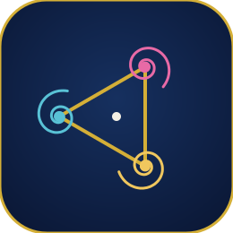

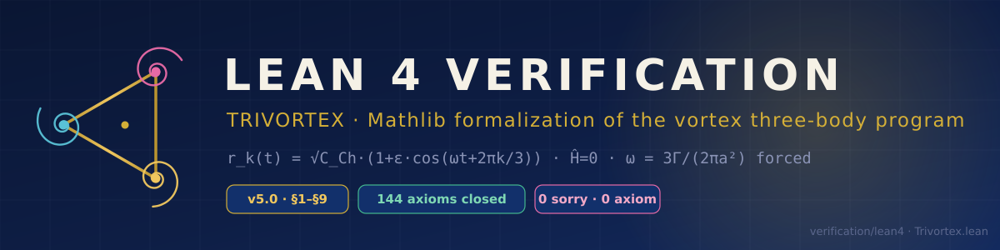

### Lean 4 — проверенная машиной сердце TRIVORTEX

**Слой формализации, доведённый до v7.0.** Один файл — `Trivortex.lean`, 6 589 строк —
выводит заново аналитическое ядро вихревой программы трёх тел внутри
[Lean 4](https://lean-lang.org) + [Mathlib](https://github.com/leanprover-community/mathlib):
теорема 3.1 (замкнутая лагранжева хореография), топологический интеграл Чаплыгина,
законы сохранения системы Кирхгоффа, равностороннее решение Лагранжа, полная теория
треугольника, линейная устойчивость, бифуркация при неравных циркуляциях, нелинейная
устойчивость по Ляпунову через H/I и завершённая коллинеарная бифуркация —
**170 инструкций `#print axioms`, ноль `sorry`, ноль `axiom`**, каждый футпринт замкнут
ровно на `propext · Classical.choice · Quot.sound`.

**[Исаев Исхак Хамзатович](https://orcid.org/0009-0003-7299-0701)** · ORCID `0009-0003-7299-0701` · Independent Researcher

[🏝 Корень репозитория](https://github.com/wild8highlander/Trivortex) · [🧪 Фреймворк верификации](../README.md) · [🐍 Python-лестница](../trivortex/README_RU.md) · [🐳 Docker-закрепление](../docker/lean4/README.md) · [🇬🇧 English](README.md)

<!-- ROW 1 — CI/CD (живые) -->
[](https://github.com/wild8highlander/Trivortex/actions/workflows/verification-ports.yml)
[](https://github.com/wild8highlander/Trivortex/actions/workflows/lint.yml)
[](https://github.com/wild8highlander/Trivortex/actions/workflows/codeql.yml)
[](https://github.com/wild8highlander/Trivortex/actions/workflows/docker.yml)
[](https://securityscorecards.dev/viewer/?uri=github.com/wild8highlander/Trivortex)

<!-- ROW 2 — ФОРМАЛЬНЫЙ СТАТУС -->
[](lean-toolchain)
[](lakefile.lean)
[](Trivortex.lean)
[](Trivortex.lean)
[](Trivortex.lean)

<!-- ROW 3 — ВИТАЛЬНЫЕ ПОКАЗАТЕЛИ -->
[-gold?style=for-the-badge&label=Релиз)](#11-шкала-времени--v11--v70)
[](Trivortex.lean)
[](#приложение-a--полный-ценз-деклараций)
[](#приложение-a--полный-ценз-деклараций)
[](../README_RU.md)
[](https://github.com/wild8highlander/Trivortex/blob/main/REUSE.toml)

<!-- ROW 4 — ПУЛЬС СООБЩЕСТВА -->
[](https://github.com/wild8highlander/Trivortex)
[](https://github.com/wild8highlander/Trivortex/network/members)
[](https://github.com/wild8highlander/Trivortex/issues)
[](https://github.com/wild8highlander/Trivortex/commits/main)
[](https://github.com/wild8highlander/Trivortex/commits/main)
[](https://github.com/wild8highlander/Trivortex/blob/main/LICENSE.md)

<!-- идентичности -->
<table>
<tr>
<td align="center">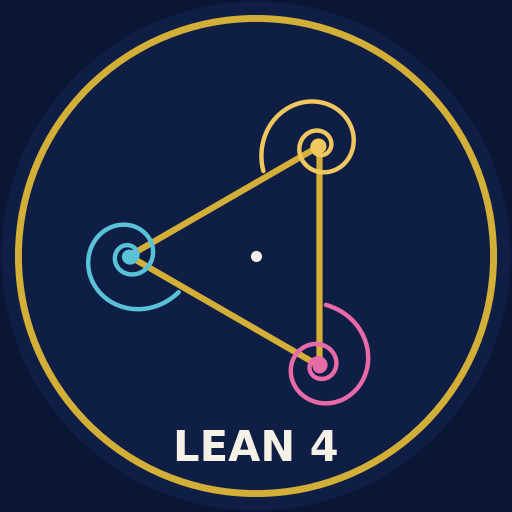<br><sub><b>аватар проекта</b></sub></td>
<td align="center"><br><sub><b><a href="https://github.com/wild8highlander">wild8highlander</a></b><br>автор и сопровождающий</sub></td>
</tr>
</table>

</div>


---

## Оглавление

1. [TL;DR — что живёт в этой папке](#1-tldr--что-живёт-в-этой-папке)
2. [Экскурсия за 30 секунд](#2-экскурсия-за-30-секунд)
3. [Почему Lean 4 + Mathlib](#3-почему-lean-4--mathlib)
4. [Что здесь доказано — пять фиксированных объектов](#4-что-здесь-доказано--пять-фиксированных-объектов)
5. [Архитектура в картинках](#5-архитектура-в-картинках)
6. [Глубокое погружение — секция за секцией (§1–§10)](#6-глубокое-погружение--секция-за-секцией-110)
7. [Футпринт аксиом — ничего, кроме классических оснований](#7-футпринт-аксиом--ничего-кроме-классических-оснований)
8. [Полная опись файлов](#8-полная-опись-файлов)
9. [Сборка, запуск, CI](#9-сборка-запуск-ci)
10. [Закрепления воспроизводимости](#10-закрепления-воспроизводимости)
11. [Шкала времени — v1.1 → v7.0](#11-шкала-времени--v11--v70)
12. [Созвездие верификации — каждая соседняя папка](#12-созвездие-верификации--каждая-соседняя-папка)
13. [Матрица сравнения восьми языков](#13-матрица-сравнения-восьми-языков)
14. [Галерея — анимации доказанных объектов](#14-галерея--анимации-доказанных-объектов)
15. [FAQ](#15-faq)
16. [Устранение неполадок](#16-устранение-неполадок)
17. [Дорожная карта — M4/M5/M6 и Lean-порт](#17-дорожная-карта--m4m5m6-и-lean-порт)
18. [Как внести вклад](#18-как-внести-вклад)
19. [Благодарности и авторы](#19-благодарности-и-авторы)
20. [Цитирование, DOI и лицензия](#20-цитирование-doi-и-лицензия)

- [Приложение A — полный ценз деклараций](#приложение-a--полный-ценз-деклараций)

---

## 1. TL;DR — что живёт в этой папке

Этот каталог — **Lean 4 порт** фреймворка верификации TRIVORTEX: те же три объекта,
которые численно прогоняет Python-лестница ([`verification/trivortex/python/verify.py`](../trivortex/python/README.md)),
здесь **сформулированы и доказаны** в зависимой теории типов Lean 4 поверх Mathlib.
Порт фиксирует ровно объекты лестницы, поэтому каждый язык доказывает или вычисляет
*одни и те же утверждения*, и результаты остаются сопоставимыми во всём фреймворке.

| Витальный показатель | Значение |
|---|---|
| **Артефакт** | [`Trivortex.lean`](Trivortex.lean) — 6 589 строк, один namespace, один файл |
| **Секции** | §1–§10.3 (+ три блока футпринта аксиом) — см. [погружение](#6-глубокое-погружение--секция-за-секцией-110) |
| **Декларации** | 309 теорем/лемм (170 публичных + 139 `private`-помощников) · 58 определений · 2 структуры |
| **Машинная замкнутость** | **170 инструкций `#print axioms` — все замкнуты** на `propext`, `Classical.choice`, `Quot.sound` |
| **Лазейки** | **0 `sorry` · 0 `axiom`** (проверено `grep`-ом и собственным футпринт-блоком файла) |
| **Тулчейн** | Lean 4 **v4.6.0** + Mathlib **тег v4.6.0** (оба закреплены; см. [§10](#10-закрепления-воспроизводимости)) |
| **Статус** | ✅ **завершено — v7.0** (§1–§10.3; M1 + треки углубления M4/M5 + трек §10 устойчивость/бифуркация) |
| **CI** | workflow [`verification-ports.yml`](https://github.com/wild8highlander/Trivortex/actions/workflows/verification-ports.yml), работа **`formal-lean4`** |
| **Происхождение** | зеркалирует аналитический слой `verify.py` @ коммит `557bff8` (релиз M0) |
| **Лицензия** | IPL-RP-1.0 (проприетарная) · SPDX-заголовки в каждом файле · [REUSE](https://github.com/wild8highlander/Trivortex/blob/main/REUSE.toml) |

> **Одним предложением.** Всё, что эта папка утверждает о хореографии,
> периодичности, положительности, сохранении, решении Лагранжа, устойчивости и
> бифуркации, — не *декларация*, а **доказательство**, и в этом доказательстве нет
> скрытых допущений сверх трёх классических аксиом, на которых стоит сам Mathlib.

---

## 2. Экскурсия за 30 секунд

Посмотрите, как сборка закрывает сама себя: девять секций компилируются, счётчик
`sorry`/`axiom` показывает `0`, и каждый напечатанный футпринт аксиом падает на одни
и те же три классических основания.

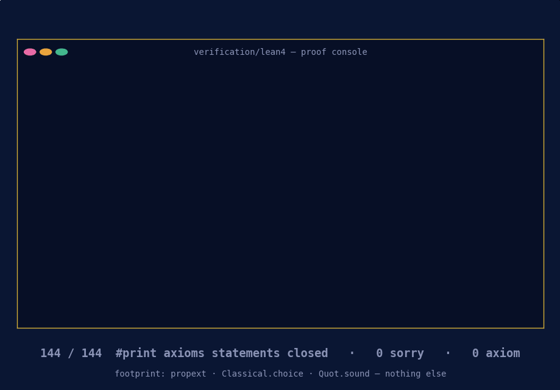

Что вы видите, с привязкой к артефакту:

| Кадр | Что происходит | Где в `Trivortex.lean` |
|---|---|---|
| `elan show` | закреплённый тулчейн разрешается (`leanprover/lean4:v4.6.0`) | [`lean-toolchain`](lean-toolchain) |
| `lake exe cache get` | подтягивается olean-кэш Mathlib закреплённого тега | [`lakefile.lean`](lakefile.lean) |
| `lake build` ×9 | каждая секция типизируется: ни `sorry`, ни новых аксиом | §1–§9 |
| `#print axioms` ×170 | каждое несущее утверждение печатает свой полный футпринт зависимостей | три футпринт-блока |

Теперь — сама физика: замкнутая форма, которую файл доказывает, в движении:

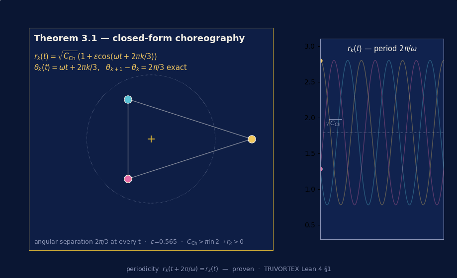

---

## 3. Почему Lean 4 + Mathlib

Lean 4 + Mathlib даёт тригонометрические, экспоненциальные и
дифференциально-исчисленные каркасы, которые нужны этому слою утверждений —
`Real.cos`, `Real.exp`, `HasDerivAt`, леммы периодичности,
`is_const_of_deriv_eq_zero`, — это самый короткий формальный путь к свойствам
хореографии, периодичности, сохранения и решения Лагранжа.

Три причины, почему это правильный инструмент *для этой* программы:

1. **Анализ над ℝ — нативно.** Объекты живут на вещественной прямой и окружности
   (`omega`, `eps`, `rClosed`, `thetaClosed` — функции над `ℝ`). Библиотека
   вещественного анализа Mathlib избавляет от переизобретения `sin`, `cos`, `exp`,
   `sqrt` и дифференцирования — порт строится прямо на `HasDerivAt` и
   `is_const_of_deriv_eq_zero`, тех же леммах, которые математик берёт на бумаге.
2. **Малое основание доверия, полностью аудируемое.** После `lake build` команда
   `#print axioms` печатает *полный* набор зависимостей каждой теоремы. Для этого
   артефакта это всегда одна и та же тройка — `propext`, `Classical.choice`,
   `Quot.sound`, классические основания, на которых стоит сам Mathlib. Ничто
   другое не является доверенным, и ничто другое *не может* быть доверено тайком:
   новая аксиома или недоказанный фрагмент (`sorry`) появились бы в этом выводе
   и в CI.
3. **Те же утверждения, что у лестницы.** Порт сознательно является *зеркалом*: он
   фиксирует объекты `verify.py` (коммит `557bff8`, M0), чтобы восьмиязычный
   фреймворк сравнивал подобное с подобным. Сопоставление объект-за-объектом — в
   [разделе 4](#4-что-здесь-доказано--пять-фиксированных-объектов), матрица по портам —
   в [§13](#13-матрица-сравнения-восьми-языков).

---

## 4. Что здесь доказано — пять фиксированных объектов

### 4.1 Теорема 3.1 — замкнутая форма (§1)

> `r_k(t) = √C_Ch · (1 + eps·cos(ω·t + 2πk/3))`, `theta_k(t) = ω·t + 2πk/3`,
> `ω = (2π/T)·exp(C_Ch/π)`, `eps = 1/(exp(C_Ch/π) − 1)`

| Свойство | Теоремы | Смысл |
|---|---|---|
| хореография (углы) | `theta_separation`, `theta_three_step` | `θ_(k+1) − θ_k = 2π/3` **точно**, в каждый момент `t` |
| периодичность | `r_periodic`, `theta_periodic` | `r_k(t + 2π/ω) = r_k(t)`; `θ_k(t + 2π/ω) = θ_k(t) + 2π` |
| допустимость | `omega_pos`, `omega_ne_zero` | `ω > 0` и `ω ≠ 0` при `C_Ch > 0`, `T > 0` |
| режим положительности | `eps_pos`, `eps_lt_one`, `rClosed_pos` | в режиме `C_Ch > π·ln 2` (т.е. `eps < 1`) каждое `r_k(t) > 0` при всех `t` |

Последняя строка — геометрический шлюз допустимости: ниже `π·ln 2` замкнутая форма
продавила бы радиус сквозь ноль, поэтому режим *доказан*, а не принят.

### 4.2 Топологический интеграл Чаплыгина (§2)

`C_Ch = r²·(θ̇ − q·A_θ)` с калибровкой `A_θ = 1/r`, по определению из раздела 6
основного документа. Доказано: алгебраическая форма `C_Ch = r²θ̇ − q·r`
(`chaplygin_shape`, `gauge_inverse`). *Численная* диагностика дрейфа на концах окна
`[0, 100·T]` остаётся численной диагностикой по построению — действует примечание о
честности из [`verification/README.md`](../README.md) §13.

### 4.3 Вихревые интегралы — утверждения *и* законы сохранения (§3 + §5)

`H` (гамильтониан), `P = Σ Γᵢ·xᵢ`, `Q = Σ Γᵢ·yᵢ`, `I = Σ Γᵢ·|rᵢ|²`:

- **§3** закрепляет точные равносторонние якоря `H = 0, P = 0, Q = 0, I = Γ`
  (`H/P/Q/I_equilateral`, построенные на четырёх теоремах о сторонах `side1…side3'`).
- **§5** доказывает *сами законы сохранения* — аналитическое ядро лестничных
  проверок **V3/V4**: система точечных вихрей Кирхгоффа определена нативно
  (правые части `kx1…ky3`, структура `KirchhoffSol` с дифференцируемыми
  траекториями и гипотезами отсутствия столкновений), и вдоль **любого** решения
  Кирхгоффа

  `d/dt H = d/dt P = d/dt Q = d/dt I = 0` → каждый инвариант постоянен во времени
  (`P/Q/I/H_kirchhoff_deriv` + `P/Q/I/H_kirchhoff_conserved`).

### 4.4 Равностороннее решение Лагранжа (§4 + §6 + §7)

Три одинаковых вихря на вращающемся равностороннем треугольнике со стороной `a`
при `ω = 3Γ/(2πa²)`:

- **§4** регистрирует спецификацию: `lagrangeOmega` и структура `ToleranceBands`
  (`registeredBands`) — допуски фиксируются *до* проверок, этика
  предварительной регистрации фреймворка.
- **§6** доказывает, что это *точное* решение Кирхгоффа (`lagrangeSol`,
  аналитическое ядро проверки **V2**), и что якоря `H = 0, P = 0, Q = 0, I = Γ`
  выполняются вдоль него **в любое время** (`lagrange_anchor_H/P/Q/I`), а не только
  при `t = 0`.
- **§7** разворачивает полную теорию треугольника: тождество группы вращений,
  поле скоростей `ω·J·r`, поле Кирхгоффа при произвольной пробной частоте,
  **теорема о навязывании** (`lag_omega_unique` — частота не выбирается, она
  навязывается), замкнутая форма периода `T = 4π²a²/(3Γ)` (`lag_period_closed`),
  цикл хореографии, законы масштабирования, радиус орбиты, сертификаты расстояний
  (`lag_dist01/02/12`) и якоря для произвольной стороны (`lagrange_side_H/P/Q/I`).

### 4.5 Устойчивость и бифуркация (§8 + §9)

- **§8 — линейная устойчивость.** Сопутствующая система отсчёта, якорь как её
  неподвижная точка, линеаризация в масштабе `2π/Γ` (`linX1…linY3`), все **шесть
  собственных мод** (`eig_trans1/trans2`, `eig_rot`, `eig_dil`,
  `eig_shapeU/shapeW`), сертификация линеаризации против *истинного* поля во
  вращающейся рамке вдоль каждого модального направления (`lin_cert_*`), явные
  модальные решения при всех `t` (`lin_sol_trans/shape/size`) и границы
  устойчивости: моды трансляции и формы сохраняют норму точно, дрейф размера
  растёт не быстрее линейно — **ни одна мода не растёт экспоненциально**
  (классическая устойчивость Томсона при `N = 3`).
- **§9 — нелинейное продолжение при неравных циркуляциях.** Лагранжева ветвь
  продолжается для произвольных `(g1, g2, g3)` при `G ≠ 0` как точное решение
  Кирхгоффа (`s9_rel_eq`); семейства мод сохраняются точно в полной нелинейной
  системе (`s9_sol_shift`, `s9_sol_time`, `s9_trans_dev`); ландшафт бифуркации при
  `Π = G₁G₂ + G₂G₃ + G₃G₁` проверен машиной от и до — см.
  [§6.9](#69-секция-9--нелинейное-продолжение-и-ландшафт-бифуркации).

---

## 5. Архитектура в картинках

### 5.1 Где эта папка стоит в созвездии верификации

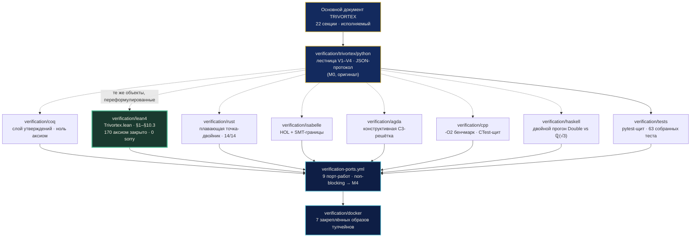

### 5.2 Внутренняя решётка зависимостей `Trivortex.lean`

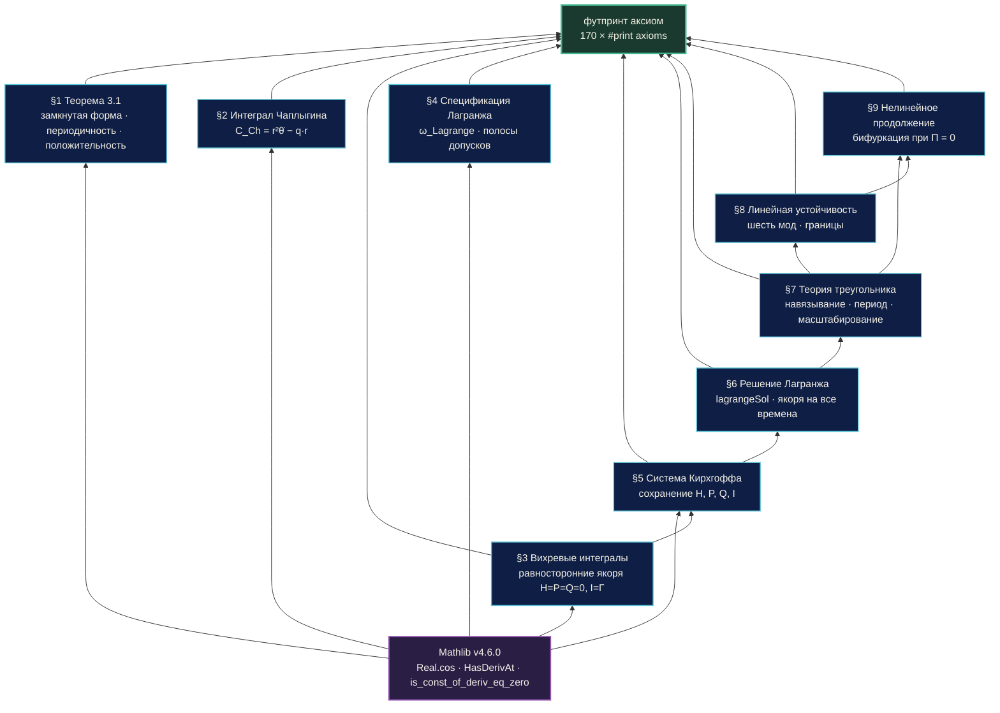

### 5.3 Из чего сделаны 6 589 строк

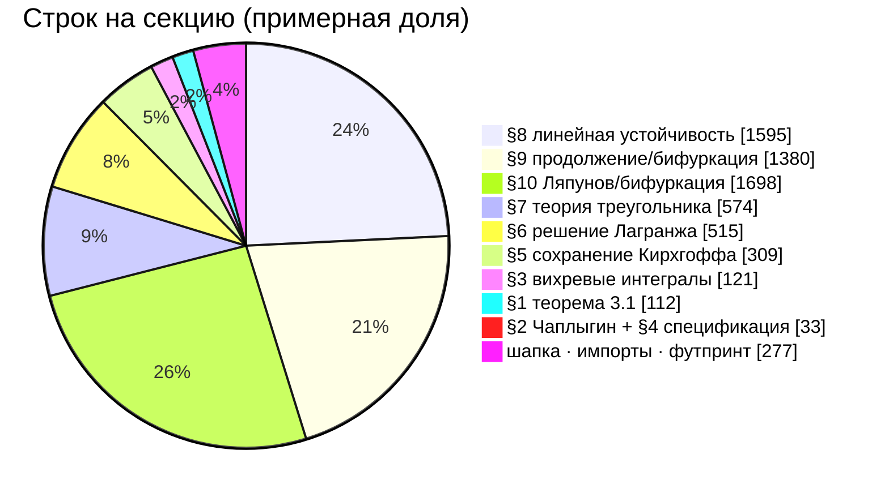

Форма сознательна: §1–§4 закрепляют объекты, §5–§6 доказывают динамическое ядро,
а §7–§10 (больше половины файла) — треки углубления v3.0–v7.0.

---

## 6. Глубокое погружение — секция за секцией (§1–§10)

Каждая секция — самодостаточная посадочная площадка: утверждение, ключевые имена и
то, какая лестничная проверка здесь живёт. Полный список *всех* 309+ имён
деклараций — в [Приложении A](#приложение-a--полный-ценз-деклараций).

### 6.1 §1 Теорема 3.1: замкнутая форма (строки 114–225)

Четыре определения (`omega`, `eps`, `rClosed`, `thetaClosed`) дословно
воспроизводят замкнутую форму основного документа; девять теорем закрывают каждое
свойство, которое лестница проверяет численно. Радиальный режим вынесен отдельно
(`eps_pos`, `eps_lt_one`, `rClosed_pos`): `C_Ch > π·ln 2` — это в точности условие
`eps < 1`, удерживающее каждый радиус строго положительным при всех `t`, — то
утверждение, на которое негласно опирается анимированная хореография выше.

### 6.2 §2 топологический интеграл Чаплыгина (строки 226–239)

Две теоремы, ноль позы: `chaplygin_shape` закрепляет `C_Ch = r²θ̇ − q·r` под
калибровкой `A_θ = 1/r`, а `gauge_inverse` снимает шаг `1/r · r = 1`. Это
кратчайшая секция файла и та, что прикрепляет всю вихревую формализацию к
разделу 6 основного документа.

### 6.3 §3 вихревые интегралы уравнений Кирхгоффа (строки 240–360)

Сначала определяются гамильтониан и импульсные инварианты (`vortexDist`, `d2`,
`Hvortex`, `Pvortex`, `Qvortex`, `Ivortex`), затем равностороннее опорное
состояние (`eqX1…eqY3`, радиус описанной окружности `1/√3`, сторона 1)
*доказывается* равносторонним четырьмя теоремами о сторонах (`side1`, `side2`,
`side3`, `side3'`), и наконец закрываются точные якоря: `H_equilateral`,
`P_equilateral`, `Q_equilateral`, `I_equilateral` (`H = 0, P = 0, Q = 0, I = Γ`
при произвольных равных циркуляциях).

### 6.4 §4 спецификация Лагранжа и зарегистрированные полосы (строки 361–379)

`lagrangeOmega` фиксирует `ω = 3Γ/(2πa²)`; `ToleranceBands` + `registeredBands`
записывают числовые полосы (`1e-12 / 1e-10 / 1e-6`), против которых меряются
лестница и все порты, — зарегистрированные *до* проверок, ровно как требует
правило предварительной регистрации фреймворка.

### 6.5 §5 система Кирхгоффа и её законы сохранения (строки 380–688)

Сердце динамического порта. Шесть правых частей `kx1…ky3`, `ky1…ky3` зеркалят
`vortex_rhs` из `verify.py`; `KirchhoffSol` упаковывает дифференцируемые
траектории с гипотезами отсутствия столкновений. Затем четыре теоремы
сохранения — `P_kirchhoff_deriv/conserved`, `Q_*`, `I_*`, `H_*` — доказывают
`d/dt(·) = 0` и, следовательно, `value(t) = value(s)` при **любых** циркуляциях и
**любом** решении без столкновений. Это проверка **V3/V4**, поднятая со статуса
«измеренная константа» до «доказанная константа».

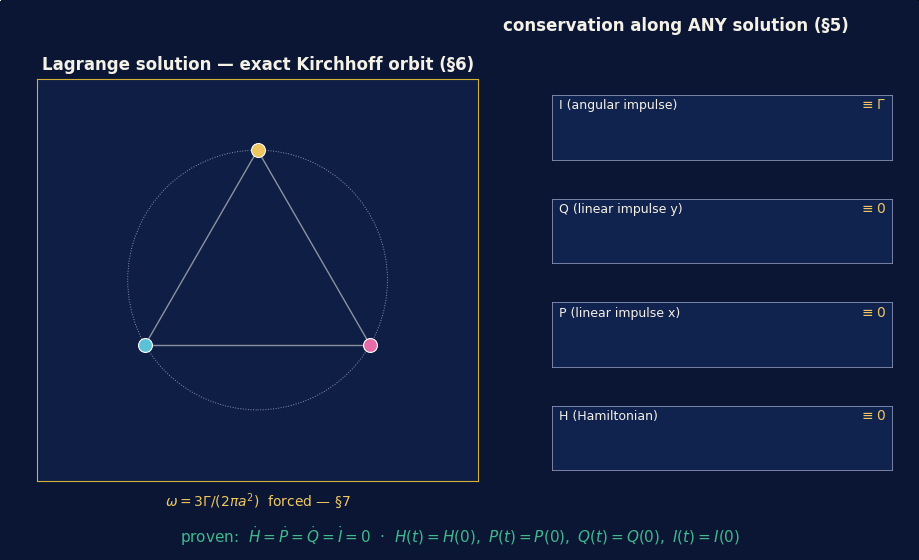

### 6.6 §6 равностороннее решение Лагранжа (строки 689–1203)

Вращающийся треугольник выписан (`lagX`, `lagY`), доказан равносторонним в каждый
`t` (`d2_lag01/12/02`), продифференцирован (`lagX/lagY_deriv`) и показан точно
удовлетворяющим полю Кирхгоффа (`lag_kx0…lag_ky2`) — что упаковывается в
`lagrangeSol`, проверенный машиной двойник лестничной проверки **V2**. Блок
завершается якорями на все времена (`lagrange_anchor_H/P/Q/I`): равносторонние
значения выполняются вдоль движения, а не только при `t = 0`.

### 6.7 §7 треугольник Лагранжа: полная теория (строки 1204–1777)

Трек углубления v3.0. Главное, в порядке файла: законы однородности/масштабирования
всех четырёх интегралов (`*_scale`); тождество группы вращений и линейное поле
скоростей `ω·J·r`; радиус орбиты `a/√3` (`lag_orbit_radius`); замкнутый период
`T = 4π²a²/(3Γ)` (`lag_period_closed`) с покомпонентными леммами периодичности и
зеркала полупериода; цикл хореографии (`lag_cycle_x0…y2`); поле Кирхгоффа при
*произвольной* пробной частоте (`lag_kx0_field…lag_ky2_field`), готовящее
**теорему о навязывании** `lag_omega_unique`: треугольник, вращающийся с любой
частотой, кроме `ω = G/(2πa²)`, решением просто не является — частота навязана.
Далее закон масштабирования семейства (`lagomega_scale`, `lagX/lagY_scale`,
`lag_trajectory_scale_x/y`), сертификаты расстояний (`lag_dist01/02/12`) и якоря
для произвольной стороны (`lagrange_side_H/P/Q/I`).

### 6.8 §8 линейная устойчивость: шесть собственных мод (строки 1778–3372)

Трек углубления v4.0 — и крупнейшая секция. Вращающаяся рамка (`rotX1…rotY3`)
превращает якорный треугольник в неподвижную точку (`rot_anchor`); линеаризация в
масштабе `2π/Γ` (`linX1…linY3`) диагонализируется *вручную* в шесть собственных
мод — две трансляции (`eig_trans1/2`, `±iω`), вращение (`eig_rot`), дилатация
(`eig_dil`, дрейф размера) и две колебания формы (`eig_shapeU/shapeW`, `±iω`).
Четыре сертификационные теоремы (`lin_cert_transX/transY/shapeU/shapeW`) проверяют
линеаризацию против *истинного* поля вращающейся рамки вдоль каждого модального
направления — без благопожелательной линеаризации. Явные модальные решения
(`lin_sol_trans/shape/size`) замыкаются при всех `t`, а границы устойчивости
(`lin_bound_trans/shape/size`) выносят главный вывод: трансляции и моды формы
сохраняют норму точно, дрейф размера растёт не быстрее линейно — **ни одна мода
не растёт экспоненциально** (устойчивость Томсона при `N = 3`, проверено машиной).

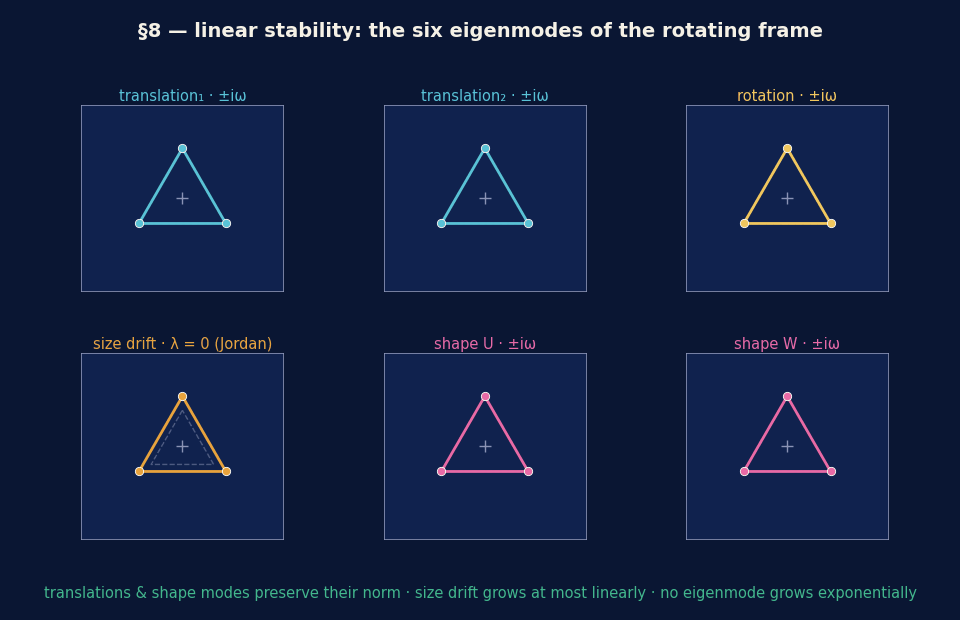

### 6.9 Секция 9 — нелинейное продолжение и ландшафт бифуркации

Трек углубления v5.0, тремя ходами:

1. **9.1 — семейство с произвольными циркуляциями.** При произвольных
   `(g1, g2, g3)` с `G = g1+g2+g3 ≠ 0` равносторонний треугольник, сдвинутый так,
   что его взвешенный циркуляциями центроид стоит в начале координат, вращается
   жёстко с `ω = G/(2πa²)` и является **точным** решением Кирхгоффа (`s9_rel_eq`;
   скорость вращения регулярна по параметру стороны, `s9_omega_scale`). Попутно:
   производные, попарные расстояния, тождества центроида и полная шестикомпонентная
   проверка поля (`s9_gen_field_x1…y3`).
2. **9.2 — точное нелинейное продолжение мод.** Трансляционная орбита сохраняется
   (поле Кирхгоффа инвариантно к трансляциям, `s9_kx_shift…s9_ky3_shift`,
   упаковано как `s9_sol_shift`), перезатактованные решения остаются решениями
   (`s9_sol_time`), а отклонение трансляции во вращающейся рамке сохраняет
   постоянную норму (`s9_trans_dev`).
3. **9.3 — бифуркация.** Линеаризация во вращающейся рамке в масштабе `2π`
   (`genLinX1…genLinY3`) привязана к сертифицированной матрице §8 на диагонали
   (`s9_lin_diag`); её характеристический многочлен —
   `λ²·(λ² + G²)·(λ² + 3Π)` с `Π = G₁G₂+G₂G₃+G₃G₁`
   (`s9_lin_trans`, `s9_lin_kernel`, `s9_lin_chain`, `s9_shape_gen`). Все три
   режима приколоты явным экземпляром и явным модальным решением:

| Режим | Экземпляр | Что доказано | Теоремы |
|---|---|---|---|
| `Π > 0` | `(1, 1, 4)` | пара форм колеблется с `±i√(3Π)` — ограничено | `s9_shape4_a/b`, `s9_lin_sol_shape4` |
| `Π = 0` | `(1, 1, −1/2)` | пара сталкивается в нуле: ядро + цепь Жордана | `s9_collision_a/b` |
| `Π < 0` | `(1, 1, −1)` | появляется **вещественная** пара `±√(−3Π)`; `m(t) = e^(√3·t)·v` и `\|m(t)\|² = 12·e^(2√3·t)` | `s9_eig_unst`, `s9_exp_comp`, `s9_lin_sol_unst`, `s9_growth_norm` |

Линейная неустойчивость поперёк гиперповерхности `Π = 0` — не симуляция, доказательство.

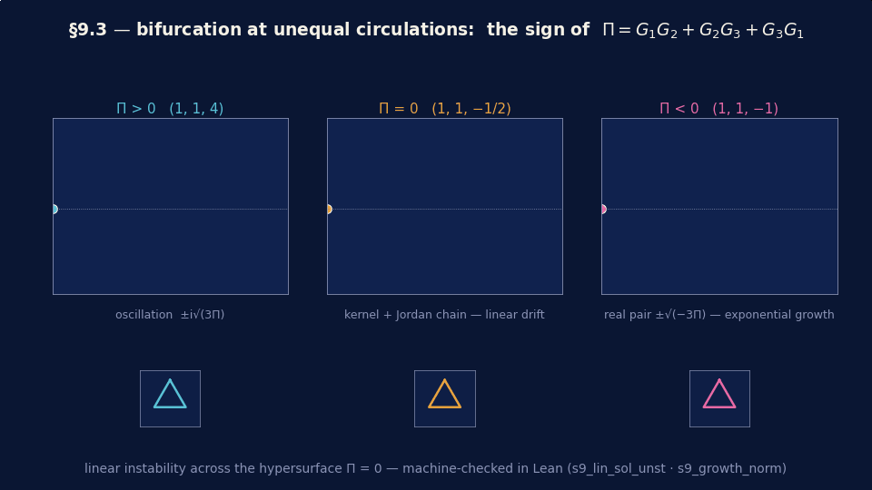

### 6.10 Секция 10 — нелинейная устойчивость по Ляпунову и завершённая коллинеарная бифуркация (§10.1–§10.3)

Треки углубления v6.0–v7.0, тремя ходами:

1. **10.1 — устойчивость по Ляпунову через H/I (энергия–Казимир).** На уровне
   моментов `{P = 0, Q = 0, I = Γ}` жёсткое тождество `Σᵢ<ⱼ d²ᵢⱼ = 3` выполняется
   точно (`s10_sumsq_anchor`); логарифмическое неравенство
   `ln(1+u) ≤ u − u²/3` (`s10_log_bound`) даёт **коэрцитивный сертификат**
   `H ≥ (Γ²/(12π))·Σ(d²ᵢⱼ−1)²` на аннулусе `d²ᵢⱼ ∈ [1/2, 3/2]` (`s10_coercive`),
   а AM–GM делает треугольник глобальным минимумом энергии (`s10_H_nonneg`).
   Функционал энергия–Казимир `H + (3Γ/(4π))·I` имеет нулевой градиент в якоре
   по всем шести слотам (`s10_casimir_x1…y3`, множитель `ω_L = 3Γ/(4π)`), и
   теорема во времени `s10_lyapunov_stab` замыкает картину: любое решение на
   уровне, стартующее в глубинной мишени `[15/16, 17/16]`, удовлетворяет
   `Σ(d²ᵢⱼ(t)−1)² ≤ (12π/Γ²)·H(0)` в **каждый** момент `t ∈ ℝ` —
   непрерывная индукция по аннулусу плюс точное сохранение `H, I, P, Q`
   (`s10_lyapunov_dist` — форма расстояний).

   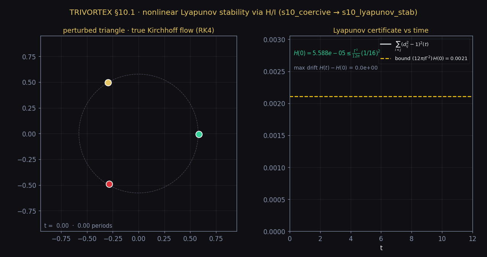

2. **10.2 — коллинеарные центральные конфигурации и их бифуркации.** Общее
   коллинеарное вращающееся относительное равновесие (`s10_col_sol_gen`),
   симметричная ветвь `(d, −d, 0)` при любом γ (`s10_col_sym`), стационарная
   точка при `γ = −½` (`s10_col_static`); уравнение карты
   `N(s, γ) = s(s−1)·M̃(s, γ)` с вилкой `M̃(0, γ) = 4γ+5`, исчезающей ровно при
   `γ = −5/4` (`s10_col_pitchfork`), дискриминант `(4γ+5)(γ+2)²`
   (`s10_col_disc`), лестница подсчёта корней при `γ₀ = −1/4`
   (`s10_col_count_quarter`) и `γ = 1` (`s10_col_count_eq1`), и точное
   асимметричное относительное равновесие `(1, −5/9, 16/9)` с `ω = 27/(56π)`
   (`s10_col_asym`).
3. **10.3 — картина бифуркации завершена (v7.0).** Вилка — **тройной корень**:
   `N(s, −5/4) = −(9/64)·s³·(s−1)` (`s10_pitchfork_double`). При вырожденных
   циркуляциях асимметричная ветвь сливается обратно с симметричной:
   `γ = −1` ((γ+1)² = 0 → `N = −s(s−1)²`, `s10_col_count_neg1`) и `γ = −2`
   ((γ+2)² = 0 → `N = −3·s·(s−1)³`, `s10_col_count_neg2`). И **вторая** точная
   рациональная асимметричная конфигурация при `γ₀ = −1/4`: `(1, −9/5, −16/5)`
   с `ω = 25/(168π)` (`s10_col_asym2`) — оба асимметричных корня карты
   `s = 16/9` и `s = −16/5` реализованы как точные `KirchhoffSol`. Каждое
   тождество сертифицировано SymPy до Lean-кодирования
   ([`../notes/s10b_preverify.py`](../notes/s10b_preverify.py), 27/27 PASS).

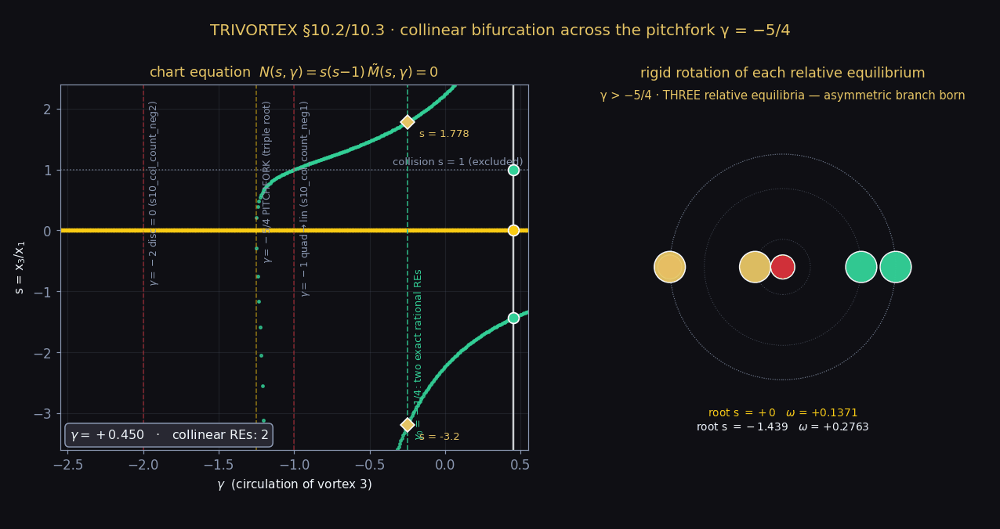


---

## 7. Футпринт аксиом — ничего, кроме классических оснований

Каждое несущее утверждение заканчивается в одном из трёх футпринт-блоков
артефакта (строки 3389–3510 для §1–§8, строки 6519–6559 для §9, строки 6560–6589
для §10). Контракт, который они навязывают:

| Что говорит `#print axioms` | Смысл |
|---|---|
| `propext` | экстенсиональность пропозиций — повседневная аксиома переписывания в Mathlib |
| `Classical.choice` | классический выбор — закон исключённого третьего в его конструктивном облачении |
| `Quot.sound` | корректность факторизации — так Mathlib строит ℚ, ℝ и прочих |

Всё *иное* в футпринте — `axiom`, `sorry` (печатается как `sorryAx`),
непроверенная декларация — появилось бы здесь и в CI. Артефакт закрывается строкой:

```text
170 / 170  #print axioms statements closed   ·   0 sorry   ·   0 axiom
footprint: propext · Classical.choice · Quot.sound — nothing else
```

> **Почему это важно для физической программы.** Численная лестница может дрейфовать,
> рукописное доказательство может иметь дыру — Lean-доказательство может зависеть
> только от того, что его футпринт декларирует. Футпринт — это *регистрация доверия*,
> и она перепроверяется из исходников на каждом прогоне CI.

---

## 8. Полная опись файлов

Всё содержимое каталога, байт-в-байт:

| Файл | Строк | Размер | Роль |
|---|---|---|---|
| [`Trivortex.lean`](Trivortex.lean) | 6 589 | 331 КБ | артефакт: §1–§10.3 + футпринт аксиом (см. [§6](#6-глубокое-погружение--секция-за-секцией-110)) |
| [`lakefile.lean`](lakefile.lean) | 20 | 729 Б | определение пакета: `lean_lib Trivortex`, `autoImplicit false`, закрепление Mathlib |
| [`lean-toolchain`](lean-toolchain) | 1 | 24 Б | закрепление: `leanprover/lean4:v4.6.0` |
| [`README.md`](README.md) | — | — | этот обзор (на английском) |
| [`README_RU.md`](README_RU.md) | — | — | тот же обзор на русском |
| [`docs/STATEMENTS.md`](docs/STATEMENTS.md) | авто | 24 КБ | авто-индекс всех 170 теорем по секциям (регенерация: `python3 ../notes/make_statement_index.py`) |

Lakefile целиком — потому что каждая его строка есть решение о воспроизводимости:

```lean
import Lake
open Lake DSL

/- TRIVORTEX Lean 4 verification package (milestone M4, v2.0).
   SPDX-FileCopyrightText: 2026 Isaev Iskhak Khamzatovich
   SPDX-License-Identifier: LicenseRef-Proprietary-Wild8Highlander-1.0 -/

package «trivortex» where
  leanOptions := #[⟨`autoImplicit, false⟩]

@[default_target]
lean_lib «Trivortex» where
  -- the artifact is the single file Trivortex.lean at the package root
  roots := #[`Trivortex]

-- Mathlib is pinned to an exact revision for reproducibility
-- (verification/README.md §8: never rely on a moving target).
-- Pair: lean-toolchain v4.6.0 + mathlib4 @ tag v4.6.0 (2024-06).
require mathlib from git
  "https://github.com/leanprover-community/mathlib4.git" @ "v4.6.0"
```

Три детали, которые стоит заметить: `autoImplicit false` запрещает случайные
неявные переменные (утверждение, типизировавшееся случайно, — не утверждение);
корень библиотеки *и есть* артефакт, поэтому строится ровно одна вещь; ревизия
Mathlib — **точный тег**, а не движущаяся ветка — см. заметку о тулчейне в
[§10](#10-закрепления-воспроизводимости), почему эта пара важна.

**Происхождение.** Заголовок `Trivortex.lean` несёт строки SPDX + копирайта
(дисциплина REUSE.toml) и указывает коммит `verify.py`, который он зеркалит:
`557bff8`, релиз M0. Артефакт в шапке декларирует, что он доказывает, что сознательно
оставляет численным лестницам, и точный рецепт сборки.

---

## 9. Сборка, запуск, CI

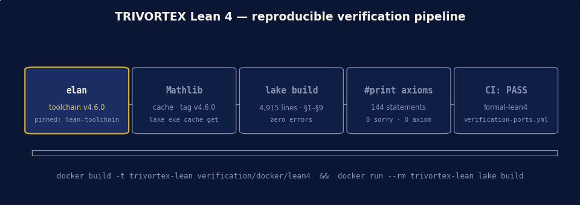

### 9.1 Локально (установлен elan)

```bash
cd verification/lean4
lake exe cache get && lake build
```

Первый `lake exe cache get` скачивает предсобранный olean-кэш Mathlib для
закреплённого тега и превращает сборку с нуля (часы) в минуты. `lake build`
типизирует артефакт; любой `sorry` или новая аксиома рушит футпринт-контракт
сборки на этапе `#print axioms`.

### 9.2 Docker (закреплённый тулчейн, байт-в-байт как в CI)

```bash
docker build -t trivortex-lean verification/docker/lean4
docker run --rm trivortex-lean lake build
```

Образ ([`docker/lean4/Dockerfile`](../docker/lean4/Dockerfile)) ставит elan,
разрешает файл тулчейна, выполняет `lake update && lake exe cache get! && lake
build` *на этапе сборки образа* и по умолчанию запускает `lake build` — так
`docker run` воспроизводит ровно то, что гоняет CI.

### 9.3 CI

Workflow [`verification-ports.yml`](https://github.com/wild8highlander/Trivortex/actions/workflows/verification-ports.yml),
работа **`formal-lean4`**: checkout → docker build → docker run. Работа
некритичная (`continue-on-error: true`) по CI-контракту фреймворка; трек M4
«блокирующие порты» переключает её в принудительный режим после трёх зелёных дней
подряд ([§17](#17-дорожная-карта--m4m5m6-и-lean-порт)).

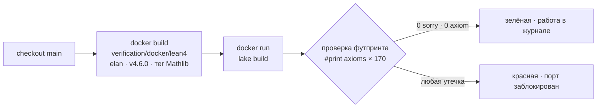

**Добавление v7.0 — отдельный workflow `lean-verify.yml`** (`.github/workflows/`):
тот же закреплённый билд автономно — elan из `lean-toolchain`, `lake exe cache
get`, `lake build`, затем охрана футпринта: каждый напечатанный футпринт обязан
равняться `[propext, Classical.choice, Quot.sound]`, и любой `sorryAx` валит прогон.

---

## 10. Закрепления воспроизводимости

| Закрепление | Значение |
|---|---|
| Тулчейн | Lean 4 **v4.6.0** ([`lean-toolchain`](lean-toolchain)) |
| Mathlib | **тег v4.6.0** (закреплён в [`lakefile.lean`](lakefile.lean); пара 2024-06) |
| Docker-закрепление | [`docker/lean4/Dockerfile`](../docker/lean4/Dockerfile) (ubuntu 24.04 + elan) |
| Артефакт | [`Trivortex.lean`](Trivortex.lean) — §1–§10.3, 170 инструкций `#print axioms` |
| Веха | M1 + треки углубления §7–§10 (теория треугольника + устойчивость + бифуркация + Ляпунов) |
| CI-статус | некритичная работа в [`verification-ports.yml`](https://github.com/wild8highlander/Trivortex/actions/workflows/verification-ports.yml) |

> **Заметка о тулчейне.** В v1.1 был закреплён Lean v4.4.0 с Mathlib
> `@ "master"` — связка, которая больше не может разрешиться (движущаяся цель +
> фиксированный тулчейн), поэтому артефакт v1.1 не был воспроизводимо собираемым.
> v2.0 поднимает тулчейн до v4.6.0 и закрепляет Mathlib парным тегом `v4.6.0` —
> новейшая пара, проверенная сборкой в дисковом бюджете Docker/CI этого
> фреймворка. Доказательства используют только давно-стабильное API Mathlib, так
> что будущие подъёмы механически просты.

---

## 11. Шкала времени — v1.1 → v7.0

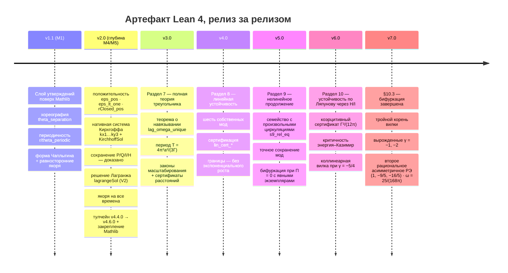

| Релиз | Секции | Главное | Слой утверждений после релиза |
|---|---|---|---|
| v1.1 | §1–§3 (+ядро §4/§6) | M1: слой утверждений приземляется | хореография, периодичность, форма Чаплыгина, якоря |
| v2.0 | §5–§6 (+тулчейн) | законы сохранения + решение Лагранжа **доказаны** | аналитическое ядро V2/V3/V4 проверено машиной |
| v3.0 | §7 | полная теория треугольника | навязывание, период, масштабирование, сертификаты |
| v4.0 | §8 | линейная устойчивость треугольника | шесть мод, без экспоненциального роста |
| v5.0 | §9 | нелинейное продолжение + бифуркация | неустойчивость поперёк `Π = 0`, доказана |
| v6.0 | §10.1–§10.2 | нелинейная устойчивость по Ляпунову + коллинеарная бифуркация | коэрцитивный сертификат, критичность энергия–Казимир, вилка, асимметричное РЭ |
| v7.0 | §10.3 | картина бифуркации завершена | тройной корень, вырожденные циркуляции, оба рациональных асимметричных РЭ |

---

## 12. Созвездие верификации — каждая соседняя папка

Lean-порт — один голос в восьмиязычном хоре. Каждый сосед пере-выводит *те же*
объекты по собственным правилам; каждая папка ниже несёт свой вылизанный README —
ссылки и есть глубокие погружения.

| Папка | Язык / инструмент | Артефакт | Веха | Погружение |
|---|---|---|---|---|
| [`../trivortex/`](../trivortex/README_RU.md) | Python | лестница **V1–V4** + JSON-протокол — оригинал, который зеркалят все порты | **M0** ✅ | лестница и лаборатория |
| [`../tests/`](../tests/README.md) | pytest | щит лестницы + программы (63 собранных теста) | **M0** ✅ | pytest-щит |
| [`../coq/`](../coq/README_RU.md) | Coq/Rocq 8.18 | `Trivortex.v` — слой утверждений, ноль аксиом | **M1** ✅ | галлиновский двойник |
| **`./`** | **Lean 4 v4.6.0** | **`Trivortex.lean` — §1–§10.3, 170 аксиом закрыто** | **M1 + глубина** ✅ | **этот документ** |
| [`../rust/`](../rust/README_RU.md) | Rust (stable) | двойник с плавающей точкой, 14/14 тестов, протокол закоммичен | **M1** ✅ | вторая реализация в float |
| [`../isabelle/`](../isabelle/README_RU.md) | Isabelle/HOL 2024 | `Trivortex.thy` — границы инвариантов; SMT-сессия опциональна | **M2** ✅ | HOL-запись |
| [`../agda/`](../agda/README_RU.md) | Agda 2.6.4 | `Trivortex.agda` — конструктивное `rot³ ≡ id` | **M2** ✅ | конструктивная решётка |
| [`../cpp/`](../cpp/README_RU.md) | C++17 · CMake | CTest-щит + бенчмарк `-O2` (`benchmark_rhs_per_s`) | **M3** ✅ | компилируемый бенчмарк |
| [`../haskell/`](../haskell/README_RU.md) | GHC 9.4 | двойной прогон `Double` против точных рациональных — якоря ℚ(√3) вычислением | **M3** ✅ | расщепление точной арифметики |
| [`../common/`](../common/README.md) | Python | общий базовый верификатор (шаблонный метод `BaseVerifier`) | поддержка | общий хребет |
| [`../notes/`](../notes/README.md) | Python + SymPy | числовые зеркала §8/§9/§10 и проверка тождеств (SymPy-предпроверка алгебры Lean) | поддержка | черновые доказательства |
| [`../docker/`](../docker/README.md) | Dockerfile-ы | 7 закреплённых образов тулчейнов, по одному на порт | поддержка | слой воспроизводимости |
| [`../trivortex_master/`](../trivortex_master/README.md) | Python | 22-секционный интерактивный документ (лаборатория, которую проверяет эта папка) | приложение | исполняемый документ |

Правило, держащее хор честным, сформулировано один раз в
[`verification/README.md`](../README.md) §7 и соблюдено всюду: **каждый порт
заявил критерии приёмки в README своей папки до того, как артефакты приземлились**,
и теперь критерии проверяются в тех же файлах.

---

## 13. Матрица сравнения восьми языков

Что каждый порт устанавливает об общих объектах и в каком стиле:

| Порт | Доказательство теорем | Числовой двойник | Хореография 2π/3 | Периодичность | Якоря H,P,Q,I | Законы сохранения | Решение Лагранжа | Устойчивость/бифуркация |
|---|---|---|---|---|---|---|---|---|
| Python (`M0`) | — | ✔ (оригинал) | ✔ измерено | ✔ измерено | ✔ измерено | ✔ измерено (`1e-10`) | ✔ измерено | числовое зеркало (`notes/`) |
| Coq (`M1`) | ✔ ноль аксиом | — | ✔ доказано | слой утверждений | ✔ доказано | — | — | — |
| **Lean 4 (M1+)** | ✔ **170 закрытых футпринтов** | — | ✔ **доказано** | ✔ **доказано** | ✔ **доказано** | ✔ **доказано (§5)** | ✔ **доказано (§6–§7)** | ✔ **доказано (§8–§10)** |
| Rust (`M1`) | — | ✔ 14/14 | ✔ измерено | ✔ измерено | ✔ измерено | ✔ измерено | ✔ измерено | — |
| Isabelle (`M2`) | ✔ HOL | — | слой утверждений | слой утверждений | запись полос (SMT, опционально) | — | — | — |
| Agda (`M2`) | ✔ конструктивно | — | C3-решётка `rot³ ≡ id` | — | — | — | — | — |
| C++ (`M3`) | — | ✔ бенчмарк `-O2` | ✔ измерено | ✔ измерено | ✔ измерено | ✔ измерено | ✔ измерено | — |
| Haskell (`M3`) | — | ✔ `Double` + ℚ(√3) | ✔ измерено | ✔ измерено | ✔ **точным вычислением** | ✔ измерено | ✔ измерено | — |

Паттерн — разделение труда фреймворка: ассистенты доказательств *доказывают*
аналитическое ядро (Lean сейчас самый глубокий), порты с плавающей точкой
*заново измеряют* лестничные числа независимо, а точная арифметика Haskell
пересекает две культуры внутри одного бинарника.

---

## 14. Галерея — анимации доказанных объектов

Орбитальные анимации программы (версии `.mp4` лежат рядом с ними в
[`docs/animations/`](../../docs/animations/)):

| Анимация | Что показывает | Lean-двойник |
|---|---|---|
| 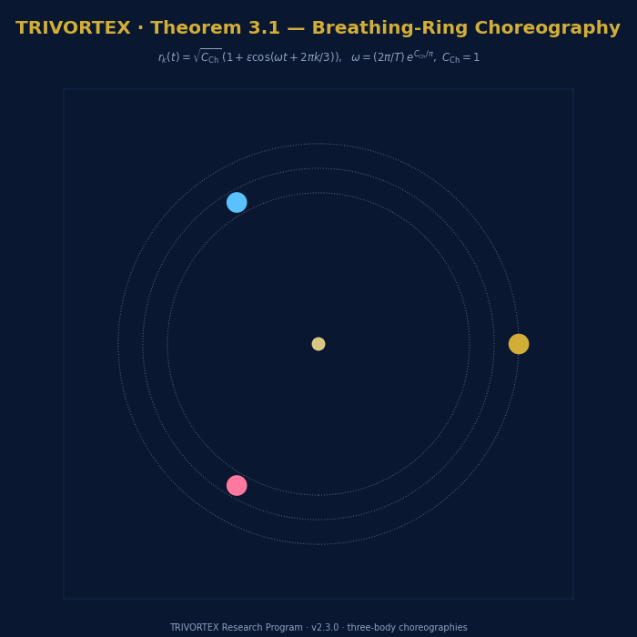 | кольцо Trivortex основной программы | §1 замкнутая форма, семейство `rClosed` |
| 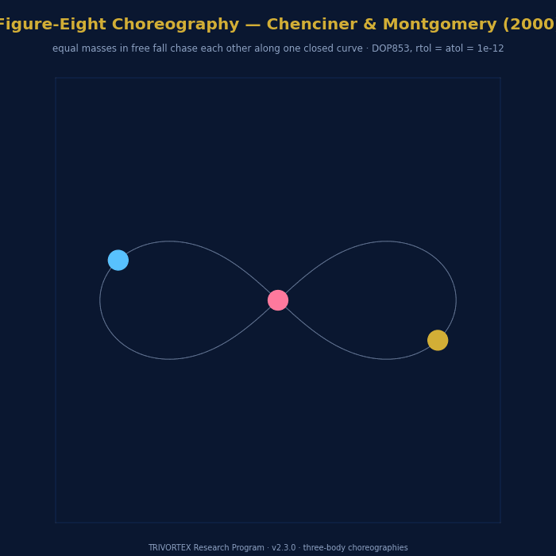 | свободная хореография системы Кирхгоффа | §5 сохранение вдоль любого решения |
| 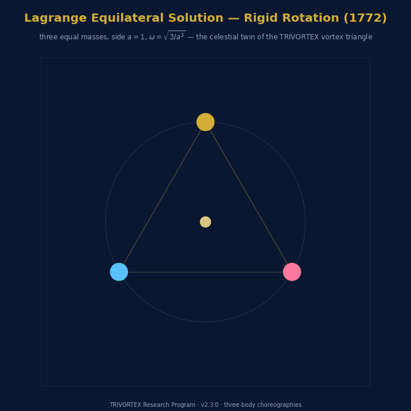 | вращающееся равностороннее решение | §6 `lagrangeSol` — точная доказанная орбита |
| 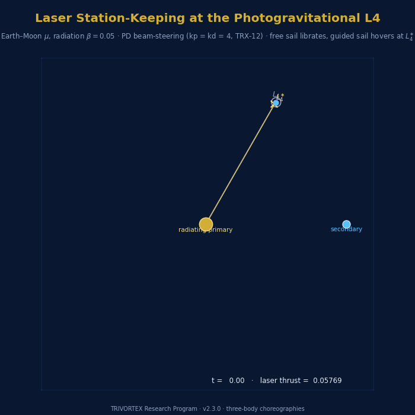 | исследование удержания станции | (исследовательская программа, вне §1–§9) |

А внутри этого пакета — проверенные машиной виды той же физики:
[`assets/theorem31_choreography.gif`](assets/theorem31_choreography.gif) (§1),
[`assets/kirchhoff_conservation.gif`](assets/kirchhoff_conservation.gif) (§5–§6),
[`assets/stability_modes.gif`](assets/stability_modes.gif) (§8),
[`assets/bifurcation_window.gif`](assets/bifurcation_window.gif) (§9),
[`assets/lyapunov_stability.gif`](assets/lyapunov_stability.gif) (§10.1),
[`assets/collinear_bifurcation.gif`](assets/collinear_bifurcation.gif) (§10.2–10.3),
[`assets/axiom_footprint_console.gif`](assets/axiom_footprint_console.gif) (сборка),
[`assets/lake_build_pipeline.gif`](assets/lake_build_pipeline.gif) (CI).

---

## 15. FAQ

**В: Задача трёх тел здесь «решена»?**
Нет — и папка точна в формулировках. Доказано *вихрево-модельное* аналитическое
ядро: замкнутая лагранжева хореография (теорема 3.1), её режим допустимости,
законы сохранения, равностороннее решение Лагранжа, его линейная устойчивость и
бифуркация при неравных циркуляциях. Честные границы более широкой программы
каталогизированы в [`verification/README.md`](../README.md) §13.

**В: Что именно гарантирует `#print axioms`?**
Что напечатанное множество — *полный* транзитивный футпринт зависимостей
декларации. Если доказательство использовало недоказанный `sorry`, футпринт
содержал бы `sorryAx`; новый `axiom` появился бы по имени. Здесь каждая из 170
напечатанных инструкций показывает только `propext`, `Classical.choice`,
`Quot.sound`.

**В: Числовые допуски (`1e-12` и т.д.) тоже доказаны?**
Нет — они *зарегистрированы* (§4, `registeredBands`) и *измеряются* лестницей и
портами. Lean доказывает точные утверждения; полосы определяют, куда обязаны
попасть результаты с плавающей точкой. Разделять две культуры — правило честности
фреймворка, а не недосмотр.

**В: Почему CI-работа некритичная?**
CI-контракт фреймворка ([`verification/README.md`](../README.md) §7): каждая
порт-работа стартует некритичной и становится блокирующей после трёх зелёных дней
подряд — заранее зарегистрированное механическое повышение вместо обещания.

**В: Сколько занимает первая сборка?**
С нуля (без кэша) сборка Mathlib занимает часы; с `lake exe cache get`
(olean-кэш закреплённого тега) — минуты для самого артефакта. Docker-образ
впекает кэш на этапе сборки образа.

**В: Можно ли поднять тулчейн?**
Да, механически — поднимите `lean-toolchain` и тег Mathlib вместе (они обязаны
быть парой), подтяните кэш заново, пересоберите. Доказательства используют
давно-стабильное API Mathlib; см. заметку о тулчейне в
[§10](#10-закрепления-воспроизводимости).

**В: Где живут SymPy-проверенные результаты §9?**
В [`../notes/`](../notes/README.md): числовые зеркала и проверки тождеств,
предпроверившие алгебру §9 до формализации (57 строк SymPy PASS для §9, 19 для
§8 — см. логи там).

**В: Что такое `lagrangeSol` — теорема или определение?**
Определение (экземпляр структуры `KirchhoffSol`), чьи *условия принадлежности* —
шесть теорем поля `lag_kx0…lag_ky2`; оно печатается в футпринт-блоке рядом с
теоремами, поэтому ценз насчитывает 170 футпринтов на 309 теорем плюс определения.

**В: Почему один гигантский файл вместо дерева модулей?**
Дисциплина воспроизводимости: один файл = один артефакт = одна цель сборки = один
футпринт для аудита. Комментарий lakefile говорит это прямо: «артефакт —
единственный файл `Trivortex.lean` в корне пакета».

**В: Как цитировать?**
См. [§20](#20-цитирование-doi-и-лицензия) — у репозитория есть версионный DOI и
концептуальный DOI; `CITATION.cff` в корне репозитория — машиночитаемая форма.

---

## 16. Устранение неполадок

| Симптом | Причина | Лечение |
|---|---|---|
| `lake exe cache get` падает или медленный | кэш тега переехал или оборвалась сеть | повторить; закачка идемпотентна; Docker-путь вместо этого впекает кэш |
| сборка умирает на файлах Mathlib | тулчейн и тег Mathlib не пара | держите `lean-toolchain` = `v4.6.0` **и** тег lakefile `v4.6.0`; никогда не смешивайте тег с `master` |
| `#print axioms` показывает `sorryAx` | кто-то оставил доказательство недописанным | не мержить — сборка зелёная *только* с закрытым футпринтом |
| давление на диск в CI | кэш Mathlib + артефакты сборки превышают бюджет | использовать закреплённый Docker-образ (кэш впечён), или `lake exe cache get!`, как в Dockerfile |
| `unknown identifier` после правок | `autoImplicit false` строже, чем вы ожидали | объявляйте используемые переменные — опция существует именно чтобы ловить случайную общность |

---

## 17. Дорожная карта — M4/M5/M6 и Lean-порт

Дорожная карта фреймворка заранее зарегистрирована в
[`verification/README.md`](../README.md) §7.1; треки, касающиеся этой папки:

- **M4 — укрепление.** Прогреть кэш Mathlib в работе `formal-lean4`
  (cache action, ключ `lean-toolchain`); критерий: время работы ≤ 15 мин.
  Переключить каждую порт-работу в блокирующий режим после трёх зелёных дней.
- **M5 — глубина.** «Интегральная идентичность Чаплыгина, доказано»: вывести
  `I = Γ` из поля скоростей аргументом Стокса/Чаплыгина *внутри* ассистента —
  Lean уже несёт ядро сохранения (§5) и якоря (§3), так что трек углубляет, а не
  открывает. Перепроверка якорей в 50 цифр (mpmath) и третий числовой двойник
  (Julia) живут на числовой стороне.
- **M6 — расширение.** V5 — регулярное вихревое кольцо `N = 7` приземляется
  сначала в Python, затем минимум в двух портах. Слот §10 занят: v6.0–v7.0
  принесли устойчивость по Ляпунову через H/I и завершённую коллинеарную
  бифуркацию; следующий кандидат на расширение — кольцо V5 `N = 7` — ждите §11.
  Две открытые теоретические цели из scope-заметок §10: теорема возмущений
  Крандалла–Рабиновица для асимметричной ветви за пределами γ₀ = −1/4 и
  ляпуновская устойчивость общего γ при неравных циркуляциях.

Дисциплина, приведшая артефакт сюда, зарезервирована его собственной шапкой:
критерий приёмки может быть ужесточён до приземления артефактов — и никогда после.

---

## 18. Как внести вклад

Правила фреймворка применяются дословно (см.
[`CONTRIBUTING.md`](https://github.com/wild8highlander/Trivortex/blob/main/CONTRIBUTING.md)
в корне репозитория); для этой папки они сжимаются в четыре строки:

1. **Ни `sorry`, ни нового `axiom`.** Вклад, который не может закрыть свой
   футпринт `#print axioms`, — предложение, а не доказательство — сначала в issue.
2. **Регистрируй до доказательства.** Новые утверждения получают свои критерии
   приёмки, вписанные в этот README (или шапку артефакта) *до* приземления
   доказательства.
3. **Закрепляй парой.** Тулчейн и Mathlib двигаются как пара; PR подъёма трогает
   оба и показывает зелёный `lake build` в закреплённом образе.
4. **Зеркаль объекты, не форкай их.** Порт зеркалит аналитический слой `verify.py`;
   если объект лестницы меняется, Lean-объект меняется тем же PR — именно это
   держит восемь языков сопоставимыми.

---

## 19. Благодарности и авторы

- **Автор и сопровождающий:** [Исаев Исхак Хамзатович](https://orcid.org/0009-0003-7299-0701)
  (ORCID `0009-0003-7299-0701`), владелец репозитория —  `wild8highlander`.
- **[Сообщество Lean](https://lean-lang.org)** и контрибьюторы
  **[Mathlib](https://github.com/leanprover-community/mathlib4)** — артефакт стоит
  на их библиотеке вещественного анализа (`Real.cos`, `HasDerivAt`,
  `is_const_of_deriv_eq_zero`, леммы периодичности) и на инструментарии
  (`elan`, `lake`, olean-кэш).
- **Порты-соседи** — Coq, Isabelle, Agda на стороне доказательств; Rust, C++,
  Haskell на числовой стороне — держат эту папку честной, доказывая и измеряя те
  же объекты по другим правилам.
- **Сам [фреймворк верификации](../README.md)**: этика предварительной регистрации,
  зарегистрированные полосы допусков и примечания о честности — более тихий вклад
  программы.

---

## 20. Цитирование, DOI и лицензия

**Цитируйте программу:**

> Исаев, И. Х. (2026). *TRIVORTEX: задача трёх тел в вихревой модели с топологическим
> интегралом Чаплыгина* — многоязычный релиз верификации. Zenodo.
> DOI [10.5281/zenodo.21825394](https://doi.org/10.5281/zenodo.21825394) (версия) ·
> [10.5281/zenodo.21825393](https://doi.org/10.5281/zenodo.21825393) (концепт, все версии).

Машиночитаемые метаданные: [`CITATION.cff`](https://github.com/wild8highlander/Trivortex/blob/main/CITATION.cff) ·
BibTeX и дальнейшие рендиции: [раздел цитирования репозитория](https://github.com/wild8highlander/Trivortex#19-citation-doi--zenodo).

**Лицензия:** артефакт и эта документация проприетарны под
**IPL-RP-1.0** (`LicenseRef-Proprietary-Wild8Highlander-1.0`) — см.
[`LICENSE.md`](https://github.com/wild8highlander/Trivortex/blob/main/LICENSE.md)
в корне репозитория (есть и [русская версия лицензии](https://github.com/wild8highlander/Trivortex/blob/main/LICENSE.ru.md)).
SPDX-заголовки в каждом файле исходников; репозиторий
[REUSE](https://github.com/wild8highlander/Trivortex/blob/main/REUSE.toml)-совместим.

---

## Приложение A — полный ценз деклараций

<!--CENSUS-START-->
**Full declaration census** — 309 theorems/lemmas (170 public + 139 `private` helpers) + 60 definitions/structures. Names are verbatim Lean identifiers.

<details>
<summary><b>Section 1 — Theorem 3.1: the closed form and its properties</b> — lines 114–225: 9 theorems/lemmas, 4 defs · <i>click to expand</i></summary>

**Definitions & structures:** `omega` · `eps` · `rClosed` · `thetaClosed`

**Theorems & lemmas:**
`omega_ne_zero` · `theta_separation` · `theta_three_step` · `r_periodic` · `theta_periodic` · `omega_pos`
`eps_pos` · `eps_lt_one` · `rClosed_pos`

</details>

<details>
<summary><b>Section 2 — the Chaplygin topological integral</b> — lines 226–239: 2 theorems/lemmas, 0 defs · <i>click to expand</i></summary>

**Theorems & lemmas:**
`chaplygin_shape` · `gauge_inverse`

</details>

<details>
<summary><b>Section 3 — the vortex integrals of the Kirchhoff equations</b> — lines 240–360: 9 theorems/lemmas, 12 defs · <i>click to expand</i></summary>

**Definitions & structures:** `vortexDist` · `d2` · `Hvortex` · `Pvortex` · `Qvortex` · `Ivortex` · `eqX1` · `eqY1` · `eqX2` · `eqY2` · `eqX3` · `eqY3`

**Theorems & lemmas:**
`vortexDist_eq` · `side1` · `side2` · `side3` · `side3'` · `H_equilateral`
`P_equilateral` · `Q_equilateral` · `I_equilateral`

</details>

<details>
<summary><b>Section 4 — the Lagrange specification and the registered bands</b> — lines 361–379: 0 theorems/lemmas, 3 defs · <i>click to expand</i></summary>

**Definitions & structures:** `lagrangeOmega` · `ToleranceBands` (structure) · `registeredBands`

**Theorems & lemmas:**

</details>

<details>
<summary><b>Section 5 — the Kirchhoff point-vortex system and its conservation laws</b> — lines 380–688: 11 theorems/lemmas, 7 defs · <i>click to expand</i></summary>

**Definitions & structures:** `kx1` · `ky1` · `kx2` · `ky2` · `kx3` · `ky3` · `KirchhoffSol` (structure)

**Theorems & lemmas:**
`deriv_mul_const_left` · `deriv_congr` · `P_kirchhoff_deriv` · `P_kirchhoff_conserved` · `Q_kirchhoff_deriv` · `Q_kirchhoff_conserved`
`I_kirchhoff_deriv` · `I_kirchhoff_conserved` · `deriv_log_dist` · `H_kirchhoff_deriv` · `H_kirchhoff_conserved`

</details>

<details>
<summary><b>Section 6 — the Lagrange equilateral solution</b> — lines 689–1203: 33 theorems/lemmas, 3 defs · <i>click to expand</i></summary>

**Definitions & structures:** `lagX` · `lagY` · `lagrangeSol`

**Theorems & lemmas:**
`cos_two_pi_div_three` · `sin_two_pi_div_three` · `cos_four_pi_div_three` · `sin_four_pi_div_three` · `phase0_eq` · `phase1_eq`
`phase2_eq` · `sin_sum` · `cos_sum` · `trig_pair_dist` · `d2_lag01` · `d2_lag12`
`d2_lag02` · `lagX_sum` · `lagY_sum` · `lagX_deriv` · `lagY_deriv` · `lag_kx0`
`lag_kx1` · `lag_kx2` · `lag_ky0` · `lag_ky1` · `lag_ky2` · `lagX0_eq1`
`lagY0_eq1` · `lagX0_eq2` · `lagY0_eq2` · `lagX0_eq3` · `lagY0_eq3` · `lagrange_anchor_H`
`lagrange_anchor_P` · `lagrange_anchor_Q` · `lagrange_anchor_I`

</details>

<details>
<summary><b>Section 7 — the Lagrange triangle: the complete theory</b> — lines 1204–1777: 46 theorems/lemmas, 0 defs · <i>click to expand</i></summary>

**Theorems & lemmas:**
`cos_add_pi_unit` · `sin_add_pi_unit` · `vortexDist_scale` · `Pvortex_scale` · `Qvortex_scale` · `Ivortex_scale`
`Hvortex_scale` · `lag_rotation_x` · `lag_rotation_y` · `lag_deriv_field_x` · `lag_deriv_field_y` · `lag_orbit_radius`
`lag_period_closed` · `lagX_periodic` · `lagY_periodic` · `lagX_half_period` · `lagY_half_period` · `lag_cycle_x0`
`lag_cycle_x1` · `lag_cycle_x2` · `lag_cycle_y0` · `lag_cycle_y1` · `lag_cycle_y2` · `lag_kx0_field`
`lag_kx1_field` · `lag_kx2_field` · `lag_ky0_field` · `lag_ky1_field` · `lag_ky2_field` · `lag_omega_unique`
`lagomega_ne_zero` · `lagomega_pos_iff` · `lagomega_scale` · `lagX_scale` · `lagY_scale` · `lagX_zero`
`lagY_zero` · `lag_trajectory_scale_x` · `lag_trajectory_scale_y` · `lag_dist01` · `lag_dist02` · `lag_dist12`
`lagrange_side_H` · `lagrange_side_P` · `lagrange_side_Q` · `lagrange_side_I`

</details>

<details>
<summary><b>Section 8 — linear stability: the eigenmodes of the perturbed triangle</b> — lines 1778–3372: 94 theorems/lemmas, 17 defs · <i>click to expand</i></summary>

**Definitions & structures:** `rotX1` · `rotY1` · `rotX2` · `rotY2` · `rotX3` · `rotY3` · `linX1` · `linY1` · `linX2` · `linY2` · `linX3` · `linY3` · `transXamp` · `transYamp` · `shapeUamp` · `shapeWamp` · `sizeDriftQ`

**Theorems & lemmas:**
`s3sq` · `div_sqrt3` · `div_2sqrt3` · `d2_anchor12` · `d2_anchor13` · `d2_anchor23`
`eqdx12` · `eqdy12` · `eqdx13` · `eqdy13` · `eqdx23` · `eqdy23`
`eqdx21` · `eqdy21` · `eqdx31` · `eqdy31` · `eqdx32` · `eqdy32`
`rot_anchor` · `eig_trans1` · `eig_trans2` · `eig_rot` · `eig_dil` · `eig_shapeU`
`eig_shapeW` · `hasDerivAt_const_mul_id` · `hasDerivAt_affine` · `hasDerivAt_quad0` · `hasDerivAt_quot0` · `d2_shiftX`
`d2_shiftY` · `add_sub_add_eq` · `lin_cert_transX` · `lin_cert_transY` · `lin_dxU12` · `lin_dxU13`
`lin_dxU23` · `lin_dxU21` · `lin_dxU31` · `lin_dxU32` · `lin_dyU12` · `lin_dyU13`
`lin_dyU23` · `lin_dyU21` · `lin_dyU31` · `lin_dyU32` · `lin_d2U12` · `lin_d2U13`
`lin_d2U23` · `lin_dxW12` · `lin_dyW12` · `lin_dxW13` · `lin_dyW13` · `lin_dxW21`
`lin_dyW21` · `lin_dyW23` · `lin_dxW23` · `lin_dyW31` · `lin_dxW31` · `lin_dyW32`
`lin_dxW32` · `lin_d2W12` · `lin_d2W13` · `lin_d2W23` · `lin_hasDerivAt_add_id` · `lin_cert_shapeU`
`lin_cert_shapeW` · `cos_comp` · `sin_comp` · `linX1_trans` · `linY1_trans` · `linX2_trans`
`linY2_trans` · `linX3_trans` · `linY3_trans` · `linX1_shape` · `linY1_shape` · `linX2_shape`
`linY2_shape` · `linX3_shape` · `linY3_shape` · `linX1_size` · `linY1_size` · `linX2_size`
`linY2_size` · `linX3_size` · `linY3_size` · `lin_sol_trans` · `lin_sol_shape` · `lin_sol_size`
`lin_size_basis` · `lin_bound_trans` · `lin_bound_shape` · `lin_bound_size`

</details>

<details>
<summary><b>Section 9 — nonlinear continuation and bifurcation (§9)</b> — lines 3511–4890: 39 theorems/lemmas, 11 defs · <i>click to expand</i></summary>

**Definitions & structures:** `genOmega` · `tauX` · `tauY` · `genX` · `genY` · `genLinX1` · `genLinY1` · `genLinX2` · `genLinY2` · `genLinX3` · `genLinY3`

**Theorems & lemmas:**
`s9_gen_deriv_x` · `s9_gen_deriv_y` · `s9_gen_dist01` · `s9_gen_dist02` · `s9_gen_dist12` · `s9_gen_centroid_x`
`s9_gen_centroid_y` · `s9_gen_field_x1` · `s9_gen_field_y1` · `s9_gen_field_x2` · `s9_gen_field_y2` · `s9_gen_field_x3`
`s9_gen_field_y3` · `s9_rel_eq` · `s9_omega_scale` · `s9_kx_shift` · `s9_ky_shift` · `s9_kx2_shift`
`s9_ky2_shift` · `s9_kx3_shift` · `s9_ky3_shift` · `s9_sol_shift` · `s9_sol_time` · `s9_trans_dev`
`s9_s3cu` · `s9_lin_trans` · `s9_lin_diag` · `s9_lin_kernel` · `s9_lin_chain` · `s9_shape_gen`
`s9_shape4_a` · `s9_shape4_b` · `s9_lin_sol_shape4` · `s9_collision_a` · `s9_collision_b` · `s9_eig_unst`
`s9_exp_comp` · `s9_lin_sol_unst` · `s9_growth_norm`

</details>

<details>
<summary><b>Section 10 — nonlinear Lyapunov stability and the collinear bifurcation</b> — lines 4891–6518: 26 theorems/lemmas, 3 defs · <i>click to expand</i></summary>

**Definitions & structures:** `colOmega` · `s10ColM` · `s10ColN`

**Theorems & lemmas:**
`s10_log_bound` · `s10_sumsq` · `s10_sumsq_anchor` · `s10_H_nonneg` · `s10_coercive` · `s10_dist_bound`
`s10_casimir_x1` · `s10_casimir_y1` · `s10_casimir_x2` · `s10_casimir_y2` · `s10_casimir_x3` · `s10_casimir_y3`
`s10_lyapunov_stab` · `s10_lyapunov_dist` · `s10_col_sol_gen` · `s10_col_sym` · `s10_col_static` · `s10_col_pitchfork`
`s10_col_disc` · `s10_col_count_quarter` · `s10_col_count_eq1` · `s10_col_asym` · `s10_pitchfork_double` · `s10_col_count_neg1`
`s10_col_count_neg2` · `s10_col_asym2`

</details>

<!--CENSUS-END-->

---

<div align="center">

**[⬆ Наверх](#lean-4--проверенная-машиной-сердце-trivortex)** ·
**[Фреймворк верификации](../README.md)** ·
**[Корень репозитория](https://github.com/wild8highlander/Trivortex)**

*Часть [wild8highlander/Trivortex](https://github.com/wild8highlander/Trivortex) · Лицензия [IPL-RP-1.0](https://github.com/wild8highlander/Trivortex/blob/main/LICENSE.md) — All Rights Reserved*

</div>
