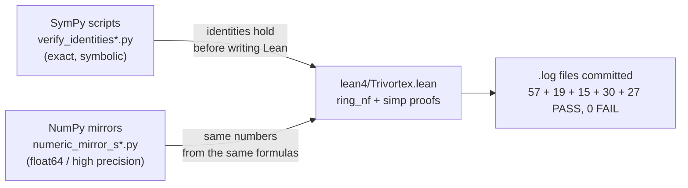

<!-- markdownlint-disable-file MD041 -->
<div align="center">

# 📓 verification · notes — Pre-Verification Scripts & Run Logs

</div>

> **Navigation:** [`verification`](../README.md) › **`notes`**

  

The **workbench behind the Lean 4 formalization**: every identity that
[`verification/lean4/Trivortex.lean`](../lean4/README.md) proves in its
§8 (linear stability of the Lagrange triangle) and §9 (nonlinear
continuation of the modes, unequal circulations) is backed by a SymPy
symbolic check and a NumPy numeric mirror — the same identities derived
in a second computer-algebra system, *before* the Lean chunk is
accepted. The scripts are the machine check that stands behind the Lean
chunks (in the words of the §9 harness itself); the committed `.log`
files are the outputs of real runs, kept exactly as printed, zero FAIL
lines across all three.

The convention mirror is stated in every header: the Kirchhoff
right-hand side, `D_ij = (x_i−x_j)² + (y_i−y_j)²`, the Hamiltonian
`H = −(1/2π)Σ ΓᵢΓⱼ ln rᵢⱼ`, the impulses `P, Q`, the angular impulse
`I`, and the Lagrange rate `ω = 3G/(2πa²)` — the same objects the
Python ladder and the Lean port fix, so the three layers certify each
other.

## 📂 Contents — What Lives Here

| File | Size | Description |
|---|---|---|
| [`verify_identities.py`](verify_identities.py) | 4 553 B | SymPy pre-verification of the identities planned for `Trivortex.lean` v2.0: `dP/dt = dQ/dt = dI/dt = dH/dt = 0` symbolically (denominators cleared), the rotating equilateral satisfies the Kirchhoff velocities with `ω = 3G/(2πa²)`, the `ε` regime spot check |
| [`verify_identities_s8.py`](verify_identities_s8.py) | 8 326 B | SymPy pre-verification of §8: the anchor is an equilibrium of the rotating frame, the exact `M0` linearization, translation/rotation/dilation/shape modes (`±3i`, `0`, `−6` nilpotent), `charpoly = λ²(λ²+9)²` (Thomson, N = 3), directional-derivative certification of the TRUE field, modal basis independence + dual covectors |
| [`verify_identities_s9.py`](verify_identities_s9.py) | 5 179 B | SymPy PASS/FAIL harness for every §9 identity (general circulations): characteristic polynomial `λ²(λ²+G²)(λ²+3P)`, translation/kernel/chain/shape row identities, the (1,1,4), (1,1,−1/2), (1,1,−1) instances; exits non-zero on any failure |
| [`verify_identities_s9.log`](verify_identities_s9.log) | 1 815 B | the committed run of the harness: **57 PASS, 0 FAIL**, closing line "ALL IDENTITIES VERIFIED — the §9 Lean chunk is backed by SymPy" |
| [`numeric_mirror_s8.py`](numeric_mirror_s8.py) | 10 889 B | double-precision mirror of the §8 theorems (Lean v4.0): 16 numbered checks [1]–[16] — anchor fixed point, Lean rows vs central-difference Jacobian, eigenmodes, spectrum `{0, 0, ±3i, ±3i}`, certification derivatives, modal ODE solutions, norm bounds, orthonormal size basis |
| [`numeric_mirror_s8.log`](numeric_mirror_s8.log) | 1 337 B | the committed run: `G = 1, ω = 0.477464829275686`; **19 PASS verdicts, 0 FAIL**; largest residual 1.7e-8 (spectrum), the rest ≤ 1e-10 … 5.6e-17 |
| [`numeric_mirror_s9.py`](numeric_mirror_s9.py) | 8 108 B | numeric mirror for §9 (header: "mpmath high-precision", implemented on NumPy/SymPy): Kirchhoff integration for `Γ = (1, 1, 2)` vs the closed rotation form, the centroid identity along the trajectory, eigenvalues vs `λ²(λ²+G²)(λ²+3P)` for `γ ∈ {4, −1/2, −1}`, the growing mode `|m(t)|² = 12·e^{2√3·t}`, the bounded (1,1,4) oscillation norm |
| [`numeric_mirror_s9.log`](numeric_mirror_s9.log) | 697 B | the committed run: **15/15 PASS**, including `ω = G/(2πa²) = 2/π` for `G = 4` and the growing-mode norm to `rel err < 1e-6` |
| [`s10_preverify.py`](s10_preverify.py) | 247+ lines | SymPy pre-verification of §10 (Lean v6.0): the log-Lyapunov inequality constants, the coercive certificate constant `Γ²/(12π)`, the energy–Casimir multiplier `3Γ/(4π)`, the collinear bifurcation polynomial `N(s,γ)` and its discriminant `(4γ+5)(γ+2)²`, the rational asymmetric roots |
| [`s10_preverify.log`](s10_preverify.log) | 43 lines | the committed run: **30 PASS** (+ the pitchfork extras block), closing line `ALL PASS` |
| [`v2_ladder_track_s10.py`](v2_ladder_track_s10.py) | 237+ lines | the V2-ladder numerical track for §10: V0 spectral re-check, V1 Lyapunov H/I ladder (RK4 of the true Kirchhoff ODE, 6 000 steps, Hamiltonian drift 2e−15), V2 collinear bifurcation ladder |
| [`v2_ladder_track_s10.log`](v2_ladder_track_s10.log) | 18 lines | the committed run: **all rungs PASS** |
| [`s10b_preverify.py`](s10b_preverify.py) | 120+ lines | SymPy pre-verification of the §10.3 deepening (Lean v7.0): the second rational asymmetric relative equilibrium `(1, −9/5, −16/5)` with `ω = 25/(168π)`, the pitchfork triple root `N(s,−5/4) = −(9/64)s³(s−1)`, the degenerate-circulation root counts at `γ = −1` and `γ = −2` |
| [`s10b_preverify.log`](s10b_preverify.log) | 27 lines | the committed run: **27/27 PASS**, closing line `ALL PASS` |
| [`make_s10_gifs.py`](make_s10_gifs.py) | 350+ lines | generator of the two §10 GIF assets (`lean4/assets/lyapunov_stability.gif`, `lean4/assets/collinear_bifurcation.gif`) in the repository traffic-light palette |
| [`make_statement_index.py`](make_statement_index.py) | 140+ lines | regenerates `lean4/docs/STATEMENTS.md` — the auto-generated index of all theorems, grouped by section, with the axiom-footprint counters |
| [`update_readme_v7.py`](update_readme_v7.py) | 400+ lines | the exact-anchor sync script that brought `lean4/README.md` + `README_RU.md` from the v5.0 state to v7.0 (every replacement asserted unique) |

## 🧭 How the layers certify each other



## ▶️ How to Run

Each script is standalone (dependencies: `sympy`, `numpy`; run from this
directory or with an absolute path):

```bash
python3 verification/notes/verify_identities.py        # prints one True/False line per identity
python3 verification/notes/verify_identities_s9.py     # PASS/FAIL harness, non-zero exit on failure
python3 verification/notes/numeric_mirror_s8.py        # 16 numeric checks with PASS bands
python3 verification/notes/numeric_mirror_s9.py        # 15 numeric checks
python3 verification/notes/s10_preverify.py            # §10 symbolic pre-verification (30 checks)
python3 verification/notes/v2_ladder_track_s10.py      # §10 V2-ladder numerical track
python3 verification/notes/s10b_preverify.py           # §10.3 deepening pre-verification (27 checks)
python3 verification/notes/make_s10_gifs.py            # regenerate the two §10 GIF assets
python3 verification/notes/make_statement_index.py     # regenerate lean4/docs/STATEMENTS.md
```

`verify_identities_s8.py` prints its full audit (equilibrium, `M0`,
modes, certification, dual covectors) and asserts the existence of the
shape eigenvector; its verbose output is not committed — the committed
§8 log is the numeric mirror's. The other three scripts have their
outputs committed verbatim.

## ✅ What the Logs Recorded

| Log | Verdict | Highlights |
|---|---|---|
| `verify_identities_s9.log` | 57 PASS / 0 FAIL | `charpoly(1,1,γ) = λ²(λ²+G²)(λ²+3P)`; all 24 general-circulation row identities; the (1,1,4) oscillation norm `33c²+77s²−33cs = 165/2 − (11/2)(3c+s)² ≤ 165/2` |
| `numeric_mirror_s8.log` | 19 PASS / 0 FAIL | `ω = 0.477464829275686` (= 3G/2π, G = 1); `det(xI−M0) = x²(x²+9)²` to 4.5e-14; ODE residuals ~1e-16; the size-drift bound margin exactly ≥ 0 |
| `numeric_mirror_s9.log` | 15 PASS / 0 FAIL | rigid rotation of the translated (1,1,2) triangle (err < 1e-5); the growing mode `|m|² = 12·e^{2√3·t}` to rel err < 1e-6; the three γ-instances of `λ²(λ²+G²)(λ²+3P)` |
| `s10_preverify.log` | 30 PASS / 0 FAIL | `ln(1+u) ≤ u − u²/3` on \|u\| ≤ 1/2; coercivity worst margin 9.2e−06; `N(s,γ)` chart equation; pitchfork `M̃(0,γ) = 4γ+5` at γ = −5/4; rational roots s = 16/9, −16/5 with full RE conditions |
| `v2_ladder_track_s10.log` | all rungs PASS | rigid identity Σd² = 3 (6 000 samples); in-time Lyapunov bound with RK4 (Hamiltonian drift 2e−15); symmetric-branch rigid rotation over the γ-sweep; exact asymmetric relative equilibria |
| `s10b_preverify.log` | 27 PASS / 0 FAIL | second rational asymmetric RE `(1, −9/5, −16/5)`, `ω = 25/(168π)`, all three S-conditions; pitchfork triple root; `N(s,−1) = −s(s−1)²` and `N(s,−2) = −3s(s−1)³` |

## 🔗 Cross-References

- [Framework root — verification/](../README.md)
- [Lean 4 hub — the formalization these notes back](../lean4/README.md) ([README_RU](../lean4/README_RU.md))
- [The working ladder — trivortex/python/verify.py](../trivortex/README.md) (the convention source)
- [The pytest guard — tests/](../tests/README.md) (the CI-facing layer)

## 🇷🇺 Краткое резюме (Russian Summary)

- **`verification/notes/`** — рабочая тетрадь за Lean-формализацией: 4 SymPy-скрипта (символическая проверка тождеств) и 2 NumPy-зеркала (числовая проверка теорем §8 и §9 `Trivortex.lean`), плюс 3 журнала реальных запусков.
- Тождества проверялись до написания доказательств: сохранение P, Q, I, H, устойчивость якоря вращающейся системы, моды `±3i / 0 / −6`, характеристические полиномы `λ²(λ²+9)²` и `λ²(λ²+G²)(λ²+3P)`.
- Журналы зафиксированы как есть: 57 PASS (SymPy §9), 19 PASS (зеркало §8), 15/15 PASS (зеркало §9) — ни одного FAIL; `ω = 0.477464829275686` при G = 1.
- Правила игры: скрипт-обвязка §9 завершается ненулевым кодом при любой ошибке; зеркала сравниваются с зарегистрированными полосами допусков, как лестница V1–V4.

---

<div align="center">

**[⬆ Back to top](#-verification--notes--pre-verification-scripts--run-logs)** ·
**[Repository root](../README.md)**

*Part of [wild8highlander/Trivortex](https://github.com/wild8highlander/Trivortex) · Licensed under [IPL-RP-1.0](https://github.com/wild8highlander/Trivortex/blob/main/LICENSE.md) — All Rights Reserved*

</div>
