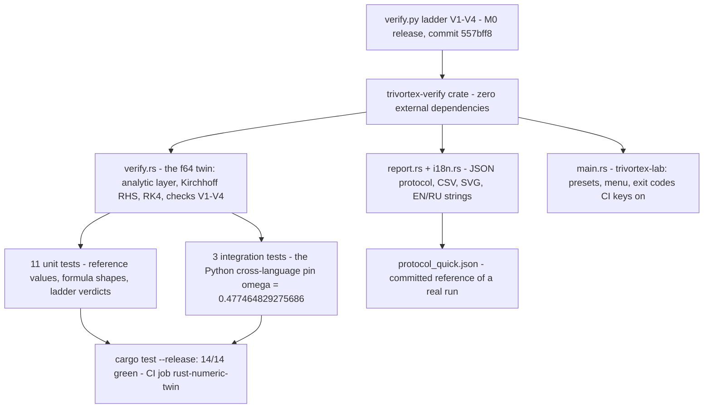

<!-- markdownlint-disable-file MD041 -->
<div align="center">

# ⚡ Rust Verification — the Floating-Point Twin


[](https://github.com/wild8highlander/Trivortex/actions/workflows/verification-ports.yml)


</div>

> **Navigation:** [`verification`](../README.md) › **`rust`**

> The numerical port of the **TRIVORTEX** document
> (`code/trivortex_core*.py`): a line-for-line f64 twin of the V1–V4
> ladder in a small dependency-free crate — the floating-point path is
> exactly the platform's, with no library in between — plus the
> interactive bilingual laboratory `trivortex-lab` and the committed
> reference protocol of a real run.
>
> **Status: landed — v1.1 (milestone M1).** The artifact, the
> CI-callable check and the bilingual documentation live in this
> directory; the acceptance criteria below are checked. Local runs
> need the pinned toolchain (Docker); the repository CI runs the
> port non-blocking until it stays green for three
> consecutive days (see [`verification/README.md`](../README.md) §7).

---

## 📂 Contents — What Lives Here

This directory: [`README.md`](README.md) (this document) ·
[`README_RU.md`](README_RU.md) (the Russian overview, same structure) ·
annotated source maps in [`src/`](src/README.md) and [`tests/`](tests/README.md).

| File | Size | Lines | Description |
|---|---|---|---|
| [`Cargo.toml`](Cargo.toml) | 737 B | 25 | The crate `trivortex-verify` 1.0.0, edition 2021, MSRV `rust-version = "1.75"`, **zero external dependencies**; lib `trivortex_verify`, bin `trivortex-lab`; release profile `opt-level = 3`, `lto = true` |
| [`Cargo.lock`](Cargo.lock) | 160 B | 7 | Trivially short — the dependency-free crate has nothing to lock |
| [`src/lib.rs`](src/lib.rs) | 519 B | 12 | The library root: modules `verify`, `report`, `i18n` |
| [`src/verify.rs`](src/verify.rs) | 26 272 B | 732 | The numeric twin: the analytic layer, the Kirchhoff equations, RK4, the four checks V1–V4, the JSON-compatible value tree — primitive f64 only (no collections, no I/O, no libc beyond libm), so a `no_std` port is a header change plus a libm crate; 11 unit tests inside |
| [`src/main.rs`](src/main.rs) | 24 138 B | 654 | The CLI entry point of `trivortex-lab`: presets quick / default / full or custom parameters, the menu, protocol output, exit codes CI keys on |
| [`src/report.rs`](src/report.rs) | 11 789 B | 367 | The dependency-free JSON protocol, CSV data and native SVG figure writers |
| [`src/i18n.rs`](src/i18n.rs) | 5 491 B | 82 | The bilingual (EN/RU) interface strings |
| [`tests/ladder.rs`](tests/ladder.rs) | 2 359 B | 58 | The integration suite pinning the twin against the Python reference numbers |
| [`protocol_quick.json`](protocol_quick.json) | 2 474 B | 83 | The committed reference protocol of a real quick run (the pytest guard pins against it) |
| [`.gitignore`](.gitignore) | 23 B | 2 | Keeps build artifacts and local outputs out of the tree |

## 🚀 How to Build / Run

```bash
cargo test --release --manifest-path verification/rust/Cargo.toml    # the 14-test guard
cargo run --release --manifest-path verification/rust/Cargo.toml     # the lab menu
cargo run --release --manifest-path verification/rust/Cargo.toml -- \
    --preset quick --no-menu --lang ru --plots --csv                  # CI mode
```

Or via the Makefile from `verification/` (`make help` lists all targets):

```bash
make rust        # cargo test --release (pinned references + quick ladder)
make rust-lab    # the interactive bilingual laboratory
```

The pinned toolchain is [`docker/rust/Dockerfile`](../docker/rust/Dockerfile)
(image `rust:1.77`; the image runs `cargo test --release` at build time
and its entrypoint runs the quick ladder in CI mode with `--lang en`):

```bash
docker build -t trivortex-rust verification/docker/rust
docker run --rm trivortex-rust
```

CI runs the same flow in the non-blocking job *rust-numeric-twin* of
[`verification-ports.yml`](https://github.com/wild8highlander/Trivortex/actions/workflows/verification-ports.yml).

## ✅ What Is Verified Here

The port fixes exactly three objects, so that every language proves or
computes the *same* statements and the results stay comparable:

1. **Theorem 3.1 (closed form).**
   `r_k(t) = sqrt(C_Ch) * (1 + eps*cos(omega*t + 2*pi*k/3))`,
   `theta_k(t) = omega*t + 2*pi*k/3`,
   `omega = (2*pi/T)*exp(C_Ch/pi)`, `eps = 1/(exp(C_Ch/pi) - 1)`;
   properties to establish: exact `2*pi/3` angular separation (equilateral
   choreography) and periodicity `r_k(t + 2*pi/omega) = r_k(t)`.
2. **Chaplygin integral.** The combination
   `C_Ch = r^2*(theta_dot - q*A_theta)` with `A_theta = 1/r`, following the
   definition fixed in Section 6 of the core document, together with its
   recorded endpoint-drift diagnostic over `[0, 100*T]`.
3. **Vortex integrals.** `H`, `P = sum(Gamma*x)`, `Q = sum(Gamma*y)`,
   `I = sum(Gamma*|r|^2)` along numerically integrated Kirchhoff
   trajectories — conserved to the tolerance bands of
   [`verification/tests/`](../tests/README.md).

The test guard: **14 tests green** — 11 unit tests in
[`src/verify.rs`](src/verify.rs) (`frequency_reference_value`,
`amplitude_reference_value`, `amplitude_small_cch_guard`,
`closed_form_periodicity`, `chaplygin_formula_shape`,
`analytic_omega_reference`, `equilateral_initial_shape`,
`vortex_rhs_rigid_rotation_of_pair`, `python_mod_branches`,
`quick_ladder_v1_to_v4_pass`, `report_schema_shape`) plus 3 integration
tests in [`tests/ladder.rs`](tests/ladder.rs)
(`quick_preset_reproduces_python_reference_verdict`,
`quick_preset_tolerances_match_registered_bands`,
`default_preset_stays_green`). The cross-language pin: for the quick
preset the Python ladder reports ω = `0.477464829275686` (Γ = 1, a = 1)
with every check inside its band — the Rust twin must agree to the same
bands (not necessarily bit-for-bit: different libm calls, but inside
every documented tolerance); the committed
[`protocol_quick.json`](protocol_quick.json) (2026-10-08, `4/4 passed`)
is the reference the pytest guard re-checks.

Rust's role in the matrix: the Kirchhoff right-hand side and the RK4
stepper of `verify.py` translate line for line into a small crate, and
`cargo test` gives CI a second, independent floating-point
implementation. Divergences between the Python and Rust ladders are the
cheapest early-warning system for platform-specific floating-point
surprises (x87 vs SSE, fused multiply-add contraction, libm differences).



## 📋 Acceptance Criteria (all checked)

- [x] The three objects above are expressed in Rust with no hidden
      assumptions beyond the artifact header
      (`verification/rust/` crate — the twin core lives in `src/verify.rs`);
- [x] A CI-callable check: `cargo test --release --manifest-path verification/rust/Cargo.toml` — runs the pinned-reference guard (14 tests) and the quick ladder (workflow `verification-ports.yml`, job *rust-numeric-twin*);
- [x] The artifact header carries SPDX + copyright lines (REUSE.toml)
      and a provenance note pointing at the commit of `verify.py` it
      mirrors (557bff8, the M0 release);
- [x] `verification/README.md` status table flips this row to
      *landed (v1.1)* with a link.

## 🔧 Toolchain Pin and Milestones

| Pin | Value |
|---|---|
| Toolchain | Rust 1.77 (Docker pin; crate MSRV 1.75, edition 2021) |
| Docker pin | [`docker/rust/Dockerfile`](../docker/rust/Dockerfile) — image `rust:1.77` |
| Artifact | `verification/rust/` crate (`src/verify.rs` twin core, `src/main.rs` laboratory) — **landed** (v1.1) |
| Milestone | **M1** of the staged plan (with [Coq](../coq/README.md) and [Lean 4](../lean4/README.md)) |
| CI status | non-blocking job *rust-numeric-twin* in `verification-ports.yml`; promotion to blocking after three green days |

Milestone context: **M1** = independent re-derivation — the
[Rust](../rust/README.md) twin is the second floating-point
implementation beside the Python ladder, alongside the proof assistants
[Coq](../coq/README.md) and [Lean 4](../lean4/README.md); **M2** adds
[Isabelle](../isabelle/README.md) + [Agda](../agda/README.md); **M3** adds
[C++](../cpp/README.md) + [Haskell](../haskell/README.md). The status
table lives in [`verification/README.md`](../README.md) §7.

## 🔗 Cross-References

- [Verification framework](../README.md) — milestones, tolerance bands, protocol schema
- [Lean 4 hub](../lean4/README.md) — the Mathlib formalization of the statement layer this twin measures against
- [Coq port](../coq/README.md) — the proven bands (`registered_bands`) this ladder enforces
- [C++ port](../cpp/README.md) — the compiled benchmark ladder the `-O2` board number pins against
- [Haskell port](../haskell/README.md) — the exact ℚ(√3) dual of the same registers
- [Sources map](src/README.md) · [Integration suite](tests/README.md) — the annotated sub-directory guides
- [Docker pin](../docker/rust/Dockerfile) and [pytest guard](../tests/README.md) — the committed numbers the pytest suite pins against
- CI workflow: [`verification-ports.yml`](https://github.com/wild8highlander/Trivortex/actions/workflows/verification-ports.yml) · Makefile targets: `make rust`, `make rust-lab`

---

<div align="center">

**[⬆ Back to top](#-rust-verification--the-floating-point-twin)** ·
**[Repository root](../../README.md)**

*Part of [wild8highlander/Trivortex](https://github.com/wild8highlander/Trivortex) · Licensed under [IPL-RP-1.0](https://github.com/wild8highlander/Trivortex/blob/main/LICENSE.md) — All Rights Reserved*

</div>
