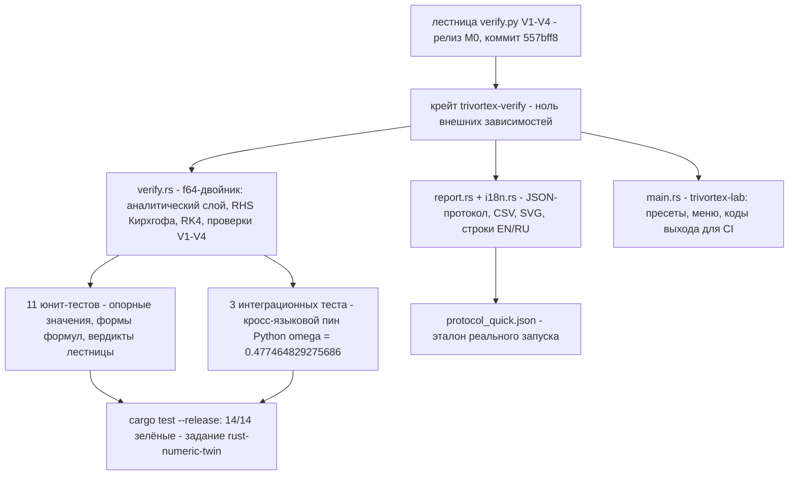

<!-- markdownlint-disable-file MD041 -->
<div align="center">

# ⚡ Верификация на Rust — плавающий двойник


[](https://github.com/wild8highlander/Trivortex/actions/workflows/verification-ports.yml)


</div>

> **Навигация:** [`verification`](../README.md) › **`rust`**
>
> Числовой порт документа **TRIVORTEX** (`code/trivortex_core*.py`):
> построчный f64-двойник лестницы V1–V4 в маленьком крейте без единой
> внешней зависимости — плавающий путь ровно платформенный, без
> библиотек между — плюс интерактивная двуязычная лаборатория
> `trivortex-lab` и закоммиченный эталонный протокол реального запуска.
>
> **Статус: реализовано — v1.1 (веха M1).** Артефакт, CI-вызываемая
> проверка и двуязычная документация живут в этом каталоге; критерии
> приёмки ниже выполнены. Локальные запуски требуют пиннед-тулчейн
> (Docker); CI репозитория гоняет порт non-blocking, пока он не зелёный
> три дня подряд (см. [`verification/README.md`](../README.md) §7).

---

## 📂 Состав каталога

В этом каталоге: [`README.md`](README.md) (этот документ) ·
[`README_RU.md`](README_RU.md) (этот перевод, та же структура) ·
аннотированные карты исходников в [`src/`](src/README.md) и
[`tests/`](tests/README.md).

| Файл | Размер | Строк | Описание |
|---|---|---|---|
| [`Cargo.toml`](Cargo.toml) | 737 Б | 25 | Крейт `trivortex-verify` 1.0.0, edition 2021, MSRV `rust-version = "1.75"`, **ноль внешних зависимостей**; lib `trivortex_verify`, bin `trivortex-lab`; release-профиль `opt-level = 3`, `lto = true` |
| [`Cargo.lock`](Cargo.lock) | 160 Б | 7 | Тривиально короткий — у крейта без зависимостей нечего фиксировать |
| [`src/lib.rs`](src/lib.rs) | 519 Б | 12 | Корень библиотеки: модули `verify`, `report`, `i18n` |
| [`src/verify.rs`](src/verify.rs) | 26 272 Б | 732 | Числовой двойник: аналитический слой, уравнения Кирхгофа, RK4, четыре проверки V1–V4, JSON-совместимое дерево значений — только примитивный f64 (никаких коллекций, I/O, libc кроме libm), поэтому `no_std`-порт — это правка шапки плюс крейт libm; внутри 11 юнит-тестов |
| [`src/main.rs`](src/main.rs) | 24 138 Б | 654 | Точка входа CLI `trivortex-lab`: пресеты quick / default / full и свои параметры, меню, вывод протокола, коды выхода, на которые ключится CI |
| [`src/report.rs`](src/report.rs) | 11 789 Б | 367 | Писатели JSON-протокола, CSV-данных и нативных SVG-графиков — без зависимостей |
| [`src/i18n.rs`](src/i18n.rs) | 5 491 Б | 82 | Двуязычные (EN/RU) строки интерфейса |
| [`tests/ladder.rs`](tests/ladder.rs) | 2 359 Б | 58 | Интеграционный набор, пиннящий двойник к опорным числам Python |
| [`protocol_quick.json`](protocol_quick.json) | 2 474 Б | 83 | Эталонный протокол реального быстрого запуска (pytest-защита пиннится к нему) |
| [`.gitignore`](.gitignore) | 23 Б | 2 | Держит артефакты сборки и локальные выводы вне дерева |

## 🚀 Сборка и запуск

```bash
cargo test --release --manifest-path verification/rust/Cargo.toml    # защита из 14 тестов
cargo run --release --manifest-path verification/rust/Cargo.toml     # меню лаборатории
cargo run --release --manifest-path verification/rust/Cargo.toml -- \
    --preset quick --no-menu --lang ru --plots --csv                  # режим CI
```

Либо через Makefile из каталога `verification/` (`make help` перечисляет все цели):

```bash
make rust        # cargo test --release (опорные значения + быстрая лестница)
make rust-lab    # интерактивная двуязычная лаборатория
```

Пиннед-тулчейн — [`docker/rust/Dockerfile`](../docker/rust/Dockerfile)
(образ `rust:1.77`; образ выполняет `cargo test --release` при сборке,
а его entrypoint запускает быструю лестницу в режиме CI с `--lang en`):

```bash
docker build -t trivortex-rust verification/docker/rust
docker run --rm trivortex-rust
```

CI выполняет тот же поток в non-blocking задании *rust-numeric-twin*
воркфлоу
[`verification-ports.yml`](https://github.com/wild8highlander/Trivortex/actions/workflows/verification-ports.yml).

## ✅ Что здесь верифицировано

Порт фиксирует ровно три объекта, чтобы каждый язык доказывал или
вычислял *те же* утверждения и результаты оставались сопоставимыми:

1. **Теорема 3.1 (замкнутая форма).**
   `r_k(t) = sqrt(C_Ch) * (1 + eps*cos(omega*t + 2*pi*k/3))`,
   `theta_k(t) = omega*t + 2*pi*k/3`,
   `omega = (2*pi/T)*exp(C_Ch/pi)`, `eps = 1/(exp(C_Ch/pi) - 1)`;
   свойства к установлению: точное угловое разделение `2*pi/3`
   (равносторонняя хореография) и периодичность
   `r_k(t + 2*pi/omega) = r_k(t)`.
2. **Интеграл Чаплыгина.** Комбинация
   `C_Ch = r^2*(theta_dot - q*A_theta)` при `A_theta = 1/r`, согласно
   определению из раздела 6 основного документа, вместе с
   зарегистрированной диагностикой дрейфа на концах отрезка `[0, 100*T]`.
3. **Вихревые интегралы.** `H`, `P = sum(Gamma*x)`, `Q = sum(Gamma*y)`,
   `I = sum(Gamma*|r|^2)` вдоль численно проинтегрированных траекторий
   Кирхгофа — с сохранением в полосах допусков
   [`verification/tests/`](../tests/README.md).

Тестовая защита: **14 тестов зелёные** — 11 юнит-тестов в
[`src/verify.rs`](src/verify.rs) (`frequency_reference_value`,
`amplitude_reference_value`, `amplitude_small_cch_guard`,
`closed_form_periodicity`, `chaplygin_formula_shape`,
`analytic_omega_reference`, `equilateral_initial_shape`,
`vortex_rhs_rigid_rotation_of_pair`, `python_mod_branches`,
`quick_ladder_v1_to_v4_pass`, `report_schema_shape`) плюс 3
интеграционных теста в [`tests/ladder.rs`](tests/ladder.rs)
(`quick_preset_reproduces_python_reference_verdict`,
`quick_preset_tolerances_match_registered_bands`,
`default_preset_stays_green`). Кросс-языковой пин: для пресета quick
Python-лестница сообщает ω = `0.477464829275686` (Γ = 1, a = 1) с каждой
проверкой внутри своей полосы — двойник Rust обязан соглашаться в тех же
полосах (не обязательно бит-в-бит: разные вызовы libm, но внутри каждого
задокументированного допуска); закоммиченный
[`protocol_quick.json`](protocol_quick.json) (2026-10-08, `4/4 passed`) —
эталон, который повторно проверяет pytest-защита.

Роль Rust в матрице: правая часть Кирхгофа и шаг RK4 из `verify.py`
переводятся построчно в маленький крейт, и `cargo test` даёт CI вторую,
независимую плавающую реализацию. Расхождения между Python- и
Rust-лестницами — самая дешёвая система раннего предупреждения о
платформенно-специфичных сюрпризах плавающей арифметики (x87 против SSE,
fused multiply-add contraction, отличия libm).



## 📋 Критерии приёмки (все выполнены)

- [x] Три объекта выше выражены на Rust без скрытых допущений, кроме шапки
      артефакта (крейт `verification/rust/` — ядро двойника живёт в
      `src/verify.rs`);
- [x] CI-вызываемая проверка: `cargo test --release --manifest-path verification/rust/Cargo.toml` —
      защита опорных значений (14 тестов) и быстрая лестница (воркфлоу
      `verification-ports.yml`, задание *rust-numeric-twin*);
- [x] Шапка артефакта несёт строки SPDX + копирайта (REUSE.toml) и
      примечание о происхождении со ссылкой на коммит `verify.py`,
      зеркало которого это файл (557bff8, релиз M0);
- [x] Строка таблицы статусов в `verification/README.md` переключена в
      *landed (v1.1)* со ссылкой.

## 🔧 Пин тулчейна и вехи

| Пин | Значение |
|---|---|
| Тулчейн | Rust 1.77 (Docker-пин; MSRV крейта 1.75, edition 2021) |
| Docker-пин | [`docker/rust/Dockerfile`](../docker/rust/Dockerfile) — образ `rust:1.77` |
| Артефакт | крейт `verification/rust/` (ядро двойника `src/verify.rs`, лаборатория `src/main.rs`) — **реализован** (v1.1) |
| Веха | **M1** поэтапного плана (вместе с [Coq](../coq/README_RU.md) и [Lean 4](../lean4/README.md)) |
| Статус CI | non-blocking задание *rust-numeric-twin* в `verification-ports.yml`; перевод в blocking после трёх зелёных дней |

Контекст вех: **M1** = независимое пере-выведение — двойник
[Rust](../rust/README_RU.md) — вторая плавающая реализация рядом с
Python-лестницей, вместе с пруф-ассистентами
[Coq](../coq/README_RU.md) и [Lean 4](../lean4/README.md); **M2**
добавляет [Isabelle](../isabelle/README_RU.md) +
[Agda](../agda/README_RU.md); **M3** добавляет
[C++](../cpp/README_RU.md) + [Haskell](../haskell/README_RU.md).
Таблица статусов — в [`verification/README.md`](../README.md) §7.

## 🔗 Перекрёстные ссылки

- [Фреймворк верификации](../README.md) — вехи, полосы допусков, схема протокола
- [Lean 4 хаб](../lean4/README.md) — формализация слоя формулировок в Mathlib, эталон для этого двойника
- [Порт Coq](../coq/README_RU.md) — доказанные полосы (`registered_bands`), которые enforce эта лестница
- [Порт C++](../cpp/README_RU.md) — компилируемая лестница-бенчмарк, против которой пиннится цифра `-O2`
- [Порт Haskell](../haskell/README_RU.md) — точный ℚ(√3)-двойник тех же регистров
- [Карта исходников](src/README.md) · [Интеграционный набор](tests/README.md) — аннотированные гиды по подкаталогам
- [Docker-пин](../docker/rust/Dockerfile) и [pytest-защита](../tests/README.md) — закоммиченные числа, к которым пиннится pytest-набор
- CI-воркфлоу: [`verification-ports.yml`](https://github.com/wild8highlander/Trivortex/actions/workflows/verification-ports.yml) · цели Makefile: `make rust`, `make rust-lab`

---

<div align="center">

**[⬆ Наверх](#-верификация-на-rust--плавающий-двойник)** ·
**[Корень репозитория](../../README.md)**

*Часть [wild8highlander/Trivortex](https://github.com/wild8highlander/Trivortex) · Лицензия [IPL-RP-1.0](https://github.com/wild8highlander/Trivortex/blob/main/LICENSE.md) — All Rights Reserved*

</div>
