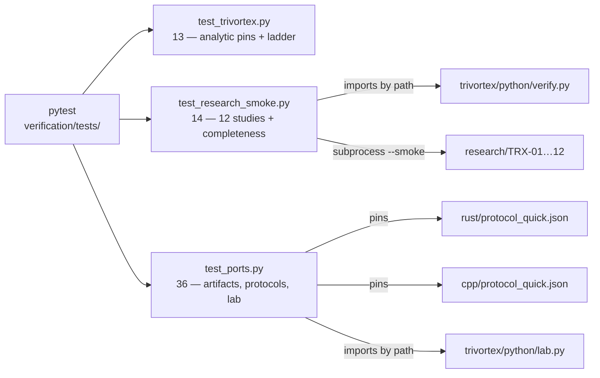

<!-- markdownlint-disable-file MD041 -->
<div align="center">

# 🧪 verification · tests — the pytest Guard (63 tests)

</div>

> **Navigation:** [`verification`](../README.md) › **`tests`**

  

Pytest coverage for the whole verification program of the three-body
vortex model. **63 tests collected — `13 + 14 + 36` — all passing.**
Every test is bound to either a hard analytic reference value (Theorem
3.1, the Lagrange angular velocity), a numerical residual produced by a
real RK4 run, or a committed artifact/protocol of the landed ports — no
mocked numbers, no skipped physics.

> Counting note: a raw `grep -c "def test_"` finds 25 test functions
> (13 / 3 / 9 per file); `pytest --collect-only` reports 63 because
> `@pytest.mark.parametrize` expands the 12-study smoke sweep, the
> 26-row artifact table and the 2×3 protocol checks. Both numbers are
> honest; the 63 is what CI counts.

---

## Table of contents

1. [Quick start](#1-quick-start)
2. [What is covered](#2-what-is-covered)
3. [Test map](#3-test-map)
4. [Tolerance philosophy](#4-tolerance-philosophy)
5. [Writing new tests](#5-writing-new-tests)
6. [CI integration](#6-ci-integration)

---

## 1. Quick start

From the repository root:

```bash
python -m pip install numpy pytest
python -m pytest verification/tests/ -v
```

Expected tail of a healthy run:

```text
verification/tests/test_ports.py::TestPortProtocols::test_protocol_schema[cpp] PASSED
============================== 63 passed in ~30s ==============================
```

The suite needs only `numpy` and `pytest` — no LaTeX, no provers, no
Docker. The port-guard file is deliberately toolchain-agnostic: it pins
the **committed** JSON protocols of Rust and C++ and never invokes a
compiler. The heavy cross-language execution matrix lives in the
[`verification-ports.yml`](../../.github/workflows/verification-ports.yml)
workflow instead; the roadmap is in the
[framework hub](../README.md#7-multi-language-roadmap-and-milestones).

---

## 2. What is covered

The suite guards four layers of the TRIVORTEX program against regressions:

| Layer | Guarded property | Typical residual |
|---|---|---|
| **Analytic** | Closed form of Theorem 3.1: frequency `ω = (2π/T)·e^{C_Ch/π}`, amplitude `ε = 1/(e^{C_Ch/π}−1)`, periodicity of `r_k(t)`, shape of the Chaplygin combination | `≤ 1e-12` (float64 exactness) |
| **Numerical core** | Kirchhoff right-hand side: antisymmetry, rotation sense, zero radial drift for the rigid pair | `≤ 1e-15` |
| **Ladder V1–V4** | Choreography 2π/3, periodicity, rigid Lagrange rotation with `ω = 3Γ/(2πa²)`, conservation of `H, P, Q, I` (equal and unequal circulations) | `≤ 1e-10` |
| **Ports & program** | Artifact presence for M1–M3, schema and cross-language pinning of the committed protocols, research-study smoke runs, laboratory analyses | registered §6/§11 bands of the [hub](../README.md#6-tolerance-bands) |

The ladder tests run the same code paths as
[`verification/trivortex/python/verify.py`](../trivortex/python/verify.py)
but with the fast `quick` preset, so the analytic core finishes in about
two seconds; the study smoke sweep (12 subprocess runs) and the
laboratory analyses bring the full suite to ≈ 30 s — cheap enough to run
on every push, which is exactly what the
[`ci.yml`](../../.github/workflows/ci.yml) workflow does.

---

## 3. Test map

```text
test_trivortex.py                        13 tests  (5 303 B)
├── TestTheorem31                      ← analytic layer, hard references (5)
│   ├── test_frequency_reference_value       ω = 1.3748022274393588 (C_Ch=1)
│   ├── test_amplitude_reference_value       ε = 1/(e^{1/π}−1)
│   ├── test_amplitude_small_cch_guard       the C_Ch ≤ 0.01 guard
│   ├── test_closed_form_periodicity         r_k(t+T_r) = r_k(t)
│   └── test_chaplygin_formula_shape         C_Ch = r²θ̇ − q·r (A_θ = 1/r)
├── TestLagrangeSolution               ← classical results, pinned (3)
│   ├── test_analytic_omega_reference        ω = 3Γ/(2πa²)
│   ├── test_equilateral_initial_shape       sides = (a, a, a)
│   └── test_vortex_rhs_rigid_rotation_of_pair   Kirchhoff pair, exact
├── TestVerificationLadder             ← V1–V4 in the quick preset (4)
│   ├── test_v1_choreography
│   ├── test_v2_lagrange_rotation
│   ├── test_v3_invariants
│   └── test_v4_robustness
└── TestReportGeneration
    └── test_json_report_serializes          JSON protocol round-trip

test_research_smoke.py                   14 tests  (6 045 B)
├── test_research_study_smoke[TRX-01…12]     parametrized × 12: every study
│                                            runs `--smoke`, exits 0 (timeout
│                                            300 s), protocol status PASS
├── test_research_program_completeness       12 studies × {README, code, pack,
│                                            scheme SVG, 4 figures, bilingual
│                                            monographs, PDF+DOCX renditions}
└── test_publications_library                reading room: 28 PDFs + 28 DOCX,
                                             HTML sources, 4 build scripts,
                                             4 animations (GIF+MP4 each)

test_ports.py                            36 tests  (9 434 B)
├── TestPortArtifacts                    27
│   ├── test_artifact_present[×25]           the 25 planned artifacts: 24 files
│   │                                        of M1–M3 (7 languages) + lab.py,
│   │                                        incl. the 2 committed protocols
│   ├── test_bilingual_readmes_landed        README.md + README_RU.md × 7 langs
│   └── test_spdx_headers_present            SPDX + copyright in 7 artifacts
├── TestPortProtocols                     6
│   ├── test_protocol_schema[rust, cpp]      §12 schema of the hub, quick, 4 checks
│   ├── test_protocol_matches_python_verdicts[rust, cpp]
│   └── test_protocol_matches_python_reference_numbers[rust, cpp]
│                                             V1 ≤ 1e-12, V2 shape ≤ 1e-10,
│                                             ω ≤ 1e-6 (vs lagrange_omega pin
│                                             0.477464829275686), V3/V4 ≤ 1e-10
└── TestPythonLaboratory                  3
    ├── test_lab_imports_and_bilingual_strings   STRINGS[en, ru]
    ├── test_lab_reference_helpers               convergence grid 250…8000
    └── test_lab_invariant_drift_scan_passes     dH, dP, dQ, dI ≤ 1e-10
```

The three suites and their object in one picture:



---

## 4. Tolerance philosophy

Tolerances in this suite are **not** tuned to make tests pass; they encode
what float64 arithmetic can honestly deliver for each quantity class:

- **1e-15 / 1e-14** — algebraic identities evaluated in float64
  (antisymmetry of the right-hand side, reference constants);
- **1e-12** — closed-form residuals of Theorem 3.1 (argument reduction in
  `cos`, transcendental round-off);
- **1e-10** — RK4-integrated invariants over several rotation periods
  (fourth-order truncation at `dt = T/2000` dominates).

If a residual sits far *below* its tolerance band, the test is loosened —
a passing test that cannot fail is dead weight. If a residual ever creeps
*above* its band, that is treated as a regression of the model code, not
of the test.

The cross-language pinning of `test_ports.py` compares the committed
protocols against the *tolerance*, not bit-for-bit: different libm calls
give different last bits — the divergence is documented in the port
READMEs, and the analytic `omega` anchor itself is pinned to
`rel=1e-12` in every language.

---

## 5. Writing new tests

1. Import the ladder module through the existing
   `importlib` shim at the top of `test_trivortex.py` (it loads
   `verify.py` by path, so no package installation is needed).
2. Bound every new numerical assertion to a **named reference**: an exact
   analytic value, a docstring with the formula, or a JSON protocol from a
   recorded run.
3. Keep individual tests under ~5 s wall time; long integrations belong to
   the `full` preset of `verify.py`, not to the pytest suite.
4. Name tests after the property they protect
   (`test_<property>_<context>`), so a red test reads as a diagnosis.

Example — adding a conservation check for a new configuration:

```python
def test_invariants_survive_random_vortex_config(self):
    rng = np.random.default_rng(42)
    state = rng.normal(scale=0.5, size=8)          # 4 vortices
    gamma = rng.choice([1.0, -1.0], size=4)
    inv0 = tv.invariants(state, gamma)
    for _ in range(2000):
        state = tv.rk4_step(state, gamma, 1e-3)
    inv1 = tv.invariants(state, gamma)
    for key in inv0:
        assert abs(inv1[key] - inv0[key]) <= 1e-9, key
```

---

## 6. CI integration

The suite is the second job of the repository pipeline:

- **Workflow**: [`.github/workflows/ci.yml`](../../.github/workflows/ci.yml)
- **Trigger**: every push to `main` and every pull request;
- **Matrix**: Python 3.10 / 3.11 / 3.12 on `ubuntu-latest`;
- **Steps**: `pip install numpy pytest` → `pytest verification/tests/ -v`
  → `verify.py --preset quick` → upload of the JSON report artifact.

The executed ports run in the separate, non-blocking
[`verification-ports.yml`](../../.github/workflows/verification-ports.yml)
workflow (8 jobs — Rust, C++, Haskell, the laboratory smoke, Coq, Lean 4,
Isabelle, Agda); the framework hub's
[§7](../README.md#7-multi-language-roadmap-and-milestones) records the
flip-to-blocking contract (three consecutive green days).

A green run produces the badge in the root README; a red run uploads the
failing JSON protocol so the regression can be diagnosed from the
artifact alone, without re-running anything locally.

## 🇷🇺 Краткое резюме (Russian Summary)

- **`verification/tests/`** — pytest-щит всей программы: 63 собранных теста (13 + 14 + 36; сырых функций — 25, остальные разворачиваются параметризацией), всё проходит за ≈ 30 с.
- `test_trivortex.py` (13): аналитический слой Теоремы 3.1, лагранжева частота ω = 3Γ/(2πa²), лестница V1–V4 на пресете `quick`, сериализация JSON-протокола.
- `test_research_smoke.py` (14): 12 исследований TRX в режиме `--smoke` (тайм-аут 300 с, статус PASS) + полнота комплекта + библиотека публикаций (28 PDF + 28 DOCX).
- `test_ports.py` (36): наличие 26 артефактов M1–M3, двуязычные README, SPDX-заголовки, схемы и перекрёстная привязка протоколов Rust/C++ к числам Python-лестницы, двуязычная лаборатория.
- Зависимости — только numpy и pytest; компиляторы и пруверы не вызываются; тяжёлая кросс-языковая матрица — в `verification-ports.yml`.

---

<div align="center">

**[⬆ Back to top](#-verification--tests--the-pytest-guard-63-tests)** ·
**[Repository root](../README.md)**

*Part of [wild8highlander/Trivortex](https://github.com/wild8highlander/Trivortex) · Licensed under [IPL-RP-1.0](https://github.com/wild8highlander/Trivortex/blob/main/LICENSE.md) — All Rights Reserved*

</div>
