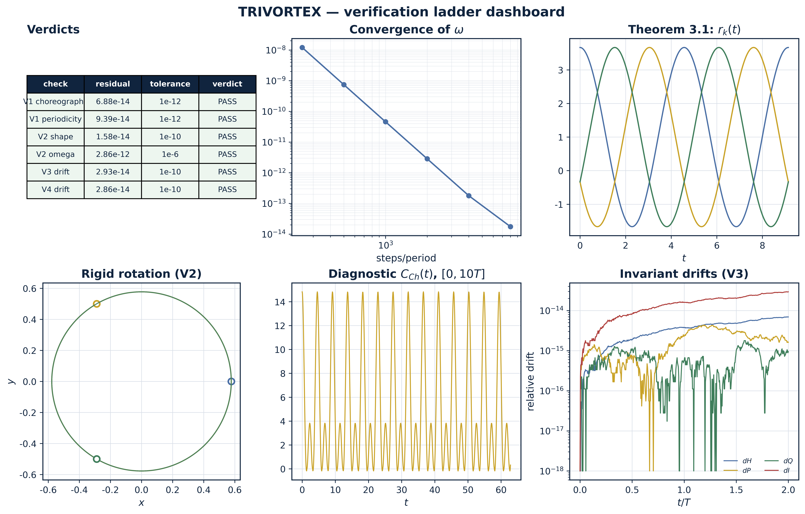
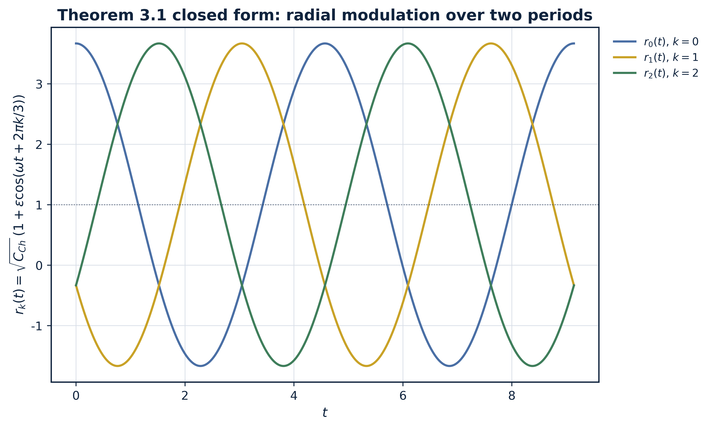
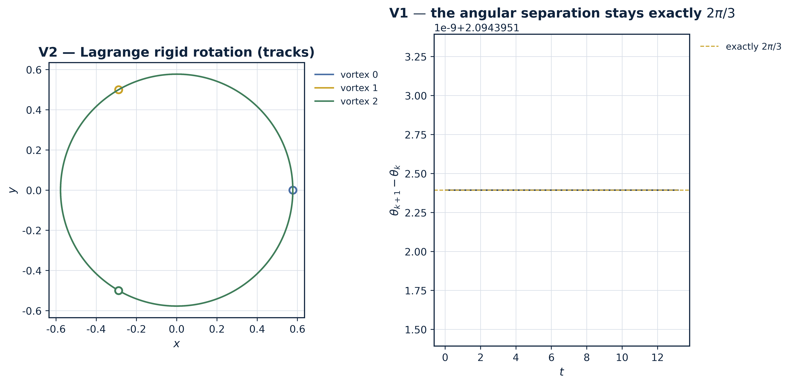
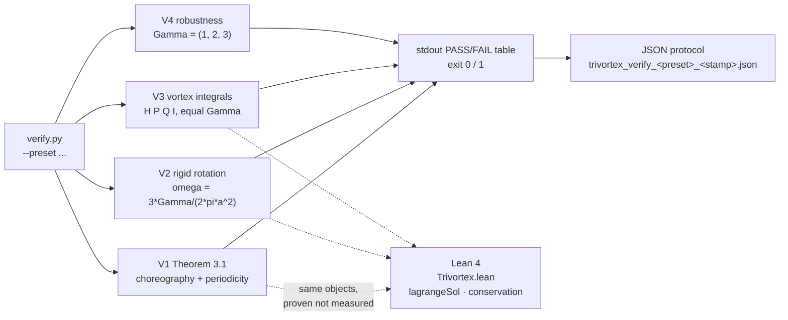

<!-- markdownlint-disable-file MD041 -->
<div align="center">

# 🐍 trivortex — the Working Verification Ladder (M0)


</div>

> **Navigation:** [`verification`](../README.md) › **`trivortex`**


The independent, dependency-light checker of the TRIVORTEX document —
**the original object of verification and milestone M0 of the framework**.
`python/verify.py` re-derives the four claims that anchor Theorem 3.1 and the
Chaplygin topological integral, from scratch, sharing **no code** with
`code/trivortex_core*.py`; `python/lab.py` is the interactive scientific
laboratory built around the same registers. Every other artifact in the
verification constellation — the pytest guard, the Coq / Lean 4 / Rust /
Isabelle / Agda / C++ / Haskell ports — mirrors *this* ladder.

## 📂 Contents — What Lives Here

| Path | Size | Contents |
|---|---:|---|
| [`python/verify.py`](python/verify.py) | 17,911 B | the V1–V4 ladder: closed-form checks, Kirchhoff RK4 dynamics, JSON protocol, three presets (469 lines, numpy-only) |
| [`python/lab.py`](python/lab.py) | 35,483 B | the interactive scientific laboratory: preset or fully custom runs, convergence and drift analyses, 600 dpi figures (874 lines) |
| [`python/sample-figures/choreography.png`](python/sample-figures/choreography.png) | 420,611 B | committed sample: the Lagrange rigid-rotation choreography |
| [`python/sample-figures/closed_form.png`](python/sample-figures/closed_form.png) | 657,387 B | committed sample: the closed form of Theorem 3.1 |
| [`python/sample-figures/dashboard.png`](python/sample-figures/dashboard.png) | 1,793,356 B | committed sample: the one-glance lab dashboard |
| [`README.md`](README.md) / [`README_RU.md`](README_RU.md) | — | this overview, EN + RU |

## 🧭 Why this is "independent" verification

`verify.py` shares **no code** with `code/trivortex_core*.py`. It
re-implements from scratch the objects it checks — the closed form of
Theorem 3.1, the Chaplygin combination `C_Ch = r²(θ̇ − q·A_θ)`, the
Kirchhoff right-hand side of point-vortex dynamics, and its own RK4
stepper. A regression in the core document's numerics therefore cannot
hide behind a shared helper: the ladder either reproduces the claims with
its own arithmetic or it fails loudly (exit code `1`).

Registration before measurement: every check carries a target and a
tolerance committed *before* the recorded run — a passing check is a claim
held to a published band, not a noisy measurement.

The full statement of the checks, the tolerance bands, the milestone
plan and the honesty notes live in the framework root:
[`verification/README.md`](../README.md).

## ✅ The V1–V4 checks

The ladder certifies four claims. Each returns a `passed` verdict computed
against registered tolerances:

| # | Check | What is verified | Registered tolerance |
|---|---|---|---|
| **V1** | Theorem 3.1 — closed form | the three vortices keep the exact `2π/3` angular separation at all probed times (equilateral choreography) and the closed form is periodic, `r_k(t + T_r) = r_k(t)` with `T_r = 2π/ω`, over the window `[0, 100·T]` | separation `≤ 1e-12`, periodicity `≤ 1e-12` |
| **V2** | Rigid rotation of the Lagrange triangle | three equal vortices on an equilateral triangle of side `a` rotate rigidly with the analytic angular velocity `ω = 3Γ/(2πa²)` — the point-vortex analogue of the classical Lagrange equilateral solution; RK4-measured `ω` must match the analytic value and the triangle must stay equilateral | shape drift `≤ 1e-10`, `ω` relative error `≤ 1e-6` |
| **V3** | Conservation of the vortex integrals (equal Γ) | along the V2 trajectory the classical invariants are conserved: Hamiltonian `H`, linear impulses `P = Σ Γ·x`, `Q = Σ Γ·y`, angular impulse `I = Σ Γ·\|r\|²` — the many-body Chaplygin-type integrals | relative drift `≤ 1e-10` |
| **V4** | Robustness with unequal circulations | for `Γ = (1, 2, 3)` (non-symmetric, generic triangle with the centroid at the origin) all V3 invariants are still conserved — the integrals do not require the symmetric initial condition | relative drift `≤ 1e-10` |

The closed form being checked in V1 (mirroring Section 5 of the core
document):

```text
r_k(t)     = sqrt(C_Ch) * (1 + eps * cos(omega*t + 2*pi*k/3))
theta_k(t) = omega*t + 2*pi*k/3
omega      = (2*pi/T) * exp(C_Ch/pi)
eps        = 1/(exp(C_Ch/pi) - 1)
```

**Honesty boundary.** V1 additionally *records* the endpoint drift of the
gauge-dependent combination `C_Ch(t) = r²(θ̇ − q·A_θ)` (with `A_θ = 1/r`) —
the exact quantity written down by Section 6 of the core document. That
combination oscillates by construction and is window-dependent; it is
reported as a **diagnostic, not a pass/fail criterion**. The
window-independent conserved quantities of the model are the vortex
integrals certified by V3/V4. The full honesty note is
[§13 of the verification README](../README.md).

## ⚙️ Presets

| Preset | `rotations` | `steps_per_period` | `n_points_cch` | Wall time | Used by |
|---|---:|---:|---:|---|---|
| `quick` | 2 | 2,000 | 200 | ≈ 0.5 s | CI (every push) |
| `default` | 5 | 4,000 | 1,000 | ≈ 2 s | local checks |
| `full` | 20 | 8,000 | 2,000 | ≈ 35 s | release validation |

<div align="center">

</div>

## 🚀 How to Run

```bash
# fast smoke run — what CI executes
python3 python/verify.py --preset quick

# default ladder (~2 s) and the long integration (~35 s)
python3 python/verify.py
python3 python/verify.py --preset full

# explicit JSON output directory
python3 python/verify.py --preset default --out-dir /tmp/trivortex
```

Without `--out-dir` the JSON report lands in `verification/outputs/trivortex/`.
Exit code `0` = all checks passed, `1` = at least one check failed.

A healthy run ends with:

```text
  RESULT: 4/4 checks passed  (preset=default, wall time 2.18s)
  JSON report: .../trivortex_verify_default_2026-10-06_06-20-11.json
```

## 🧪 The JSON protocol

Each run writes one file with the UTC date, the preset, the wall time and
per-check records (`check`, residuals, tolerances, `passed`, full
parameter snapshot). The top-level schema is intentionally flat and stable
— `suite`, `version`, `preset`, `date_utc`, `wall_time_s`,
`checks_passed` / `checks_total`, `all_passed`, `checks[]` — so the same
reader works for the Python ladder and for every language port
(`verification/tests/test_ports.py` parses the committed port protocols
against the same bands). Attach the JSON to any issue that reports a
failing check — the parameter snapshot makes the failure reproducible
without asking a single follow-up question.

## 🔬 `lab.py` — the interactive laboratory

While `verify.py` is the CI workhorse — one preset, one JSON protocol —
`lab.py` is the researcher's bench around the same registers. It re-imports
the ladder's check functions and **never modifies them**: the registered
tolerances and criteria of [`verification/README.md`](../README.md) stay
authoritative; the lab only adds optics, ergonomics and analysis. numpy is
required, matplotlib only for figures; the session is EOF-safe (Ctrl-D
exits cleanly), so batch and CI runs work without a tty.

| Menu | Item |
|---|---|
| 1 | run the verification ladder V1–V4 (preset) |
| 2 | custom parameters: `C_Ch`, `T`, `Γ`, `a`, rotations, steps/period — with the computed `ω`, `ε`, `ω_Lagrange` echoed back |
| 3 | analysis: convergence study (measured `ω` error vs integration grid) |
| 4 | analysis: invariant-drift scan of `H`, `P`, `Q`, `I` along the trajectory |
| 5 | figures: the full set at **600 dpi** (PNG + PDF + SVG) |
| 6 | figures: the one-glance dashboard (600 dpi) |
| 7 | reports: JSON protocol + CSV data of the last run |
| 0 | exit |

The figure set: `fig1_closed_form`, `fig2_chaplygin` (the Section-6
diagnostic), `fig3_choreography`, `fig4_convergence`,
`fig5_robustness` (unequal circulations), `fig6_invariants`,
`fig7_dashboard` — every figure saved at the registered raster resolution
`FIG_DPI = 600` in three formats.

```bash
python3 python/lab.py                          # interactive session
python3 python/lab.py --lang ru                # Russian interface
python3 python/lab.py --no-menu --figures      # figures for the default preset
python3 python/lab.py --preset quick --no-menu # CI smoke (no figures)
```

The CI job `python-lab` in
[`verification-ports.yml`](https://github.com/wild8highlander/Trivortex/blob/main/.github/workflows/verification-ports.yml)
runs exactly that smoke: the quick ladder plus the 600 dpi dashboard.

## 🖼 Sample figures

Three committed PNGs — what the ladder and the lab render, committed so the
repository shows its outputs without running anything. They are
**documentation artifacts, not registers**: the numeric truth lives in the
JSON protocols.

<p align="center">
  
</p>

<p align="center">
  
  
</p>

## 🧩 Proven in Lean 4 — the machine-checked sibling

The analytic core of this ladder is no longer only numerics: the Lean 4
port ([`verification/lean4`](../lean4/README.md)) fixes exactly the
objects of `verify.py` (provenance: commit `557bff8`, the M0 release) and
**proves** them over Mathlib, with the axiom footprint of every theorem
closed to exactly `propext`, `Classical.choice`, `Quot.sound` (statement
layer v5.0, §1–§9; 145 `#print axioms` statements, zero `sorry`/`axiom`):

| Python check | Lean counterpart | Status |
|---|---|---|
| V1 closed form: `2π/3` choreography, periodicity, positivity for `C_Ch > π·ln 2` | `theta_separation`, `r_periodic`, `theta_periodic`, `eps_pos`, `eps_lt_one`, `rClosed_pos` | ✅ proven |
| V2 rigid rotation: `ω = 3Γ/(2πa²)` is an exact Kirchhoff solution | `lagrangeSol` (+ `lag_kx0…lag_ky2`), anchors `H = 0, P = 0, Q = 0, I = Γ` for all time (`lagrange_anchor_H/P/Q/I`) | ✅ proven |
| V3/V4 integrals conserved | `P/Q/I/H_kirchhoff_deriv` + `_conserved` — along *any* Kirchhoff solution, *any* circulations | ✅ proven |

The numeric ladder and the formal port agree by construction on the same
definitions — the ladder measures what Lean proves. Toolchain pin: Lean 4
v4.6.0 with the Mathlib tag `v4.6.0`.



## 🔗 Cross-References

- [`verification/README.md`](../README.md) — the framework root: full check statements, tolerance rationale, milestones, honesty notes
- [`trivortex/python/`](python/README.md) — the two scripts behind this ladder, in detail
- [`verification/lean4/`](../lean4/README.md) — the machine-checked sibling of the analytic layer
- [`verification/tests/`](../tests/README.md) — the 63-test pytest guard (206 program-level tests pass across the program)
- The checked object itself: `code/trivortex_core*.py` — the 22-section executable document

---

<div align="center">

**[⬆ Back to top](#-trivortex--the-working-verification-ladder-m0)** ·
**[verification](../README.md)** ·
**[Repository root](../../README.md)**

*Part of [wild8highlander/Trivortex](https://github.com/wild8highlander/Trivortex) · Licensed under [IPL-RP-1.0](https://github.com/wild8highlander/Trivortex/blob/main/LICENSE.md) — All Rights Reserved*

</div>
