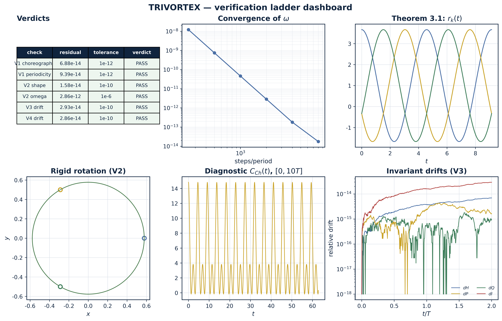
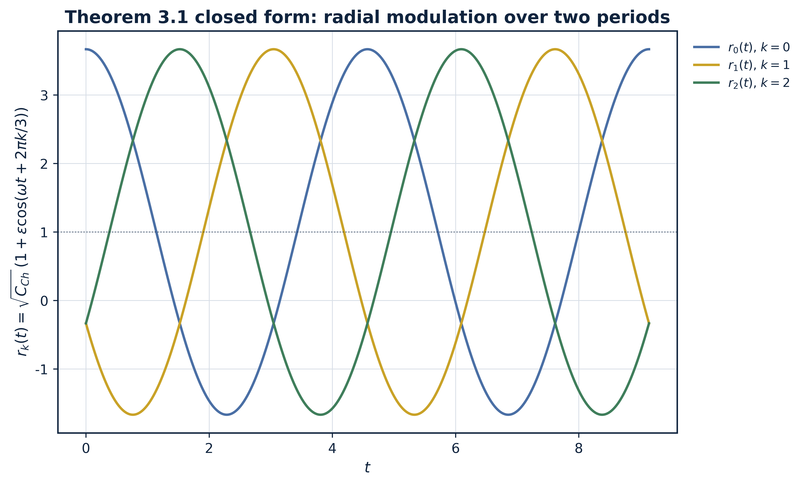
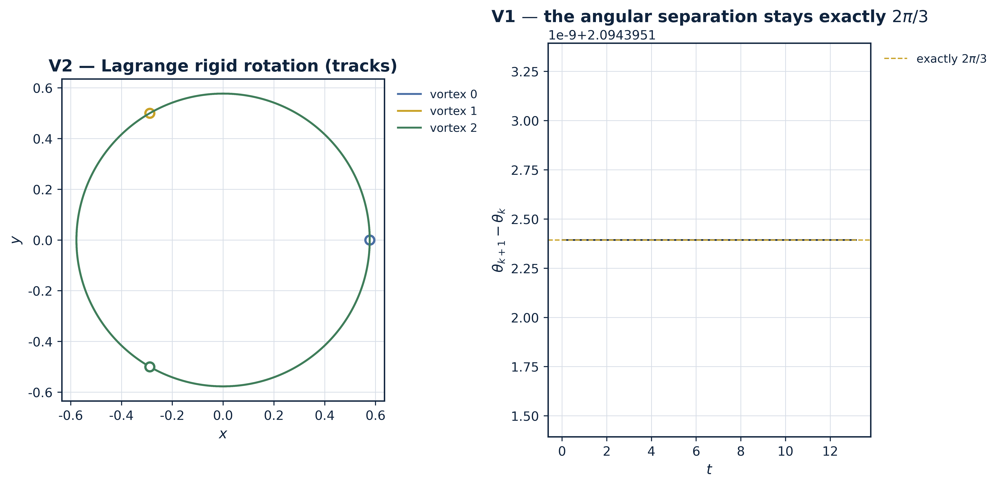
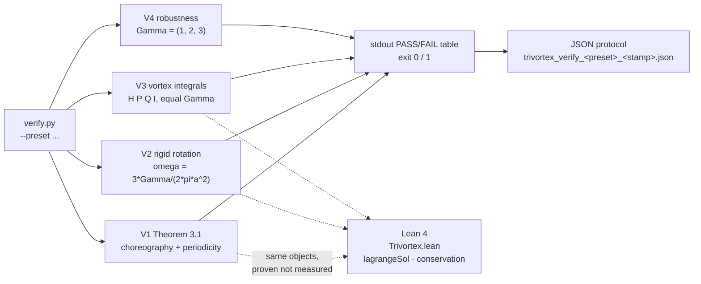

<!-- markdownlint-disable-file MD041 -->
<div align="center">

# 🐍 trivortex — рабочая лестница верификации (M0)


</div>

> **Навигация:** [`verification`](../README.md) › **`trivortex`**


Независимый нетребовательный к зависимостям проверяющий модуль документа
TRIVORTEX — **исходный объект верификации и веха M0 всего каркаса**.
`python/verify.py` заново выводит четыре утверждения, на которых держатся
Теорема 3.1 и топологический интеграл Чаплыгина, — с нуля, не разделяя
**ни строки кода** с `code/trivortex_core*.py`; `python/lab.py` —
интерактивная научная лаборатория вокруг тех же регистров. Все остальные
артефакты верификационного созвездия — pytest-охрана, порты Coq / Lean 4 /
Rust / Isabelle / Agda / C++ / Haskell — зеркалят именно *эту* лестницу.

## 📂 Содержимое — что здесь живёт

| Путь | Размер | Содержимое |
|---|---:|---|
| [`python/verify.py`](python/verify.py) | 17 911 Б | лестница V1–V4: проверки замкнутой формы, динамика Кирхгофа RK4, JSON-протокол, три пресета (469 строк, только numpy) |
| [`python/lab.py`](python/lab.py) | 35 483 Б | интерактивная научная лаборатория: пресетные и полностью настраиваемые прогоны, анализы сходимости и дрейфа, графики 600 dpi (874 строки) |
| [`python/sample-figures/choreography.png`](python/sample-figures/choreography.png) | 420 611 Б | закоммиченный образец: хореография жёсткого вращения Лагранжа |
| [`python/sample-figures/closed_form.png`](python/sample-figures/closed_form.png) | 657 387 Б | закоммиченный образец: замкнутая форма Теоремы 3.1 |
| [`python/sample-figures/dashboard.png`](python/sample-figures/dashboard.png) | 1 793 356 Б | закоммиченный образец: сводная панель лаборатории |
| [`README.md`](README.md) / [`README_RU.md`](README_RU.md) | — | этот обзор, EN + RU |

## 🧭 Почему это «независимая» верификация

`verify.py` не разделяет **никакого кода** с `code/trivortex_core*.py`.
Он заново реализует с нуля всё, что проверяет, — замкнутую форму
Теоремы 3.1, комбинацию Чаплыгина `C_Ch = r²(θ̇ − q·A_θ)`, правую часть
Кирхгофа для динамики точечных вихрей и собственный шаг RK4. Регрессия в
численной части основного документа поэтому не может спрятаться за общим
вспомогательным кодом: лестница либо воспроизводит утверждения своей
собственной арифметикой, либо громко падает (код выхода `1`).

Регистрация до измерения: каждая проверка несёт цель и допуск,
закоммиченные *до* записанного прогона — прошедшая проверка есть
утверждение, удержанное в опубликованной полосе, а не шумное измерение.

Полная формулировка проверок, полосы допусков, план вех и заметки о
честности живут в корне каркаса: [`verification/README.md`](../README.md).

## ✅ Проверки V1–V4

Лестница удостоверяет четыре утверждения. Каждое возвращает вердикт
`passed`, вычисленный против зарегистрированных допусков:

| # | Проверка | Что проверяется | Зарегистрированный допуск |
|---|---|---|---|
| **V1** | Теорема 3.1 — замкнутая форма | три вихря сохраняют точное угловое разделение `2π/3` во все пробные моменты (равносторонняя хореография), и замкнутая форма периодична: `r_k(t + T_r) = r_k(t)`, где `T_r = 2π/ω`, на окне `[0, 100·T]` | разделение `≤ 1e-12`, периодичность `≤ 1e-12` |
| **V2** | Жёсткое вращение треугольника Лагранжа | три равных вихря на равностороннем треугольнике со стороной `a` вращаются жёстко с аналитической угловой скоростью `ω = 3Γ/(2πa²)` — точечно-вихревой аналог классического равностороннего решения Лагранжа задачи трёх тел; измеренная RK4 величина `ω` обязана совпасть с аналитической, а треугольник — остаться равносторонним | дрейф формы `≤ 1e-10`, относительная ошибка `ω` `≤ 1e-6` |
| **V3** | Сохранение вихревых интегралов (равные Γ) | вдоль траектории V2 сохраняются классические инварианты: гамильтониан `H`, линейные импульсы `P = Σ Γ·x`, `Q = Σ Γ·y`, угловой импульс `I = Σ Γ·\|r\|²` — многочастичные интегралы типа Чаплыгина | относительный дрейф `≤ 1e-10` |
| **V4** | Устойчивость при неравных циркуляциях | при `Γ = (1, 2, 3)` (несимметричный, общий треугольник с центроидом в начале координат) все инварианты V3 сохраняются — интегралы не требуют симметричного начального условия | относительный дрейф `≤ 1e-10` |

Замкнутая форма, проверяемая в V1 (зеркало раздела 5 основного документа):

```text
r_k(t)     = sqrt(C_Ch) * (1 + eps * cos(omega*t + 2*pi*k/3))
theta_k(t) = omega*t + 2*pi*k/3
omega      = (2*pi/T) * exp(C_Ch/pi)
eps        = 1/(exp(C_Ch/pi) - 1)
```

**Граница честности.** Дополнительно V1 *записывает* дрейф на конце окна
калибровочно-зависимой комбинации `C_Ch(t) = r²(θ̇ − q·A_θ)` (с
`A_θ = 1/r`) — той самой величины из раздела 6 основного документа. Эта
комбинация колеблется по построению и зависит от окна; она печатается как
**диагностика, а не критерий Pass/Fail**. Не зависящие от окна
сохраняющиеся величины модели — вихревые интегралы, удостоверяемые V3/V4.
Полная заметка о честности — [§13 верификационного README](../README.md).

## ⚙️ Пресеты

| Пресет | `rotations` | `steps_per_period` | `n_points_cch` | Время | Кто использует |
|---|---:|---:|---:|---|---|
| `quick` | 2 | 2 000 | 200 | ≈ 0.5 с | CI (каждый push) |
| `default` | 5 | 4 000 | 1 000 | ≈ 2 с | локальные проверки |
| `full` | 20 | 8 000 | 2 000 | ≈ 35 с | валидация релизов |

<div align="center">

</div>

## 🚀 Как запустить

```bash
# быстрый smoke-прогон — то, что исполняет CI
python3 python/verify.py --preset quick

# лестница по умолчанию (~2 с) и длинное интегрирование (~35 с)
python3 python/verify.py
python3 python/verify.py --preset full

# явный каталог для JSON-отчёта
python3 python/verify.py --preset default --out-dir /tmp/trivortex
```

Без `--out-dir` JSON-отчёт попадает в `verification/outputs/trivortex/`.
Код выхода `0` = все проверки пройдены, `1` = хотя бы одна провалена.

Здоровый прогон заканчивается так:

```text
  RESULT: 4/4 checks passed  (preset=default, wall time 2.18s)
  JSON report: .../trivortex_verify_default_2026-10-06_06-20-11.json
```

## 🧪 JSON-протокол

Каждый прогон записывает один файл с UTC-датой, пресетом, временем работы
и пораздельными записями проверок (`check`, невязки, допуски, `passed`,
полный снимок параметров). Схема верхнего уровня намеренно плоская и
стабильная — `suite`, `version`, `preset`, `date_utc`, `wall_time_s`,
`checks_passed` / `checks_total`, `all_passed`, `checks[]` — так что один
и тот же читатель работает и для питонской лестницы, и для каждого
языкового порта (`verification/tests/test_ports.py` разбирает
закоммиченные протоколы портов против тех же полос). Прикладывайте JSON к
любому issue о проваленной проверке — снимок параметров делает сбой
воспроизводимым без единого уточняющего вопроса.

## 🔬 `lab.py` — интерактивная лаборатория

Пока `verify.py` — рабочая лошадка CI (один пресет, один JSON-протокол),
`lab.py` — стол исследователя вокруг тех же регистров. Он переиспользует
функции проверок лестницы и **никогда их не изменяет**: зарегистрированные
допуски и критерии [`verification/README.md`](../README.md) остаются
авторитетными; лаборатория добавляет только оптику, эргономику и анализ.
numpy обязателен, matplotlib — только для графиков; сессия безопасна при
EOF (Ctrl-D завершает работу чисто), поэтому батч- и CI-прогоны работают
без терминала.

| Меню | Пункт |
|---|---|
| 1 | запустить лестницу верификации V1–V4 (пресет) |
| 2 | свои параметры: `C_Ch`, `T`, `Γ`, `a`, обороты, шагов/период — с эхом вычисленных `ω`, `ε`, `ω_Лагранж` |
| 3 | анализ: исследование сходимости (ошибка измеренной `ω` от сетки) |
| 4 | анализ: сканирование дрейфа инвариантов `H`, `P`, `Q`, `I` по траектории |
| 5 | графики: полный набор в **600 dpi** (PNG + PDF + SVG) |
| 6 | графики: сводная панель одним взглядом (600 dpi) |
| 7 | отчёты: JSON-протокол + CSV-данные последнего прогона |
| 0 | выход |

Набор фигур: `fig1_closed_form`, `fig2_chaplygin` (диагностика раздела 6),
`fig3_choreography`, `fig4_convergence`, `fig5_robustness` (неравные
циркуляции), `fig6_invariants`, `fig7_dashboard` — каждая сохраняется в
зарегистрированном растровом разрешении `FIG_DPI = 600` в трёх форматах.

```bash
python3 python/lab.py                          # интерактивная сессия
python3 python/lab.py --lang ru                # русский интерфейс
python3 python/lab.py --no-menu --figures      # графики для пресета default
python3 python/lab.py --preset quick --no-menu # CI smoke (без графиков)
```

CI-задание `python-lab` в
[`verification-ports.yml`](https://github.com/wild8highlander/Trivortex/blob/main/.github/workflows/verification-ports.yml)
исполняет ровно этот smoke: быструю лестницу плюс dashboard в 600 dpi.

## 🖼 Образцы фигур

Три закоммиченных PNG — то, что рендерят лестница и лаборатория;
закоммичены, чтобы репозиторий показывал свои выводы без запуска чего-либо.
Это **документационные артефакты, а не регистры**: численная истина живёт
в JSON-протоколах.

<p align="center">
  
</p>

<p align="center">
  
  
</p>

## 🧩 Доказано в Lean 4 — машиночитаемый близнец

Аналитическое ядро этой лестницы — больше не только численность: порт на
Lean 4 ([`verification/lean4`](../lean4/README.md)) фиксирует ровно те
же объекты, что и `verify.py` (происхождение: коммит `557bff8`, релиз M0),
и **доказывает** их над Mathlib, причём аксиомный след каждой теоремы
замкнут ровно на `propext`, `Classical.choice`, `Quot.sound` (слой
утверждений v5.0, §1–§9; 145 утверждений `#print axioms`, ноль
`sorry`/`axiom`):

| Проверка на Python | Lean-аналог | Статус |
|---|---|---|
| V1 замкнутая форма: хореография `2π/3`, периодичность, положительность при `C_Ch > π·ln 2` | `theta_separation`, `r_periodic`, `theta_periodic`, `eps_pos`, `eps_lt_one`, `rClosed_pos` | ✅ доказано |
| V2 жёсткое вращение: `ω = 3Γ/(2πa²)` — точное решение Кирхгофа | `lagrangeSol` (+ `lag_kx0…lag_ky2`), якоря `H = 0, P = 0, Q = 0, I = Γ` на всё время (`lagrange_anchor_H/P/Q/I`) | ✅ доказано |
| V3/V4 интегралы сохраняются | `P/Q/I/H_kirchhoff_deriv` + `_conserved` — вдоль *любого* решения Кирхгофа, при *любых* циркуляциях | ✅ доказано |

Численная лестница и формальный порт согласованы по построению на одних и
тех же определениях — лестница измеряет то, что Lean доказывает. Пин
тулчейна: Lean 4 v4.6.0 с тегом Mathlib `v4.6.0`.



## 🔗 Перекрёстные ссылки

- [`verification/README.md`](../README.md) — корень каркаса: полные формулировки проверок, обоснование допусков, вехи, заметки о честности
- [`trivortex/python/`](python/README.md) — два скрипта этой лестницы подробно
- [`verification/lean4/`](../lean4/README.md) — машиночитаемый близнец аналитического слоя
- [`verification/tests/`](../tests/README.md) — pytest-охрана из 63 тестов (206 программных тестов проходят по всей программе)
- Сам проверяемый объект: `code/trivortex_core*.py` — исполняемый документ из 22 разделов

---

<div align="center">

**[⬆ Наверх](#-trivortex--рабочая-лестница-верификации-m0)** ·
**[verification](../README.md)** ·
**[Корень репозитория](../../README.md)**

*Часть [wild8highlander/Trivortex](https://github.com/wild8highlander/Trivortex) · Лицензия [IPL-RP-1.0](https://github.com/wild8highlander/Trivortex/blob/main/LICENSE.md) — All Rights Reserved*

</div>
