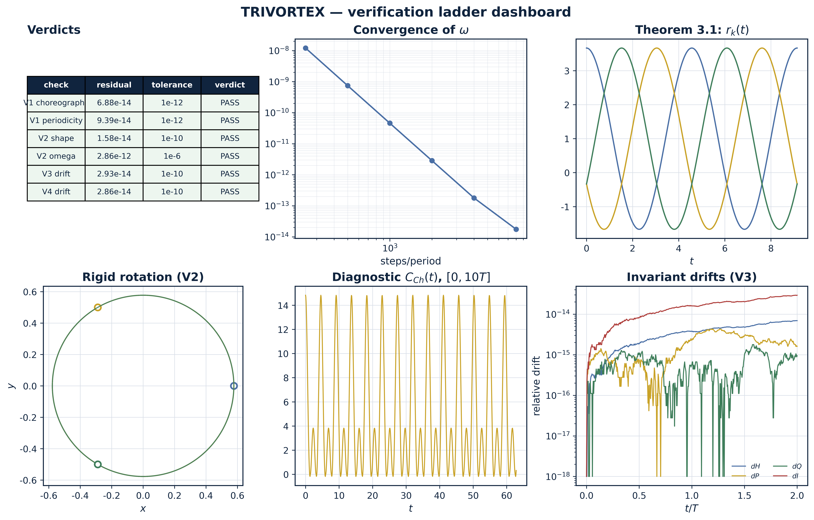
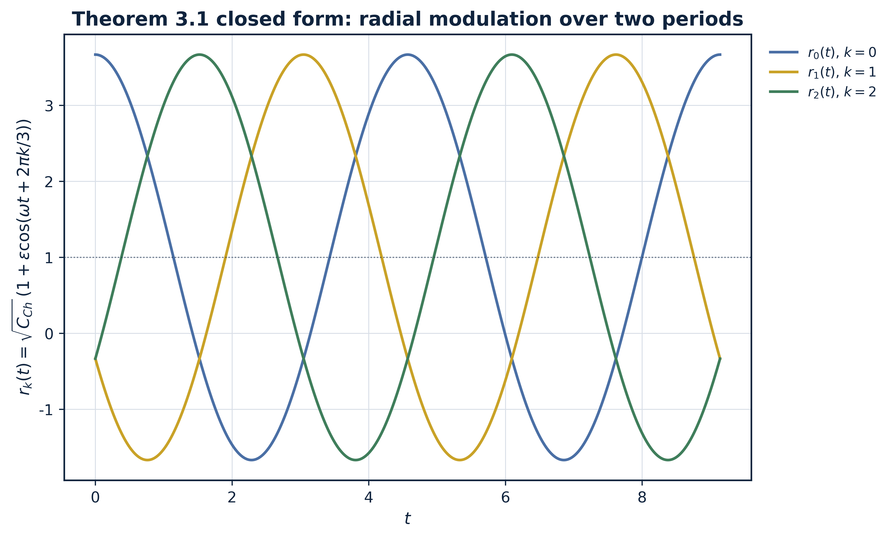
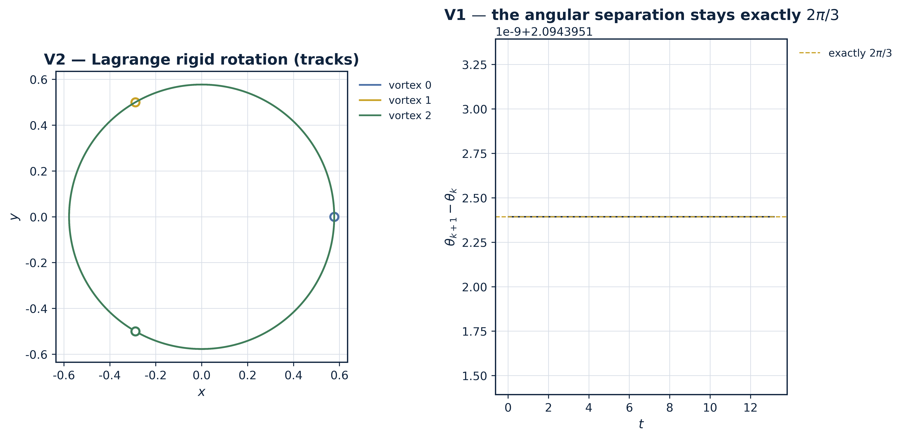

<!-- markdownlint-disable-file MD041 -->
<div align="center">

# 🐍 python — the Ladder and the Laboratory

</div>

> **Navigation:** [`verification`](../../README.md) › [`trivortex`](../README.md) › **`python`**


The reference implementation of the verification program: `verify.py`
is the independent V1–V4 ladder the whole repository's CI keys on, and
`lab.py` is the interactive laboratory that walks the same registers
step by step. Together they are milestone **M0** — the original object
that every language port mirrors (see the machine-checked sibling,
[`verification/lean4`](../../lean4/README.md)).

## 📂 Contents — What Lives Here

| File | Size | Description |
|---|---:|---|
| [`verify.py`](verify.py) | 17,911 B | the V1–V4 ladder: closed-form checks, Kirchhoff RK4 dynamics, JSON protocol, three presets |
| [`lab.py`](lab.py) | 35,483 B | the interactive scientific laboratory: analyses, 600 dpi figures, CSV |
| [`sample-figures/choreography.png`](sample-figures/choreography.png) | 420,611 B | committed sample render: the Lagrange choreography |
| [`sample-figures/closed_form.png`](sample-figures/closed_form.png) | 657,387 B | committed sample render: the Theorem 3.1 closed form |
| [`sample-figures/dashboard.png`](sample-figures/dashboard.png) | 1,793,356 B | committed sample render: the one-glance lab dashboard |

## `verify.py` — the independent ladder

Re-implements — **from scratch, sharing no code with the document** —
everything it checks: the closed form, the Chaplygin combination
`C_Ch = r²(θ̇ − q·A_θ)`, the Kirchhoff right-hand side, its own RK4
stepper. numpy-only, three presets:

| preset | `rotations` / `steps_per_period` / `n_points_cch` | wall time | used by |
|---|---|---|---|
| `quick` | 2 / 2,000 / 200 | ≈ 0.5 s | CI (every push, job in `ci.yml`) |
| `default` | 5 / 4,000 / 1,000 | ≈ 2 s | local checks |
| `full` | 20 / 8,000 / 2,000 | ≈ 35 s | release validation |

```bash
python3 verify.py --preset quick --out-dir ../../outputs/trivortex
```

Every run writes a JSON protocol with the recorded residuals and the
full parameter snapshot; CI archives it as an artifact. The registered
criteria (V1 choreography + periodicity, V2 rigid rotation at
`ω = 3Γ/(2πa²)`, V3/V4 integral conservation) and the honesty boundary
of the Chaplygin diagnostic — recorded, window-dependent, *not* a
pass/fail criterion — are documented in the
[verification README](../../README.md).

## `lab.py` — the interactive laboratory

The researcher's bench around the same registers: preset or fully custom
runs (`C_Ch`, `T`, `Γ`, `a`, rotations, steps/period — with the computed
`ω`, `ε`, `ω_Lagrange` echoed), a convergence study (`ω` error vs grid),
an invariant-drift scan of `H`, `P`, `Q`, `I`, publication-grade figures
at **600 dpi** in three formats (PNG + PDF + SVG): the closed form, the
Chaplygin diagnostic, the choreography, convergence, unequal-circulation
robustness, invariant drifts, and the one-glance dashboard — plus a JSON
protocol and CSV data for every run. Bilingual (EN/RU, `--lang en|ru`);
EOF-safe (Ctrl-D exits cleanly); runs with no arguments and needs only
numpy (matplotlib only for figures). It re-imports the ladder's check
functions and never modifies them.

```bash
python3 lab.py --lang ru               # интерактивная сессия
python3 lab.py --preset quick --no-menu # CI smoke (no figures)
```

The CI job `python-lab` runs `lab.py --smoke`: the quick ladder plus the
600 dpi dashboard on every push of
[`verification-ports.yml`](https://github.com/wild8highlander/Trivortex/blob/main/.github/workflows/verification-ports.yml).

## `sample-figures/` — the committed samples

Three committed PNGs ([`choreography.png`](sample-figures/choreography.png),
[`closed_form.png`](sample-figures/closed_form.png),
[`dashboard.png`](sample-figures/dashboard.png)) — what the ladder and
the lab render, committed so the repository shows its outputs without
running anything. They are documentation artifacts, not registers; the
numeric truth lives in the JSON protocols.

<p align="center">
  
</p>

<p align="center">
  
  
</p>

## 🔗 Cross-References

- [`trivortex/`](../README.md) — the ladder's home in the framework (M0)
- [`verification/README.md`](../../README.md) — full check statements, tolerance bands, honesty notes
- [`verification/lean4/`](../../lean4/README.md) — the analytic core of V2/V3/V4 proven in Lean (`lagrangeSol`, conservation of `H/P/Q/I`, `#print axioms` closed)
- [`verification/tests/`](../../tests/README.md) — the pytest guard of this ladder

## 🇷🇺 Краткое резюме (Russian Summary)

- `verify.py` (469 строк) — независимая лестница V1–V4: замкнутая форма Теоремы 3.1, жёсткое вращение Лагранжа (`ω = 3Γ/(2πa²)`), сохранение интегралов `H, P, Q, I` при равных и неравных циркуляциях; три пресета (quick ≈ 0.5 с, default ≈ 2 с, full ≈ 35 с), JSON-протокол со снимком параметров, коды выхода 0/1;
- `lab.py` (874 строки) — интерактивная лаборатория: свои параметры с эхом `ω`, `ε`, `ω_Лагранж`, анализы сходимости и дрейфа инвариантов, графики fig1–fig7 в 600 dpi (PNG + PDF + SVG), JSON + CSV на каждый прогон, двуязычный интерфейс (EN/RU), безопасна при EOF;
- `sample-figures/` — три закоммиченных образца рендеров (документация, не регистры; численная истина — в JSON-протоколах);
- аналитическое ядро V2/V3/V4 доказано в Lean 4 (`lagrangeSol`, законы сохранения, след аксиом замкнут).

---

<div align="center">

**[⬆ Back to top](#-python--the-ladder-and-the-laboratory)** ·
**[trivortex](../README.md)** ·
**[Repository root](../../../README.md)**

*Part of [wild8highlander/Trivortex](https://github.com/wild8highlander/Trivortex) · Licensed under [IPL-RP-1.0](https://github.com/wild8highlander/Trivortex/blob/main/LICENSE.md) — All Rights Reserved*

</div>
