<!-- markdownlint-disable-file MD041 -->
<div align="center">

# 🧭 trivortex_master — the Pure-Python N-body Laboratory

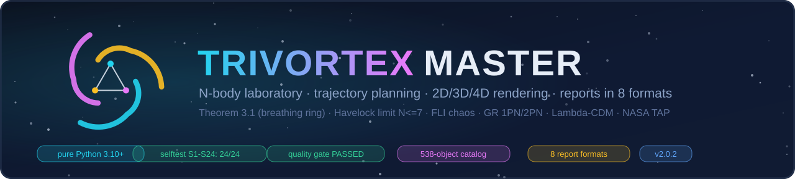

</div>

> **Navigation:** [`verification`](../README.md) › **`trivortex_master`**


**TRIVORTEX MASTER** is a pure-Python N-body laboratory: trajectory
planning, physics from Newtonian RK4 to post-Newtonian GR, 2D/3D/4D
rendering, animations, and eight report formats — with a zero-dependency
core (stdlib-first). Every external package (numpy, matplotlib,
REBOUND, …) is optional: it accelerates and enriches, but never blocks
a launch. Every claim is pinned to a test with an independent reference.

> **v2.0.2 (2026-11-24)** — documentation release: all READMEs are now
> **English**, the acceptance check A10 is language-neutral, and the asset
> gallery gains three new real-run charts (Poincare sections, the
> Lambda-CDM distance ladder, an HR view of the 25 brightest stars).
> The v2.0.1 code fixes stand: `TestResult.check` no longer resurrects a
> failed test, S9 verifies the admissible domain of Theorem B
> (`C_Ch > pi*ln2`) and detects the degenerate default, and the sky map
> uses dependency injection (S3-clean). Full quality gate — **PASSED**,
> see the [run log](docs/assets/quality_gate_log.txt).
>
> The code state has moved on since this README surface: the
> [CHANGELOG](CHANGELOG.md) records **v2.0.3** (pyflakes-zero, docstring
> coverage 100% — 1040/1040 public definitions), and the entry-point
> banner and `build_zip.py` carry the same version.

## 📂 Contents — What Lives Here

| File / folder | Size | Contents |
|---|---:|---|
| [`trivortex_master.py`](trivortex_master.py) | 47,960 B | the single entry point: interactive menu (ACLL banner), CLI, engine injection |
| [`trivortex_master_single.py`](trivortex_master_single.py) | 1,641,348 B | the single-file edition: all 110 package modules glued into one executable file |
| [`trivortex_master_single.jl`](trivortex_master_single.jl) | 2,290,898 B | the Julia single-file edition (v2.2.0-jl "SIGNAL EDITION": own palette, RU/EN i18n, HUD monitor) |
| [`build_zip.py`](build_zip.py) | 5,614 B | dist build: preflight → selftest → ZIP + manifest |
| [`CHANGELOG.md`](CHANGELOG.md) | 20,665 B | the version history (v1.0.0 → v2.0.3) |
| [`LICENSE`](LICENSE) | 1,815 B | IPL-RP-1.0 |
| [`trivortex_bundle.zip`](trivortex_bundle.zip) | 15,383 B | a committed distribution bundle |
| [`core/`](core/README.md) · [`lab/`](lab/README.md) · [`realism/`](realism/README.md) · [`render/`](render/README.md) · [`reports/`](reports/README.md) · [`analysis/`](analysis/README.md) · [`tools/`](tools/README.md) | — | the package layers (see [Repository layout](#-repository-layout)) |
| [`data/`](data/README.md) · [`docs/`](docs/README.md) · [`runs/`](runs/README.md) | — | catalog + presets, release notes + asset gallery, run protocols + session logs |

## 🚀 Quick start

```bash
# package edition (recommended for development)
python3 trivortex_master.py                 # interactive menu (ACLL banner)
python3 trivortex_master.py --selftest      # structural tests S1-S24
python3 trivortex_master.py --preset inner_solar --simulate --render --report
python3 trivortex_master.py --banner-only   # banner only

# single-file edition (all 110 modules in one file)
python3 trivortex_master_single.py --selftest
python3 trivortex_master_single.py --preset figure_eight --simulate --gif

# full CI loop
python3 tools/quality_gate.py               # selftest + acceptance + 49 checks + hygiene
python3 build_zip.py                        # dist/trivortex_master_v2.0.2.zip + manifest
```

**Requirements: Python 3.10+ and nothing else.** Optional accelerators —
`numpy` `scipy` `matplotlib` `imageio` `rebound` `dedalus` `psutil` —
each engine reports its status in the menu ("Help -> Engine status").

<details>
<summary><b>Optional accelerators — what each one unlocks</b></summary>

| Package | What it unlocks | Fallback without it |
|---|---|---|
| `numpy` | vectorized kernels where meaningful | pure-Python loops |
| `matplotlib` | the `mpl` render backend, 2D/3D/4D plots | ASCII + pure-raster backends |
| `imageio` / `ffmpeg` | MP4 animation export | GIF via the own LZW codec |
| `rebound` | the REBOUND engine comparison in S8 | native Newtonian RK4 |
| `dedalus` | fluid-flow adapters | adapter stays dormant |
| `psutil` | HUD system monitor (CPU/RAM/temp/IO) | telemetry line disabled |
| `openpyxl` / `python-pptx` | *read-side validation* of our stdlib XLSX/PPTX | validation via zip/XML inspection |

</details>

## 🧭 Feature matrix

| Area | How it is implemented |
|---|---|
| **N-body lab** | 20 presets (Solar System, Lagrange, figure-eight, vortex rings, Barnard's system from NASA TAP, Laplace resonance) + manual scene assembly |
| **Body range** | N = 3..7; N = 8 only with `allow_unphysical` (Havelock threshold, POLYVORTEX W4: max Re lambda = +0.4502); N >= 9 hard-refused |
| **Physics** | Newtonian gravity RK4 (+ dissipation), Kirchhoff vortices with H/P/Q/I integrals, Barnes-Hut O(N log N), 1PN/2PN relativity, tides, radiation, CR3BP, Hamiltonian split integrators of orders 2/4/6, spacecraft (quaternions/reaction wheels/PID) |
| **Trajectories** | planners: Theorem 3.1 (omega = 1.3748022274393588), Lagrange 1772, Chenciner-Montgomery figure-eight, Keplerian orbits, waypoints + Catmull-Rom splines |
| **Rendering** | 4 engines: `ascii` (truecolor terminal), `pure` (own 3D rasterizer: 4x4 matrices, scanline, z-buffer, Lambert + Blinn-Phong), `mpl` (2D/3D/4D), `gl` (optional); a software raytracer with shadows and reflections; particles; cinematic cameras |
| **Codecs** | own PNG encoder (CRC32, Paeth/Sub/Up filters, fixed-Huffman DEFLATE, x88 vs naive) and a GIF-LZW encoder (GIF89a, NETSCAPE loop) — no Pillow/imageio required |
| **Reports** | TXT, MD, HTML (AURORA/ICE/MINIMAL themes), CSV, JSON, DOCX, PDF 1.4, XLSX, PPTX, ODT — OOXML/ODF written in pure stdlib |
| **Catalog** | 538 objects, each with a source URL: 98 static entries + 440 NASA TAP exoplanets (cached in `data/cache/`) |
| **Analysis** | selftest S1-S24 against independent references; Metropolis MCMC (Gelman-Rubin R-hat), Lomb-Scargle, BLS transits, TTV, Morlet wavelets, entropies + surrogates, IOD, HCM families |
| **Realism** | Lambda-CDM (Planck-18), space weather, observatory, TLE (NORAD checksums), Horizons API with an offline fallback, almanac (Saros), the 25 brightest Hipparcos stars |

## 📊 Real results

Every chart below was computed by **this code** from real runs; the
generation scripts live in the development repo, the ready files in
`docs/assets/`.

### Scene presets — RK4 trajectories

<p align="center">
  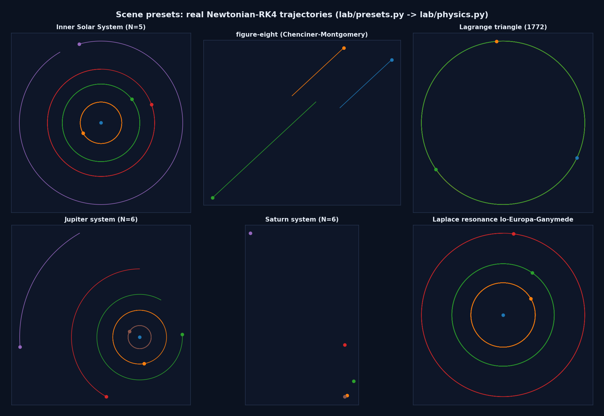
</p>

### Theorem 3.1 "breathing ring" — the fixed test S9

The closed form is non-degenerate only for **C_Ch > pi*ln2 ~ 2.1776**
(Theorem B of the polyvortex monograph): there eps < 1 and radii stay
positive. The core default C_Ch = 1 sits *below* the threshold — the
curve degenerates into a limacon with an inner loop. Before v2.0.1 the
S9 test checked the 2*pi/3 separation exactly in that degenerate point
and "miraculously" passed due to the `TestResult.check` bug; now **both**
domains are verified and the threshold is detected explicitly.

<p align="center">
  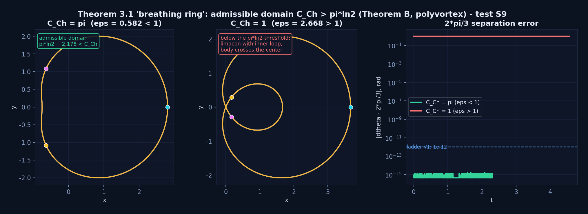 pi*ln2" width="96%"/>
</p>

<p align="center">
  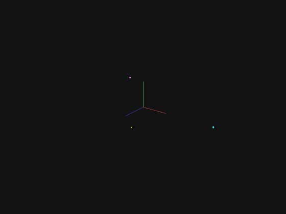
  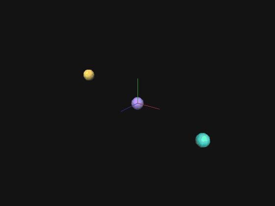
</p>

<p align="center"><i>GIFs encoded by the package's own LZW codec (render/animator.py)</i></p>

### The Havelock limit N<=7 / N=8

A ring scan with 2% positional jitter: the N=8 deformation grows ~30x
over the stable rings — the numerical twin of POLYVORTEX stage W4. That
is why N=8 in MASTER requires the explicit `allow_unphysical` flag.

<p align="center">
  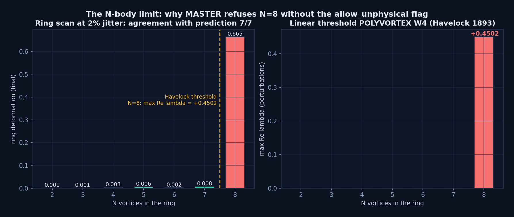
</p>

### Chaos: FLI and Poincare sections

<p align="center">
  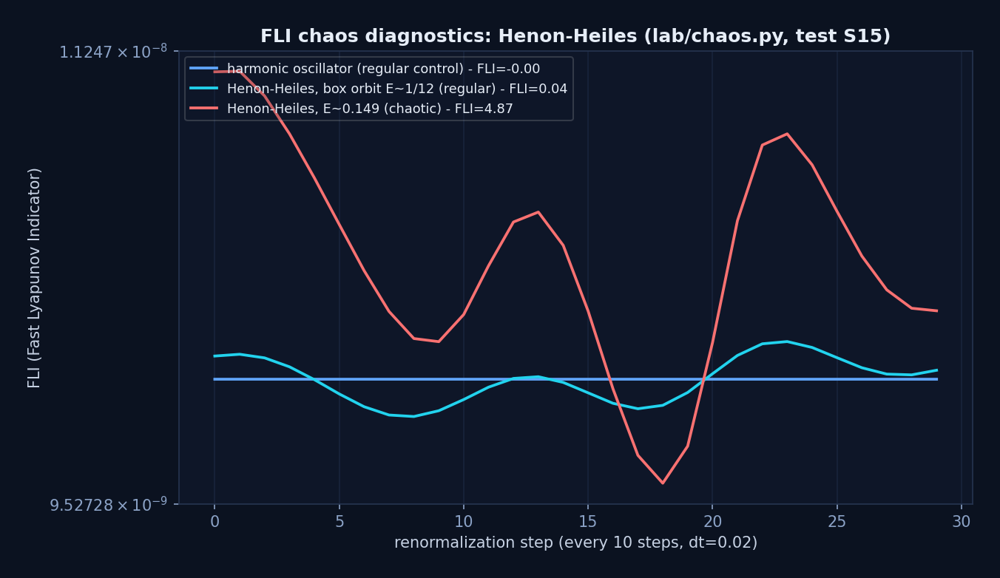
  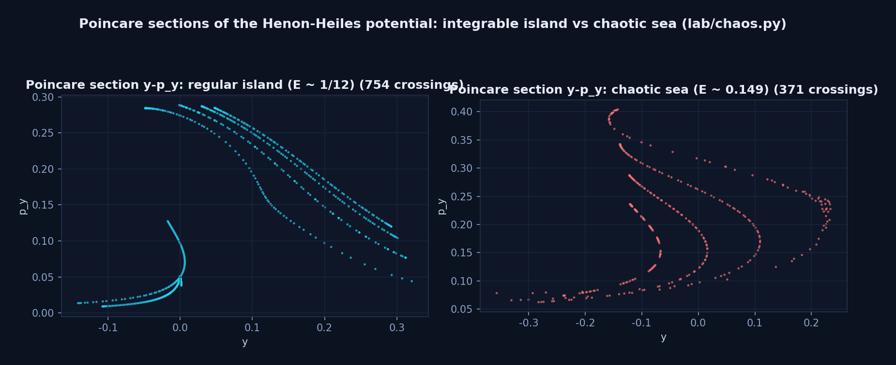
</p>

### Physics vs observations

| Quantity | MASTER | Reference | Test |
|---|---|---|---|
| Mercury perihelion (1PN) | 42.98"/century | 42.98"/century (GR) | S13 |
| Lunar recession | 3.80 cm/yr | 3.82 cm/yr (LLR) | S17 |
| TRAPPIST-1e T_eq | 250 K | 249 K (Gillon 2017) | S19 |
| RK4 energy drift | 3.5e-16 | <= 1e-6 | S7 |
| Kirchhoff integrals | <= 1e-11 | <= 1e-10 (ladder V3/V4) | S5/S6 |

<p align="center">
  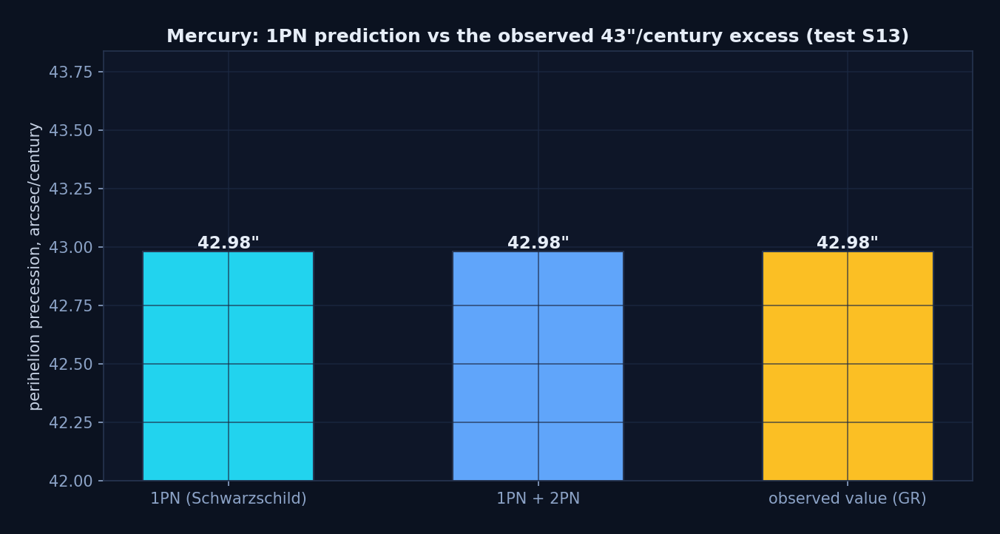
  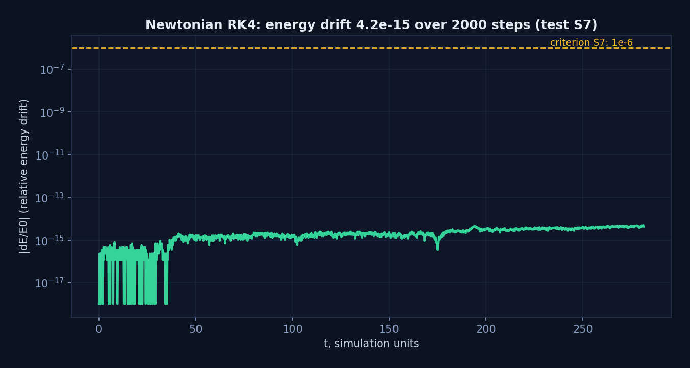
</p>

<p align="center">
  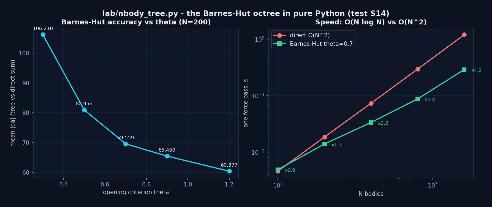
  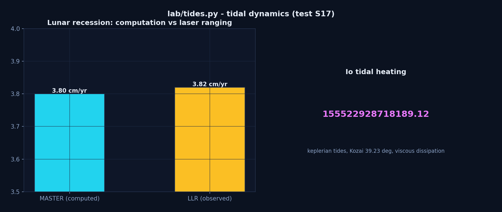
</p>

### Rendering with the package's own engines

<p align="center">
  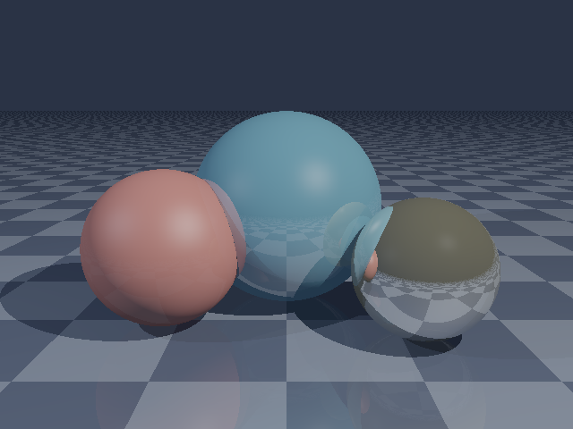
  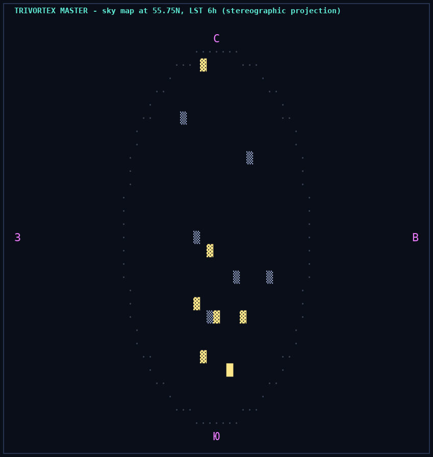
</p>

<p align="center">
  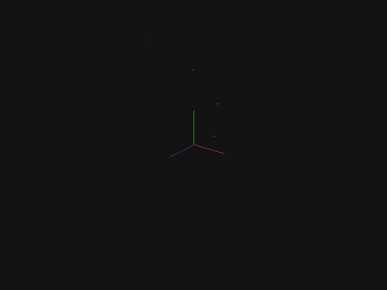
  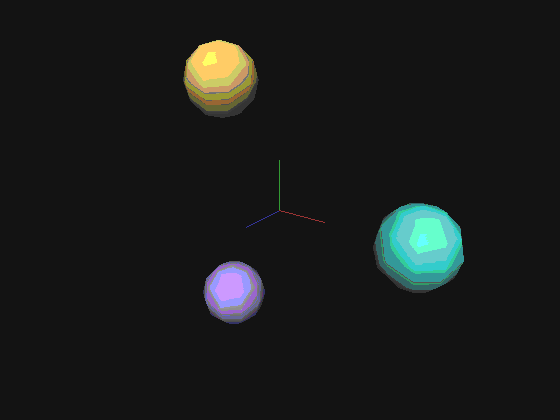
</p>

### The 538-object catalog and the sky

<p align="center">
  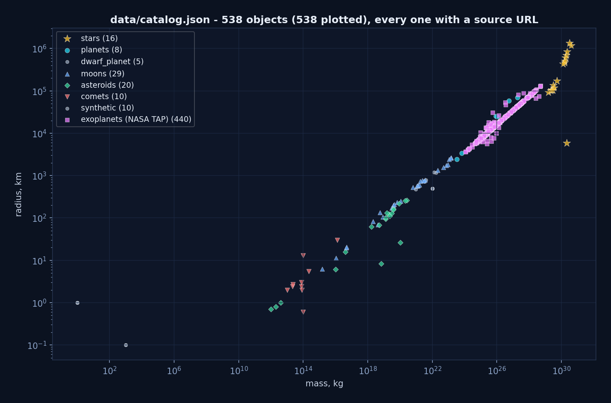
  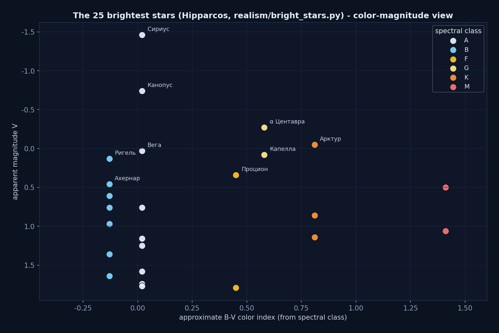
</p>

### Cosmology and data analysis

<p align="center">
  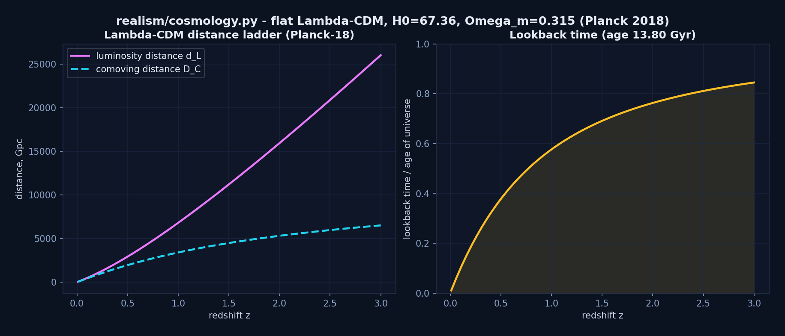
  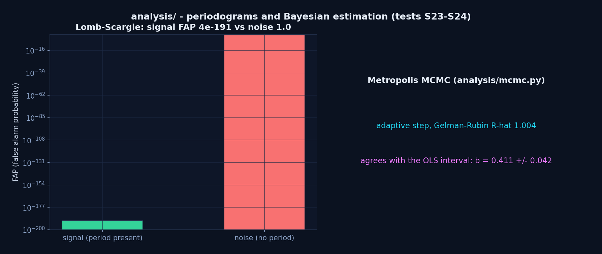
</p>

## 📦 Single-file edition — `trivortex_master_single.py`

All 110 package modules glued into **one executable file** (27.8k lines;
"linker-glue" architecture: blocks are verbatim, package imports resolve
through `sys.modules`, name duplicates canonicalized). CLI-equivalent to
the package, including the selftest, the menu, and the quality gate.

```text
$ python3 trivortex_master_single.py --selftest
  [OK] S1 scene structure
        presets without problems: 19/19 (+1 unphysical preset skipped by flag)
  [OK] S9 Theorem 3.1 planner: 2*pi/3 choreography
        omega = 1.3748022274394 (reference 1.3748022274394)
        2*pi/3 separation at C_Ch=pi>pi*ln2: error 1.8e-15 (eps=0.582<1, ladder V1: <=1e-12)
        pi*ln2 threshold confirmed: C_Ch=1 (eps=2.668>1) degenerate - limacon with a loop
        r periodicity: 2.4e-15 <= 1e-12
  ...
  [OK] S24 wavelets + fitting: chirp and a Gaussian peak
TOTAL: 24/24 PASSED
```

Full log: [docs/assets/selftest_log.txt](docs/assets/selftest_log.txt) ·
banner: [docs/assets/banner_only_output.txt](docs/assets/banner_only_output.txt)

A Julia sibling lives next to it: [`trivortex_master_single.jl`](trivortex_master_single.jl)
(v2.2.0-jl "SIGNAL EDITION" — own traffic-light/gold palette, RU/EN i18n,
two-column book menu, live HUD monitor; zero new packages).

## 🏛 Architecture

Import directions are strictly one-way and verified by test S3
(acyclicity + layer rules). Since v2.0.1 the sky map
`render/ascii_sky.py` receives its star catalog through **dependency
injection**: the `realism` layer hands over the catalog and the
coordinate transforms via `bind_astronomy()` — the same pattern as
`register_engine()` for the REBOUND/Dedalus adapters.

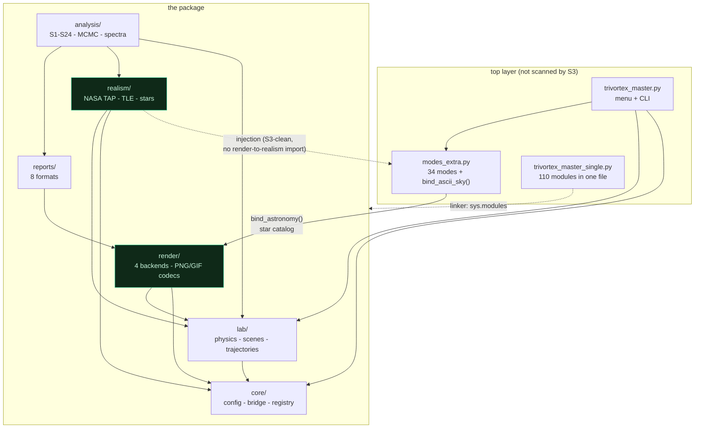

And the one-run pipeline — from a preset to renders, reports and the
audit journal in `runs/`:

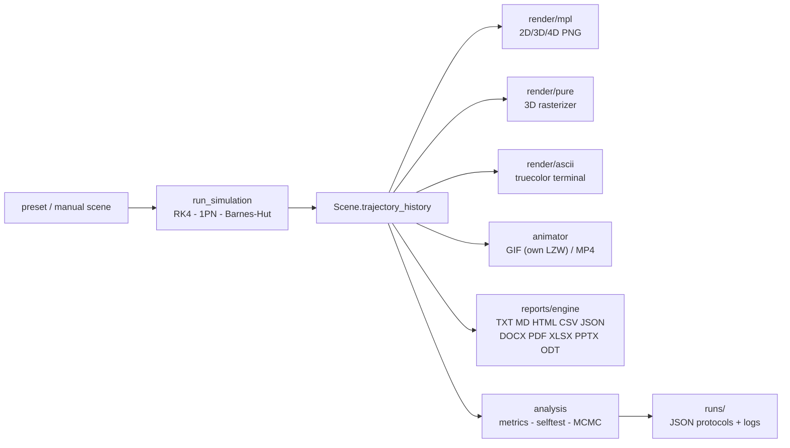

## 🧪 The verification ladder

Every claim of the complex is pinned to a test with an independent
reference:

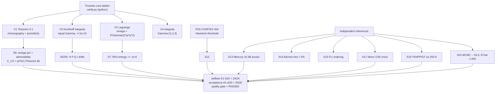

The real log of the full CI loop (selftest + acceptance + 49 module
checks + hygiene over 117 files): **[docs/assets/quality_gate_log.txt](docs/assets/quality_gate_log.txt)** —
TOTAL: `PASSED`, exit code 0. The machine-readable snapshot of the same
loop is [`runs/quality_gate.json`](runs/quality_gate.json).

## 🎛 Menu & CLI

The launch menu exposes **73 modes in 11 categories** (Laboratory,
Visualization, Simulations, Animations, Analysis, Science, Render,
Reports, Tools, Settings, Help). Batch mode without a tty (cron/CI) is
supported: EOF on any question selects the default.

```text
CLI flags: --selftest - --preset <id> - --simulate - --steps N - --render
           --gif - --report - --profile <p> - --allow-unphysical
           --banner-only - --no-color
```

## ⚙️ Profiles

| Profile | Purpose |
|---|---|
| `quick` | instant runs (ascii, 400 steps) |
| `standard` | balanced (auto backends) |
| `realistic` | SI gravity, 1PN relativity, REBOUND when present, NASA data |
| `research` | all 8 report formats, 6000 steps |
| `cinematic` | 1920x1080, long animations |
| `pure_stdlib` | guaranteed: no external packages, no network |

## 🔗 Link with the Trivortex core

The complex inherits the results of the parent repository
[wild8highlander/Trivortex](https://github.com/wild8highlander/Trivortex):

- **Theorem 3.1** — the closed form of the three-vortex problem
  (omega = (2*pi/T)*e^(C_Ch/pi) = 1.3748022274393588 at C_Ch=1, T=2*pi;
  values follow the core code `verification/trivortex/python/verify.py`):
  embedded in the planner `AnalyticPlanner.theorem31()` and pinned by S9;
- **Ladder V1-V4** — the Kirchhoff-integral conservation criteria are
  reproduced in tests S5/S6. The analytic core of those checks is now
  **proven in Lean 4** as well — [`verification/lean4`](../lean4/README.md):
  `lagrangeSol` (the exact rotating triangle) and the conservation laws of
  `H/P/Q/I`, with every theorem's `#print axioms` footprint closed;
- **POLYVORTEX W4** — the Havelock threshold N<=7/N=8
  (max Re lambda = +0.4502): the rationale behind the body limit and the
  "Havelock rings" field scan;
- **Theorem B (polyvortex)** — the admissibility threshold of the closed
  form C_Ch > pi*ln2 ~ 2.1776 (eps = 1 exactly at the threshold): since
  v2.0.1 recorded in the planner metadata (`admissible`) and verified
  by S9.

The inherited object itself is the core **22-section executable document**
(`code/trivortex_core*.py`) with its interactive menu and report engine.

If a copy of the repository is present (or `TRIVORTEX_HOME` is set), the
bridge `core/bridge.py` connects the core and its verify.py ladder;
otherwise MASTER runs autonomously (status in "Help -> Engine status").

## 📁 Repository layout

| Folder | Contents | README |
|---|---|---|
| `core/` | configuration, profiles, the core bridge, mode registry | [core/README.md](core/README.md) |
| `lab/` | N-body physics: 27 modules from RK4 to GR and chaos | [lab/README.md](lab/README.md) |
| `realism/` | real data: NASA TAP, TLE, Horizons, cosmology | [realism/README.md](realism/README.md) |
| `render/` | 4 render engines, own PNG/GIF codecs, raytracer | [render/README.md](render/README.md) |
| `reports/` | 8-format reports in pure stdlib | [reports/README.md](reports/README.md) |
| `analysis/` | tests S1-S24, MCMC, spectra, field studies | [analysis/README.md](analysis/README.md) |
| `tools/` | catalog/dist builds, quality gate, export | [tools/README.md](tools/README.md) |
| `data/` | 538-object catalog, presets, literature, TAP cache | [data/README.md](data/README.md) |
| `docs/` | releases, API, the README asset gallery | [docs/README.md](docs/README.md) |
| `runs/` | run protocols and session logs | [runs/README.md](runs/README.md) |
| `trivortex_master_single.py` | single-file edition (110 modules) | — see the section above |

## ⚠️ Honest limitations

- comet-nucleus masses are literature estimates (flagged `mass_estimated: true`);
- the own PDF writer uses core-14 fonts: Cyrillic is transliterated
  (install fpdf2 for a Unicode PDF);
- a *noise-free* vortex ring of N=8 does not fall apart numerically —
  the instability is linear and needs a perturbation (flagged
  `unstable*` in the Havelock scan);
- the Theorem 3.1 closed form is degenerate at C_Ch <= pi*ln2 (a
  limacon with an inner loop) — the core default C_Ch=1 lies below the
  threshold; this is a registered fact of the polyvortex monograph
  (Theorem B), detected by S9 and the `admissible` metadata field
  since v2.0.1;
- the parent Trivortex README carried a tabular epsilon value corrected
  on 2026-11-23 to 2.6680737914285615 = 1/(e^(1/pi)-1); MASTER always
  follows the core *code*.

## ❓ FAQ

<details>
<summary><b>Does it really run without numpy?</b></summary>

Yes — that is the stdlib-first contract, and it is *tested*: acceptance
A1 launches the package with accelerators unavailable and the
`pure_stdlib` profile pins it. Optional packages only widen the
feature set (see the collapsible table above).

</details>

<details>
<summary><b>Why is N=8 forbidden by default?</b></summary>

Linear stability: an N-point equal-vortex ring is stable for N<=7 and
unstable from N=8 (Havelock 1893; POLYVORTEX W4 pins max Re lambda =
+0.4502). MASTER makes physics explicit: N=8 requires the
`allow_unphysical` flag and is marked as such in every report; N>=9 is a
hard refusal (test S12).

</details>

<details>
<summary><b>How do I add my own scene preset?</b></summary>

`tools/extend_presets.py` merges a JSON preset into
`data/presets_scenes.json` (validated by S1 on the next selftest run),
or build a scene in code: `Scene(config=cfg)` + `add_body(Body(...))`.

</details>

<details>
<summary><b>Are the GIFs really produced without Pillow?</b></summary>

Yes — `render/animator.py` implements GIF89a with its own LZW compressor
and the NETSCAPE loop extension; `render/png_codec.py` likewise writes
PNG with CRC32, row filters, and fixed-Huffman DEFLATE. The binary
outputs decode cleanly under PIL (verified in render contracts, S10).

</details>

## 🗺 Roadmap

| Version | Items |
|---|---|
| v2.0.x | language-neutral CI surface (done in 2.0.2) |
| v2.1 | WebGL export of the pure-raster backend; symmetric symplectic integrators for the vortex engine |
| v2.2 | multi-run ensemble sweeps with parallel workers |

## 🤝 Contributing

1. Fork, branch (`feat/my-change`).
2. Keep the layer rules: `core -> nothing`, `lab -> {core, lab}`,
   `render -> {core, lab}`, `reports -> {render}`, `realism -> {core, lab}`,
   `analysis -> anything`. Test S3 enforces this.
3. Every new claim needs a `self_check()` with an independent reference,
   and a line in `tools/quality_gate.py`.
4. `python3 tools/quality_gate.py` must exit 0 before you push.
5. Follow the honest-limitations style: unknown = "estimated", never
   silently invented.

## 📜 License

IPL-RP-1.0 (as the Trivortex core) — see [LICENSE](LICENSE).

## 🇷🇺 Краткое резюме (Russian Summary)

- **trivortex_master** — чисто питоновская лаборатория N тел: планирование траекторий, физика от ньютоновского RK4 до постньютоновской ОТО, рендеринг 2D/3D/4D, анимации и восемь форматов отчётов; ядро — чистый stdlib, все внешние пакеты опциональны;
- качество приколото к тестам: selftest S1–S24 = 24/24, acceptance A1–A20 = 20/20, quality gate 49/49 + гигиена 117 файлов — PASSED (журнал и машинный протокол в `runs/quality_gate.json`);
- каталог из 538 объектов (98 статических + 440 экзопланет NASA TAP), у каждой записи — URL источника; 20 пресетов сцен; меню на 73 режима в 11 категориях; профили `quick` … `pure_stdlib`;
- физика сверена с независимыми ссылками: Меркурий 42.98″/век (S13), отступание Луны 3.80 см/год (S17), TRAPPIST-1e 250 K (S19), дрейф энергии RK4 3.5e-16 (S7), интегралы Кирхгофа ≤ 1e-11 (S5/S6);
- лимит тел — физика, а не конвенция: кольцо равных вихрей устойчиво при N ≤ 7 и неустойчиво с N = 8 (Хавелок 1893; POLYVORTEX W4, max Re lambda = +0.4502), N = 8 — только с `allow_unphysical`;
- наследует ядро Trivortex: Теорема 3.1 (omega = e^(1/pi) = 1.3748022274393588), лестница V1–V4, порог Хавелока и Теорема B (`C_Ch > pi·ln2`); аналитическое ядро теперь доказано и в Lean 4 (`verification/lean4`).

---

<div align="center">

**[⬆ Back to top](#-trivortex_master--the-pure-python-n-body-laboratory)** ·
**[verification](../README.md)** ·
**[Repository root](../../README.md)**

*Part of [wild8highlander/Trivortex](https://github.com/wild8highlander/Trivortex) · Licensed under [IPL-RP-1.0](https://github.com/wild8highlander/Trivortex/blob/main/LICENSE.md) — All Rights Reserved*

</div>
