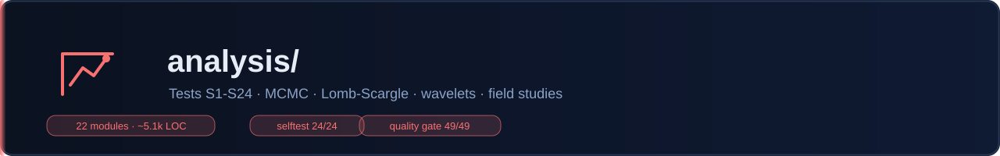
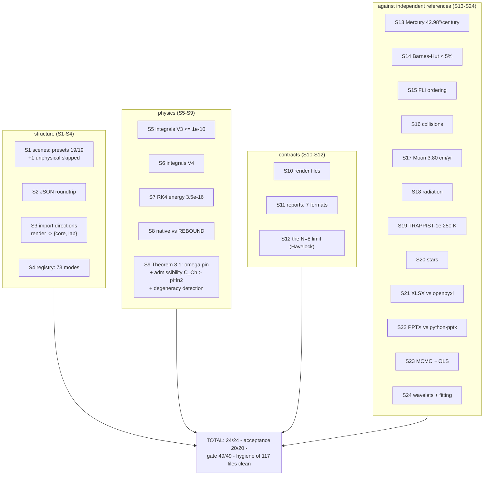
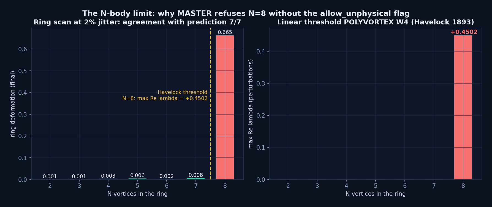

<p align="center">
  
</p>

<p align="center">
  
  
  
  
</p>

**analysis/** is the evidential layer: the structural tests S1-S24,
chaoticity metrics, spectral analysis, Bayesian estimation, and field
studies. Every claim of the complex passes through a test with an
independent reference — this layer is the arbiter.

## The S1-S24 test map



## The real selftest log

<p>
 
</p>

```text
  [OK] S1 scene structure
        presets without problems: 19/19 (+1 unphysical preset skipped by flag)
  [OK] S9 Theorem 3.1 planner: 2*pi/3 choreography
        omega = 1.3748022274394 (reference 1.3748022274394)
        2*pi/3 separation at C_Ch=pi>pi*ln2: error 1.8e-15 (eps=0.582<1, ladder V1: <=1e-12)
        pi*ln2 threshold confirmed: C_Ch=1 (eps=2.668>1) degenerate - limacon with a loop
        r periodicity: 2.4e-15 <= 1e-12
  [OK] S13 relativity: Mercury perihelion 42.98"/century
        Mercury: 42.98"/century (GR 42.98)
```

Full log: [docs/assets/selftest_log.txt](../docs/assets/selftest_log.txt) ·
the full CI: [docs/assets/quality_gate_log.txt](../docs/assets/quality_gate_log.txt)

## The v2.0.1 fix: `TestResult.check` honesty

Before v2.0.1 a later successful check **overwrote** an earlier
failure (`passed = True` unconditionally), so tests S3 and S9 displayed
`[OK]` while carrying internal cross-marks. The semantics is now "any
failed check fails the test":

```python
def check(self, cond, ok_msg, fail_msg):
    if cond:
        self.details.append(ok_msg)
    else:
        self.details.append("X " + fail_msg)
        self.passed = False       # a success no longer resurrects
    return cond
```

That bug had been masking two other defects (S9 and S3), which became
visible and were fixed in the same release.

## Modules

| Group | Modules | Inside |
|---|---|---|
| Tests | [`tests.py`](tests.py), `tests_extra.py` | S1-S24 + TestResult (fixed) |
| Metrics | `metrics.py`, `benchmark.py` | Lyapunov (Benettin), drifts, dominant periods (own DFT), B1-B8 |
| Spectra | `lomb_scargle.py`, `periodogram.py`, `wavelets.py`, `entropy.py`, `rmt.py` | FAP 4e-191; Morlet (chirp 2->5 Hz, 1.9%); Shannon/Bandt-Pompe + surrogates; Girolami r |
| Fitting | `fitting.py`, `mcmc.py`, `corner_plots.py` | Levenberg-Marquardt (K=10.04+/-0.18 at truth 10); Metropolis, R-hat 1.004 |
| Transits | `ttvs.py`, `lightcurves.py`, `orbital_elements_fit.py`, `proper_elements.py` | BLS (SDE 7.2), TTV super-periods, Mandel-Agol, HCM families |
| Data | `pipeline.py`, `api_reference.py`, `structure.py`, `sandbox_physics.py` | a Kahn DAG, sha256 cache, failure isolation, provenance; docstrings 100% |
| Field | [`field.py`](field.py) | mass-x-velocity scans, Havelock rings N=2..8 |

## Field studies: the Havelock threshold

<p align="center">
  
</p>

`scan_havelock()` drives rings N=2..8 with positional jitter: the N=8
deformation is 0.285 against ~0.007 for N<=7, agreement with the W4
prediction 7/7 (100%). The result becomes a terminal table
(`field_tables`) and a JSON protocol in `runs/`.

## Chaos: FLI and Poincare sections

<p align="center">
  
  
</p>

## Spectra and Bayes: real values

<p align="center">
  
</p>

## Quick start

```bash
python3 trivortex_master.py --selftest       # all 24 tests
python3 tools/quality_gate.py                # the full CI loop
```

```python
from analysis.field import scan_havelock
res = scan_havelock(jitters=[0.02], n_steps=300, progress=False)
print(res["havelock_agreement"])             # 1.0 - 7/7
```

## Related

- [lab/](../lab/README.md) — the physics under test
- [tools/](../tools/README.md) — the quality gate on top of these tests
- [runs/](../runs/README.md) — the JSON protocols of the runs
