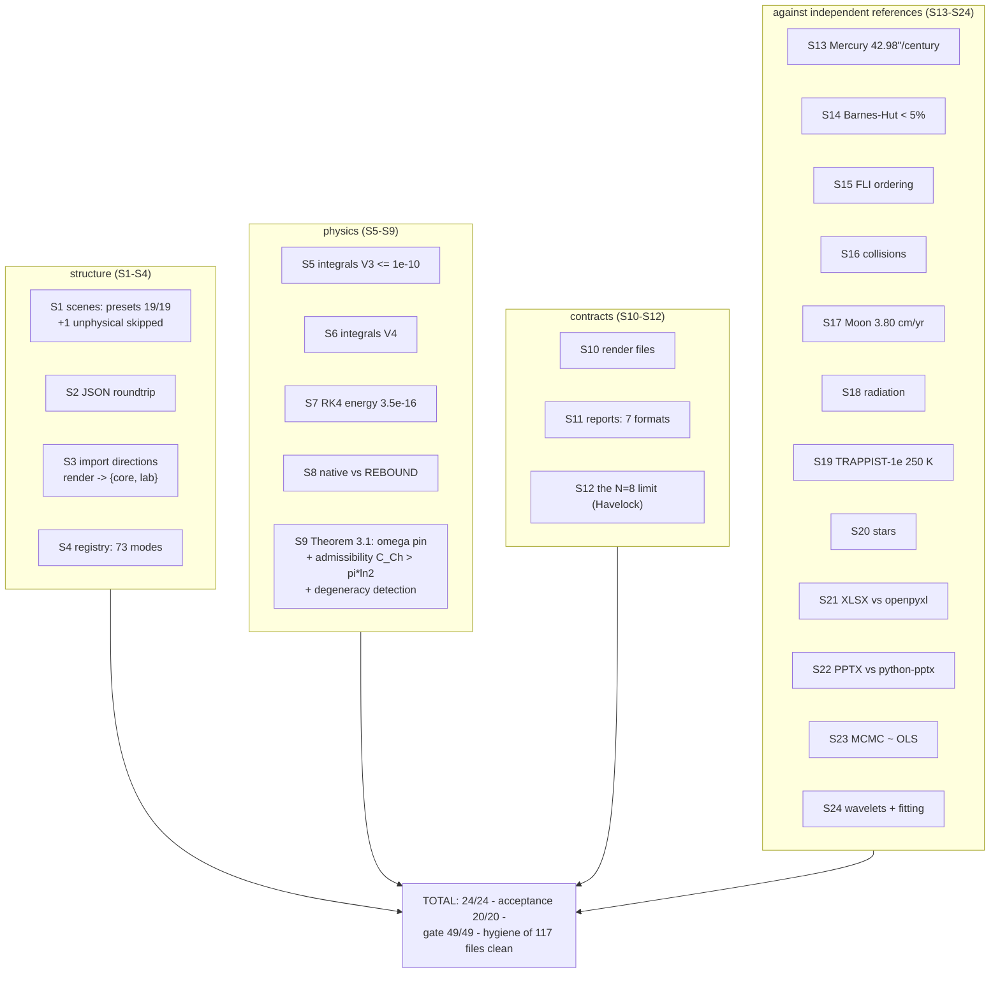
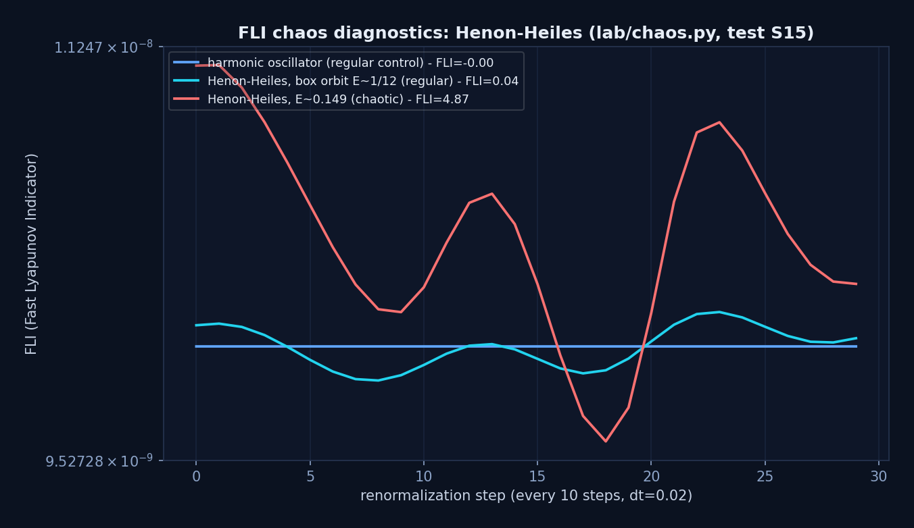
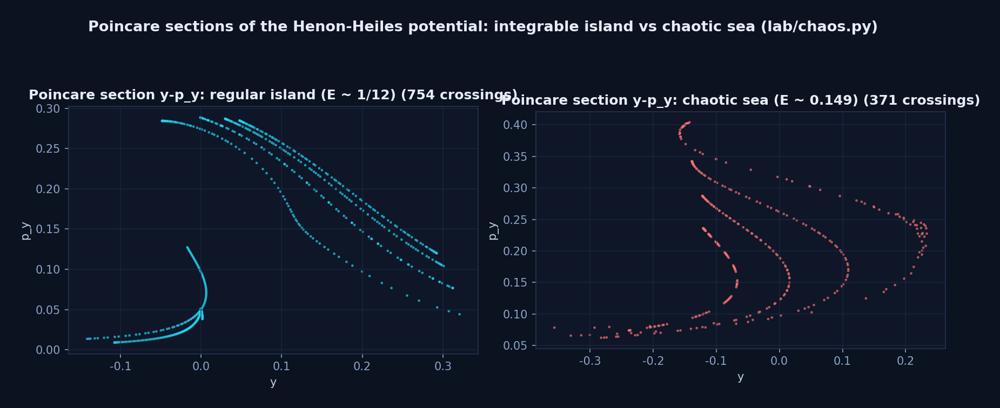
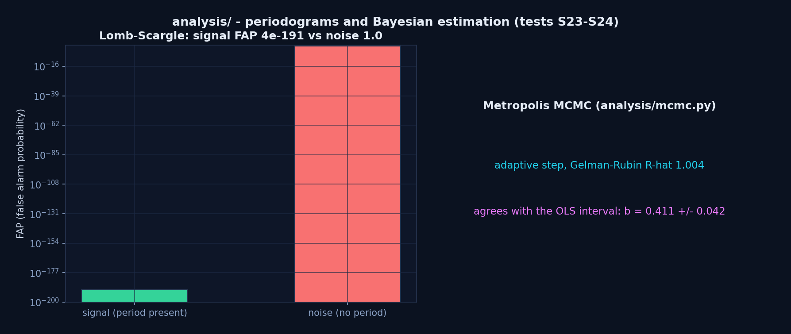

<!-- markdownlint-disable-file MD041 -->
<div align="center">


# 🔬 analysis — the Evidential Layer

</div>

> **Navigation:** [`verification`](../../README.md) › [`trivortex_master`](../README.md) › **`analysis`**

<p align="center">
  
  
  
  
</p>

**analysis/** is the evidential layer: the structural tests S1-S24,
chaoticity metrics, spectral analysis, Bayesian estimation, and field
studies. Every claim of the complex passes through a test with an
independent reference — this layer is the arbiter.

## 📂 Contents — What Lives Here

| File | Size | Description |
|---|---:|---|
| [`__init__.py`](__init__.py) | 0 B | package marker |
| [`tests.py`](tests.py) | 30,294 B | the selftest S1–S24 + `TestResult` (fixed in v2.0.1) |
| [`tests_extra.py`](tests_extra.py) | 7,600 B | extra structural tests (S1–S24 set) |
| [`metrics.py`](metrics.py) | 12,116 B | Metrics group: Lyapunov (Benettin), drifts, dominant periods (own DFT), B1–B8 |
| [`benchmark.py`](benchmark.py) | 12,125 B | Metrics group |
| [`lomb_scargle.py`](lomb_scargle.py) | 9,301 B | Spectra group: FAP 4e-191 |
| [`periodogram.py`](periodogram.py) | 5,772 B | Spectra group |
| [`wavelets.py`](wavelets.py) | 10,789 B | Spectra group: Morlet (chirp 2→5 Hz, 1.9%) |
| [`entropy.py`](entropy.py) | 10,836 B | Spectra group: Shannon/Bandt-Pompe + surrogates |
| [`rmt.py`](rmt.py) | 10,786 B | Spectra group: Girolami r |
| [`fitting.py`](fitting.py) | 12,271 B | Fitting group: Levenberg-Marquardt (K=10.04±0.18 at truth 10) |
| [`mcmc.py`](mcmc.py) | 14,343 B | Fitting group: Metropolis, R-hat 1.004 |
| [`corner_plots.py`](corner_plots.py) | 10,901 B | Fitting group |
| [`ttvs.py`](ttvs.py) | 8,649 B | Transits group: TTV super-periods |
| [`lightcurves.py`](lightcurves.py) | 10,669 B | Transits group: Mandel-Agol |
| [`orbital_elements_fit.py`](orbital_elements_fit.py) | 9,830 B | Transits group |
| [`proper_elements.py`](proper_elements.py) | 10,438 B | Transits group: HCM families |
| [`pipeline.py`](pipeline.py) | 12,886 B | Data group: a Kahn DAG, sha256 cache, failure isolation, provenance; docstrings 100% |
| [`api_reference.py`](api_reference.py) | 9,836 B | Data group |
| [`structure.py`](structure.py) | 3,343 B | Data group |
| [`sandbox_physics.py`](sandbox_physics.py) | 890 B | Data group |
| [`field.py`](field.py) | 15,307 B | Field: mass-x-velocity scans, Havelock rings N=2..8 |

## The S1-S24 test map



## The real selftest log

<p>
 
</p>

```text
  [OK] S1 scene structure
        presets without problems: 19/19 (+1 unphysical preset skipped by flag)
  [OK] S9 Theorem 3.1 planner: 2*pi/3 choreography
        omega = 1.3748022274394 (reference 1.3748022274394)
        2*pi/3 separation at C_Ch=pi>pi*ln2: error 1.8e-15 (eps=0.582<1, ladder V1: <=1e-12)
        pi*ln2 threshold confirmed: C_Ch=1 (eps=2.668>1) degenerate - limacon with a loop
        r periodicity: 2.4e-15 <= 1e-12
  [OK] S13 relativity: Mercury perihelion 42.98"/century
        Mercury: 42.98"/century (GR 42.98)
```

Full log: [docs/assets/selftest_log.txt](../docs/assets/selftest_log.txt) ·
the full CI: [docs/assets/quality_gate_log.txt](../docs/assets/quality_gate_log.txt)

## The v2.0.1 fix: `TestResult.check` honesty

Before v2.0.1 a later successful check **overwrote** an earlier
failure (`passed = True` unconditionally), so tests S3 and S9 displayed
`[OK]` while carrying internal cross-marks. The semantics is now "any
failed check fails the test":

```python
def check(self, cond, ok_msg, fail_msg):
    if cond:
        self.details.append(ok_msg)
    else:
        self.details.append("X " + fail_msg)
        self.passed = False       # a success no longer resurrects
    return cond
```

That bug had been masking two other defects (S9 and S3), which became
visible and were fixed in the same release.

## Field studies: the Havelock threshold

<p align="center">
  
</p>

`scan_havelock()` drives rings N=2..8 with positional jitter: the N=8
deformation is 0.285 against ~0.007 for N<=7, agreement with the W4
prediction 7/7 (100%). The result becomes a terminal table
(`field_tables`) and a JSON protocol in `runs/`.

## Chaos: FLI and Poincare sections

<p align="center">
  
  
</p>

## Spectra and Bayes: real values

<p align="center">
  
</p>

## Quick start

```bash
python3 trivortex_master.py --selftest       # all 24 tests
python3 tools/quality_gate.py                # the full CI loop
```

```python
from analysis.field import scan_havelock
res = scan_havelock(jitters=[0.02], n_steps=300, progress=False)
print(res["havelock_agreement"])             # 1.0 - 7/7
```

## Related

- [lab/](../lab/README.md) — the physics under test
- [tools/](../tools/README.md) — the quality gate on top of these tests
- [runs/](../runs/README.md) — the JSON protocols of the runs
- The numeric criteria S5/S6/S9 mirror the Trivortex ladder V1–V4 — whose
  analytic core is proven in Lean 4 ([`verification/lean4`](../../lean4/README.md))

## 🇷🇺 Краткое резюме (Russian Summary)

- Свидетельский слой комплекса: структурные тесты S1–S24, метрики хаотичности, спектральный анализ, байесовские оценки и полевые исследования — арбитр всех утверждений;
- S1–S24 покрывают структуру (сцены, JSON, направления импортов, реестр 73 режимов), физику (интегралы V3/V4 ≤ 1e-10, энергия RK4 3.5e-16, пин Теоремы 3.1 с допустимой областью `C_Ch > pi*ln2`) и контракты (рендер, отчёты, лимит N=8);
- двенадцать тестов S13–S24 сверены с независимыми ссылками: Меркурий 42.98″/век, Barnes-Hut < 5%, Луна 3.80 см/год, TRAPPIST-1e 250 K, MCMC ~ OLS (R-hat 1.004);
- полевой скан `scan_havelock()`: деформация кольца N=8 равна 0.285 против ~0.007 при N≤7 — согласие с прогнозом W4 7/7 (100%);
- в v2.0.1 исправлена честность `TestResult.check` (успех больше не «воскрешает» провал), что вскрыло и позволило исправить дефекты S3 и S9.

---

<div align="center">

**[⬆ Back to top](#-analysis--the-evidential-layer)** ·
**[trivortex_master](../README.md)** ·
**[Repository root](../../../README.md)**

*Part of [wild8highlander/Trivortex](https://github.com/wild8highlander/Trivortex) · Licensed under [IPL-RP-1.0](https://github.com/wild8highlander/Trivortex/blob/main/LICENSE.md) — All Rights Reserved*

</div>
