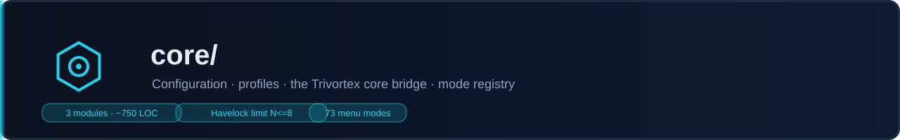
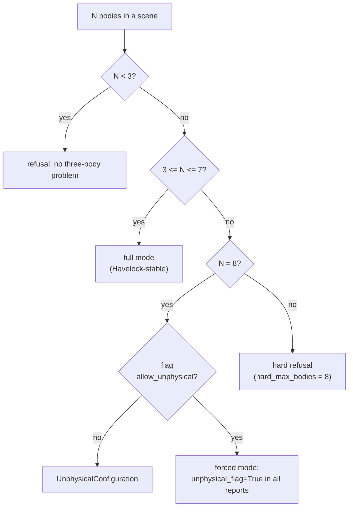

<!-- markdownlint-disable-file MD041 -->
<div align="center">



# 🧱 core — the Foundation Layer

</div>

> **Navigation:** [`verification`](../../README.md) › [`trivortex_master`](../README.md) › **`core`**

<p align="center">
  
  
  
  
</p>

**core/** is the foundation of the package: configuration with
profiles and the body limit, the bridge to the Trivortex core, and the
menu mode registry. It is the only layer forbidden to import any other
package layer (S3 rule: `core -> nothing`) — everything else builds on
it.

## 📂 Contents — What Lives Here

| File | Size | Description |
|---|---:|---|
| [`__init__.py`](__init__.py) | 0 B | package marker |
| [`config.py`](config.py) | 11,891 B | `MasterConfig`, profiles, validation |
| [`bridge.py`](bridge.py) | 10,732 B | bridge to the Trivortex core + reference values |
| [`registry.py`](registry.py) | 8,564 B | the menu mode registry (73 modes, 11 categories) |

## Modules

| Module | Purpose | Key entities |
|---|---|---|
| [`config.py`](config.py) | `MasterConfig`, profiles, validation | `from_profile()`, `UnphysicalConfiguration`, `G_SI` (CODATA 2018) |
| [`bridge.py`](bridge.py) | bridge to the Trivortex core + reference values | `find_trivortex()`, `THEOREM31_REF`, `HAVelock_REF`, `theorem31_series()` |
| [`registry.py`](registry.py) | the menu mode registry (73 modes, 11 categories) | `@register_mode`, `get_modes()` |

## Configuration: how the body limit works

The N limit is physics, not a convention (the Havelock threshold,
POLYVORTEX W4):



## The core bridge: references instead of copy-paste

`bridge.py` never imports the core forcibly — it *searches* for it
(`TRIVORTEX_HOME` or a sibling checkout) and works honestly on its own
when absent. The reference values are pinned as literals and re-checked
against the core code whenever it is found:

| Reference | Value | Used by |
|---|---|---|
| `THEOREM31_REF["omega"]` | 1.3748022274393588 = e^(1/pi) | the S9 pin test |
| `THEOREM31_REF["epsilon"]` | 2.6680737914285615 = 1/(e^(1/pi)-1) | the README/code divergence note |
| `HAVelock_REF` | N<=7 stable; N=8: max Re lambda = +0.4502 | test S12, the ring scan |
| `LADDER_LEVELS` | the V1-V4 criteria (integrals <= 1e-10) | tests S5/S6 |

`theorem31_series()` is the bridge's own closed form (the core is not
required): r_k(t) = sqrt(C_Ch)*(1+eps*cos(omega*t+2*pi*k/3)),
theta_k = omega*t+2*pi*k/3.

The same objects — the closed form, the rigid rotation `omega = 3*Gamma/(2*pi*a^2)`
and the conservation of the vortex integrals — are **proven** in Lean 4 in
[`verification/lean4`](../../lean4/README.md) (`lagrangeSol`, the
`P/Q/I/H_kirchhoff_*` conservation theorems); the pins here and the proofs
there fix the same numbers.

## The mode registry

```python
from core.registry import register_mode

@register_mode(name="my_mode", title="My mode", category="Science",
               icon="TEST", order=50, description="what it does")
def mode_my(app):
    ...
```

Test S4 verifies that all 73 registered modes are callable and
distributed across 11 categories without name collisions.
`modes_extra.py` (the top layer) adds 34 modes on top of the base 21.

## Quick start

```python
from core.config import from_profile

cfg = from_profile("quick", n_steps=200)   # profile + overrides
print(cfg.backend, cfg.n_steps, cfg.G)     # ascii 200 6.6743e-11
```

Profiles: `quick` · `standard` · `realistic` · `research` · `cinematic`
· `pure_stdlib` — the full list in the [root README](../README.md#-profiles).

## Related

- [lab/](../lab/README.md) — consumes `MasterConfig` for every scene
- [analysis/](../analysis/README.md) — tests S3/S4/S12 verify this layer
- [root README](../README.md) — architecture and the verification ladder

## 🇷🇺 Краткое резюме (Russian Summary)

- Фундамент пакета: конфигурация с профилями и лимитом тел, мост к ядру Trivortex и реестр режимов меню; единственный слой, которому запрещено импортировать другие слои (правило S3: `core -> nothing`);
- лимит тел — физика (порог Хавелока, POLYVORTEX W4): N ≤ 7 — полный режим, N = 8 — только с флагом `allow_unphysical`, N ≥ 9 — жёсткий отказ (`UnphysicalConfiguration`, `hard_max_bodies = 8`);
- `bridge.py` не импортирует ядро принудительно — оно ищет его (`TRIVORTEX_HOME` или соседний чекаут) и честно работает само: эталонные значения pinned как литералы (`THEOREM31_REF["omega"] = 1.3748022274393588 = e^(1/pi)`, `HAVelock_REF`, `LADDER_LEVELS`) и перепроверяются при обнаружении ядра;
- `registry.py` — реестр на 73 режима в 11 категориях; тест S4 проверяет вызываемость и отсутствие коллизий имён;
- те же числа доказаны в Lean 4 (`verification/lean4`): пины моста и формальные доказательства фиксируют одни и те же величины.

---

<div align="center">

**[⬆ Back to top](#-core--the-foundation-layer)** ·
**[trivortex_master](../README.md)** ·
**[Repository root](../../../README.md)**

*Part of [wild8highlander/Trivortex](https://github.com/wild8highlander/Trivortex) · Licensed under [IPL-RP-1.0](https://github.com/wild8highlander/Trivortex/blob/main/LICENSE.md) — All Rights Reserved*

</div>
