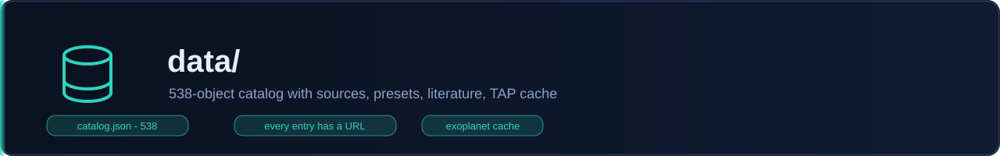

<p align="center">
  
</p>

<p align="center">
  
  
  
</p>

**data/** holds the complex's data: the 538-object catalog (every entry
with a source URL), 20 scene presets, annotated literature, the NASA
TAP exoplanet cache, and the launch ASCII banners.

## Contents

| File | Inside |
|---|---|
| [`catalog.json`](catalog.json) | **538 objects**: 98 static entries (planets, moons, asteroids, comets, stars) + 440 NASA TAP exoplanets; each with mass, radius, orbit, color, and a `source` with a URL |
| [`presets_scenes.json`](presets_scenes.json) | 20 scene presets (19 physical + 1 unphysical) |
| [`literature.md`](literature.md) | 21 annotated sources: from Lagrange 1772 to Gillon 2017 |
| [`trajectories.json`](trajectories.json) | stored trajectories for the menu |
| [`cache/exoplanets_*.json`](cache/) | the TAP cache (daily TTL, offline fallback) |
| [`banners/acll*.txt`](banners/) | the ACLL ASCII banner (truecolor + plain for pipes) |

## The catalog: mass-radius (real data)

<p align="center">
  
</p>

Test A6 verifies: **538 objects, 538 with a `source`** — not a single
record without a source. The exoplanet part is assembled from the NASA
Exoplanet Archive (TAP, table `ps`, `default_flag=1`) with a daily
cache; the static core is NSSDC/checked literature values.

```python
import json
cat = json.load(open("data/catalog.json"))
entries = cat if isinstance(cat, list) else cat["objects"]
by_type = {}
for e in entries:
    by_type[e["type"]] = by_type.get(e["type"], 0) + 1
# {'exoplanet': 440, 'planet': 8, 'moon': 29, 'asteroid': 20, ...}
```

## Honest estimate flags

Comet-nucleus masses are literature estimates, not measurements: those
entries carry `"mass_estimated": true`, and the presets inherit the
flag honestly.

## Rebuilding

```bash
python3 tools/build_catalog.py             # full (network + static core)
python3 tools/build_catalog.py --limit 50  # cap the TAP sample
python3 tools/build_catalog.py --offline   # the static 98 only
```

## Related

- [realism/](../realism/README.md) — the TAP loaders and the validator
- [lab/](../lab/README.md) — presets turn the catalog into scenes
- [tools/](../tools/README.md) — the catalog build
