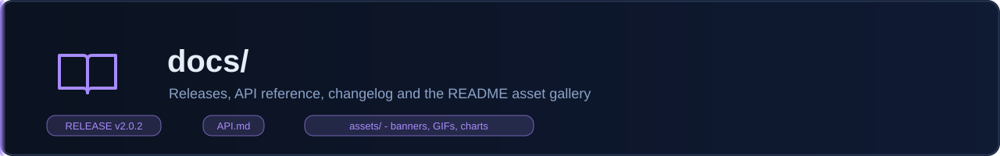
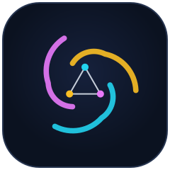

<!-- markdownlint-disable-file MD041 -->

# 📚 docs — Release Notes and the Asset Gallery

> **Navigation:** [`verification`](../../README.md) › [`trivortex_master`](../README.md) › **`docs`**

  
  
  
  

**docs/** is the documentation and the graphics gallery: release
notes, the API reference, and the README asset gallery (banners with
SMIL animation, GIFs, charts from real runs, logs).

## 📂 Contents — What Lives Here

| File | Size | Description |
|---|---:|---|
| [`RELEASE_v2.0.2.md`](RELEASE_v2.0.2.md) | 1,565 B | v2.0.2 release notes: English READMEs, language-neutral A10, the extended gallery |
| [`RELEASE_v2.0.1.md`](RELEASE_v2.0.1.md) | 1,885 B | v2.0.1 release notes: the test-honesty fixes, S3-DI, documentation |
| [`RELEASE_v2.0.0.md`](RELEASE_v2.0.0.md) | 933 B | v2.0.0 release notes: the volume doubling, metric table x2.18-x4.84 |
| [`API.md`](API.md) | 104,266 B | the public API reference |
| `RELEASE_v2.0.0.md.json` (+ `.doubling.json`) | 745 + 849 B | machine-readable release notes and the v1-to-v2 protocol |
| `RELEASE_v2.0.1.md.json` (+ `.doubling.json`) | 747 + 849 B | the same for v2.0.1 |
| `RELEASE_v2.0.2.md.json` (+ `.doubling.json`) | 747 + 849 B | the same for v2.0.2 |
| [`README.md`](README.md) | 2,980 B | this overview |
| [`assets/`](assets/) | 36 files | the graphics gallery for all READMEs — below |

## The asset gallery

Every image was generated **by this package**: charts from real engine
runs, GIFs by the own LZW codec, the raytracer image by the own
raytracer, banners as SVG with SMIL animation (the vortices rotate
right on GitHub).

| Category | Files |
|---|---|
| Banners (SVG, animated) | `banner_root.svg` · `banner_core.svg` ... `banner_runs.svg` (11) + `logo.svg` |
| Run charts (PNG) | `presets_gallery.png` · `theorem31_admissibility.png` · `havelock_threshold.png` · `chaos_fli.png` · `poincare_sections.png` · `energy_conservation.png` · `barnes_hut.png` · `relativity_mercury.png` · `tides_moon.png` · `trappist_teq.png` · `catalog_mass_radius.png` · `analysis_periodogram.png` · `cosmology_ladder.png` · `bright_stars_hr.png` |
| GIFs (own LZW) | `theorem31_ring.gif` · `figure_eight.gif` · `inner_solar.gif` · `lagrange_triangle.gif` |
| Engine renders | `raytracer_demo.png` (the raytracer) · `sky_map_terminal.png` (the stereographic sky map) |
| Real logs | `selftest_log.txt` · `quality_gate_log.txt` · `quality_gate_single_log.txt` · `banner_only_output.txt` |

## The logo

  

Three vortex spirals (the AURORA palette: cyan/magenta/amber) rotate at
different periods around the triangle of nodes — a visual formula of
the three-body problem. The animation is SMIL `<animateTransform>`:
it works in a GitHub README without any GIF.

## Related

- [root README](../README.md) — where all of this is embedded
- [CHANGELOG](../CHANGELOG.md) — the version history

## 🇷🇺 Краткое резюме (Russian Summary)

- Документация и графическая галерея комплекса: заметки о релизах v2.0.0 → v2.0.2 (плюс машинно-читаемые `.json`-версии), справочник публичного API (`API.md`);
- галерея `assets/` — 36 файлов, и каждый сгенерирован самим пакетом: графики реальных прогонов движка, GIF-анимации собственным LZW-кодеком, изображение собственного рейстрейдера, баннеры как SVG с SMIL-анимацией (вихри вращаются прямо на GitHub);
- 11 анимированных SVG-баннеров + логотип: три вихревые спирали палитры AURORA вращаются вокруг треугольника узлов — визуальная формула задачи трёх тел;
- реальные журналы: `selftest_log.txt`, `quality_gate_log.txt`, `quality_gate_single_log.txt`, `banner_only_output.txt`.

---

**[⬆ Back to top](#-docs--release-notes-and-the-asset-gallery)** ·
**[trivortex_master](../README.md)** ·
**[Repository root](../../../README.md)**

*Part of [wild8highlander/Trivortex](https://github.com/wild8highlander/Trivortex) · Licensed under [IPL-RP-1.0](https://github.com/wild8highlander/Trivortex/blob/main/LICENSE.md) — All Rights Reserved*

