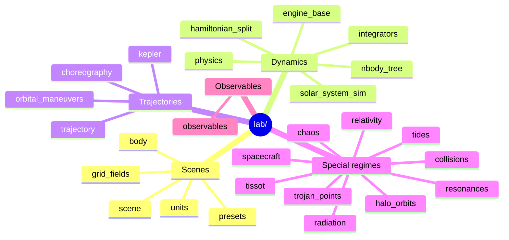
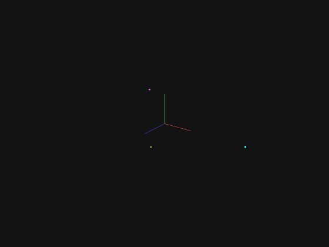
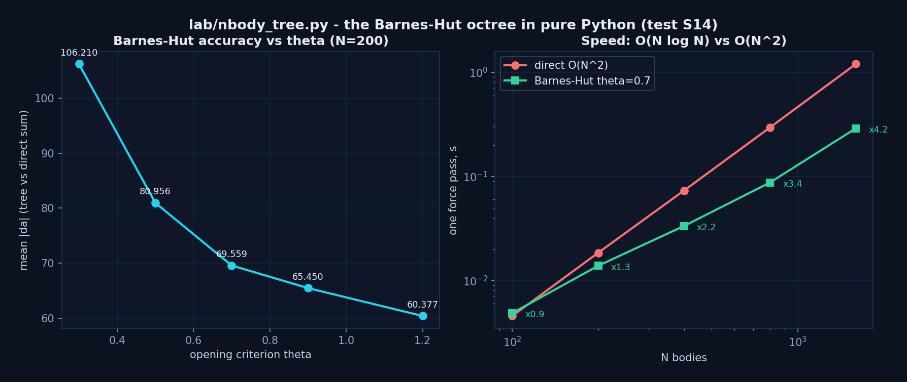
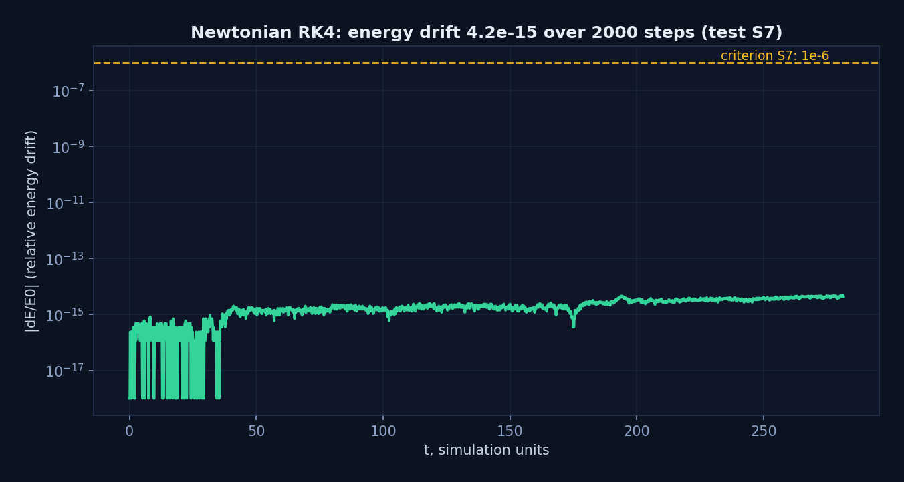

<p align="center">
  
</p>

<p align="center">
  
  
  
  
  
</p>

**lab/** is the physics core of the complex: bodies and scenes,
integrators from Newtonian RK4 to 6th-order Hamiltonian splits,
trajectory planners (including Theorem 3.1 of the Trivortex core),
20 presets, and a whole palette of "sciences": GR, chaos, tides,
radiation, CR3BP, spacecraft attitude control.

## Module map



## Presets: real trajectories

<p align="center">
  
</p>

| Preset | N | Highlight |
|---|---|---|
| `inner_solar` | 5 | inner Solar System from the catalog |
| `figure_eight` | 3 | Chenciner-Montgomery choreography: E=-1.287142, closure 3.9e-08 |
| `lagrange_triangle` | 3 | rigid rotation, omega_L = 3*Gamma/(2*pi*a^2) (Lagrange 1772) |
| `vortex_ring_5` / `vortex_ring_7` | 5/7 | Kirchhoff vortex rings (7 is the last stable one) |
| `jupiter_system` / `saturn_system` | 6 | systems with moons from the catalog |
| `io_europa_ganymede` | 4 | the Laplace resonance 1:2:4 |
| `trappist_like` | 5 | Barnard's system from NASA TAP |
| `sun_all_planets` | 9 | unphysical preset: only with `allow_unphysical` |

## The Theorem 3.1 planner: admissibility (fixed in v2.0.1)

<p align="center">
  
</p>

The closed form r_k(t) = sqrt(C_Ch)*(1+eps*cos(omega*t+2*pi*k/3)) is
non-degenerate for **C_Ch > pi*ln2 ~ 2.1776** (Theorem B of the
polyvortex monograph): eps < 1, radii positive, and the ring "breathes"
cleanly. At C_Ch = 1 (the core default, eps ~ 2.668) the curve is a
limacon with an inner loop: the body crosses the center and the
*geometric* 2*pi/3 separation breaks (the separation of the polar
angles theta_k holds always). Since v2.0.1 the planner records the
`admissible` flag in its metadata and test S9 checks both domains and
detects the threshold.

```python
from lab.trajectory import get_planner

planner = get_planner("analytic")
traj = planner.theorem31(C_Ch=3.14159, n_steps=500)
traj.metadata["omega"]       # 2.598... = e^(pi/pi)*(2*pi/T)
traj.metadata["admissible"]  # True: eps = 1/(e-1) ~ 0.582 < 1
```

<p align="center">
  
  
</p>

## Physics vs independent references

Every "science" module carries a `self_check()` against a literature
or observational reference — the quality gate (49/49) and tests
S13-S20 run them:

| Module | Reference | Result |
|---|---|---|
| [`relativity.py`](relativity.py) | Mercury 42.98"/century (GR) | 42.98"/century, Kerr ISCO, Lense-Thirring, Petersen |
| [`nbody_tree.py`](nbody_tree.py) | direct summation | error < 5%, O(N log N) speedup |
| [`chaos.py`](chaos.py) | Henon-Heiles | FLI: chaos 4.87 > regular 0.04 > oscillator -0.00 |
| [`tides.py`](tides.py) | LLR 3.82 cm/yr; Io 1e14 W; Kozai | 3.80 cm/yr; x1.56; 39.23 deg |
| [`radiation.py`](radiation.py) | Poynting-Robertson | t_PR(100 um, 1 AU) = 2.09e5 yr |
| [`collisions.py`](collisions.py) | conservation laws | momentum <= 1e-12, energy at eps=1 <= 1e-9 |
| [`halo_orbits.py`](halo_orbits.py) | NASA (Earth-Moon) | L1-L5 to the 6th digit |
| [`trojan_points.py`](trojan_points.py) | the Rabe criterion | 0.03852 |
| [`spacecraft.py`](spacecraft.py) | a 90-deg slew | 12 s, abs(H) <= 1.8e-16 |

<p align="center">
  
  
</p>

<p align="center">
  
  
</p>

<p align="center">
  
  
</p>

## The Havelock limit: why N=8 is forbidden

<p align="center">
  
</p>

A ring of N equal vortices is linearly stable for N <= 7 and unstable
from N >= 8 (Havelock 1893; the spectral twin is POLYVORTEX W4:
max Re lambda = +0.4502). A scan with 2% jitter: the N=8 ring
deformation is 0.285 against ~0.007 for the stable ones. That is why
`core/config.py` demands `allow_unphysical` for N=8 and refuses N>=9
(test S12).

## Quick start

```python
from core.config import from_profile
from lab.presets import build_preset
from lab.physics import run_simulation

sc = build_preset("inner_solar", from_profile("quick", n_steps=500))
summary = run_simulation(sc, n_steps=500)
print(sc.bodies[1].position, summary["t_final"])
```

Engines are injected via `register_engine` (REBOUND/Dedalus without an
import cycle lab<->realism — the S3 pattern, see
[realism/](../realism/README.md)).

## Related

- [core/](../core/README.md) — configuration and the N limit
- [analysis/](../analysis/README.md) — tests and metrics of this layer
- [render/](../render/README.md) — scene visualization
