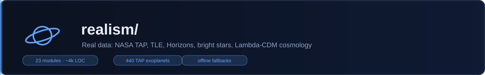
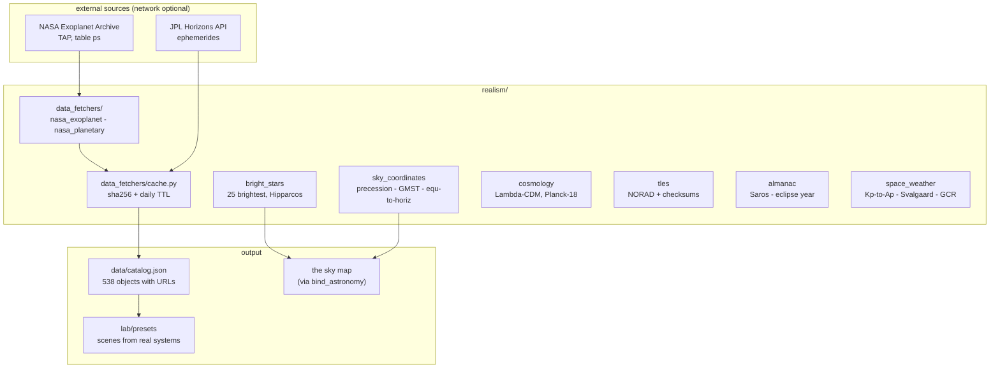
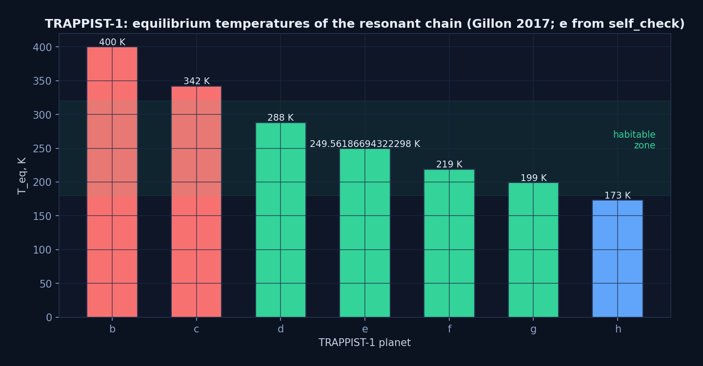
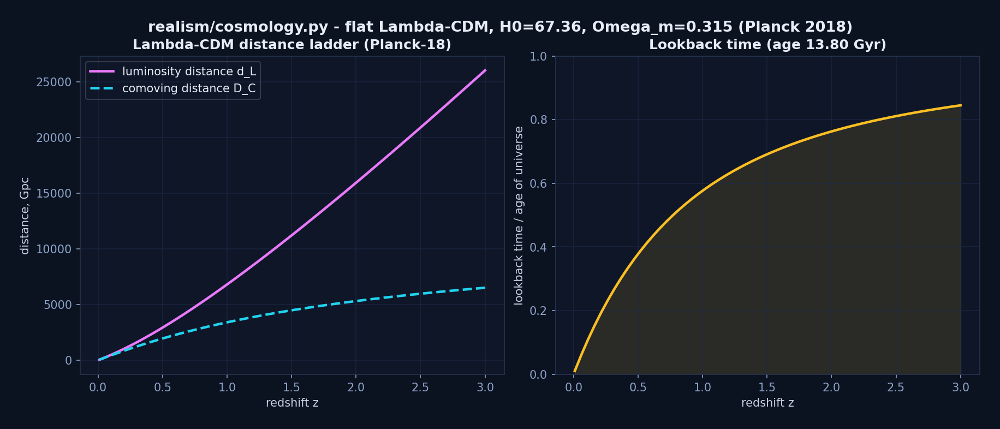
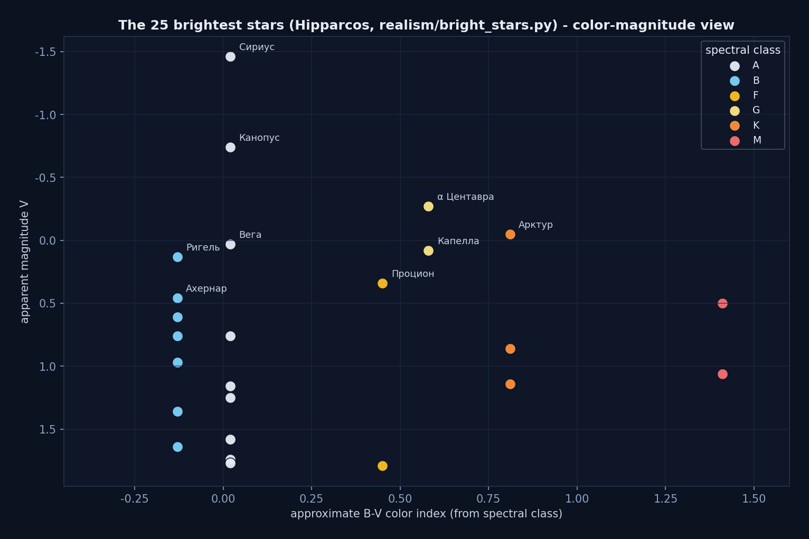
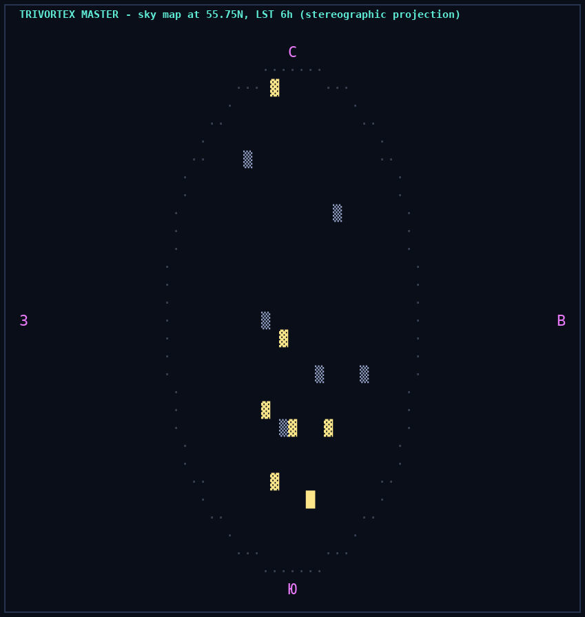

<!-- markdownlint-disable-file MD041 -->
<div align="center">



# 🌍 realism — the Real-Data Layer

</div>

> **Navigation:** [`verification`](../../README.md) › [`trivortex_master`](../README.md) › **`realism`**

<p align="center">
  
  
  
  
</p>

**realism/** is the real-data layer: astrometry, catalogs, cosmology
and mission design. The layer rule (S3): `realism -> {core, lab}` —
data flows into the laboratory, but never drags the renderer or the
reports along.

## 📂 Contents — What Lives Here

| File | Size | Description |
|---|---:|---|
| [`__init__.py`](__init__.py) | 1,125 B | package init + the engine injection hook |
| [`sky_coordinates.py`](sky_coordinates.py) | 13,129 B | Sky group: precession, GMST, equatorial → horizontal |
| [`bright_stars.py`](bright_stars.py) | 8,944 B | Sky group: the 25 brightest Hipparcos stars |
| [`observatory.py`](observatory.py) | 13,708 B | Sky group |
| [`almanac.py`](almanac.py) | 10,832 B | Sky group: Saros, the eclipse year |
| [`eclipse_predictor.py`](eclipse_predictor.py) | 6,457 B | Sky group |
| [`planetary_systems.py`](planetary_systems.py) | 13,862 B | Catalogs group: TRAPPIST-1 and friends (Gillon 2017) |
| [`stellar.py`](stellar.py) | 11,875 B | Catalogs group: blackbody → CIE → sRGB, mass-luminosity |
| [`validator.py`](validator.py) | 6,033 B | Catalogs group |
| [`cosmology.py`](cosmology.py) | 7,306 B | Cosmos group: flat Lambda-CDM (Planck-18) |
| [`space_weather.py`](space_weather.py) | 13,372 B | Cosmos group: Kp-to-Ap, Svalgaard, GCR |
| [`encounter.py`](encounter.py) | 4,993 B | Cosmos group |
| [`mission_design.py`](mission_design.py) | 8,060 B | Cosmos group |
| [`jpl_horizons.py`](jpl_horizons.py) | 10,453 B | Cosmos group: the Horizons API with an offline fallback |
| [`tles.py`](tles.py) | 10,838 B | Cosmos group: TLE with NORAD checksums |
| [`data_fetchers/cache.py`](data_fetchers/cache.py) | 3,746 B | Fetchers: sha256 cache + daily TTL |
| [`data_fetchers/nasa_exoplanet.py`](data_fetchers/nasa_exoplanet.py) | 5,896 B | Fetchers: NASA Exoplanet Archive (TAP, table `ps`) |
| [`data_fetchers/nasa_planetary.py`](data_fetchers/nasa_planetary.py) | 4,709 B | Fetchers: NASA planetary factsheet |
| [`adapters/rebound_adapter.py`](adapters/rebound_adapter.py) | 5,903 B | Adapters: REBOUND via `register_engine` (S3-clean) |
| [`adapters/dedalus_adapter.py`](adapters/dedalus_adapter.py) | 7,795 B | Adapters: Dedalus |
| [`adapters/custom_adapter.py`](adapters/custom_adapter.py) | 7,053 B | Adapters: custom engines |

(The 0-byte `__init__.py` markers of `data_fetchers/` and `adapters/` are omitted from the table; the layer is 23 `.py` files in total.)

## Data sources



Every network source has an **honest offline fallback**: without a
network the complex runs on the cache and the static catalog core,
and the status is visible in the menu ("Help -> Engine status").

## Modules

| Group | Modules | References |
|---|---|---|
| Sky | `sky_coordinates`, `bright_stars`, `observatory`, `almanac`, `eclipse_predictor` | Sirius dec -39.61 deg; Saros; stereographic conformality |
| Catalogs | `planetary_systems`, `stellar`, `validator` | TRAPPIST-1e T_eq = 250 K (Gillon 2017: 249); Habets-81; Roche-Eggleton 0.3789 |
| Cosmos | `cosmology`, `space_weather`, `encounter`, `mission_design`, `jpl_horizons`, `tles` | Planck-18: age 13.80 Gyr, d_L(z=1) = 6.81 Gpc; Parker 47.3 deg |
| Adapters | `adapters/rebound_adapter`, `adapters/dedalus_adapter`, `adapters/custom_adapter` | injection via `register_engine` (S3-clean) |

## Real results

### TRAPPIST-1

<p align="center">
  
</p>

`planetary_systems.self_check()` verifies the resonance chain and the
equilibrium temperatures against Gillon 2017; Hill-stability scanners
(Gladman) and habitable-zone packing feed the presets.

### The Lambda-CDM distance ladder

<p align="center">
  
</p>

`cosmology.py` integrates the flat Lambda-CDM distances (Planck-18
parameters) in closed form: luminosity and comoving distances plus the
lookback time — the age of the universe (13.80 Gyr) is a self_check
reference.

### Stars: color from physics

`stellar.py` maps a blackbody temperature to CIE (Wyman 2013) and then
to sRGB: the Sun comes out **#FFF9F9** (white, as it actually looks from
space), M dwarfs red, O stars blue. Mass-luminosity-radius relations
and main-sequence lifetimes (an O star of 30 M_sun lives 1.4 Myr) are
covered by `self_check` (test S20).

### The 25 brightest stars

<p align="center">
  
</p>

## The sky map: injection instead of import (fixed in v2.0.1)

Before v2.0.1 `render/ascii_sky.py` imported `realism.bright_stars` and
`realism.sky_coordinates`, breaking the S3 direction rule
(`render -> {core, lab}`). Now the catalog and the coordinate
transforms are **injected** by the top layer through
`bind_astronomy()` — the same pattern as `register_engine()` for the
engines:

```python
# modes_extra.py (top layer)
from render.ascii_sky import bind_astronomy
from realism.bright_stars import BRIGHT_STARS
from realism.sky_coordinates import equatorial_to_horizontal, angular_separation

bind_astronomy(lambda: BRIGHT_STARS, equatorial_to_horizontal, angular_separation)
```

The result is the same map, but the import graph is clean (S3 green):

<p align="center">
  
</p>

## Quick start

```python
from realism.cosmology import self_check as cosmology_check
from realism.stellar import stellar_params

print(cosmology_check())            # age 13.80 Gyr, d_L(z=1) 6.81 Gpc
print(stellar_params(5778.0))       # the Sun: L, R, sRGB color #FFF9F9
```

## Related

- [data/](../data/README.md) — the TAP cache and the 538-object catalog
- [lab/](../lab/README.md) — presets built from real systems
- [render/](../render/README.md) — the sky map (the DI receiver)

## 🇷🇺 Краткое резюме (Russian Summary)

- Слой реальных данных: астрометрия, каталоги, космология и миссии; правило слоя (S3): `realism -> {core, lab}` — данные текут в лабораторию, но не тянут за собой рендерер и отчёты;
- источники: NASA Exoplanet Archive (TAP, таблица `ps`), JPL Horizons, каталог 25 ярчайших звёзд Hipparcos; у каждого сетевого источника — честный офлайн-фолбэк (кэш sha256 с дневным TTL + статическое ядро каталога);
- результаты сверены со ссылками: Planck-18 (возраст 13.80 млрд лет, d_L(z=1) = 6.81 Гпк), Gillon 2017 (T_eq TRAPPIST-1e 250 K), цвет Солнца #FFF9F9 из физики чёрного тела через CIE → sRGB;
- с v2.0.1 карта неба получает каталог и преобразования координат через внедрение зависимости `bind_astronomy()` вместо импорта — граф импортов чист (S3 зелёный);
- движки REBOUND/Dedalus подключаются инъекцией через `register_engine()` без цикла импортов.

---

<div align="center">

**[⬆ Back to top](#-realism--the-real-data-layer)** ·
**[trivortex_master](../README.md)** ·
**[Repository root](../../../README.md)**

*Part of [wild8highlander/Trivortex](https://github.com/wild8highlander/Trivortex) · Licensed under [IPL-RP-1.0](https://github.com/wild8highlander/Trivortex/blob/main/LICENSE.md) — All Rights Reserved*

</div>
