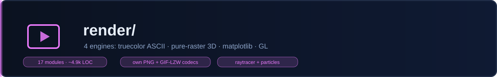
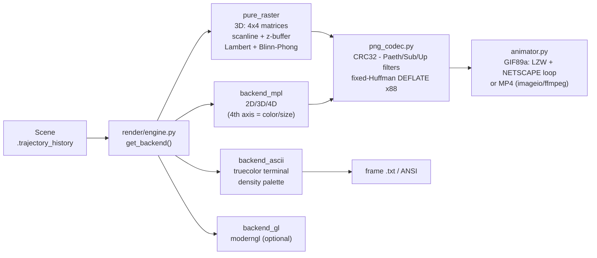
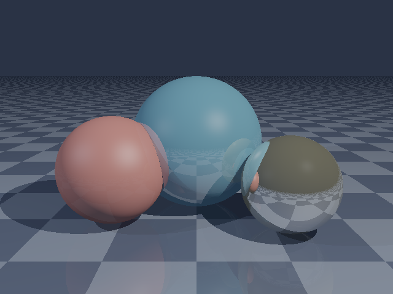
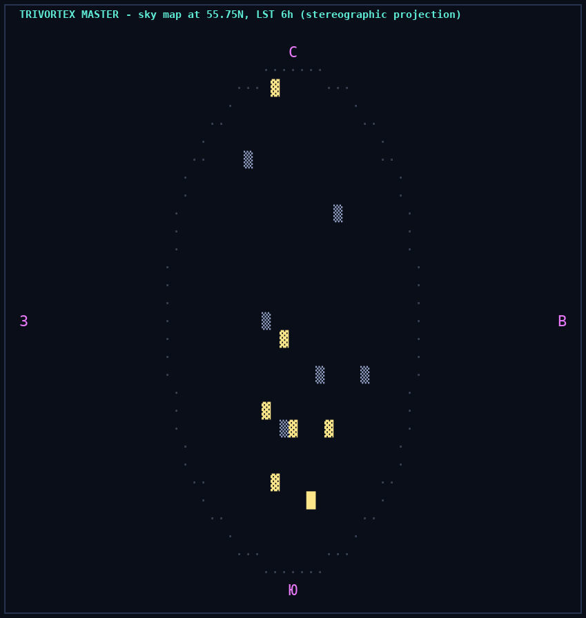
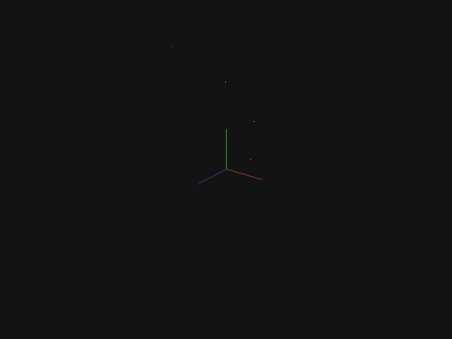
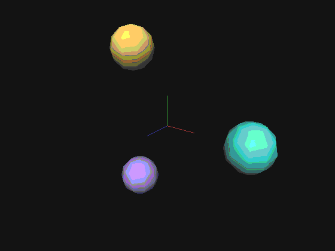

<p align="center">
  
</p>

<p align="center">
  
  
  
  
  
</p>

**render/** is the presentation layer: four interchangeable backends,
own PNG and GIF codecs (no Pillow/imageio), a software raytracer, the
particle system, cinematic cameras, and the HUD in the AURORA palette.

## The render pipeline



## Codecs without dependencies

| Codec | What is inside | Verification |
|---|---|---|
| [`png_codec.py`](png_codec.py) | CRC32, 5 row filters, fixed-Huffman DEFLATE with hash chains (x88 vs naive matching) | decodes under PIL/reference PNG readers |
| `animator.py` (GIF) | an LZW compressor for GIF89a, a 256-color palette, the NETSCAPE loop extension | bit-exact vs giflib/PIL semantics |

## Real frames and animations

<p align="center">
  
  
</p>

The raytracer ([`raytracer.py`](raytracer.py)): spheres + a plane, the
Phong model, hard shadows, recursive reflections, Reinhard tonemapping —
640x480 rendered in pure Python within seconds.

<p align="center">
  
  
</p>

Both GIFs were assembled by `animate_scene()` — frames drawn by
`pure_raster`, compressed by the own LZW. Not a single external
dependency.

## The sky map: DI instead of a violation (fixed in v2.0.1)

`ascii_sky.py` draws a stereographic projection (conformal — circles
stay circles, Snyder 1987) — but the star catalog lives in `realism/`.
Before v2.0.1 the module imported realism directly, breaking the S3
rule. Now it uses **dependency injection**: `bind_astronomy(catalog,
eq_to_horiz, ang_sep)` is called by the top layer (modes_extra /
tools), and an unbound state fails with a clear error message. The
render layer stays clean: `render -> {core, lab}`.

## HUD and banners

- [`hud.py`](hud.py) — the truecolor AURORA palette, the gradient ACLL
  banner, a one-line progress bar with an EMA time estimate, the system
  monitor (cpu/ram/temp/io via psutil, optional); degrades to plain
  text when piped;
- [`banners.py`](banners.py) — frames, status bars, legends for the terminal;
- [`font_5x7.py`](font_5x7.py) — a 5x7 bitmap font for the pure backend.

## The rest

| Module | What it does |
|---|---|
| [`camera.py`](camera.py) | cinematic cameras: orbit, follow, Catmull-Rom over keyframes, shake |
| [`particles.py`](particles.py) | explosions/disks/jets; self-check: all 150 particles die within 30 ticks |
| [`frame_compositor.py`](frame_compositor.py) | layers and blend modes for frames |
| [`spectrum.py`](spectrum.py) | blackbody to CIE to sRGB (the Sun #FFF9F9) |

## Quick start

```python
from core.config import from_profile
from lab.presets import build_preset
from lab.physics import run_simulation
from render.animator import animate_scene

sc = build_preset("figure_eight", from_profile("quick", n_steps=900))
run_simulation(sc, n_steps=900)
animate_scene(sc, "figure_eight.gif", n_frames=56, fps=14, backend="pure")
```

## Related

- [lab/](../lab/README.md) — where the scene history comes from
- [realism/](../realism/README.md) — the star source for the sky map (DI)
- [reports/](../reports/README.md) — embeds these PNGs into reports (base64)
