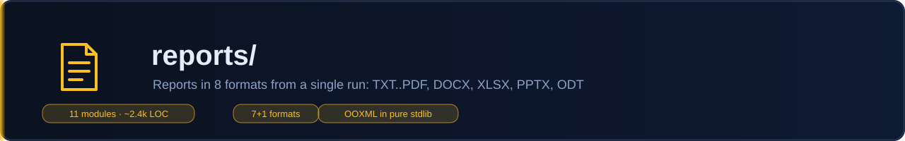
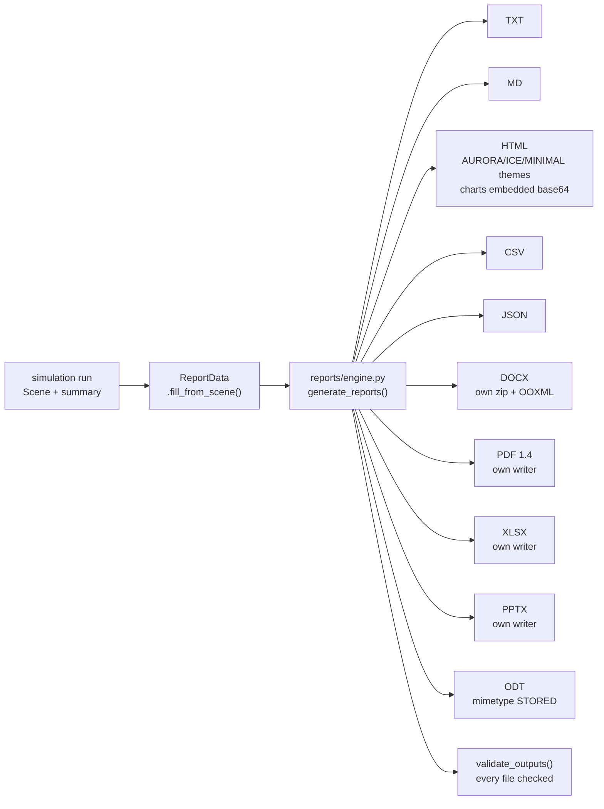

<!-- markdownlint-disable-file MD041 -->
<div align="center">



# 📄 reports — Eight Formats from One Run

</div>

> **Navigation:** [`verification`](../../README.md) › [`trivortex_master`](../README.md) › **`reports`**

<p align="center">
  
  
  
  
  
</p>

**reports/** generates reports from a single simulation run into
**eight formats**: TXT, MD, HTML, CSV, JSON, DOCX, PDF, XLSX, PPTX and
ODT. The OOXML/ODF formats are written by own serializers on pure
stdlib (zip + XML), without python-docx/openpyxl/python-pptx — and are
still **validly readable** by them (verified by tests S21/S22).

## 📂 Contents — What Lives Here

| File | Size | Description |
|---|---:|---|
| [`__init__.py`](__init__.py) | 0 B | package marker |
| [`engine.py`](engine.py) | 17,765 B | `ReportData`, `generate_reports()`, `validate_outputs()` — the pipeline core |
| [`templates.py`](templates.py) | 10,234 B | text templates of the sections (summary, bodies, events, metrics) |
| [`charts.py`](charts.py) | 3,976 B | tables and ASCII visualizations for the text formats |
| [`bibliography.py`](bibliography.py) | 1,622 B | source references with URLs for the "Literature" section |
| [`writers/docx_writer.py`](writers/docx_writer.py) | 11,397 B | DOCX: own zip + OOXML, valid for python-docx |
| [`writers/pdf_writer.py`](writers/pdf_writer.py) | 13,061 B | PDF 1.4: own writer (core fonts, Cyrillic transliterated) |
| [`writers/xlsx_writer.py`](writers/xlsx_writer.py) | 15,084 B | XLSX: an OOXML workbook, read by openpyxl (test S21) |
| [`writers/pptx_writer.py`](writers/pptx_writer.py) | 20,860 B | PPTX: 3 slides, read by python-pptx (test S22) |
| [`writers/odt_writer.py`](writers/odt_writer.py) | 11,023 B | ODT: OpenDocument, mimetype STORED, valid for LibreOffice |

## One run — eight formats



## Structure

| Module | Purpose |
|---|---|
| [`engine.py`](engine.py) | `ReportData`, `generate_reports()`, `validate_outputs()` — the pipeline core |
| [`templates.py`](templates.py) | text templates of the sections (summary, bodies, events, metrics) |
| [`charts.py`](charts.py) | tables and ASCII visualizations for the text formats |
| [`bibliography.py`](bibliography.py) | source references with URLs for the "Literature" section |
| [`writers/docx_writer.py`](writers/docx_writer.py) | DOCX: own zip + OOXML, valid for python-docx |
| [`writers/pdf_writer.py`](writers/pdf_writer.py) | PDF 1.4: own writer (core fonts, Cyrillic transliterated) |
| [`writers/xlsx_writer.py`](writers/xlsx_writer.py) | XLSX: an OOXML workbook, read by openpyxl (test S21) |
| [`writers/pptx_writer.py`](writers/pptx_writer.py) | PPTX: 3 slides, read by python-pptx (test S22) |
| [`writers/odt_writer.py`](writers/odt_writer.py) | ODT: OpenDocument, mimetype STORED, valid for LibreOffice |

## Honest limitations

- the PDF writer uses the core-14 fonts: Cyrillic is transliterated
  (install fpdf2 for a Unicode PDF — the writer detects and uses it);
- charts in HTML are embedded as base64 PNGs from `render/` — a report
  is self-contained in one file.

## Quick start

```python
from core.config import from_profile
from lab.presets import build_preset
from lab.physics import run_simulation
from reports.engine import ReportData, generate_reports, validate_outputs

sc = build_preset("earth_moon", from_profile("quick", n_steps=15))
sim = run_simulation(sc, n_steps=15)
data = ReportData("Demo run", scene=sc, sim_summary={"t": sim["t_final"]})
data.fill_from_scene()

written = generate_reports(data, "runs/report_demo",
                           formats=["txt", "md", "html", "csv", "json",
                                    "docx", "pdf", "xlsx", "pptx", "odt"])
print(validate_outputs(written))   # all files present and non-empty
```

CLI equivalent: `python3 trivortex_master.py --preset earth_moon --simulate --report`

## Related

- [render/](../render/README.md) — the PNGs for base64 embedding
- [analysis/](../analysis/README.md) — the metrics that land in reports
- [runs/](../runs/README.md) — where the protocols are written

## 🇷🇺 Краткое резюме (Russian Summary)

- Отчёты из одного прогонa симуляции в восемь форматов: TXT, MD, HTML (темы AURORA/ICE/MINIMAL), CSV, JSON, DOCX, PDF 1.4, XLSX, PPTX, ODT;
- OOXML/ODF-форматы пишутся собственными сериализаторами на чистом stdlib (zip + XML), без python-docx/openpyxl/python-pptx — и при этом корректно читаются ими (проверено тестами S21/S22);
- HTML-отчёт самодостаточен: графики встроены как base64 PNG из `render/`;
- честное ограничение: PDF-писатель использует core-14 шрифты, кириллица транслитерируется (при установке fpdf2 писатель сам переключается на Unicode PDF);
- `validate_outputs()` проверяет каждый записанный файл — все присутствуют и непусты.

---

<div align="center">

**[⬆ Back to top](#-reports--eight-formats-from-one-run)** ·
**[trivortex_master](../README.md)** ·
**[Repository root](../../../README.md)**

*Part of [wild8highlander/Trivortex](https://github.com/wild8highlander/Trivortex) · Licensed under [IPL-RP-1.0](https://github.com/wild8highlander/Trivortex/blob/main/LICENSE.md) — All Rights Reserved*

</div>
