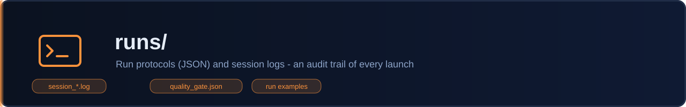
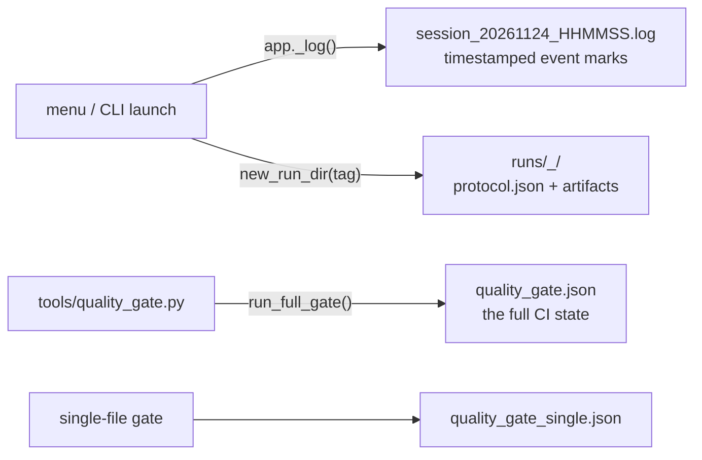

<!-- markdownlint-disable-file MD041 -->
<div align="center">



# 🗃 runs — the Audit Journal

</div>

> **Navigation:** [`verification`](../../README.md) › [`trivortex_master`](../README.md) › **`runs`**

<p align="center">
  
  
  
</p>

**runs/** is the audit journal: every launch of the complex leaves a
trace. Sessions write `session_<timestamp>.log`, the full CI loop
writes a machine-readable protocol `quality_gate.json`, menu modes
write their own JSON protocols into run folders. The committed snapshot
of this tree carries **86 session logs** plus the two quality-gate
protocols of both editions — a fresh clone reproduces the recorded
runs; new launches simply append.

## 📂 Contents — What Lives Here

| File | Size | Description |
|---|---:|---|
| [`quality_gate.json`](quality_gate.json) | 3,402 B | the machine-readable CI protocol of the package edition (v2.0.2: `passed: true`) |
| [`quality_gate_single.json`](quality_gate_single.json) | 3,402 B | the same for the single-file edition |
| `session_YYYYMMDD_HHMMSS.log` (86 files) | 47–141 B | timestamped session logs of real launches (2026-11-24) |

## What appears here



## A real example: a figure-eight session

```text
$ python3 trivortex_master.py --preset figure_eight --simulate --steps 600
scene: figure-eight (Chenciner-Montgomery) (N=3)
  simulation: t=3
energy drift: 3.7e-16
```

```text
# runs/session_20261124_021910.log
2026-11-24T02:19:10  session started
```

## The quality-gate protocol (real, v2.0.2)

`runs/quality_gate.json` is a snapshot of the whole CI loop; the
single-file edition's gate writes `quality_gate_single.json`:

```json
{
  "selftest":     {"passed": 24, "total": 24},
  "acceptance":   {"passed": 20, "total": 20, "details": {"A1": true, "...": true}},
  "module_selfchecks": {"passed": 49, "total": 49},
  "hygiene":      {"files": 117, "findings": [], "clean": true},
  "api":          {"modules": 96, "docstring_coverage": 1.0},
  "code":         {"py_lines": 57488},
  "passed": true
}
```

Both protocols on the current tree: `passed: true` — the package
edition ([log](../docs/assets/quality_gate_log.txt)) and the single-file
edition ([log](../docs/assets/quality_gate_single_log.txt)).

## Conventions

- session-log names: `session_YYYYMMDD_HHMMSS.log` (local time);
- JSON protocols of menu runs: a `<date>_<tag>/` folder with
  `protocol.json`;
- the folder is not part of any import graph — it is a pure journal;
  safe to delete everything except the committed protocols you want to
  keep.

## Related

- [tools/](../tools/README.md) — who writes these protocols
- [analysis/](../analysis/README.md) — the tests whose results are recorded
- [docs/](../docs/README.md) — copies of the logs for the README gallery

## 🇷🇺 Краткое резюме (Russian Summary)

- Аудит-журнал комплекса: каждый запуск оставляет след — сессии пишут `session_<timestamp>.log`, полный цикл CI — машинно-читаемый протокол `quality_gate.json`, режимы меню — свои JSON-протоколы в папках прогонов;
- в закоммиченном снимке дерева: 86 журналов сессий (2026-11-24) и два протокола quality gate (пакетная и однофайловая редакции), оба `passed: true`;
- протокол фиксирует: selftest 24/24, acceptance 20/20, 49 модульных самопроверок, гигиена 117 файлов чиста, 96 модулей API, 57,488 строк Python;
- папка не входит ни в какой граф импортов — это чистый журнал.

---

<div align="center">

**[⬆ Back to top](#-runs--the-audit-journal)** ·
**[trivortex_master](../README.md)** ·
**[Repository root](../../../README.md)**

*Part of [wild8highlander/Trivortex](https://github.com/wild8highlander/Trivortex) · Licensed under [IPL-RP-1.0](https://github.com/wild8highlander/Trivortex/blob/main/LICENSE.md) — All Rights Reserved*

</div>
