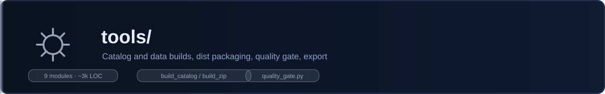
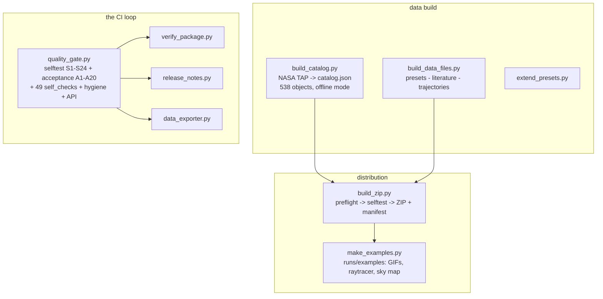

<p align="center">
  
</p>

<p align="center">
  
  
  
</p>

**tools/** is the build-and-CI toolkit: the catalog from NASA TAP,
data-file generation, the ZIP distribution, the quality gate, data
export, and release notes.

## The build and CI pipeline



## The quality gate: one call — the whole CI

`python3 tools/quality_gate.py` — a non-zero exit code on any failure,
a JSON protocol in `runs/quality_gate.json`. The real outcome on the
current tree (v2.0.2):

```text
selftest:       24/24
acceptance:     20/20
module checks:  49/49
hygiene:        clean (117 files)
docstrings:     66%
TOTAL:          PASSED
```

Full logs: [package](../docs/assets/quality_gate_log.txt) ·
[single-file edition](../docs/assets/quality_gate_single_log.txt) (also PASSED)

### Hygiene: markers-as-data (v2.0.1, refined in v2.0.2)

The hygiene scan looks for `TODO/FIXME/XXX/HACK` outside quotes. The
glued `trivortex_master_single.py` contains a **verbatim copy of the
scanner itself** — with the patterns as string data. The package gate
flagged the single file, and the single-file gate symmetrically flagged
the package scanner. The fix: a mutual skip-set of "scanner code
carriers":

```python
skip_files = {"tools/quality_gate.py", "trivortex_master_single.py"}
```

### A10: language-neutral (v2.0.2)

The acceptance check A10 used to grep the Russian word for "profile"
in README.md — it would fail on the English READMEs. It now accepts
either language:

```python
"python3 trivortex_master.py" in readme and ("profile" in low or "профил" in low)
```

## Modules

| Tool | What it does |
|---|---|
| [`quality_gate.py`](quality_gate.py) | the unified CI: selftest + acceptance + 49 self-checks + hygiene + limits |
| [`verify_package.py`](verify_package.py) | acceptance A1-A20 (launch without packages, the N range, ZIP integrity, ...) |
| [`build_catalog.py`](build_catalog.py) | catalog build: `--limit N` `--offline`; 440 TAP exoplanets + 98 static |
| [`build_data_files.py`](build_data_files.py) | scene presets, literature, trajectories |
| [`build_dist.py`](build_dist.py) | `dist/examples/`: raytracer, sky map (with the DI binding), corner text |
| [`make_examples.py`](make_examples.py) | example runs into `runs/examples/` |
| [`data_exporter.py`](data_exporter.py) | export of trajectories/metrics to CSV/JSON |
| [`release_notes.py`](release_notes.py) | release-note generation from the CHANGELOG |
| [`extend_presets.py`](extend_presets.py) | adding user presets |

## Quick start

```bash
python3 tools/quality_gate.py                 # full CI, exit 0/1
python3 tools/build_catalog.py --limit 100    # catalog (network optional)
python3 tools/build_catalog.py --offline      # static core only
python3 build_zip.py                          # dist/ + manifest
```

## Related

- [analysis/](../analysis/README.md) — the tests the gate runs
- [data/](../data/README.md) — the catalog build output
- [runs/](../runs/README.md) — where the gate protocols land
